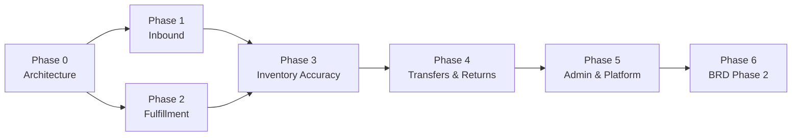

# Implementation Readiness Report

**Project:** IMS Angular Frontend (`ims-frontend`)  
**Perspective:** Chief Software Architect  
**Specification Baseline:** BRD-IMS-001, SRS (UI-001–050, UC-001–048, FR-001–090, API-001–178, BR-001–032)  
**Analysis Date:** July 7, 2026  
**Purpose:** Executive input for **Implementation Planning** — go/no-go, sequencing, and risk management

---

## Readiness Verdict

| Question | Answer |
|----------|--------|
| **Is the application MVP-deliverable today?** | **No** |
| **Is the codebase ready for high-velocity feature development?** | **Not without a 2–3 sprint architecture stabilization** |
| **Can implementation planning proceed?** | **Yes** — with phased plan below |
| **Recommended planning stance** | **Foundation-first, then vertical slices** |

```text
IMPLEMENTATION READINESS SCORECARD

MVP business delivery          ██░░░░░░░░░░░░░░░░░░  ~15%
Structural foundation          ██████░░░░░░░░░░░░░░  ~32%
Specification traceability     ████████████████████  100% (routes, screen IDs)
Production readiness           █░░░░░░░░░░░░░░░░░░░  ~5%

OVERALL IMPLEMENTATION READINESS (weighted)          ~18%
```

---

## 1. Overall Completion Percentage

### 1.1 Weighted Composite

| Dimension | Weight | Completion | Weighted contribution |
|-----------|--------|------------|----------------------|
| Business features / use cases | 25% | 8% | 2.0% |
| API integration | 20% | 0% | 0.0% |
| Screen UI & workflows | 15% | 22% | 3.3% |
| Code quality & architecture | 10% | 42% | 4.2% |
| Shared components | 10% | 28% | 2.8% |
| Routing & navigation | 8% | 38% | 3.0% |
| Forms & validation | 7% | 3% | 0.2% |
| Security & permissions | 5% | 12% | 0.6% |
| **Total** | **100%** | — | **~16%** |

Rounded **overall implementation completion: ~18%** (reported range **15–20%** depending on security weighting).

### 1.2 Dual Lens (for planners)

| Lens | % | Meaning |
|------|---|---------|
| **Delivery lens** | **~15%** | End-user can complete BRD MVP workflows |
| **Foundation lens** | **~32%** | Project skeleton (routes, shell, files, mocks) exists |
| **Traceability lens** | **100%** | All 50 UI routes and screen IDs mapped to spec |

> **Key insight:** High traceability ≠ high readiness. The project is **well-mapped but under-built**.

### 1.3 BRD Phase Alignment

| BRD scope | Items | Functional completion |
|-----------|-------|----------------------|
| MVP use cases (35) | UC-001–UC-048 subset | **0% full / 100% scaffold** |
| MVP business processes | BP-01–BP-18, BP-24–25, BP-27–29, BP-32 | **~12% avg per process** |
| Phase 2 features | Procurement PO, replenishment, valuation, etc. | **~10% scaffold only** |
| Phase 3 features | Executive KPI program | **~10% scaffold only** |

---

## 2. Feature Completion Summary

*Source: [Feature-Coverage-Matrix.md](Feature-Coverage-Matrix.md)*

| Artifact | Total | Full | Partial | Missing | Coverage |
|----------|-------|------|---------|---------|----------|
| Business processes (BP) | 32 | 0 | 32 | 0 | 5% functional |
| Use cases (UC) | 48 | 0 | 48 | 0 | 6% functional |
| User journeys / workflows | 30 | 0 | 0 | 30 | 3% |
| Functional requirements (FR) | 90 | 0 | ~19 touch | ~71 | 4% |
| Business rules (BR) | 32 | 0 | 0 | 32 | **0%** |
| SoD rules | 20 | 0 | 0 | 20 | **0%** |

### Feature Status by Domain

| Domain | Representative UCs | Status | Notes |
|--------|-------------------|--------|-------|
| Master data | UC-001, UC-002, UC-003, UC-046 | Partial scaffold | No CRUD, import wizard, or policies |
| Inbound | UC-008–UC-011 | Partial scaffold | No receipt, discrepancy, put-away workflows |
| Inventory control | UC-012–UC-019 | Partial scaffold | No counting, variance, adjustment, quarantine |
| Fulfillment | UC-021–UC-027 | Partial scaffold | No ATP, reservation, pick/ship |
| Transfers | UC-031–UC-033 | Partial scaffold | No request/approve/execute |
| Returns | UC-035–UC-036 | Partial scaffold | No RA → inspect → disposition |
| Reporting | UC-037–UC-039 | Partial scaffold | Dashboard mock only |
| Administration | UC-044–UC-045 | Partial scaffold | Demo auth; no user/role admin |
| Notifications | UC-047 | Partial scaffold | Route only; no acknowledge |

**Fully implemented business features: 0**

---

## 3. Screen Completion Summary

*Source: [Screen-Coverage-Matrix.md](Screen-Coverage-Matrix.md)*

| Tier | Screens | Count | Avg completion | Description |
|------|---------|-------|----------------|-------------|
| **A** | UI-001 | 1 | 52% | Sign-in with demo auth |
| **B** | UI-002 | 1 | 48% | Dashboard with composed widgets (mock) |
| **C** | UI-003–UI-050 | 48 | ~18% | Route + breadcrumb + title + JSON mock |

| Metric | Value |
|--------|-------|
| Base routes registered | **50 / 50 (100%)** |
| Child/detail routes | **0 / ~35 (0%)** |
| Screens ≥80% complete | **0** |
| Screens partial | **50** |
| **Weighted screen completion** | **~22%** |

### Screen Highlights

| Best implemented | Least implemented |
|------------------|-------------------|
| UI-001 Sign In (form, error banner) | UI-015 Goods Receipt (no workbench) |
| UI-002 Dashboard (KPI grid, quick actions, tasks) | UI-031 Pick/Pack/Ship (no workflow steps) |
| App shell on all authenticated screens | All detail/create routes absent |

---

## 4. Component Completion Summary

*Source: [Component-Coverage-Matrix.md](Component-Coverage-Matrix.md)*

| Metric | Value |
|--------|-------|
| Spec components (C-001–C-060) | 60 |
| Files in codebase | **60 / 60 (100%)** |
| Fully spec-compliant | **0** |
| Partially implemented | **17** |
| Placeholder (`ng-content` only) | **43** |
| Used in feature pages | **~5** (+ 8 in shell) |
| `ControlValueAccessor` (forms) | **0** |
| **Weighted component completion** | **~28%** |

### Component Tiers

| Tier | Count | Examples |
|------|-------|----------|
| T1 — Shell-integrated, functional | 9 | Global header, nav bars, breadcrumb, page title |
| T2 — Implemented, limited use | 8 | KPI card, data table, error banner, quick-action tile |
| T3 — API surface only | 10 | Inputs declared; template ignores them |
| T4 — Scaffold placeholder | 33 | Queue list, line-item editor, permission matrix |

**Planning implication:** Do not schedule screen work assuming shared components exist — **implement components just-in-time per vertical slice**.

---

## 5. API Integration Summary

*Source: [API-Consumption-Matrix.md](API-Consumption-Matrix.md)*

| Metric | Value |
|--------|-------|
| Spec APIs (API-001–178) | 178 |
| Consumed via `HttpClient` | **0 (0%)** |
| Angular API service classes | **0** |
| `provideHttpClient` | **Not configured** |
| HTTP interceptors | **0** |
| Environment / base URL | **Not configured** |
| Mock substitutes | ~12 screen shapes in `MockDataService` |
| Auth APIs (173, 174) | **Not integrated** (demo auth) |
| **Overall API integration** | **0%** |

### Integration Blockers

1. No HTTP infrastructure (client, interceptors, environments)
2. No facade or `*ApiService` layer
3. No DTO/mapper types
4. No error envelope mapping (`VAL_*`, `BIZ_*`, `AUTH_*`)
5. Known backend gaps: requisition list API, location pick queue (document in plan)

---

## 6. Code Quality Summary

*Source: [Code-Quality-Report.md](Code-Quality-Report.md)*

| Dimension | Score | Assessment |
|-----------|-------|------------|
| Folder structure | 72% | Sound `core` / `shared` / `features`; missing data-access |
| Component responsibilities | 35% | Shell good; pages cloned; stubs misleading |
| Service responsibilities | 25% | Two services only; god-object mock |
| Reusability | 30% | Library on disk, largely unused |
| Naming conventions | 78% | Consistent `ims-*`, `*.page.ts` |
| Code duplication | 28% | 48 identical scaffolds |
| SOLID principles | 32% | SRP/DIP violations |
| Angular best practices | 55% | Standalone, strict TS; no OnPush/HTTP/tests |
| Performance posture | 60% | Route lazy-load OK; CD defaults |
| Maintainability | 38% | File count >> behavior count |
| **Overall code quality** | **~42%** |

### Quality Positives (build on these)

- Angular 19 standalone-first architecture
- Strict TypeScript and template checking
- Functional route guards (`authGuard`, `guestGuard`)
- Signals in `AuthService`
- Domain-aligned feature folders
- Design tokens in global SCSS

---

## 7. Technical Debt Summary

*Source: [Technical-Debt-Report.md](Technical-Debt-Report.md)*

| Severity | Count | Dominant themes |
|----------|-------|-----------------|
| **High** | 10 | Mock god-object, 48 page clones, 43 stub components, no HTTP/facades, no permission guards, monolithic routes, no child routes, no tests |
| **Medium** | 14 | No OnPush, hardcoded counts, untyped `unknown` data, brittle nav logic, no error interceptor |
| **Low** | 6 | CLI prefix mismatch, debug json pipe, empty hooks |

**Estimated debt repayment before MVP velocity:** **16–24 person-weeks**

### Debt Repayment Priority

| Priority | Action |
|----------|--------|
| P0 | HTTP + environments + interceptors |
| P0 | `ScreenScaffoldComponent` — stop 48× duplication |
| P0 | Facade + repository per domain |
| P0 | Split `app.routes.ts` into feature routes |
| P1 | Permission guards + auth API |
| P1 | Implement or delete stub components on critical path |
| P2 | OnPush, path aliases, test harness |

---

## 8. Highest-Priority Missing Work

Ranked for **BRD MVP go-live** (BD-07: BP-07–09, BP-10, BP-16–18, BP-24–25, BP-27–29).

### P0 — Blockers (must complete before any MVP claim)

| # | Missing work | Spec refs | Why blocking |
|---|--------------|-----------|--------------|
| 1 | **HTTP data layer** | API-001+, app.config | No real data possible |
| 2 | **Production authentication** | API-173/174, UC-044/045 | Security / session |
| 3 | **Permission & location-scope guards** | FR-084, PERM-* | BRD compliance |
| 4 | **Facade architecture** | Frontend Architecture Mapping | Without it, 48 pages need rewrite |
| 5 | **Child/detail routes** | UI-* /:id, /new | No workflows executable |

### P1 — MVP critical workflows (BRD Phase 1)

| # | Workflow | Screens | Business rules |
|---|----------|---------|----------------|
| 6 | Goods receipt → verify → put-away | UI-015, UI-017 | BR-004, BR-005, BR-007, BR-017 |
| 7 | Inventory status & availability | UI-020, UI-021 | BR-001 |
| 8 | Order availability → reservation | UI-030 | BR-001, BR-002, BR-010 |
| 9 | Pick → verify → pack → ship | UI-031 | BR-003 |
| 10 | Cycle count → variance → adjustment | UI-023, UI-025, UI-026 | BR-018–BR-022 |
| 11 | Transfer request → approve → execute | UI-038–UI-040 | BR-011, BR-012 |
| 12 | Return authorization → disposition | UI-042, UI-043 | BR-025, BR-026 |

### P2 — Supporting MVP capabilities

| # | Missing work | Screens |
|---|--------------|---------|
| 13 | Notification acknowledge | UI-004, API-159 |
| 14 | Low-stock alert review | UI-036 |
| 15 | User & role administration | UI-049, UI-050 |
| 16 | Movement history & audit trail | UI-022, UI-048 |
| 17 | Operational dashboard (live data) | UI-002 |
| 18 | Form validation framework | F-001–F-049, shared form CVA |

### P3 — Phase 2+ (defer until MVP stable)

- Purchase orders, requisitions, replenishment (UI-011–014, UI-037)
- Valuation reconciliation (UI-045)
- Promotional readiness (UI-046)
- Executive KPI program (UI-003)
- ABC classification (UI-009)
- Multi-location split fulfillment (UI-035)

---

## 9. Recommended Implementation Order

### Phase 0 — Architecture Stabilization (Sprints 1–2)

**Goal:** Make the codebase safe to extend. **Do not add new scaffold screens.**

| Step | Deliverable | Exit criteria |
|------|-------------|---------------|
| 0.1 | `provideHttpClient`, environments, auth/error interceptors | Health-check API callable |
| 0.2 | `ScreenScaffoldComponent`; migrate existing pages | Zero duplicate page templates |
| 0.3 | Feature `*.routes.ts` + `loadChildren` | `app.routes.ts` < 80 lines |
| 0.4 | `AuthApiService` + session bootstrap (API-173) | Demo auth removed |
| 0.5 | `permissionGuard` + route `data.permissions` | Unauthorized routes blocked |
| 0.6 | Path aliases, `OnPush` on new components | Lint/architecture rules documented |
| 0.7 | Facade + repository pattern on **one** pilot domain | Pattern documented for teams |

**Team:** 2 senior + 1 mid frontend; 1 backend for API contract alignment

---

### Phase 1 — MVP Vertical Slice: Inbound (Sprints 3–4)

**Goal:** First end-to-end BRD workflow with real APIs.

| Step | Screens | APIs (sample) | Components to implement |
|------|---------|---------------|-------------------------|
| 1.1 | UI-015 Goods Receipt | API-081–088 | QueueList, LineItemEditor, StepProgress |
| 1.2 | UI-016 Discrepancies | API-089–093 | ComparisonPanel, EvidenceAttachment |
| 1.3 | UI-017 Put-Away | API-094–097 | DropdownSelect, ConfirmationDialog |
| 1.4 | Child routes | `:goodsReceiptId` | BreadcrumbService |

**Enforce:** BR-004, BR-005, BR-006, BR-007, BR-017

---

### Phase 2 — MVP Vertical Slice: Fulfillment (Sprints 5–6)

| Step | Screens | Focus |
|------|---------|-------|
| 2.1 | UI-030 Reservation | ATP check, reserve, release — BR-001, BR-002 |
| 2.2 | UI-031 Pick/Pack/Ship | Verify → pack → ship — BR-003 |
| 2.3 | UI-034 Order status | Status timeline, search |
| 2.4 | UI-033 Exceptions | Exception queue |

---

### Phase 3 — MVP Vertical Slice: Inventory Accuracy (Sprints 7–8)

| Step | Screens | Focus |
|------|---------|-------|
| 3.1 | UI-023 Cycle count | Blind count — BR-018 |
| 3.2 | UI-025 Variance | Investigation + approval — BR-019 |
| 3.3 | UI-026 Adjustment | Reason codes, submit — BR-020, BR-021 |
| 3.4 | UI-020 Status monitor | Live stock board |

---

### Phase 4 — MVP Vertical Slice: Network & Returns (Sprints 9–10)

| Step | Screens | Focus |
|------|---------|-------|
| 4.1 | UI-038–040 Transfers | Request → approve → execute — BR-011, BR-012 |
| 4.2 | UI-042–043 Returns | RA → inspect → disposition — BR-025, BR-026 |
| 4.3 | UI-036 Alerts | Acknowledge, link to replenishment |

---

### Phase 5 — Platform & Admin (Sprints 11–12)

| Step | Screens | Focus |
|------|---------|-------|
| 5.1 | UI-049–050 Admin | Users, roles, permission matrix, SoD |
| 5.2 | UI-004 Notifications | Full notification center |
| 5.3 | UI-002 Dashboard | Live KPIs (API-150–152) |
| 5.4 | UI-001 Sign-in | Production validation, F-001 complete |
| 5.5 | UI-022, UI-048 Audit | Movement history, audit trail |

---

### Phase 6 — Phase 2 BRD Features (Sprints 13+)

- Master data CRUD (UI-005–008)
- Procurement (UI-011–014, UI-019, UI-037)
- Reporting & valuation (UI-044, UI-045)
- Phase 2/3 items per BRD release tags

---

### Implementation Order Diagram



---

## 10. Risks Before Continuing Development

### Critical Risks

| ID | Risk | Impact | Likelihood | Mitigation |
|----|------|--------|------------|------------|
| R-01 | **Continuing scaffold-only development** | Debt grows ~5 files + 50 LOC mock per screen; API migration cost explodes | **Certain** | Freeze new scaffolds; Phase 0 mandatory |
| R-02 | **No backend API availability** | Frontend blocked on all vertical slices | High | API contract workshop; mock server/MSW parallel |
| R-03 | **Demo auth shipped to production** | Security breach, compliance failure | High if undetected | Remove demo users; gate behind `environment` |
| R-04 | **Assuming shared components work** | Rework when stubs replaced | **High** | Just-in-time component build per slice |
| R-05 | **BRD order integration undefined** (ISS-002) | Fulfillment screens unusable without order feed | High | Define minimum order DTO contract in Sprint 1 |
| R-06 | **No permission model in UI** | Unauthorized actions visible | **High** | `permissionGuard` in Phase 0 |

### High Risks

| ID | Risk | Impact | Mitigation |
|----|------|--------|------------|
| R-07 | Missing requisition list API (GAP-API-01) | UI-013, UI-037 blocked | Plan workaround or API-179 dependency |
| R-08 | Missing location pick queue API (GAP-API-02) | UI-031 degraded | Per-order pick API workaround |
| R-09 | 48 pages direct `MockDataService` coupling | Big-bang rewrite at API connect | Facades in Phase 0 |
| R-10 | Zero automated regression tests | Refactor breaks auth/routing | Tests with Phase 0 auth/routing |
| R-11 | 32 business rules not enforced | Audit / UAT failure | `PolicyService` + validators per slice |
| R-12 | Team velocity illusion from file count | Stakeholder misread of progress | This report as baseline metrics |

### Medium Risks

| ID | Risk | Mitigation |
|----|------|------------|
| R-13 | Navigation IA drift (audit under reports) | Reconcile nav vs routes in Phase 5 |
| R-14 | Performance with real data (12k+ SKUs) | Virtual scroll, OnPush, facade caching |
| R-15 | Phase 2 scope creep into MVP | Enforce BRD phase tags on backlog |
| R-16 | Opening balance / go-live data (UC-046) | Plan import workflow early with backend |

### Go / No-Go Criteria for Feature Sprints

| Gate | Criteria |
|------|----------|
| **Go to Phase 1** | Phase 0 exit criteria met; pilot facade merged; auth API working in dev |
| **Go to UAT** | P1–P5 vertical slices complete; BR-001–BR-028 enforced on happy paths; permission guards on all routes |
| **Go to Production** | 0% demo auth; API integration ≥ MVP set; test coverage on facades/guards; security review passed |

---

## Planning Metrics Baseline

Track sprint-over-sprint from this baseline:

| KPI | Baseline | MVP target |
|-----|----------|------------|
| Overall weighted completion | **~18%** | **≥85%** |
| APIs integrated | 0 / 178 | ≥120 (MVP subset) |
| UC fully implemented | 0 / 35 MVP | ≥30 |
| Screens ≥80% complete | 0 / 50 | ≥40 |
| Components functional | 17 / 60 | ≥45 |
| Business rules enforced | 0 / 32 | ≥24 (MVP subset) |
| Child routes | 0 / 35 | ≥25 |
| Test spec files | 3 | ≥80 |
| Pages using facades (not mock) | 0 / 48 | 48 |

---

## Source Reports

| Report | Path | Primary metric |
|--------|------|----------------|
| Project Architecture Report | `gap_frontend/Project-Architecture-Report.md` | As-built structure |
| Screen Coverage Matrix | `gap_frontend/Screen-Coverage-Matrix.md` | 22% screens |
| Component Coverage Matrix | `gap_frontend/Component-Coverage-Matrix.md` | 28% components |
| API Consumption Matrix | `gap_frontend/API-Consumption-Matrix.md` | 0% APIs |
| Validation Coverage Report | `gap_frontend/Validation-Coverage-Report.md` | 3% forms |
| Routing Assessment Report | `gap_frontend/Routing-Assessment-Report.md` | 38% routing |
| Code Quality Report | `gap_frontend/Code-Quality-Report.md` | 42% quality |
| Feature Coverage Matrix | `gap_frontend/Feature-Coverage-Matrix.md` | 8% features |
| Technical Debt Report | `gap_frontend/Technical-Debt-Report.md` | High severity |

---

## Executive Recommendation

The IMS frontend has completed a **successful specification mapping phase** — routes, folders, component inventory, and screen IDs align with BRD/SRS. It has **not** completed an **implementation phase**. Attempting to deliver MVP features by filling in scaffold screens one-by-one will amplify technical debt and produce non-integrable UI.

**Recommended planning decision:**

1. **Approve a 2-sprint Phase 0** (architecture stabilization) as a formal project phase with dedicated capacity.
2. **Adopt vertical-slice delivery** (inbound → fulfillment → accuracy → transfers) rather than horizontal "all list screens first."
3. **Treat shared components as backlog items** within each slice, not as pre-existing assets.
4. **Pair frontend sprints with API delivery** — publish MVP API manifest before Phase 1.
5. **Use this report's KPI table** as the sprint review scorecard.

**Bottom line:** The project is **~18% complete overall** and **not ready for unconstrained feature development**, but it **is ready for a well-sequenced implementation plan** starting with foundation, then BRD-critical vertical slices.

---

*End of report — suitable for Implementation Planning intake.*
