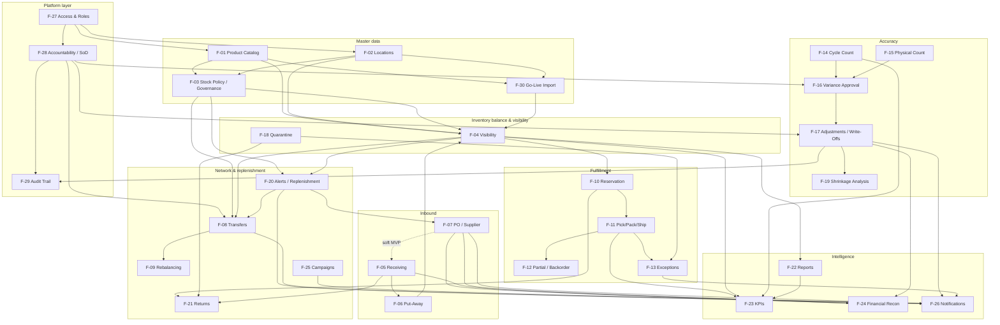

# IMS Feature Dependency Map & Implementation Order

| Attribute | Detail |
|-----------|--------|
| **Document ID** | IMPL-DEP-001 |
| **Document Title** | Feature Dependency Map & Optimal Implementation Order |
| **Perspective** | Solution Architect |
| **Version** | 1.0 |
| **Date** | July 11, 2026 |
| **Status** | Architecture baseline for delivery planning |
| **Inputs** | IMPL-FEAT-001, Domain Aggregates, Logical/Physical Data Model, REST API Catalog, Screen Inventory, System Modules Design, Gap Analysis |

---

## 1. Purpose

Analyze all **30 implementation features (F-01–F-30)** and define:

1. Required previous features (hard prerequisites)
2. Features that depend on this feature (downstream consumers)
3. Database dependencies (schemas / tables)
4. API dependencies (API IDs / modules)
5. UI dependencies (screens + shared shell)
6. **Optimal implementation order** that minimizes blocked work and maximizes vertical-slice value

This is a **solution architecture** dependency model — not sprint tasking.

---

## 2. Dependency Types

| Type | Meaning | Planning rule |
|------|---------|---------------|
| **Hard** | Cannot ship or demo without predecessor | Must schedule earlier |
| **Soft** | Can ship MVP slice without predecessor; full capability needs it | Parallelize carefully |
| **Runtime event** | Downstream reacts to events from upstream (eventual consistency) | Contract first; implement producer then consumer |
| **Platform** | Cross-cutting infrastructure (auth, HTTP, audit write path) | Build once; every feature consumes |

**Database legend** uses physical schemas from `Physical-Data-Model.md`.  
**API legend** uses modules M-01–M-13 + Platform (API-173–178).  
**UI legend** uses UI-001–UI-050.

---

## 3. System-Wide Dependency Graph



**Solid arrows** = hard dependency. **Dotted** = soft (MVP can proceed with thinner predecessor).

---

## 4. Feature-by-Feature Dependency Analysis

---

### F-27 — User Access & Role Management

| # | Field | Detail |
|---|-------|--------|
| **1. Required previous features** | None (foundation). Requires platform IdP/session contract only. |
| **2. Features that depend on it** | **All features** (hard for production). Direct UI consumers: F-28, F-01–F-26, F-29, F-30 |
| **3. Database dependencies** | `identity.user_accounts`, `identity.role_assignments`, `identity.role_assignment_locations` |
| **4. API dependencies** | API-140–149 (M-12); API-173, API-174 (Platform session/logout) |
| **5. UI dependencies** | UI-001 Sign In; UI-049 User Account Management; UI-050 Role & Access Admin; app shell auth guards |

**Architect note:** Implement **session + RBAC evaluation** before any mutating screen goes live. Admin screens (UI-049/050) can follow first login path.

---

### F-28 — Operational Accountability & Controls

| # | Field | Detail |
|---|-------|--------|
| **1. Required previous features** | **F-27** (hard). Soft: F-03 governance SoD rules (API-031) for full evaluation. |
| **2. Features that depend on it** | F-16, F-17, F-08 (approvals); F-29 (activity → audit); all approval UIs |
| **3. Database dependencies** | Reads `identity.*`; writes/feeds `audit.audit_trail_records`; evaluates against `governance.governance_policies` |
| **4. API dependencies** | API-031 (SoD evaluate); API-148, API-149 (action / location-scope authorize) |
| **5. UI dependencies** | Cross-cutting on UI-025, UI-026, UI-027, UI-039; configuration on UI-050 |

---

### F-01 — Product Catalog Management

| # | Field | Detail |
|---|-------|--------|
| **1. Required previous features** | **F-27** (hard) |
| **2. Features that depend on it** | F-03, F-04, F-05, F-07, F-10, F-14, F-20, F-30, F-25 (all SKU-keyed features) |
| **3. Database dependencies** | `catalog.products`, `catalog.product_identifiers` |
| **4. API dependencies** | API-001–005, API-007–009 (M-01) |
| **5. UI dependencies** | UI-005 Product Catalog Management |

---

### F-02 — Location & Network Setup

| # | Field | Detail |
|---|-------|--------|
| **1. Required previous features** | **F-27** (hard) |
| **2. Features that depend on it** | F-03, F-04, F-05, F-06, F-08, F-10, F-14, F-15, F-30, F-20 |
| **3. Database dependencies** | `network.inventory_locations`, `network.storage_positions` |
| **4. API dependencies** | API-011–021 (M-02) |
| **5. UI dependencies** | UI-007 Location and Warehouse Management |

---

### F-03 — Stock Policy & Product Classification

| # | Field | Detail |
|---|-------|--------|
| **1. Required previous features** | **F-01**, **F-02**, **F-27** (hard). Split delivery: thresholds first; ABC/governance policy versions next. |
| **2. Features that depend on it** | F-04 (status indicators), F-20 (alerts), F-08 (source minimums), F-14 (ABC count priority), F-05 (tolerances), F-16/F-17 (approval thresholds / reason codes) |
| **3. Database dependencies** | `inventory.stock_policies`, `inventory.stock_policy_history`; `governance.governance_policies`, `governance.reason_codes`; `catalog.products` (ABC column/attrs) |
| **4. API dependencies** | API-038–040; API-006; API-022–030 (M-03, M-04, M-01) |
| **5. UI dependencies** | UI-008, UI-009, UI-010 |

---

### F-30 — System Go-Live & Initial Data Setup

| # | Field | Detail |
|---|-------|--------|
| **1. Required previous features** | **F-01**, **F-02**, **F-27** (hard). Soft: F-03 thresholds post-import; F-15 or validated opening count for US-010 alignment. |
| **2. Features that depend on it** | F-04 (meaningful balances); production cutover of F-05+ |
| **3. Database dependencies** | Writes `catalog.products`; `inventory.stock_positions` (opening); activates `network.inventory_locations` |
| **4. API dependencies** | API-010, API-032, API-017 |
| **5. UI dependencies** | UI-006 Product Import Workspace |

**Architect note:** Build import **pipeline early** (dev/test data), run **production load late** (after MVP workflows proven).

---

### F-29 — Audit Trail & Compliance

| # | Field | Detail |
|---|-------|--------|
| **1. Required previous features** | **F-28** (hard for attribution). Soft start: movement append-only writer can ship with first mutators (F-05). Query/export UI after trails exist. |
| **2. Features that depend on it** | F-22 (movement reports), F-24 (substantiation), auditors consuming F-16/F-17 evidence |
| **3. Database dependencies** | `audit.inventory_movement_records`, `audit.audit_trail_records` |
| **4. API dependencies** | API-155, API-156, API-157 |
| **5. UI dependencies** | UI-022, UI-047, UI-048 |

---

### F-04 — Inventory Visibility & Search

| # | Field | Detail |
|---|-------|--------|
| **1. Required previous features** | **F-01**, **F-02**, **F-03** (thresholds for status — soft for raw on-hand), **F-27**. Data producers: F-30 and/or F-05/F-06 for non-empty views. |
| **2. Features that depend on it** | F-10, F-20, F-08, F-09, F-22, F-12 (ATP decisions), F-25 |
| **3. Database dependencies** | Reads `inventory.stock_positions`, `inventory.lot_batches`, `inventory.quarantine_holds`, `inventory.stock_policies`; `catalog.products`; `network.inventory_locations` |
| **4. API dependencies** | API-033–037, API-012; API-151–153 (M-04, M-13) |
| **5. UI dependencies** | UI-020, UI-021; widgets on UI-002 |

---

### F-05 — Goods Receiving & Verification

| # | Field | Detail |
|---|-------|--------|
| **1. Required previous features** | **F-01**, **F-02**, **F-27**; **F-03** reason codes/tolerances (hard for discrepancy resolution). Soft: **F-07** (MVP may receive with PO reference stub / seeded PO). |
| **2. Features that depend on it** | F-06, F-04 (qty increase), F-21 (interim + return receipt), F-24 (three-way match inputs), F-29 movements |
| **3. Database dependencies** | `inbound.goods_receipts`, `inbound.goods_receipt_lines`, `inbound.receipt_discrepancies`; refs `procurement.purchase_orders`; updates `inventory.stock_positions` / lots; `audit.inventory_movement_records` |
| **4. API dependencies** | API-065–072, API-075–076; API-025, API-030 |
| **5. UI dependencies** | UI-015, UI-016, UI-018, UI-022 |

---

### F-06 — Put-Away Management

| # | Field | Detail |
|---|-------|--------|
| **1. Required previous features** | **F-05**, **F-02** (storage positions), **F-27** |
| **2. Features that depend on it** | F-04 (sellable ATP), F-10/F-11 (locatable stock) |
| **3. Database dependencies** | `inbound.put_aways`; `network.storage_positions`; updates `inventory.stock_positions` availability state |
| **4. API dependencies** | API-073, API-074, API-015, API-016 |
| **5. UI dependencies** | UI-017 |

---

### F-07 — Purchase Order & Inbound Supply Management

| # | Field | Detail |
|---|-------|--------|
| **1. Required previous features** | **F-01**, **F-02**, **F-27**. Soft: F-20 requisitions convert to PO. |
| **2. Features that depend on it** | F-05 (full validate-for-receipt), F-20 (pipeline visibility), F-24, F-26 (delay alerts), F-04 Phase-2 inbound views |
| **3. Database dependencies** | `procurement.suppliers`, `procurement.purchase_orders`, `procurement.purchase_order_lines`, `procurement.expected_inbound_deliveries` (+ lines) |
| **4. API dependencies** | API-049–053, API-059–065; API-161–163 |
| **5. UI dependencies** | UI-011, UI-012, UI-014, UI-019 |

---

### F-14 — Cycle Counting

| # | Field | Detail |
|---|-------|--------|
| **1. Required previous features** | **F-01**, **F-02**, **F-04** (expected qty), **F-27**. Soft: F-03 ABC for prioritization. |
| **2. Features that depend on it** | F-16, F-22 (accuracy reports), F-23 |
| **3. Database dependencies** | `accuracy.cycle_counts`; reads `inventory.stock_positions` |
| **4. API dependencies** | API-108–111, API-168 |
| **5. UI dependencies** | UI-023 |

---

### F-15 — Full Physical Inventory Count

| # | Field | Detail |
|---|-------|--------|
| **1. Required previous features** | **F-02**, **F-04**, **F-27**. Freeze must gate F-05/F-08/F-11 at same location. |
| **2. Features that depend on it** | F-16; blocks concurrent mutators while freeze active |
| **3. Database dependencies** | `accuracy.physical_inventory_counts`; freeze flag on `network.inventory_locations` |
| **4. API dependencies** | API-020, API-112–115, API-168 |
| **5. UI dependencies** | UI-024 |

---

### F-16 — Count Variance Investigation & Approval

| # | Field | Detail |
|---|-------|--------|
| **1. Required previous features** | **F-14** and/or **F-15**, **F-03** (thresholds/reason codes), **F-28**, **F-27** |
| **2. Features that depend on it** | F-17 (approved qty change), F-26 (pending approval), F-29 |
| **3. Database dependencies** | `accuracy.count_variances`; `accuracy.stock_adjustments` (via case); reads governance thresholds |
| **4. API dependencies** | API-116–119, API-123, API-029, API-031 |
| **5. UI dependencies** | UI-025 |

---

### F-17 — Stock Adjustments & Write-Offs

| # | Field | Detail |
|---|-------|--------|
| **1. Required previous features** | **F-03** (reason codes + thresholds), **F-04**, **F-28**, **F-27**. Soft: F-16 for count-originated cases. |
| **2. Features that depend on it** | F-04 (balance), F-19, F-22, F-24, F-26, F-29 |
| **3. Database dependencies** | `accuracy.stock_adjustments`, `accuracy.inventory_write_offs`; `governance.reason_codes`; mutates `inventory.stock_positions` |
| **4. API dependencies** | API-022–025, API-029, API-116–117, API-120–122 |
| **5. UI dependencies** | UI-010, UI-026, UI-027 |

---

### F-18 — Quarantine & Hold Stock Management

| # | Field | Detail |
|---|-------|--------|
| **1. Required previous features** | **F-04**, **F-27**. Soft producers: F-05, F-13, F-21 |
| **2. Features that depend on it** | F-04 ATP exclusion; F-13 damage path; F-21 disposition; F-22 quarantine register |
| **3. Database dependencies** | `inventory.quarantine_holds` |
| **4. API dependencies** | API-045, API-046, API-154 |
| **5. UI dependencies** | UI-028 |

---

### F-19 — Shrinkage & Obsolescence Analysis

| # | Field | Detail |
|---|-------|--------|
| **1. Required previous features** | **F-17** (reason-coded history), **F-22** platform (soft), **F-04** |
| **2. Features that depend on it** | F-23 (loss-related KPIs — soft) |
| **3. Database dependencies** | Reads `accuracy.stock_adjustments`, `accuracy.inventory_write_offs`, `audit.inventory_movement_records`, `inventory.stock_positions` |
| **4. API dependencies** | API-167 |
| **5. UI dependencies** | UI-029 |

---

### F-10 — Order Availability & Reservation

| # | Field | Detail |
|---|-------|--------|
| **1. Required previous features** | **F-04**, **F-01**, **F-27**. Soft: F-25 ring-fence check; F-06 for locatable ATP quality. |
| **2. Features that depend on it** | F-11, F-12, F-21, F-13 (cancel/release paths) |
| **3. Database dependencies** | `fulfillment.customer_orders`, `fulfillment.customer_order_lines`, `fulfillment.inventory_reservations`; mutates reserved qty on `inventory.stock_positions` |
| **4. API dependencies** | API-081, API-084–087, API-043–044, API-036, API-139 |
| **5. UI dependencies** | UI-030, UI-021, UI-035 (Phase 2 multi-location) |

---

### F-11 — Pick, Pack & Ship Fulfillment

| # | Field | Detail |
|---|-------|--------|
| **1. Required previous features** | **F-10**, **F-27**. Soft: lot APIs if traceable products (F-01 attrs). |
| **2. Features that depend on it** | F-12, F-13, F-04 (on-hand decrease), F-22/F-23 fill metrics, F-21 (original order link) |
| **3. Database dependencies** | `fulfillment.fulfillment_executions`, `fulfillment.fulfillment_pick_lines`, `fulfillment.shipments`, `fulfillment.shipment_lines`; lots via `inventory.lot_batches` |
| **4. API dependencies** | API-082–083, API-088–092, API-097, API-041, API-177; **gap C-01** location pick queue |
| **5. UI dependencies** | UI-031, UI-034 |

---

### F-12 — Partial Fulfillment & Backorder Management

| # | Field | Detail |
|---|-------|--------|
| **1. Required previous features** | **F-10**, **F-11** (hard for partial ship). Soft: F-20 for backorder auto-reserve. |
| **2. Features that depend on it** | F-20 (demand signal), F-26, F-22 |
| **3. Database dependencies** | `fulfillment.backorders`; partial shipment lines |
| **4. API dependencies** | API-093–095, API-164 |
| **5. UI dependencies** | UI-032 |

---

### F-13 — Fulfillment Exception Handling

| # | Field | Detail |
|---|-------|--------|
| **1. Required previous features** | **F-11**, **F-27**. Soft: F-18 quarantine on damage; F-26 alerts. |
| **2. Features that depend on it** | F-18, F-17 (inventory correction), F-26 |
| **3. Database dependencies** | Exception state on fulfillment tables; may create `inventory.quarantine_holds` |
| **4. API dependencies** | API-096, API-165, API-045 |
| **5. UI dependencies** | UI-033 |

---

### F-20 — Low-Stock Alerting & Replenishment

| # | Field | Detail |
|---|-------|--------|
| **1. Required previous features** | **F-03**, **F-04**, **F-27**. Soft: F-08 for transfer-before-buy; F-07 for PO conversion. |
| **2. Features that depend on it** | F-07 (requisition→PO), F-08 (transfer suggestions), F-26, F-22 (replenishment reporting) |
| **3. Database dependencies** | `audit.operational_alerts`; `procurement.purchase_requisitions` (+ lines); reads policies & positions |
| **4. API dependencies** | API-037, API-039, API-054–058, API-158–160, API-166; **gap C-03** requisition list |
| **5. UI dependencies** | UI-036, UI-037, UI-013 |

---

### F-08 — Inter-Location Stock Transfers

| # | Field | Detail |
|---|-------|--------|
| **1. Required previous features** | **F-02**, **F-03** (source minimum), **F-04**, **F-27**, **F-28** (approval SoD) |
| **2. Features that depend on it** | F-09, F-20 (resolution path), F-04 (balanced qty), F-26, F-02 closure disposition |
| **3. Database dependencies** | `transfer.transfer_requests` (+ lines), `transfer.stock_transfers` (+ lines), `transfer.in_transit_stock`; mutates source/dest `inventory.stock_positions` |
| **4. API dependencies** | API-098–107, API-042 |
| **5. UI dependencies** | UI-038, UI-039, UI-040 |

---

### F-09 — Network Stock Rebalancing

| # | Field | Detail |
|---|-------|--------|
| **1. Required previous features** | **F-04**, **F-08**, **F-20** (recommendation engine soft-share) |
| **2. Features that depend on it** | Creates transfer intents into F-08 |
| **3. Database dependencies** | Read-only over `inventory.stock_positions`, `inventory.stock_policies`; writes via F-08 tables |
| **4. API dependencies** | API-036, API-160, API-166 |
| **5. UI dependencies** | UI-041 |

---

### F-21 — Returns Management

| # | Field | Detail |
|---|-------|--------|
| **1. Required previous features** | **F-10/F-11** (original order), **F-05** or dedicated return receive, **F-27**. Soft: F-18, F-17 |
| **2. Features that depend on it** | F-04, F-18, F-17, F-22 |
| **3. Database dependencies** | `returns.return_authorizations` (+ lines), `returns.customer_returns` (+ lines), `returns.return_dispositions` |
| **4. API dependencies** | API-124–131; API-076 alternate (**prefer API-128 — gap C-04**) |
| **5. UI dependencies** | UI-042, UI-043 |

---

### F-22 — Inventory Reporting & Dashboards

| # | Field | Detail |
|---|-------|--------|
| **1. Required previous features** | **F-04** + at least one mutator trail (F-05/F-11/F-17). Soft: F-14 for accuracy widgets. |
| **2. Features that depend on it** | F-23, F-19 (presentation), F-26 (counts on home) |
| **3. Database dependencies** | Read projections over inventory, accuracy, audit schemas; `audit.operational_alerts` counts |
| **4. API dependencies** | API-150–152, API-154–155, API-167–168 |
| **5. UI dependencies** | UI-002, UI-044 |

---

### F-23 — Inventory Performance KPIs

| # | Field | Detail |
|---|-------|--------|
| **1. Required previous features** | **F-11**, **F-04**, **F-14**, **F-22** (hard for meaningful KPIs) |
| **2. Features that depend on it** | Executive consumers only (none hard) |
| **3. Database dependencies** | Aggregations over fulfillment, inventory, accuracy; optional snapshot tables |
| **4. API dependencies** | API-170 |
| **5. UI dependencies** | UI-003 |

---

### F-24 — Financial Inventory Reconciliation

| # | Field | Detail |
|---|-------|--------|
| **1. Required previous features** | **F-05**, **F-07**, **F-17**, **F-29** (evidence). Soft: consignment ownership API-047. |
| **2. Features that depend on it** | None hard |
| **3. Database dependencies** | `finance.supplier_invoices` (+ lines, match); `audit.inventory_valuation_snapshots`, `audit.inventory_valuation_lines` |
| **4. API dependencies** | API-077–080, API-047, API-171–172 |
| **5. UI dependencies** | UI-045 |

---

### F-25 — Promotional & Launch Stock Readiness

| # | Field | Detail |
|---|-------|--------|
| **1. Required previous features** | **F-04**, **F-10**, **F-27**. Soft: F-20 |
| **2. Features that depend on it** | F-10 (ring-fence), F-26 campaign alerts |
| **3. Database dependencies** | `commercial.promotional_stock_allocations`, `commercial.promotional_allocation_locations`; may set promotional segregation on stock |
| **4. API dependencies** | API-132–139, API-048, API-169, API-178 |
| **5. UI dependencies** | UI-046 |

---

### F-26 — Operational Notifications & Alerts

| # | Field | Detail |
|---|-------|--------|
| **1. Required previous features** | **F-27**. Producers (phased): F-20, F-16/F-17, F-08, F-13, F-07, F-25 |
| **2. Features that depend on it** | Soft UX dependency for F-20/F-16/F-08 (users can poll queues without push) |
| **3. Database dependencies** | `audit.operational_alerts` |
| **4. API dependencies** | API-158–159; queue sources API-106, API-123, API-163, API-169 |
| **5. UI dependencies** | UI-004; header badge on app shell |

---

## 5. Dependency Matrices

### 5.1 Feature → Previous / Downstream (summary)

| Feature | Required previous (hard) | Downstream dependents |
|---------|--------------------------|----------------------|
| F-27 | — | All |
| F-28 | F-27 | F-16, F-17, F-08, F-29 |
| F-01 | F-27 | F-03, F-04, F-05, F-07, F-10, F-14, F-20, F-30, F-25 |
| F-02 | F-27 | F-03, F-04, F-05, F-06, F-08, F-10, F-14, F-15, F-30 |
| F-03 | F-01, F-02, F-27 | F-04, F-05, F-08, F-14, F-16, F-17, F-20 |
| F-30 | F-01, F-02, F-27 | F-04 (data), cutover |
| F-29 | F-28 (+ mutators) | F-22, F-24 |
| F-04 | F-01, F-02, F-27 (+ F-03 soft) | F-10, F-20, F-08, F-09, F-22, F-25 |
| F-05 | F-01, F-02, F-03, F-27 | F-06, F-21, F-24, F-04 |
| F-06 | F-05, F-02 | F-04, F-10, F-11 |
| F-07 | F-01, F-02, F-27 | F-05 (full), F-20, F-24, F-26 |
| F-14 | F-01, F-02, F-04, F-27 | F-16, F-22, F-23 |
| F-15 | F-02, F-04, F-27 | F-16 |
| F-16 | F-14\|F-15, F-03, F-28 | F-17, F-26 |
| F-17 | F-03, F-04, F-28 | F-19, F-22, F-24, F-26, F-29 |
| F-18 | F-04, F-27 | F-13, F-21, F-04 |
| F-19 | F-17 | F-23 (soft) |
| F-10 | F-04, F-01, F-27 | F-11, F-12, F-21 |
| F-11 | F-10 | F-12, F-13, F-22, F-23 |
| F-12 | F-10, F-11 | F-20, F-26 |
| F-13 | F-11 | F-18, F-17, F-26 |
| F-20 | F-03, F-04 | F-07, F-08, F-26, F-22 |
| F-08 | F-02, F-03, F-04, F-28 | F-09, F-20, F-26 |
| F-09 | F-04, F-08 | F-08 (intents) |
| F-21 | F-10/F-11, F-05 | F-04, F-17, F-18 |
| F-22 | F-04 + mutators | F-23, F-19 |
| F-23 | F-11, F-04, F-14, F-22 | — |
| F-24 | F-05, F-07, F-17, F-29 | — |
| F-25 | F-04, F-10 | F-10, F-26 |
| F-26 | F-27 + producers | UX for producers |

### 5.2 Feature → Database schema ownership

| Feature | Primary schemas / tables |
|---------|--------------------------|
| F-27 | `identity.*` |
| F-28 | `identity.*`, `governance.*` (SoD), `audit.audit_trail_records` |
| F-01 | `catalog.products`, `catalog.product_identifiers` |
| F-02 | `network.inventory_locations`, `network.storage_positions` |
| F-03 | `inventory.stock_policies`, `inventory.stock_policy_history`, `governance.*`, ABC on `catalog.products` |
| F-30 | bulk write to `catalog.*`, `inventory.stock_positions`, activate `network.*` |
| F-04 | read `inventory.*`, `catalog.*`, `network.*` |
| F-05 | `inbound.goods_receipts*`, `inbound.receipt_discrepancies` |
| F-06 | `inbound.put_aways`, `network.storage_positions` |
| F-07 | `procurement.*` (suppliers, POs, expected deliveries) |
| F-14 | `accuracy.cycle_counts` |
| F-15 | `accuracy.physical_inventory_counts` |
| F-16 | `accuracy.count_variances` |
| F-17 | `accuracy.stock_adjustments`, `accuracy.inventory_write_offs` |
| F-18 | `inventory.quarantine_holds` |
| F-19 | read accuracy + audit + inventory |
| F-10 | `fulfillment.customer_orders*`, `fulfillment.inventory_reservations` |
| F-11 | `fulfillment.fulfillment_*`, `fulfillment.shipments*` |
| F-12 | `fulfillment.backorders` |
| F-13 | fulfillment exception fields + optional quarantine |
| F-20 | `audit.operational_alerts`, `procurement.purchase_requisitions*` |
| F-08 | `transfer.*` |
| F-09 | read inventory; write via transfer |
| F-21 | `returns.*` |
| F-22 | read models / intelligence over operational schemas |
| F-23 | KPI aggregations |
| F-24 | `finance.*`, `audit.inventory_valuation_*` |
| F-25 | `commercial.*` |
| F-26 | `audit.operational_alerts` |
| F-29 | `audit.inventory_movement_records`, `audit.audit_trail_records` |

### 5.3 Feature → API module map

| Feature | API module(s) | API ID range (primary) |
|---------|---------------|------------------------|
| F-01 | M-01 | 001–009 |
| F-02 | M-02 | 011–021 |
| F-03 | M-03, M-04, M-01 | 022–030, 038–040, 006 |
| F-04 | M-04, M-13 | 033–037, 151–153 |
| F-05 | M-06, M-03 | 065–072, 075–076 |
| F-06 | M-06, M-02 | 073–074, 015–016 |
| F-07 | M-05, M-13 | 049–065, 161–163 |
| F-08 | M-08, M-04 | 098–107, 042 |
| F-09 | M-13 | 036, 160, 166 |
| F-10 | M-07, M-04 | 081–087, 043–044 |
| F-11 | M-07 | 088–092, 097 (+ C-01) |
| F-12 | M-07, M-13 | 093–095, 164 |
| F-13 | M-07, M-13, M-04 | 096, 165, 045 |
| F-14 | M-09, M-13 | 108–111, 168 |
| F-15 | M-09, M-02 | 112–115, 020 |
| F-16 | M-09, M-03 | 116–119, 123, 029, 031 |
| F-17 | M-09, M-03 | 120–122, 022–025 |
| F-18 | M-04, M-13 | 045–046, 154 |
| F-19 | M-13 | 167 |
| F-20 | M-05, M-13, M-04 | 054–058, 158–160 (+ C-03) |
| F-21 | M-10 | 124–131 (+ C-04) |
| F-22 | M-13 | 150–152, 154–155, 167–168 |
| F-23 | M-13 | 170 |
| F-24 | M-06 finance APIs, M-13 | 077–080, 171–172 |
| F-25 | M-11, M-04 | 132–139, 048, 169, 178 |
| F-26 | M-13 | 158–159 |
| F-27 | M-12, Platform | 140–149, 173–174 |
| F-28 | M-03, M-12 | 031, 148–149 |
| F-29 | M-13 | 155–157 |
| F-30 | M-01, M-04, M-02 | 010, 032, 017 |

### 5.4 Feature → UI screen map

| Feature | Screens |
|---------|---------|
| F-27 | UI-001, UI-049, UI-050 |
| F-28 | UI-050 + approval screens |
| F-01 | UI-005 |
| F-02 | UI-007 |
| F-03 | UI-008, UI-009, UI-010 |
| F-30 | UI-006 |
| F-04 | UI-020, UI-021, UI-002 (widgets) |
| F-05 | UI-015, UI-016, UI-018, UI-022 |
| F-06 | UI-017 |
| F-07 | UI-011, UI-012, UI-014, UI-019 |
| F-14 | UI-023 |
| F-15 | UI-024 |
| F-16 | UI-025 |
| F-17 | UI-010, UI-026, UI-027 |
| F-18 | UI-028 |
| F-19 | UI-029 |
| F-10 | UI-030, UI-021, UI-035 |
| F-11 | UI-031, UI-034 |
| F-12 | UI-032 |
| F-13 | UI-033 |
| F-20 | UI-036, UI-037, UI-013 |
| F-08 | UI-038, UI-039, UI-040 |
| F-09 | UI-041 |
| F-21 | UI-042, UI-043 |
| F-22 | UI-002, UI-044 |
| F-23 | UI-003 |
| F-24 | UI-045 |
| F-25 | UI-046 |
| F-26 | UI-004 |
| F-29 | UI-047, UI-048, UI-022 |

---

## 6. Critical Path Analysis

### Longest hard-dependency chains (MVP)

```text
Path A — Inbound integrity
F-27 → F-01/F-02 → F-03 → F-05 → F-06 → F-04 → F-10 → F-11

Path B — Accuracy integrity
F-27 → F-01/F-02 → F-03 → F-04 → F-14 → F-16 → F-17
                         ↘ F-28 ↗

Path C — Network balance
F-27 → F-01/F-02 → F-03 → F-04 → F-08
                         ↘ F-28 ↗

Path D — Replenishment signal
F-27 → F-03 → F-04 → F-20 → F-26
```

**Critical path length (MVP):** Path A (~8 stages) dominates time-to-first complete receive→promise→ship value stream.

**Parallelism opportunity:** After F-27 + F-01 + F-02 land, run **Path A**, **Path B**, and **F-29 writer** in parallel squads.

---

## 7. Optimal Implementation Order

### Design principles for the order

1. **Platform before product** — no feature without auth, HTTP, and permission evaluation.
2. **Reference data before transactions** — catalog/locations/policies before receipts.
3. **Single writer of ATP early** — Stock Position (M-04) before fulfillment/transfer contention.
4. **Vertical slices over horizontal layers** — each stage delivers a demoable business flow.
5. **Audit as a side-effect of first mutator** — do not defer movement logging.
6. **Import twice** — pipeline early for fixtures; production load after golden paths pass.
7. **Intelligence last among dependents** — reports need real events.
8. **Close known API gaps before their UI** — C-01 before F-11 workbench polish; C-03 before F-20 requisition queue; C-04 before F-21.

---

### Recommended order (architecture sequence)

| Seq | Feature | Rationale |
|-----|---------|-----------|
| **1** | **F-27** User Access & Role Management | Unblocks every protected API/UI; session + RBAC |
| **2** | **F-28** Operational Accountability & Controls | SoD/location-scope must exist before any approval workflow |
| **3** | **F-01** Product Catalog Management | Universal SKU identity |
| **4** | **F-02** Location & Network Setup | Universal location identity + bins |
| **5** | **F-03** Stock Policy & Product Classification *(thresholds + reason codes first)* | Status, alerts, tolerances, adjustments |
| **6** | **F-29** Audit Trail & Compliance *(write path)* | Append-only movement/audit writer ready before mutators |
| **7** | **F-30** Go-Live Import *(dev/test pipeline)* | Seed catalog + opening balances for all later demos |
| **8** | **F-04** Inventory Visibility & Search *(core)* | First business value: trusted on-hand/ATP view |
| **9** | **F-05** Goods Receiving & Verification | First quantity mutator; proves inbound integrity |
| **10** | **F-06** Put-Away Management | Completes receive→available; ATP becomes trustworthy |
| **11** | **F-17** Stock Adjustments & Write-Offs *(ad-hoc path)* | Correction capability + reason codes before heavy counting |
| **12** | **F-14** Cycle Counting | Accuracy program start |
| **13** | **F-15** Full Physical Inventory Count | Freeze + baseline (can parallel with F-14 after F-04) |
| **14** | **F-16** Count Variance Investigation & Approval | Closes count→approve→adjust loop with F-17 |
| **15** | **F-26** Notifications *(approval + stock)* | Minimal alert center once F-16/F-17/F-20 signals exist |
| **16** | **F-10** Order Availability & Reservation | Commercial ATP commitment |
| **17** | **F-11** Pick, Pack & Ship Fulfillment | Completes outbound value stream (**resolve C-01 first**) |
| **18** | **F-12** Partial Fulfillment *(partial ship MVP)* | Handles real-world short supply |
| **19** | **F-20** Low-Stock Alerting & Replenishment *(alerts + suggestions)* | Closes replenishment feedback loop |
| **20** | **F-08** Inter-Location Stock Transfers | Network self-healing for stockouts |
| **21** | **F-22** Inventory Reporting & Dashboards *(core)* | Management visibility on live data |
| **22** | **F-30** Go-Live Import *(production cutover)* | Primary-site load after golden paths + UAT |
| **23** | **F-07** PO & Inbound Supply Management | Phase 2 inbound pipeline maturity |
| **24** | **F-20** *(requisitions extension)* | Transfer-before-buy → PO (**resolve C-03**) |
| **25** | **F-04** *(network / inbound projection views)* | Phase 2 visibility |
| **26** | **F-03** *(ABC + full governance policies)* | Differentiated ops |
| **27** | **F-12** *(backorder priority)* / **F-13** Exceptions | Fulfillment resilience |
| **28** | **F-18** Quarantine & Hold | Non-sellable isolation |
| **29** | **F-08** *(in-transit monitoring)* | Transfer lead-time visibility |
| **30** | **F-21** Returns Management | Full RA→inspect→disposition (**resolve C-04**) |
| **31** | **F-29** *(audit query / breach detection)* | Auditor workspace |
| **32** | **F-22** *(location performance)* / **F-19** Shrinkage | Phase 2 analytics |
| **33** | **F-26** *(exception / inbound delay alerts)* | Extended awareness |
| **34** | **F-23** KPIs | Phase 3 executive layer |
| **35** | **F-24** Financial Reconciliation | Phase 3 finance alignment |
| **36** | **F-09** Network Rebalancing | Phase 3 / deferred |
| **37** | **F-25** Promotional Readiness + **F-26** campaign alerts | Phase 3 / deferred |

---

### Wave packaging (for program plans)

| Wave | Sequence items | Outcome |
|------|----------------|---------|
| **W0 — Platform** | 1–2 | Secure session, RBAC, SoD hooks |
| **W1 — Master + Visibility** | 3–8 | Trusted catalog, sites, policies, seeded stock, visibility |
| **W2 — Inbound + Accuracy** | 9–15 | Receive→put-away; count→approve→adjust; basic alerts |
| **W3 — Fulfillment + Replenish** | 16–19 | Reserve→ship; low-stock loop |
| **W4 — Network + Reporting** | 20–21 | Transfers + operational dashboards |
| **W5 — Cutover** | 22 | Production opening balances |
| **W6 — Phase 2** | 23–33 | PO, returns, quarantine, exceptions, audit queries |
| **W7 — Phase 3** | 34–37 | KPIs, finance, rebalance, campaigns |

---

### Parallel squad recommendation

| Squad | Owns sequence | Module focus |
|-------|---------------|--------------|
| **S1 — Platform** | 1–2, 6, 15, 31 | M-12, Platform, audit writer, F-26 |
| **S2 — Master & Balance** | 3–5, 7–8, 25–26 | M-01–M-04, F-30 |
| **S3 — Inbound** | 9–10, 23 | M-05, M-06 |
| **S4 — Accuracy** | 11–14, 28, 32 | M-09, F-18 |
| **S5 — Fulfillment** | 16–18, 27, 30 | M-07, M-10 |
| **S6 — Network & Intel** | 19–21, 24, 29, 33–37 | M-08, M-13, M-11 |

Sync points: after **seq 8** (visibility), after **seq 17** (ship), after **seq 22** (cutover).

---

## 8. Architecture Risks if Order Is Violated

| Anti-pattern | Consequence |
|--------------|-------------|
| Build F-11 before F-04/F-10 | Fake ATP; double-sell risk |
| Build F-16 before F-28 | Self-approval; audit failure |
| Build F-20 before F-03 | Alerts without thresholds = noise |
| Build F-22 before mutators | Empty dashboards; false readiness signal |
| Production F-30 before golden paths | Bad opening balances poison trust (BR-06) |
| F-08 without F-03 source minimums | Cascading stockouts (BR-012) |
| F-21 without order/reservation history | Unauthorized returns |

---

## 9. Prerequisites Outside Feature IDs (still mandatory)

These are **not** business features but are **hard architecture prerequisites** before Seq 1–3 deliver value:

| Prerequisite | Why |
|--------------|-----|
| HTTP client, environments, auth interceptors | Gap P0 — zero APIs consumed today |
| Error envelope mapping (`VAL_*`, `BIZ_*`, `AUTH_*`) | Consistent UI/API contract |
| Stock Position as sole ATP mutator (M-04) | Prevent split-brain quantities |
| Domain event bus / outbox for cross-module updates | Receipt → Position → Alert chain |
| Close API gaps C-01, C-03, C-04 before related UI polish | Avoid rework |

---

## 10. Verdict — Optimal Order (executive)

**Ship in this dependency-respecting sequence:**

> **F-27 → F-28 → F-01 → F-02 → F-03 → F-29(write) → F-30(seed) → F-04 → F-05 → F-06 → F-17 → F-14 → F-15 → F-16 → F-26(core) → F-10 → F-11 → F-12(partial) → F-20(alerts) → F-08 → F-22(core) → F-30(cutover)**  
> then Phase 2: **F-07 → F-20(requisitions) → F-13 → F-18 → F-21 → F-29(query) → …**  
> then Phase 3: **F-23 → F-24 → F-09 → F-25**

This order maximizes early vertical value (visibility → receive → promise → ship), keeps the ATP consistency boundary intact, and aligns database schema creation with module ownership (identity → catalog/network/governance → inventory → inbound/accuracy → fulfillment → transfer → intelligence).

---

## 11. Document Control

| Attribute | Detail |
|-----------|--------|
| **Author role** | Solution Architect |
| **Companion doc** | `implmention/IMS-Implementation-Features.md` (IMPL-FEAT-001) |
| **Next step** | Convert sequence into backend module milestones + frontend vertical-slice backlog |
| **Out of scope** | Story points, sprint assignments, class-level design |

---

*End of Feature Dependency Map*
