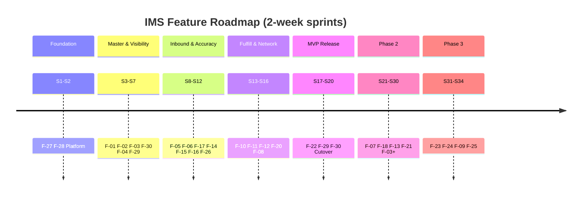

# Inventory Management System  
# Final Feature-Based Implementation Roadmap

| Attribute | Detail |
|-----------|--------|
| **Document ID** | IMPL-ROADMAP-001 |
| **Document Title** | Final Feature-Based Implementation Roadmap |
| **Perspective** | Engineering Manager |
| **Version** | 1.0 |
| **Date** | July 12, 2026 |
| **Status** | **Authoritative delivery guide** — from current state to production readiness |
| **Audience** | Sponsors, Product Owner, Technical Lead, developers, QA |

---

## 1. Executive Summary

This roadmap is the **single navigation document** for implementing the Inventory Management System (IMS). It consolidates features, dependencies, technical plans, sprints, acceptance criteria, risks, and Definition of Done into one path from today’s scaffold to production.

| Question | Answer |
|----------|--------|
| **Where are we now?** | Frontend navigation scaffold only (~15–18% readiness). **0** business features complete. **0/178** APIs integrated. |
| **Where are we going?** | Production-ready IMS: trusted stock, receive→put-away, reserve→ship, counts/adjustments, transfers, alerts, RBAC/audit. |
| **How do we get there?** | 30 business features (F-01–F-30), dependency-ordered, delivered in **34 two-week sprints** (solo FTE baseline). |
| **What does “done” mean?** | Feature DoD + release DoD + FAC-* acceptance criteria passed (not route scaffolds). |

### Release outcomes

| Release | Sprint gate | Outcome |
|---------|-------------|---------|
| **MVP** | End Sprint **20** | Primary site live: visibility, inbound, fulfillment, accuracy, transfers, alerts, access, audit trail |
| **Phase 2** | End Sprint **30** | PO/procurement, returns, quarantine, exceptions, requisitions, advanced audit |
| **Phase 3** | End Sprint **34** | KPIs, financial recon, rebalancing, campaigns (or PO-waived) |

### Capacity baseline

| Assumption | Value |
|------------|-------|
| Sprint length | 2 weeks |
| Team | **1 full-stack developer** (DB + Backend + Frontend + QA) |
| Stack | Java 21 · Spring Boot Modulith · PostgreSQL/Flyway · Angular 19 |
| MVP duration | ~10 months (Sprints 1–20) |

> If headcount increases, compress Phase 2/3; **do not reorder MVP dependencies**.

---

## 2. Document Map (sources of truth)

| Concern | Document |
|---------|----------|
| Feature list & grouping | [IMS-Implementation-Features.md](./IMS-Implementation-Features.md) |
| Dependencies & build order | [IMS-Feature-Dependency-Map.md](./IMS-Feature-Dependency-Map.md) |
| Per-feature tech plans | [plans/README.md](./plans/README.md) |
| Sprint-by-sprint plan | [IMS-Sprint-Plan.md](./IMS-Sprint-Plan.md) |
| Acceptance criteria (GWT) | [acceptance-criteria/README.md](./acceptance-criteria/README.md) |
| Task checklists (288) | [checklists/README.md](./checklists/README.md) |
| Risk register | [IMS-Implementation-Risk-Register.md](./IMS-Implementation-Risk-Register.md) |
| Gap / current state | `gap_frontend/Implementation-Readiness-Report.md` |

**Rule:** This roadmap **directs**; detailed artifacts **specify**. Conflicts → update the detailed artifact, then this summary.

---

## 3. Current State

```text
CURRENT STATE (July 2026)
─────────────────────────
✓ 50 UI routes + screen IDs (traceability)
✓ App shell + demo auth
✓ Design tokens / folder structure
✗ No business workflow end-to-end
✗ No HttpClient / API services
✗ No real RBAC / SoD
✗ No Flyway schema delivery in product path
✗ Business rules BR-001–032 not enforced in app

Overall implementation readiness ≈ 18%
```

**Implication:** Delivery starts with **platform + F-27**, not with dashboard polish.

---

## 4. Target State — Production Readiness

A release is **production-ready** when:

1. **MVP Must-Have features** listed in §6 are Done per §10  
2. Golden paths in §9 pass UAT  
3. Escalate risks in §11 are mitigated or PO-waived  
4. Go-live cutover (F-30 production) completed with dual control  
5. Ops can run: auth, backup/restore, health checks, support runbooks  

### Production capability map (MVP)

| Capability | Features |
|------------|----------|
| Who can act | F-27, F-28 |
| What/where stock is | F-01, F-02, F-03, F-04, F-30 |
| Stock enters | F-05, F-06 |
| Stock accuracy | F-14, F-15, F-16, F-17 |
| Stock leaves | F-10, F-11, F-12 |
| Network balance | F-08 |
| Signals | F-20, F-26 |
| Evidence | F-29, F-22 |

---

## 5. Feature Inventory (complete list)

### 5.1 By business group

| Group | Name | Features |
|-------|------|----------|
| G-01 | Master Data & Network Foundation | F-01, F-02, F-03, F-30 |
| G-02 | Inbound Supply & Goods Receiving | F-05, F-06, F-07 |
| G-03 | Real-Time Inventory Visibility | F-04 |
| G-04 | Inventory Control & Accuracy | F-14, F-15, F-16, F-17, F-18, F-19 |
| G-05 | Order Fulfillment | F-10, F-11, F-12, F-13 |
| G-06 | Replenishment & Stock Alerts | F-20, F-25 |
| G-07 | Network Balance & Transfers | F-08, F-09 |
| G-08 | Returns Management | F-21 |
| G-09 | Reporting & Financial Alignment | F-22, F-23, F-24 |
| G-10 | Operational Notifications | F-26 |
| G-11 | Security & Accountability | F-27, F-28 |
| G-12 | Governance, Audit & Compliance | F-29 |

### 5.2 Feature catalog (MoSCoW + stories)

| ID | Feature | Phase | Priority | User stories |
|----|---------|-------|----------|--------------|
| F-01 | Product Catalog Management | MVP | Must | US-001–004 |
| F-02 | Location & Network Setup | MVP | Must | US-005–007, 010 |
| F-03 | Stock Policy & Product Classification | MVP / P2 | Must / Should | US-008, 009, 012, 056 |
| F-04 | Inventory Visibility & Search | MVP / P2 | Must / Should | US-023–028 |
| F-05 | Goods Receiving & Verification | MVP | Must | US-015–017, 019–020, 029 |
| F-06 | Put-Away Management | MVP | Must | US-018 |
| F-07 | PO & Inbound Supply Management | P2 | Should | US-013–014, 021–022, 055, 079 |
| F-08 | Inter-Location Stock Transfers | MVP / P2 | Must / Should | US-058–061, 063 |
| F-09 | Network Stock Rebalancing | P3 | Could / Won't* | US-062 |
| F-10 | Order Availability & Reservation | MVP / P2 | Must / Should | US-041–043, 048 |
| F-11 | Pick, Pack & Ship Fulfillment | MVP | Must | US-044, 049 |
| F-12 | Partial Fulfillment & Backorder | MVP / P2 | Must / Should | US-045–046 |
| F-13 | Fulfillment Exception Handling | P2 / P3 | Should / Could | US-047, 050, 078 |
| F-14 | Cycle Counting | MVP | Must | US-030–031, 071 |
| F-15 | Full Physical Inventory Count | MVP | Must | US-032 |
| F-16 | Count Variance Investigation & Approval | MVP | Must | US-033–034, 037 |
| F-17 | Stock Adjustments & Write-Offs | MVP | Must | US-011, 035–036, 077 |
| F-18 | Quarantine & Hold Stock | P2 | Should | US-038 |
| F-19 | Shrinkage & Obsolescence Analysis | P2 / P3 | Should / Could | US-039–040 |
| F-20 | Low-Stock Alerting & Replenishment | MVP / P2 | Must / Should | US-051–054, 074 |
| F-21 | Returns Management | P2 | Should | US-064–067 |
| F-22 | Inventory Reporting & Dashboards | MVP | Must | US-068–070, 072, 074 |
| F-23 | Inventory Performance KPIs | P3 | Could | US-073 |
| F-24 | Financial Inventory Reconciliation | P3 | Could | US-075, 089 |
| F-25 | Promotional & Launch Stock Readiness | P3 | Won't* / Could | US-057, 080 |
| F-26 | Operational Notifications & Alerts | MVP / P2 | Must / Should | US-076–080 |
| F-27 | User Access & Role Management | MVP | Must | US-081–082, 085 |
| F-28 | Operational Accountability & Controls | MVP | Must | US-083–084 |
| F-29 | Audit Trail & Compliance | MVP / P2 | Must / Should | US-086–088 |
| F-30 | System Go-Live & Initial Data Setup | MVP | Must | US-090 |

\*MoSCoW “Won’t Have” for current initiative commitment; kept on Phase 3 roadmap for completeness.

**Detail:** [IMS-Implementation-Features.md](./IMS-Implementation-Features.md)

---

## 6. Dependency Model (how features unlock)

### 6.1 Hard dependency chain (MVP critical path)

```text
F-27 Access ──► F-28 SoD
       │
       ├──► F-01 Catalog ──┐
       └──► F-02 Locations ┼──► F-03 Policies ──► F-29 write
                           │         │
                           │         └──► F-30 seed ──► F-04 Visibility
                           │                              │
                    F-05 Receiving ──► F-06 Put-Away ──────┤
                           │                              ├──► F-10 Reserve ──► F-11 Ship ──► F-12 Partial
                           │                              ├──► F-20 Alerts
                           │                              └──► F-08 Transfers
                    F-14/15 Count ──► F-16 Variance ──► F-17 Adjust
                                                      └──► F-26 Notifications
                    F-04 + mutators ──► F-22 Dashboard
                    Hardening ──► F-30 production cutover
```

### 6.2 Dependency rules (non-negotiable)

| Rule | Do not… | Until… |
|------|---------|--------|
| 1 | Ship F-11 pick/pack | F-04 + F-10 Done |
| 2 | Approve variances/adjustments/transfers | F-28 SoD server-side Done |
| 3 | Generate low-stock alerts | F-03 thresholds Done |
| 4 | Production F-30 cutover | Golden paths (§9) pass |
| 5 | Pull F-07/F-21 into MVP | PO change control + schedule re-baseline |

**Detail:** [IMS-Feature-Dependency-Map.md](./IMS-Feature-Dependency-Map.md)

---

## 7. Implementation Approach

### 7.1 Vertical slice per feature

For each feature in order:

```text
1. Pull P0 checklist tasks          → checklists/F-xx-*.md
2. Database (Flyway)                → plans § Database
3. Backend (domain → API)           → plans § Backend
4. Frontend (ApiService → Facade → UI)
5. Testing against FAC-*            → acceptance-criteria/F-xx-*.md
6. Documentation / OpenAPI
7. Mark feature Done (§10)
```

### 7.2 Stack & architecture standards

| Layer | Standard |
|-------|----------|
| Backend | Java 21, Spring Boot 3.x, Spring Modulith (M-01–M-13), JPA, MapStruct |
| Data | PostgreSQL 16, schema-per-module, Flyway, optimistic locking on stock |
| API | REST `/api/v1`, RFC 7807 errors, OpenAPI via Springdoc |
| Frontend | Angular 19 standalone, HttpClient, facades + signals, child routes |
| Security | OIDC/JWT, RBAC, location scope, SoD on approve APIs |
| ATP | **Only M-04 Stock Position** mutates quantities |

### 7.3 Known API gaps (close before dependent UI)

| Gap | Blocks | Close by |
|-----|--------|----------|
| C-01 Pick queue by location | F-11 workbench | Before Sprint 14 polish |
| C-03 Requisition list | F-20 requisitions | Sprint 23 |
| C-04 Returns receipt path | F-21 | Sprint 26 (API-128 canonical) |

---

## 8. Sprint Roadmap (complete timeline)

**Detail:** [IMS-Sprint-Plan.md](./IMS-Sprint-Plan.md)

### Phase A — Foundation (Sprints 1–2)

| Sprint | Goal | Features | Exit criteria |
|--------|------|----------|---------------|
| **1** | Platform + session | F-27 (login slice) | Sign-in via UI → real session API |
| **2** | RBAC + SoD hooks | F-27 complete, F-28 | Scoped user + SoD evaluate works |

### Phase B — Master data & visibility (Sprints 3–7)

| Sprint | Goal | Features | Exit criteria |
|--------|------|----------|---------------|
| **3** | Product catalog | F-01 | CRUD + lifecycle in UI |
| **4** | Locations & bins | F-02 | WH + storage positions |
| **5** | Policies + audit writer | F-03 (core), F-29 (write) | Thresholds + reason codes; movements appendable |
| **6** | Import + stock positions | F-30 (pipeline), F-04 start | Seeded on-hand via import |
| **7** | Visibility MVP | F-04 complete | ATP/on-hand/status/search scoped |

### Phase C — Inbound & accuracy (Sprints 8–12)

| Sprint | Goal | Features | Exit criteria |
|--------|------|----------|---------------|
| **8** | Receiving core | F-05 (slice 1) | Verify receipt vs seeded PO |
| **9** | Discrepancy + put-away | F-05 (slice 2), F-06 | Receive→put-away→ATP |
| **10** | Adjustments + approval alerts | F-17, F-26 (slice) | SoD approve updates stock |
| **11** | Cycle counting | F-14 | Blind count submitted |
| **12** | Physical + variance | F-15, F-16 | Freeze + independent approve |

### Phase D — Fulfillment & replenishment (Sprints 13–16)

| Sprint | Goal | Features | Exit criteria |
|--------|------|----------|---------------|
| **13** | Reservation | F-10 (MVP) | Confirm reduces ATP; cancel restores |
| **14** | Pick/pack/ship | F-11 | Reserve→ship golden path |
| **15** | Partial + alerts | F-12 (partial), F-20 (alerts), F-26 | Ack partial; low-stock alert |
| **16** | Transfers | F-08 (MVP) | Request→approve→execute balances |

### Phase E — Network, reporting & MVP release (Sprints 17–20)

| Sprint | Goal | Features | Exit criteria |
|--------|------|----------|---------------|
| **17** | Live dashboard | F-22 (MVP) | No mock KPIs on done widgets |
| **18** | Audit query + alerts polish | F-29 (query), F-26 | Immutable trail searchable |
| **19** | Hardening / UAT | Cross-MVP | Golden paths pass; Sev-1 = 0 |
| **20** | **Production cutover** | F-30 (prod) | **MVP RELEASE** |

### Phase F — Phase 2 (Sprints 21–30)

| Sprint | Focus | Features |
|--------|-------|----------|
| 21–22 | Procurement & inbound pipeline | F-07 |
| 23 | Requisitions | F-20 extension (C-03) |
| 24 | Quarantine + exceptions | F-18, F-13 |
| 25 | Backorder priority, split fulfill, in-transit | F-12, F-10, F-08 extensions |
| 26–27 | Returns | F-21 (C-04) |
| 28 | ABC / governance / safety stock | F-03 extension |
| 29 | Audit workspace + shrinkage | F-29, F-19 |
| **30** | Phase 2 hardening | **PHASE 2 RELEASE** |

### Phase G — Phase 3 (Sprints 31–34)

| Sprint | Focus | Features |
|--------|-------|----------|
| 31 | Executive KPIs | F-23 |
| 32 | Financial reconciliation | F-24 |
| 33 | Network rebalancing | F-09 |
| 34 | Campaigns + alerts | F-25, F-26 campaign |
| — | PO waive or release | **FULL ROADMAP COMPLETE** |



---

## 9. Acceptance Criteria & Golden Paths

### 9.1 How AC is used

| Level | Artifact | Use |
|-------|----------|-----|
| Feature | `FAC-{nn}-{H\|V\|E\|P\|X}*` (429 criteria) | Feature UAT / DoD |
| Story | `project_businsse/acceptance-criteria-reviewed.md` | Detailed scenario depth |

**Index:** [acceptance-criteria/README.md](./acceptance-criteria/README.md)

Each feature AC file covers: **Happy · Validation · Error · Permission · Edge**.

### 9.2 MVP golden paths (must pass before Sprint 20)

| ID | Path | Features |
|----|------|----------|
| GP-01 | Sign in → scoped navigation | F-27 |
| GP-02 | Import catalog + openings → activate location | F-30, F-01, F-02 |
| GP-03 | View on-hand / ATP / status | F-04 |
| GP-04 | Receive → put-away → ATP increases | F-05, F-06 |
| GP-05 | Reserve → pick → pack → ship → on-hand decreases | F-10, F-11 |
| GP-06 | Partial ship with customer ack | F-12 |
| GP-07 | Cycle count → variance → SoD approve → adjust | F-14, F-16, F-17, F-28 |
| GP-08 | Transfer request → approve → dispatch → receive | F-08 |
| GP-09 | Low stock alert → acknowledge | F-03, F-20, F-26 |
| GP-10 | Query movement / audit trail | F-29 |
| GP-11 | Self-approve adjustment **blocked** | F-28, F-17 |

### 9.3 Phase 2 golden paths (Sprint 30)

| ID | Path | Features |
|----|------|----------|
| GP-12 | Create PO → receive against live PO | F-07, F-05 |
| GP-13 | Alert → requisition → convert to PO | F-20, F-07 |
| GP-14 | RA → inspect → restock/quarantine/write-off | F-21, F-18 |
| GP-15 | Pick failure → exception → quarantine | F-13, F-18 |

---

## 10. Definition of Done

### 10.1 Task DoD

A checklist task (`CHK-*`) is Done when:

- [ ] Code merged to main integration branch  
- [ ] Layer acceptance met (migration applied / API returns contract / UI uses real HTTP / test passes / doc updated)  
- [ ] No Sev-1/2 introduced by the task  

### 10.2 Feature DoD

A feature **F-xx** is Done when:

- [ ] All **P0** checklist tasks Done; P1 Done or explicitly deferred with PO note  
- [ ] Implementation plan scope for the release slice delivered  
- [ ] **Happy + Validation + Permission** FAC-* sampled and passed  
- [ ] Related APIs enforce authZ + location scope  
- [ ] If stock-mutating: movement/audit side-effect verified  
- [ ] If approval: **server-side SoD** verified (not UI-only)  
- [ ] Demo script for the feature runs on a clean seeded environment  
- [ ] OpenAPI / runbook notes updated  
- [ ] Status set to Done in checklist README tracking  

### 10.3 Sprint DoD

- [ ] Sprint goal demoed  
- [ ] Exit criteria in §8 met  
- [ ] Global sprint DoD from Sprint Plan (migrations, RFC 7807, no mocks for done screens, FAC sample)  
- [ ] Risks touching sprint features reviewed  

### 10.4 MVP Release DoD (Sprint 20)

- [ ] All MVP Must-Have features in §5.2 marked Done for MVP slice  
- [ ] Golden paths GP-01–GP-11 pass UAT with PO sign-off  
- [ ] Escalate risks (§11) mitigated or waived in writing  
- [ ] Production F-30 cutover complete; rollback tested  
- [ ] Phase 2-only nav hidden/flagged off  
- [ ] Support: health endpoint, backup, seed/admin credentials secured  
- [ ] Known-issues list published (no Sev-1)  

### 10.5 Phase 2 / Phase 3 Release DoD

- [ ] Features for that phase Done per §10.2  
- [ ] Phase golden paths pass  
- [ ] Regression of MVP golden paths still green  
- [ ] PO accepts release scope  

---

## 11. Risk Management (integrated)

**Full register:** [IMS-Implementation-Risk-Register.md](./IMS-Implementation-Risk-Register.md) (34 risks)

### Escalate risks (must address)

| ID | Risk | Mitigation in roadmap |
|----|------|----------------------|
| R-T01 | Stock concurrency / oversell | Locking + idempotency before F-10; concurrency tests |
| R-T05 | Import corrupts openings | Staging + SoD; F-30 prod only after S19 |
| R-T07 | Frontend scaffold debt | S1–2 platform; facades JIT |
| R-A01 | Split-brain ATP | Only M-04 mutates qty; ArchUnit |
| R-A03 | SoD UI-only | API-031 on all approvals |
| R-I01 | API gaps C-01/03/04 | Explicit sprint gates |
| R-I02 | No HTTP/backend | Sprint 1 hard gate |
| R-L01 | DDD/Modulith learning | Heavy review F-01/F-04/F-10 |
| R-S01 | Solo schedule slip | WIP=1; cut Should; escalate headcount if S1–7 slip >2 |
| R-S03 | Scope creep | MoSCoW freeze |
| R-S05 | Early cutover | Sprint 19 gate |
| R-S07 | Key-person risk | Docs mandatory; sustainable pace |

### Risk review cadence

| When | Action |
|------|--------|
| Sprint planning | Review risks for features in sprint |
| Mid-sprint (Day 6) | Surface new blockers |
| S20 / S30 gates | Escalate list cleared or waived |

---

## 12. Feature Delivery Card (how to execute one feature)

Use this card every time a feature is pulled into a sprint:

| Step | Action | Artifact |
|------|--------|----------|
| 1 | Confirm prerequisites Done | Dependency map § feature |
| 2 | Read implementation plan | `plans/F-xx-*.md` |
| 3 | Load P0/P1 checklist into sprint board | `checklists/F-xx-*.md` |
| 4 | Implement DB → BE → FE | Plan sections |
| 5 | Test against FAC | `acceptance-criteria/F-xx-*.md` |
| 6 | Check feature risks | Risk register heat map |
| 7 | Demo + mark Feature DoD | §10.2 |
| 8 | Update this roadmap status table (§13) | Below |

---

## 13. Roadmap Status Tracker

Update at each sprint review.

### Release status

| Release | Target sprint | Status | Date |
|---------|---------------|--------|------|
| Platform ready | 2 | Not Started | — |
| Visibility demo | 7 | Not Started | — |
| Inbound+accuracy | 12 | Not Started | — |
| Fulfillment path | 14 | Not Started | — |
| **MVP production** | **20** | Not Started | — |
| **Phase 2** | **30** | Not Started | — |
| **Phase 3** | **34** | Not Started | — |

### Feature status (MVP Must-Have)

| Feature | Status | Sprint | Notes |
|---------|--------|--------|-------|
| F-27 | Not Started | 1–2 | |
| F-28 | Not Started | 2 | |
| F-01 | Not Started | 3 | |
| F-02 | Not Started | 4 | |
| F-03 (core) | Not Started | 5 | ABC → S28 |
| F-29 (write) | Not Started | 5 | Query → S18 |
| F-30 (seed) | Not Started | 6 | Prod → S20 |
| F-04 | Not Started | 6–7 | |
| F-05 | Not Started | 8–9 | |
| F-06 | Not Started | 9 | |
| F-17 | Not Started | 10 | |
| F-26 (core) | Not Started | 10, 15, 18 | |
| F-14 | Not Started | 11 | |
| F-15 | Not Started | 12 | |
| F-16 | Not Started | 12 | |
| F-10 | Not Started | 13 | Split → S25 |
| F-11 | Not Started | 14 | C-01 |
| F-12 (partial) | Not Started | 15 | Priority → S25 |
| F-20 (alerts) | Not Started | 15 | Req → S23 |
| F-08 | Not Started | 16 | In-transit → S25 |
| F-22 | Not Started | 17 | |
| F-29 (query) | Not Started | 18 | |
| F-30 (cutover) | Not Started | 20 | |

*Status values: Not Started · In Progress · Blocked · Done · Waived*

---

## 14. Governance & Change Control

| Change type | Authority | Rule |
|-------------|-----------|------|
| Reorder MVP dependencies | TL + EM | Only with written risk acceptance |
| Add Phase 2 feature to MVP | PO + EM | Re-baseline Sprint 20 date |
| Waive FAC / risk | PO | Recorded in risk register + release notes |
| Defer P1 checklist task | TL | Must not break Feature DoD Happy/Permission |
| Production cutover date | PO + EM | After Sprint 19 UAT sign-off |

### Ceremonies (solo-adapted)

| Event | Cadence |
|-------|---------|
| Sprint planning | Day 1 |
| Mid-sprint check | Day 6 |
| Demo / review | Day 10 |
| Retro | Day 10 |
| UAT with PO | End S19, S20, S30 |

---

## 15. Success Metrics

| Metric | MVP target | How measured |
|--------|------------|--------------|
| Business features Done (MVP slice) | 100% of §13 MVP table | Checklist + FAC |
| Golden paths GP-01–11 | 100% pass | UAT script |
| API integration for MVP endpoints | Consumed via HttpClient | Gap matrix refresh |
| Sev-1 open at release | 0 | Defect tracker |
| Inventory accuracy process live | Count→adjust path works | GP-07 |
| Oversell incidents in UAT | 0 | Concurrent reservation tests |
| Time to first visibility demo | ≤ Sprint 7 | Demo log |
| Time to MVP production | ≤ Sprint 20 | Cutover sign-off |

---

## 16. First 30 Days — Immediate Action Plan

| Week | Actions |
|------|---------|
| **Week 1 (Sprint 1 start)** | Stand up Spring Boot + Flyway + PostgreSQL; HttpClient + interceptors; implement F-27 session (API-173/174); wire UI-001 |
| **Week 2** | Complete F-27 admin (UI-049/050); F-28 SoD evaluate; ArchUnit module skeleton; health path ADR |
| **Week 3–4 (Sprint 2–3)** | Gate: auth E2E green → start F-01 product catalog vertical slice |
| **Do not** | Polish dashboard mocks; start F-11; production import |

---

## 17. Appendix — Quick links by role

### Product Owner
- Features & MoSCoW → [IMS-Implementation-Features.md](./IMS-Implementation-Features.md)  
- AC / UAT → [acceptance-criteria/](./acceptance-criteria/)  
- Golden paths → §9  
- Waivers → Risk register + §14  

### Technical Lead / Developer
- Build order → [IMS-Feature-Dependency-Map.md](./IMS-Feature-Dependency-Map.md)  
- Plans → [plans/](./plans/)  
- Tasks → [checklists/](./checklists/)  
- Sprint goals → [IMS-Sprint-Plan.md](./IMS-Sprint-Plan.md)  
- Risks → [IMS-Implementation-Risk-Register.md](./IMS-Implementation-Risk-Register.md)  

### Engineering Manager
- This roadmap (§1–16)  
- Status tracker §13  
- Capacity & phase gates §1, §8  
- Escalate risks §11  

---

## 18. Approval

| Role | Name | Signature | Date |
|------|------|-----------|------|
| Product Owner | | | |
| Engineering Manager | | | |
| Technical Lead | | | |

---

**Roadmap statement:**  
*Implement F-27 → F-28 → master data → visibility → inbound → accuracy → fulfillment → transfers → reporting → harden → cutover; then Phase 2 procurement/returns; then Phase 3 analytics — never marking scaffolds as Done, and never shipping stock mutations without ATP integrity, SoD, and audit.*

---

*End of Final Feature-Based Implementation Roadmap — IMPL-ROADMAP-001*
