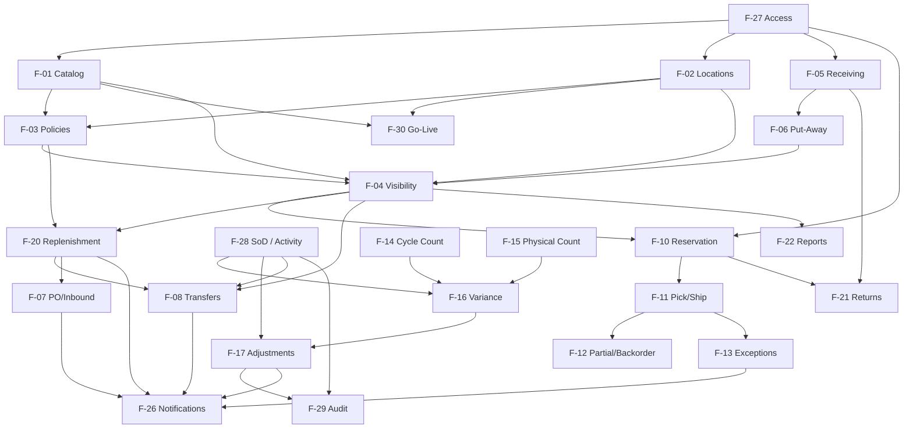

# Inventory Management System — Implementation Features Catalog

| Attribute | Detail |
|-----------|--------|
| **Document ID** | IMPL-FEAT-001 |
| **Document Title** | Implementation Features Catalog |
| **Perspective** | Engineering Manager & Product Owner |
| **Version** | 1.0 |
| **Date** | July 11, 2026 |
| **Status** | Baseline for implementation planning |
| **Audience** | Product owners, engineering leads, delivery teams, QA |

---

## 1. Purpose

This catalog identifies **all business implementation features** required to complete the Inventory Management System. Features are cohesive business capabilities — not technical tasks.

Each feature is traced to:

| Source | Artifact |
|--------|----------|
| BRD | BRD-IMS-001 (BO-01–BO-24, BP-01–BP-32, FR-001–FR-090) |
| SRS | Inventory-Management-System-SRS.md (UC-001–UC-048, BR-001–BR-032) |
| User Stories | US-001–US-090 (`project_businsse/user-stories-reviewed.md`) |
| Domain Model | Aggregates, entities, bounded contexts (`SRS/domain_model`) |
| UI Design | UI-001–UI-050 (`SRS/UI_UX/IMS-Screen-Inventory.md`) |
| API Design | API-001–API-178 (`SRS/API_Design/REST-API-Catalog.md`) |
| Gap Analysis | `gap_frontend` reports (Feature Coverage, Implementation Readiness) |

**Gap analysis implication:** The Angular frontend is a navigation/screen scaffold (~15–18% delivery readiness). **No business feature is fully implemented.** Every feature below remains required for system completion.

---

## 2. How to Read This Catalog

| Field | Meaning |
|-------|---------|
| **Feature ID** | Canonical ID from Feature Catalog (F-01–F-30) |
| **Feature name** | Business capability name |
| **Business objective** | Why the feature exists (linked to BO / epic goals) |
| **Related user stories** | US-xxx (1:1 with FR-xxx unless noted) |
| **Related domain concepts** | Aggregates / entities / value objects |
| **Related screens** | UI-xxx |
| **Related APIs** | API-xxx |
| **Priority** | Must Have (MVP) / Should Have (Phase 2) / Could Have (Phase 3) / Won't Have (deferred) |
| **Dependencies** | Other features that must exist or run first |

**Priority aligns with MoSCoW** (`moscow-epic-story-prioritization.md`). Where a feature spans phases, the **overall** priority reflects the earliest required slice; phase notes call out later extensions.

---

## 3. Feature Groups (Business Capabilities)

| Group | Name | Features | Primary phase |
|-------|------|----------|---------------|
| **G-01** | Master Data & Network Foundation | F-01, F-02, F-03, F-30 | MVP / Phase 2 |
| **G-02** | Inbound Supply & Goods Receiving | F-05, F-06, F-07 | MVP / Phase 2 / Phase 3 |
| **G-03** | Real-Time Inventory Visibility | F-04 | MVP / Phase 2 |
| **G-04** | Inventory Control & Accuracy | F-14, F-15, F-16, F-17, F-18, F-19 | MVP / Phase 2 / Phase 3 |
| **G-05** | Order Fulfillment | F-10, F-11, F-12, F-13 | MVP / Phase 2 / Phase 3 |
| **G-06** | Replenishment Planning & Stock Alerts | F-20, F-25 | MVP / Phase 2 / Phase 3 |
| **G-07** | Network Balance & Stock Transfers | F-08, F-09 | MVP / Phase 2 / Phase 3 |
| **G-08** | Returns Management | F-21 | Phase 2 (MVP interim via F-05) |
| **G-09** | Reporting, Analytics & Financial Alignment | F-22, F-23, F-24 | MVP / Phase 2 / Phase 3 |
| **G-10** | Operational Notifications & Awareness | F-26 | MVP / Phase 2 / Phase 3 |
| **G-11** | Security, Access & Accountability | F-27, F-28 | MVP |
| **G-12** | Governance, Audit & Compliance | F-29 (+ governance master data in F-03/F-17) | MVP / Phase 2 |

**Total features:** 30 | **Total user stories:** 90 | **Total screens:** 50 | **Total APIs:** 178

---

## 4. Recommended Delivery Waves (Business Sequencing)

| Wave | Focus | Feature IDs |
|------|-------|-------------|
| **Wave 0** | Access & identity enablers | F-27, F-28 |
| **Wave 1** | Master data, go-live import, core visibility, audit trail | F-01, F-02, F-03 (thresholds), F-30, F-04 (core), F-29 (trail) |
| **Wave 2** | Receiving, put-away, counting, adjustments, approval notifications | F-05, F-06, F-14, F-15, F-16, F-17, F-26 (approval) |
| **Wave 3** | Fulfillment, low-stock alerts, stock notifications | F-10, F-11, F-12 (partial), F-20 (alerts), F-26 (stock) |
| **Wave 4** | Transfers & operational reporting | F-08, F-22 (core) |
| **Wave 5** | MVP hardening & primary-site go-live | F-30 (production load), regression of MVP features |
| **Wave 6** | Phase 2 performance | F-07, F-03 (ABC/policies), F-04 (network/inbound views), F-12 (backorder), F-13, F-18, F-20 (requisitions), F-08 (in-transit), F-21, F-22 (location), F-26 (exceptions/delays), F-29 (queries) |
| **Wave 7** | Phase 3 smarter decisions | F-09, F-19 (obsolescence), F-13 (substitution), F-23, F-24, F-25, F-26 (campaign) |

---

## 5. Group Feature Catalog

---

# G-01 — Master Data & Network Foundation

**Business goal:** Establish trusted product, location, and policy master data and enable controlled adoption so every downstream process operates on consistent reference information.

**Related epics:** EPIC-01  
**Related BOs:** BO-01, BO-02, BO-21  
**Gap status:** Scaffold only (UI-005–UI-010, UI-006); no CRUD, import wizard, or policy enforcement.

---

### F-01 — Product Catalog Management

| Field | Detail |
|-------|--------|
| **1. Feature ID** | F-01 |
| **2. Feature name** | Product Catalog Management |
| **3. Business objective** | Maintain a single trusted product catalog (identity, attributes, lifecycle) so all locations and departments eliminate duplicate records and ordering/fulfillment mismatches (BO-01, BO-21). |
| **4. Related user stories** | US-001, US-002, US-003, US-004 |
| **5. Related domain concepts** | Aggregate: **Product Catalog** (Product). VOs: Product Identifier, Product Category, Product Lifecycle Status, Unit of Measure, Rotation Policy, Shelf Life Profile |
| **6. Related screens** | UI-005 Product Catalog Management |
| **7. Related APIs** | API-001, API-002, API-003, API-004, API-005, API-007, API-008, API-009 |
| **8. Priority** | **Must Have** (MVP) |
| **9. Dependencies** | F-27 (access); enables F-03, F-04, F-05, F-07, F-10, F-30 |

---

### F-02 — Location & Network Setup

| Field | Detail |
|-------|--------|
| **1. Feature ID** | F-02 |
| **2. Feature name** | Location & Network Setup |
| **3. Business objective** | Define the inventory location network (warehouses, stores, DCs), hierarchy, storage positions, and location lifecycle so stock is assigned, tracked, and reported at the correct sites (BO-01). |
| **4. Related user stories** | US-005, US-006, US-007, US-010 |
| **5. Related domain concepts** | Aggregate: **Inventory Location** (Storage Position). VOs: Location Type, Location Hierarchy Path, Physical Address, Effective Period |
| **6. Related screens** | UI-007 Location and Warehouse Management |
| **7. Related APIs** | API-011, API-012, API-013, API-014, API-015, API-016, API-017, API-018, API-019, API-020, API-021 |
| **8. Priority** | **Must Have** (MVP); US-007 location closure disposition = **Should Have** (Phase 2) |
| **9. Dependencies** | F-27; opening balances also depend on F-30 / count capability (F-15); US-007 depends on F-08, F-17 |

---

### F-03 — Stock Policy & Product Classification

| Field | Detail |
|-------|--------|
| **1. Feature ID** | F-03 |
| **2. Feature name** | Stock Policy & Product Classification |
| **3. Business objective** | Define reorder/minimum/safety-stock thresholds, governance policy references, and ABC classification so replenishment and counting effort focus on high-impact items (BO-05). |
| **4. Related user stories** | US-008, US-009, US-012, US-056 |
| **5. Related domain concepts** | Aggregates: **Stock Policy**, **Inventory Governance**, **Product Catalog** (ABC). VOs: Stock Threshold Set, Approval Threshold, Quantity Tolerance, ABC Classification |
| **6. Related screens** | UI-008 Stock Policy and Threshold Management; UI-009 ABC Classification Management; UI-010 Governance Policies and Reason Codes |
| **7. Related APIs** | API-038, API-039, API-040; API-006; API-022–API-030 |
| **8. Priority** | **Must Have** for thresholds (US-008); **Should Have** for ABC & governance policies (US-009, US-012); **Should Have** for safety-stock protection rules (US-056) |
| **9. Dependencies** | F-01, F-02; enables F-20, F-08 (source minimums), F-14 (ABC-driven counting) |

---

### F-30 — System Go-Live & Initial Data Setup

| Field | Detail |
|-------|--------|
| **1. Feature ID** | F-30 |
| **2. Feature name** | System Go-Live & Initial Data Setup |
| **3. Business objective** | Enable practical deployment through controlled bulk import of product catalog and verified opening balances so primary locations go live without embedded data errors (BO-01, BO-21). |
| **4. Related user stories** | US-090 |
| **5. Related domain concepts** | Aggregates: **Product Catalog**, **Stock Position**, **Inventory Location**. Concept: Opening Balance establishment |
| **6. Related screens** | UI-006 Product Import Workspace |
| **7. Related APIs** | API-010, API-032, API-017 |
| **8. Priority** | **Must Have** (MVP) |
| **9. Dependencies** | F-01, F-02, F-27; validation/approval before location activation; complements US-010 |

---

# G-02 — Inbound Supply & Goods Receiving

**Business goal:** Ensure all inventory entering the organization is verified, documented, and made operationally available through controlled receiving and put-away.

**Related epics:** EPIC-02  
**Related BOs:** BO-03, BO-05  
**Gap status:** Scaffold only (UI-011–UI-019); no receipt, discrepancy, or put-away workflows.

---

### F-05 — Goods Receiving & Verification

| Field | Detail |
|-------|--------|
| **1. Feature ID** | F-05 |
| **2. Feature name** | Goods Receiving & Verification |
| **3. Business objective** | Accept inbound shipments with verified quantity, identity, and condition so on-hand balances reflect physical reality from point of entry and suppliers remain accountable (BO-03). |
| **4. Related user stories** | US-015, US-016, US-017, US-019, US-020, US-029 |
| **5. Related domain concepts** | Aggregates: **Goods Receipt**, **Purchase Order**, **Stock Position**. Concepts: Receipt Discrepancy, Inventory Movement Record, Ad-hoc / return inbound |
| **6. Related screens** | UI-015 Goods Receipt Workbench; UI-016 Receipt Discrepancy Resolution; UI-018 Non-PO and Return Receipt Intake; UI-022 Inventory Movement History |
| **7. Related APIs** | API-065–API-072, API-075, API-076; API-025, API-030; API-155 |
| **8. Priority** | **Must Have** (MVP receiving + discrepancy + non-PO/return intake + movement history); **Should Have** for receipt tolerance evaluation (US-020) |
| **9. Dependencies** | F-01, F-02, F-03 (tolerances/reason codes), F-27; MVP can receive against PO reference without full F-07; enables F-06; interim returns path for F-21 |

---

### F-06 — Put-Away Management

| Field | Detail |
|-------|--------|
| **1. Feature ID** | F-06 |
| **2. Feature name** | Put-Away Management |
| **3. Business objective** | Confirm storage placement before stock becomes sellable/available so ATP reflects locatable inventory and pickers can find goods (BO-03, BO-06). |
| **4. Related user stories** | US-018 |
| **5. Related domain concepts** | Aggregates: **Goods Receipt**, **Inventory Location** (Storage Position), **Stock Position**. Concepts: Received vs. Available state |
| **6. Related screens** | UI-017 Put-Away Workbench |
| **7. Related APIs** | API-073, API-074, API-015, API-016 |
| **8. Priority** | **Must Have** (MVP) |
| **9. Dependencies** | F-05, F-02; feeds F-04 ATP accuracy |

---

### F-07 — Purchase Order & Inbound Supply Management

| Field | Detail |
|-------|--------|
| **1. Feature ID** | F-07 |
| **2. Feature name** | Purchase Order & Inbound Supply Management |
| **3. Business objective** | Manage the inbound supply pipeline from purchase commitment through expected delivery so operations, sales, and purchasing know when shortages will be resolved (BO-05). |
| **4. Related user stories** | US-013, US-014, US-021, US-022, US-055, US-079 |
| **5. Related domain concepts** | Aggregates: **Supplier**, **Purchase Order**, **Purchase Requisition** (consumer). Concepts: Expected Delivery, Supplier performance |
| **6. Related screens** | UI-011 Supplier Management; UI-012 Purchase Order Management; UI-014 Inbound Delivery Planning; UI-019 Inbound Supply Tracking |
| **7. Related APIs** | API-049–API-053, API-059–API-065; API-161, API-162, API-163 |
| **8. Priority** | **Should Have** (Phase 2) for PO lifecycle, inbound planning, tracking, delay notifications; **Could Have** (Phase 3) for supplier performance (US-022) |
| **9. Dependencies** | F-01, F-02, F-27; strengthens F-05; consumed by F-20; notifications via F-26 |

---

# G-03 — Real-Time Inventory Visibility

**Business goal:** Provide a trusted real-time single source of truth for on-hand, reserved, and ATP stock across the network.

**Related epics:** EPIC-03  
**Related BOs:** BO-01, BO-16  
**Gap status:** Scaffold only (UI-020–UI-022); mock data only.

---

### F-04 — Inventory Visibility & Search

| Field | Detail |
|-------|--------|
| **1. Feature ID** | F-04 |
| **2. Feature name** | Inventory Visibility & Search |
| **3. Business objective** | Answer what stock exists, where it is, what is reserved, and what is available to promise — without spreadsheets or warehouse calls (BO-01, BO-16). |
| **4. Related user stories** | US-023, US-024, US-025, US-026, US-027, US-028 |
| **5. Related domain concepts** | Aggregate: **Stock Position**. VOs: Stock Availability Breakdown, Stock Status Indicator. Read models: stock status board, availability inquiry |
| **6. Related screens** | UI-020 Inventory Status Monitor; UI-021 Inventory Availability Inquiry; UI-002 Operational Home Dashboard (stock health widgets) |
| **7. Related APIs** | API-033–API-037, API-012; API-151, API-152, API-153; API-035, API-036 |
| **8. Priority** | **Must Have** (MVP core on-hand/ATP/reserved/status/search); **Should Have** for expected inbound & network-wide views (US-028) |
| **9. Dependencies** | F-01, F-02, F-03 (status thresholds); updated by F-05/F-06/F-10/F-11/F-08/F-17; enables F-10, F-20, F-07 planning |

---

# G-04 — Inventory Control & Accuracy

**Business goal:** Sustain record accuracy through counting, controlled adjustments, quarantine, and loss analysis (≥95% accuracy target — BO-02).

**Related epics:** EPIC-04  
**Related BOs:** BO-02, BO-03, BO-19  
**Gap status:** Scaffold only (UI-023–UI-029); no count/adjustment workflows or SoD.

---

### F-14 — Cycle Counting

| Field | Detail |
|-------|--------|
| **1. Feature ID** | F-14 |
| **2. Feature name** | Cycle Counting |
| **3. Business objective** | Verify physical stock on a rotating schedule with blind counts to detect discrepancies early and sustain accuracy without full-wall disruption (BO-02). |
| **4. Related user stories** | US-030, US-031, US-071 |
| **5. Related domain concepts** | Aggregate: **Cycle Count**. Concepts: Blind count, count assignment, accuracy metrics |
| **6. Related screens** | UI-023 Cycle Count Workbench |
| **7. Related APIs** | API-108–API-111, API-168 |
| **8. Priority** | **Must Have** (MVP) |
| **9. Dependencies** | F-01, F-02, F-03 (optional ABC priority); feeds F-16; F-27 SoD |

---

### F-15 — Full Physical Inventory Count

| Field | Detail |
|-------|--------|
| **1. Feature ID** | F-15 |
| **2. Feature name** | Full Physical Inventory Count |
| **3. Business objective** | Conduct location-wide counts with movement freeze to establish verified baselines and support financial substantiation (BO-02, BO-07). |
| **4. Related user stories** | US-032 |
| **5. Related domain concepts** | Aggregate: **Physical Inventory Count**, **Inventory Location** (freeze). Concepts: Wall-to-wall count, certification |
| **6. Related screens** | UI-024 Physical Inventory Count Management |
| **7. Related APIs** | API-020, API-112–API-115, API-168 |
| **8. Priority** | **Must Have** (MVP) |
| **9. Dependencies** | F-02; blocks F-05/F-08/F-11 during freeze; feeds F-16 |

---

### F-16 — Count Variance Investigation & Approval

| Field | Detail |
|-------|--------|
| **1. Feature ID** | F-16 |
| **2. Feature name** | Count Variance Investigation & Approval |
| **3. Business objective** | Investigate count variances and apply corrections only through independent approval, preserving segregation of duties (BO-02, BO-19). |
| **4. Related user stories** | US-033, US-034, US-037 |
| **5. Related domain concepts** | Aggregate: **Inventory Adjustment Case**. Concepts: Variance, investigation finding, approval threshold, SoD |
| **6. Related screens** | UI-025 Variance Investigation and Approval |
| **7. Related APIs** | API-116–API-119, API-123, API-029, API-031 |
| **8. Priority** | **Must Have** (MVP) |
| **9. Dependencies** | F-14 and/or F-15; F-03/F-17 reason codes & thresholds; F-28 SoD; leads into F-17 balance update |

---

### F-17 — Stock Adjustments & Write-Offs

| Field | Detail |
|-------|--------|
| **1. Feature ID** | F-17 |
| **2. Feature name** | Stock Adjustments & Write-Offs |
| **3. Business objective** | Correct inventory records for damage, shrinkage, obsolescence, and data errors with mandatory reason codes, authorization, and full audit trail (BO-02, BO-03, BO-19). |
| **4. Related user stories** | US-011, US-035, US-036, US-077 |
| **5. Related domain concepts** | Aggregates: **Inventory Adjustment Case**, **Inventory Governance** (Reason Code), **Stock Position**. Concepts: Write-off, approval routing |
| **6. Related screens** | UI-010 Governance Policies and Reason Codes; UI-026 Stock Adjustment Management; UI-027 Write-Off Authorization |
| **7. Related APIs** | API-022–API-025, API-029; API-116, API-117, API-120–API-122 |
| **8. Priority** | **Must Have** (MVP); approval notifications delivered with F-26 |
| **9. Dependencies** | F-03/governance reason codes; F-04 visibility; F-28/F-29; F-16 for count-driven cases |

---

### F-18 — Quarantine & Hold Stock Management

| Field | Detail |
|-------|--------|
| **1. Feature ID** | F-18 |
| **2. Feature name** | Quarantine & Hold Stock Management |
| **3. Business objective** | Isolate stock pending quality, return inspection, or clearance and exclude it from ATP so defective/uninspected goods are never shipped (BO-06). |
| **4. Related user stories** | US-038 |
| **5. Related domain concepts** | Aggregate: **Stock Position** (Quarantine Hold). Concepts: Non-sellable quantity, hold reason |
| **6. Related screens** | UI-028 Quarantine and Hold Register |
| **7. Related APIs** | API-045, API-046, API-154 |
| **8. Priority** | **Should Have** (Phase 2) |
| **9. Dependencies** | F-04, F-05/F-21 (intake paths), F-17 (disposition to write-off) |

---

### F-19 — Shrinkage & Obsolescence Analysis

| Field | Detail |
|-------|--------|
| **1. Feature ID** | F-19 |
| **2. Feature name** | Shrinkage & Obsolescence Analysis |
| **3. Business objective** | Analyze loss trends and identify slow-moving/obsolete stock to drive loss prevention, clearance, and working-capital recovery (BO-02). |
| **4. Related user stories** | US-039, US-040 |
| **5. Related domain concepts** | Read models over **Inventory Adjustment Case**, **Stock Position**, reason-coded movements |
| **6. Related screens** | UI-029 Shrinkage, Loss, and Obsolescence Analysis |
| **7. Related APIs** | API-167 |
| **8. Priority** | **Should Have** (Phase 2) shrinkage analysis (US-039); **Could Have** (Phase 3) obsolescence (US-040) |
| **9. Dependencies** | F-17 reason-coded history; F-22 reporting platform |

---

# G-05 — Order Fulfillment

**Business goal:** Deliver reliable fulfillment from availability confirmation and reservation through pick/pack/ship, including partials, backorders, and exceptions.

**Related epics:** EPIC-05  
**Related BOs:** BO-06, BO-16  
**Gap status:** Scaffold only (UI-030–UI-035); no ATP, reservation, or pick/ship workflows.

---

### F-10 — Order Availability & Reservation

| Field | Detail |
|-------|--------|
| **1. Feature ID** | F-10 |
| **2. Feature name** | Order Availability & Reservation |
| **3. Business objective** | Confirm ATP before customer commitment and reserve inventory against confirmed orders to prevent overselling and double-allocation (BO-06). |
| **4. Related user stories** | US-041, US-042, US-043, US-048 |
| **5. Related domain concepts** | Aggregates: **Customer Order Fulfillment**, **Stock Position** (Reservation). Concepts: ATP check, reservation release |
| **6. Related screens** | UI-030 Order Reservation Workbench; UI-021 Inventory Availability Inquiry; UI-035 Multi-Location Split Fulfillment Planner |
| **7. Related APIs** | API-081, API-084–API-087, API-043, API-044, API-036, API-139 |
| **8. Priority** | **Must Have** (MVP confirm/reserve/release); **Should Have** for multi-location split (US-048) |
| **9. Dependencies** | F-04, F-01, F-27; enables F-11; interacts with F-25 ring-fence |

---

### F-11 — Pick, Pack & Ship Fulfillment

| Field | Detail |
|-------|--------|
| **1. Feature ID** | F-11 |
| **2. Feature name** | Pick, Pack & Ship Fulfillment |
| **3. Business objective** | Execute physical fulfillment with pick verification and deduct inventory only when goods are packed and shipped (BO-03, BO-06). |
| **4. Related user stories** | US-044, US-049 |
| **5. Related domain concepts** | Aggregate: **Customer Order Fulfillment**. Concepts: Pick list, pack confirmation, shipment, lot/batch pick |
| **6. Related screens** | UI-031 Pick, Pack, and Ship Workbench; UI-034 Order Fulfillment Status |
| **7. Related APIs** | API-082, API-083, API-088–API-092, API-097, API-041, API-177 |
| **8. Priority** | **Must Have** (MVP) |
| **9. Dependencies** | F-10; F-01 lot rules where applicable; API gap C-01 (location pick queue) noted in UI/API design |

---

### F-12 — Partial Fulfillment & Backorder Management

| Field | Detail |
|-------|--------|
| **1. Feature ID** | F-12 |
| **2. Feature name** | Partial Fulfillment & Backorder Management |
| **3. Business objective** | Ship available quantity, create acknowledged backorders, and prioritize fulfillment when stock arrives (BO-06). |
| **4. Related user stories** | US-045, US-046 |
| **5. Related domain concepts** | Aggregate: **Customer Order Fulfillment**. Concepts: Partial shipment, Backorder, priority queue |
| **6. Related screens** | UI-032 Partial Fulfillment and Backorder Management |
| **7. Related APIs** | API-093–API-095, API-164 |
| **8. Priority** | **Must Have** for partial ship (US-045); **Should Have** for backorder priority/auto-reserve (US-046) |
| **9. Dependencies** | F-10, F-11; replenishment signals from F-20 |

---

### F-13 — Fulfillment Exception Handling

| Field | Detail |
|-------|--------|
| **1. Feature ID** | F-13 |
| **2. Feature name** | Fulfillment Exception Handling |
| **3. Business objective** | Resolve pick failures, damage, cancellations, and unavailability — and optionally authorized substitutions — while correcting inventory and minimizing customer impact (BO-06). |
| **4. Related user stories** | US-047, US-050, US-078 |
| **5. Related domain concepts** | Aggregate: **Customer Order Fulfillment**. Concepts: Fulfillment exception, substitution approval, quarantine on damage |
| **6. Related screens** | UI-033 Fulfillment Exception Management |
| **7. Related APIs** | API-096, API-165, API-045 |
| **8. Priority** | **Should Have** (Phase 2) exceptions & alerts; **Could Have** (Phase 3) substitution (US-050) |
| **9. Dependencies** | F-11; F-18 for damage holds; F-26 for exception alerts |

---

# G-06 — Replenishment Planning & Stock Alerts

**Business goal:** Detect threshold breaches proactively and convert them into transfer-before-buy and purchasing actions (BO-05).

**Related epics:** EPIC-06  
**Gap status:** Scaffold only (UI-036–UI-037).

---

### F-20 — Low-Stock Alerting & Replenishment

| Field | Detail |
|-------|--------|
| **1. Feature ID** | F-20 |
| **2. Feature name** | Low-Stock Alerting & Replenishment |
| **3. Business objective** | Automatically detect low/out-of-stock conditions, acknowledge alerts, suggest replenishment (preferring network transfer), and create tracked purchase requisitions (BO-05). |
| **4. Related user stories** | US-051, US-052, US-053, US-054, US-074 |
| **5. Related domain concepts** | Aggregates: **Stock Policy**, **Stock Position**, **Purchase Requisition**. Concepts: Alert, replenishment recommendation, network availability check (BR-011) |
| **6. Related screens** | UI-036 Low-Stock Alert Review; UI-037 Replenishment Planning; UI-013 Purchase Requisition Management |
| **7. Related APIs** | API-037, API-039, API-158–API-160; API-054–API-058; API-166 |
| **8. Priority** | **Must Have** for alerts, acknowledgment, suggestions, core replenishment reporting; **Should Have** for requisition lifecycle (US-054) |
| **9. Dependencies** | F-03, F-04; may create F-08 transfers or F-07 POs; API gap C-03 (requisition list) |

---

### F-25 — Promotional & Launch Stock Readiness

| Field | Detail |
|-------|--------|
| **1. Feature ID** | F-25 |
| **2. Feature name** | Promotional & Launch Stock Readiness |
| **3. Business objective** | Position and ring-fence campaign/launch inventory early so marketing commitments are met without draining general ATP (BO-05). |
| **4. Related user stories** | US-057, US-080 |
| **5. Related domain concepts** | Aggregate: **Promotional Stock Allocation**. Concepts: Ring-fence, readiness go/no-go |
| **6. Related screens** | UI-046 Promotional Stock Readiness |
| **7. Related APIs** | API-132–API-139, API-048, API-169, API-178 |
| **8. Priority** | **Won't Have / Could Have deferred** (Phase 3 — MoSCoW Won't Have for current initiative commitment; planned Phase 3) |
| **9. Dependencies** | F-04, F-10, F-20; notifications via F-26 |

---

# G-07 — Network Balance & Stock Transfers

**Business goal:** Resolve local imbalances by moving existing network stock while protecting source service levels.

**Related epics:** EPIC-07  
**Related BOs:** BO-01, BO-05  
**Gap status:** Scaffold only (UI-038–UI-041).

---

### F-08 — Inter-Location Stock Transfers

| Field | Detail |
|-------|--------|
| **1. Feature ID** | F-08 |
| **2. Feature name** | Inter-Location Stock Transfers |
| **3. Business objective** | Request, approve, and execute balanced inter-location transfers with source minimum protection and (later) in-transit visibility (BO-05, BR-011/BR-012). |
| **4. Related user stories** | US-058, US-059, US-060, US-061, US-063 |
| **5. Related domain concepts** | Aggregate: **Stock Transfer**. Concepts: Transfer request, approval, dispatch, receive, in-transit, source capacity |
| **6. Related screens** | UI-038 Transfer Request; UI-039 Transfer Approval Queue; UI-040 Transfer Execution and In-Transit Tracking |
| **7. Related APIs** | API-098–API-107, API-042 |
| **8. Priority** | **Must Have** for request/approve/execute/source minimums; **Should Have** for in-transit monitoring (US-061) |
| **9. Dependencies** | F-02, F-03, F-04, F-27; often preferred over F-07 buy; F-26 for transfer alerts |

---

### F-09 — Network Stock Rebalancing

| Field | Detail |
|-------|--------|
| **1. Feature ID** | F-09 |
| **2. Feature name** | Network Stock Rebalancing |
| **3. Business objective** | Analyze network-wide overstock/stockout imbalance and recommend redistribution convertible to transfer requests (BO-05). |
| **4. Related user stories** | US-062 |
| **5. Related domain concepts** | Read model: Network imbalance. Consumes **Stock Position** / **Stock Policy**; produces **Stock Transfer** intents |
| **6. Related screens** | UI-041 Network Rebalancing Analysis |
| **7. Related APIs** | API-036, API-160, API-166 |
| **8. Priority** | **Won't Have / Could Have deferred** (Phase 3 — MoSCoW Won't Have for current initiative) |
| **9. Dependencies** | F-04, F-08 |

---

# G-08 — Returns Management

**Business goal:** Manage customer returns from authorization through inspection and disposition without contaminating sellable stock.

**Related epics:** EPIC-08  
**Related BOs:** BO-03, BO-06  
**Gap status:** Scaffold only (UI-042–UI-043). MVP interim receipt via F-05 (US-019).

---

### F-21 — Returns Management

| Field | Detail |
|-------|--------|
| **1. Feature ID** | F-21 |
| **2. Feature name** | Returns Management |
| **3. Business objective** | Authorize returns against original orders, inspect received goods, and restock or write off with full status visibility for customer service (BO-06, BR-26). |
| **4. Related user stories** | US-064, US-065, US-066, US-067 |
| **5. Related domain concepts** | Aggregate: **Customer Return Case**. Concepts: Return Authorization, inspection, disposition (restock/quarantine/write-off) |
| **6. Related screens** | UI-042 Return Authorization Management; UI-043 Return Inspection and Disposition |
| **7. Related APIs** | API-124–API-131; API-076 (alternate inbound path; prefer API-128 per C-04) |
| **8. Priority** | **Should Have** (Phase 2); MVP interim via F-05 US-019 |
| **9. Dependencies** | F-10/F-11 order history; F-05 receiving; F-18 quarantine; F-17 write-off |

---

# G-09 — Reporting, Analytics & Financial Alignment

**Business goal:** Provide operational reports, KPIs, and financial inventory views without manual compilation.

**Related epics:** EPIC-09  
**Related BOs:** BO-01, BO-04, BO-07, BO-18, BO-20  
**Gap status:** Dashboard mock only (UI-002/UI-003/UI-044/UI-045).

---

### F-22 — Inventory Reporting & Dashboards

| Field | Detail |
|-------|--------|
| **1. Feature ID** | F-22 |
| **2. Feature name** | Inventory Reporting & Dashboards |
| **3. Business objective** | Deliver summary dashboards and operational reports (movement, stockout/overstock, accuracy/variance, location performance, replenishment) for management visibility (BO-01, BO-04). |
| **4. Related user stories** | US-068, US-069, US-070, US-072, US-074 |
| **5. Related domain concepts** | Intelligence read models over movements, stock status, count performance, quarantine |
| **6. Related screens** | UI-002 Operational Home Dashboard; UI-044 Operational Reports and Analytics |
| **7. Related APIs** | API-150–API-152, API-154, API-155, API-167, API-168 |
| **8. Priority** | **Must Have** for core dashboard/movement/stockout/accuracy reports; **Should Have** for location performance (US-072) |
| **9. Dependencies** | F-04, F-05, F-14–F-17 transactional history |

---

### F-23 — Inventory Performance KPIs

| Field | Detail |
|-------|--------|
| **1. Feature ID** | F-23 |
| **2. Feature name** | Inventory Performance KPIs |
| **3. Business objective** | Measure fill rate, turnover, days of supply, and accuracy against targets for executive decision-making (BO-18). |
| **4. Related user stories** | US-073 |
| **5. Related domain concepts** | KPI read models derived from fulfillment, stock, and accuracy domains |
| **6. Related screens** | UI-003 Executive KPI Dashboard |
| **7. Related APIs** | API-170 |
| **8. Priority** | **Could Have** (Phase 3) |
| **9. Dependencies** | F-11, F-04, F-14, F-22 |

---

### F-24 — Financial Inventory Reconciliation

| Field | Detail |
|-------|--------|
| **1. Feature ID** | F-24 |
| **2. Feature name** | Financial Inventory Reconciliation |
| **3. Business objective** | Align operational quantities/valuation with finance needs via valuation snapshots, three-way match support, and period-end reconciliation (BO-07, BO-20). |
| **4. Related user stories** | US-075, US-089 |
| **5. Related domain concepts** | Aggregates: **Supplier Invoice**, **Stock Position** (ownership/consignment). Concepts: Three-way match, valuation snapshot, reconciliation |
| **6. Related screens** | UI-045 Inventory Valuation Reconciliation |
| **7. Related APIs** | API-077–API-080, API-047, API-171, API-172 |
| **8. Priority** | **Could Have** (Phase 3) |
| **9. Dependencies** | F-07/F-05 PO+receipt history; F-17 adjustments; F-29 audit evidence |

---

# G-10 — Operational Notifications & Awareness

**Business goal:** Deliver timely, role-appropriate notifications so stock, approval, exception, and delay conditions get action before escalation.

**Related epics:** EPIC-10  
**Gap status:** Route + header icon only (UI-004); no acknowledge or alert queue.

---

### F-26 — Operational Notifications & Alerts

| Field | Detail |
|-------|--------|
| **1. Feature ID** | F-26 |
| **2. Feature name** | Operational Notifications & Alerts |
| **3. Business objective** | Push low-stock, pending-approval, transfer/fulfillment exception, inbound-delay, and campaign-readiness notifications to the right roles (BO-05, BO-06). |
| **4. Related user stories** | US-076, US-077, US-078, US-079, US-080 |
| **5. Related domain concepts** | Cross-cutting notification/alert read model spanning Stock Policy breaches, Adjustment/Transfer approvals, Fulfillment exceptions, PO delays, Campaign readiness |
| **6. Related screens** | UI-004 Notification Center |
| **7. Related APIs** | API-158, API-159; supporting queues API-106, API-123, API-163, API-169 |
| **8. Priority** | **Must Have** for stock & approval notifications (US-076, US-077); **Should Have** for transfer/fulfillment/inbound delay (US-078, US-079); **Won't Have / deferred** campaign alerts (US-080) |
| **9. Dependencies** | Consumes events from F-20, F-16/F-17, F-08, F-13, F-07, F-25 |

---

# G-11 — Security, Access & Accountability

**Business goal:** Control who can view, transact, and approve; enforce location scope and SoD from day one.

**Related epics:** EPIC-11  
**Related BOs:** BO-19, BO-21  
**Gap status:** Demo auth only; no user/role admin or SoD enforcement.

---

### F-27 — User Access & Role Management

| Field | Detail |
|-------|--------|
| **1. Feature ID** | F-27 |
| **2. Feature name** | User Access & Role Management |
| **3. Business objective** | Provide RBAC, location-scoped authority, and user provisioning aligned to organizational roles (UR catalog) so unauthorized access is prevented (BO-19, BO-21). |
| **4. Related user stories** | US-081, US-082, US-085 |
| **5. Related domain concepts** | Aggregate: **User Account**. Concepts: Role assignment, location scope, session |
| **6. Related screens** | UI-001 Sign In / Session Entry; UI-049 User Account Management; UI-050 Role and Access Control Administration |
| **7. Related APIs** | API-140–API-149, API-173, API-174 |
| **8. Priority** | **Must Have** (MVP) — Wave 0 enabler |
| **9. Dependencies** | None (foundation); prerequisite for all other features |

---

### F-28 — Operational Accountability & Controls

| Field | Detail |
|-------|--------|
| **1. Feature ID** | F-28 |
| **2. Feature name** | Operational Accountability & Controls |
| **3. Business objective** | Log material user actions and enforce segregation of duties (no self-approval, conflicting roles) to strengthen loss prevention (BO-19). |
| **4. Related user stories** | US-083, US-084 |
| **5. Related domain concepts** | Concepts: User activity log, SoD evaluation (consults **Inventory Governance**) |
| **6. Related screens** | Cross-cutting on approval screens (UI-025, UI-026, UI-027, UI-039); UI-050 for SoD policy; UI-047/UI-048 for review |
| **7. Related APIs** | API-031, API-148, API-149; activity captured into audit trail APIs (API-156) |
| **8. Priority** | **Must Have** (MVP) |
| **9. Dependencies** | F-27; required by F-16, F-17, F-08 approvals |

---

# G-12 — Governance, Audit & Compliance

**Business goal:** Maintain immutable, queryable evidence of inventory changes and detect control breaches.

**Related epics:** EPIC-12  
**Related BOs:** BO-07, BO-19  
**Gap status:** Scaffold only (UI-047–UI-048).

---

### F-29 — Audit Trail & Compliance

| Field | Detail |
|-------|--------|
| **1. Feature ID** | F-29 |
| **2. Feature name** | Audit Trail & Compliance |
| **3. Business objective** | Provide a complete immutable audit trail of inventory changes plus structured audit queries and control-breach detection for auditors (BO-19). |
| **4. Related user stories** | US-086, US-087, US-088 |
| **5. Related domain concepts** | Inventory Movement Record / audit events from all mutating aggregates; control breach records |
| **6. Related screens** | UI-047 Audit and Control Review Workspace; UI-048 Audit Trail Query; UI-022 Inventory Movement History |
| **7. Related APIs** | API-156, API-157, API-155 |
| **8. Priority** | **Must Have** for immutable trail (US-086); **Should Have** for structured audit queries & breach detection (US-087, US-088) |
| **9. Dependencies** | F-28 activity logging; all transactional features emit auditable events |

---

## 6. Feature Summary Matrix

| ID | Feature | Group | Priority | Stories | Screens (primary) | API modules |
|----|---------|-------|----------|---------|-------------------|-------------|
| F-01 | Product Catalog Management | G-01 | Must Have | US-001–004 | UI-005 | M-01 |
| F-02 | Location & Network Setup | G-01 | Must Have (+ P2 closure) | US-005–007, 010 | UI-007 | M-02 |
| F-03 | Stock Policy & Product Classification | G-01 | Must / Should | US-008, 009, 012, 056 | UI-008–010 | M-03, M-04 |
| F-04 | Inventory Visibility & Search | G-03 | Must / Should | US-023–028 | UI-020, 021, 002 | M-04, M-13 |
| F-05 | Goods Receiving & Verification | G-02 | Must / Should | US-015–017, 019–020, 029 | UI-015, 016, 018, 022 | M-06 |
| F-06 | Put-Away Management | G-02 | Must Have | US-018 | UI-017 | M-06, M-02 |
| F-07 | PO & Inbound Supply Management | G-02 | Should / Could | US-013–014, 021–022, 055, 079 | UI-011, 012, 014, 019 | M-05, M-13 |
| F-08 | Inter-Location Stock Transfers | G-07 | Must / Should | US-058–061, 063 | UI-038–040 | M-08 |
| F-09 | Network Stock Rebalancing | G-07 | Won't / Could (P3) | US-062 | UI-041 | M-13 |
| F-10 | Order Availability & Reservation | G-05 | Must / Should | US-041–043, 048 | UI-030, 021, 035 | M-07, M-04 |
| F-11 | Pick, Pack & Ship Fulfillment | G-05 | Must Have | US-044, 049 | UI-031, 034 | M-07 |
| F-12 | Partial Fulfillment & Backorder | G-05 | Must / Should | US-045–046 | UI-032 | M-07, M-13 |
| F-13 | Fulfillment Exception Handling | G-05 | Should / Could | US-047, 050, 078 | UI-033 | M-07, M-13 |
| F-14 | Cycle Counting | G-04 | Must Have | US-030–031, 071 | UI-023 | M-09, M-13 |
| F-15 | Full Physical Inventory Count | G-04 | Must Have | US-032 | UI-024 | M-09, M-02 |
| F-16 | Count Variance Investigation & Approval | G-04 | Must Have | US-033–034, 037 | UI-025 | M-09 |
| F-17 | Stock Adjustments & Write-Offs | G-04 | Must Have | US-011, 035–036, 077 | UI-010, 026, 027 | M-03, M-09 |
| F-18 | Quarantine & Hold Stock | G-04 | Should Have | US-038 | UI-028 | M-04, M-13 |
| F-19 | Shrinkage & Obsolescence Analysis | G-04 | Should / Could | US-039–040 | UI-029 | M-13 |
| F-20 | Low-Stock Alerting & Replenishment | G-06 | Must / Should | US-051–054, 074 | UI-036, 037, 013 | M-05, M-13 |
| F-21 | Returns Management | G-08 | Should Have | US-064–067 | UI-042, 043 | M-10 |
| F-22 | Inventory Reporting & Dashboards | G-09 | Must / Should | US-068–070, 072, 074 | UI-002, 044 | M-13 |
| F-23 | Inventory Performance KPIs | G-09 | Could Have | US-073 | UI-003 | M-13 |
| F-24 | Financial Inventory Reconciliation | G-09 | Could Have | US-075, 089 | UI-045 | M-06, M-04, M-13 |
| F-25 | Promotional & Launch Stock Readiness | G-06 | Won't / Could (P3) | US-057, 080 | UI-046 | M-11 |
| F-26 | Operational Notifications & Alerts | G-10 | Must / Should / Won't | US-076–080 | UI-004 | M-13 |
| F-27 | User Access & Role Management | G-11 | Must Have | US-081–082, 085 | UI-001, 049, 050 | M-12, Platform |
| F-28 | Operational Accountability & Controls | G-11 | Must Have | US-083–084 | Cross-cutting + UI-050 | M-03, M-12 |
| F-29 | Audit Trail & Compliance | G-12 | Must / Should | US-086–088 | UI-047, 048, 022 | M-13 |
| F-30 | System Go-Live & Initial Data Setup | G-01 | Must Have | US-090 | UI-006 | M-01, M-04, M-02 |

---

## 7. Cross-Feature Dependency Map

---

## 8. Gap Analysis — Completion Requirements

From `gap_frontend` (July 7, 2026):

| Layer | Spec | Fully done | Implication for this catalog |
|-------|------|------------|------------------------------|
| Business processes | 32 | 0 | All G-01–G-12 workflows incomplete |
| Use cases | 48 | 0 | Every feature needs end-to-end UC delivery |
| Functional requirements | 90 | 0 | All US/FR behind F-01–F-30 remain open |
| Business rules | 32 | 0 | Features must enforce BR-001–BR-032 |
| UI screens | 50 | 0 (≥80%) | All listed screens need full implementation |
| APIs consumed | 178 | 0 | Full API integration required (backend + frontend) |

**Known API design gaps affecting features:**

| Gap | Affects | Note |
|-----|---------|------|
| C-01 Location pick queue | F-11 | Workbench incomplete without list-by-location endpoint |
| C-03 Requisition list | F-20 | Queue browsing incomplete |
| C-04 Returns receipt path | F-21 / F-05 | Prefer API-128 as canonical |

**Completion definition (business):** A feature is complete when related user stories meet DoD, related screens support the workflows, related APIs are integrated, domain invariants/business rules are enforced, and acceptance criteria pass UAT — not when routes/scaffolds exist.

---

## 9. Traceability Index

| Artifact | Coverage in this catalog |
|----------|--------------------------|
| Features F-01–F-30 | All 30 |
| User stories US-001–US-090 | All 90 mapped |
| Screens UI-001–UI-050 | All referenced |
| API modules M-01–M-13 + platform | All covered via feature APIs |
| Domain aggregates (18) | All referenced under features |
| Product epics EPIC-01–EPIC-12 | Mapped 1:1 to groups G-01–G-12 |

---

## 10. Document Control

| Attribute | Detail |
|-----------|--------|
| **Author roles** | Engineering Manager & Product Owner |
| **Based on** | BRD, SRS, User Stories, Domain Model, UI Design, API Design, Gap Analysis |
| **Intentional exclusions** | Technical tasks, sprint stories, component-level work, infrastructure tickets |
| **Next step** | Decompose Must Have features into implementation backlog / technical tasks by wave |
| **Related artifacts** | Feature Catalog F-01–F-30, EPIC-IMS-001, MoSCoW prioritization, REST-API-Catalog, IMS-Screen-Inventory, gap_frontend reports |

---

*End of Implementation Features Catalog*
