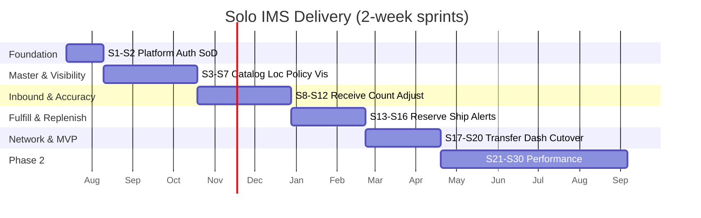

# IMS Sprint Plan — Solo Full-Stack Delivery

| Attribute | Detail |
|-----------|--------|
| **Document ID** | IMPL-SPRINT-001 |
| **Perspective** | Engineering Manager |
| **Date** | July 11, 2026 |
| **Sprint length** | 2 weeks |
| **Team** | **1 developer** — Backend + Frontend + Database + QA |
| **Sources** | Feature Implementation Plans, Dependency Map (IMPL-DEP-001), Feature Catalog, MoSCoW roadmap, Gap Analysis |
| **Status** | Delivery baseline |

---

## 1. Planning Assumptions

| Assumption | Detail |
|------------|--------|
| Capacity | ~8 focused delivery days / sprint (after planning, review, ops) |
| Work style | **Vertical slices** — DB → API → UI → tests for the sprint goal |
| Stack | Java 21 / Spring Boot Modulith · PostgreSQL + Flyway · Angular 19 |
| Existing code | Frontend routes/scaffolds exist; **no real API integration** (~18% readiness) |
| Feature slicing | Large features (F-05, F-08, F-11) span **2 sprints** where noted |
| QA ownership | Same developer writes/runs API tests + critical UI/E2E + AC checklist |
| Priority | **Must Have (MVP)** first; Should/Could in later sprints |

### Capacity reality (1 FTE)

| Feature size | Examples | Typical sprints |
|--------------|----------|-----------------|
| Small | F-06, F-18, F-28 (partial) | 0.5–1 |
| Medium | F-01, F-02, F-04, F-14, F-17, F-20 (alerts) | 1 |
| Large | F-05, F-07, F-08, F-10+F-11, F-21 | 1.5–2 |

**MVP target:** Sprints **1–20** (~10 months) to a production-capable MVP.  
**Phase 2:** Sprints **21–30**.  
**Phase 3 / deferred:** Sprints **31–34**.

> MoSCoW’s 18-sprint MVP assumed a multi-role team. This plan **recalibrates for one developer** without dropping Must-Have scope.

### Global Definition of Done (every sprint)

- [ ] Flyway migrations applied cleanly on empty + existing DB
- [ ] APIs for sprint scope return correct success/error contracts (RFC 7807)
- [ ] Angular screens for sprint scope use real HttpClient (no mock-only for done items)
- [ ] Happy + Validation + Permission ACs sampled from `FAC-*` for included features
- [ ] AuthZ + location scope enforced on new endpoints
- [ ] Movement/audit side-effects verified if mutating stock
- [ ] Demo script runnable for the sprint goal
- [ ] No Sev-1/2 open for sprint scope

---

## 2. Release Roadmap Overview

| Phase | Sprints | Outcome |
|-------|---------|---------|
| **Foundation** | 1–2 | Secure session, RBAC, SoD hooks, HTTP/Flyway platform |
| **Master data & visibility** | 3–7 | Catalog, locations, policies, import seed, ATP visibility |
| **Inbound & accuracy** | 8–12 | Receive → put-away; adjust; cycle/physical/variance |
| **Fulfillment & replenishment** | 13–16 | Reserve → ship; partial; low-stock alerts |
| **Network & MVP close** | 17–20 | Transfers; dashboard; hardening; go-live cutover |
| **Phase 2** | 21–30 | PO module, returns, quarantine, exceptions, requisitions, audit queries |
| **Phase 3** | 31–34 | KPIs, finance recon, rebalance, campaigns |

---

## 3. Sprint Plans

---

### Sprint 1 — Platform & Session Foundation

| Field | Detail |
|-------|--------|
| **1. Sprint goal** | Establish runnable backend + frontend HTTP platform and **sign-in / session** so all later work authenticates against real APIs. |
| **2. Features included** | **F-27** (slice: session login/logout + session API); platform enablers (not a business feature ID) |
| **3. Database work** | Create `identity` schema; `user_accounts` seed admin; Flyway baseline `V1_00` |
| **4. Backend work** | Spring Boot app skeleton / Modulith layout; Security JWT/session; `API-173` session, `API-174` logout; problem-detail error advice; `provide`-ready CORS |
| **5. Frontend work** | `provideHttpClient` + interceptors; environments; wire **UI-001** to real auth; replace demo `sessionStorage`-only auth |
| **6. QA work** | Login/logout API tests; 401 on protected route; FAC-27-H1/E1/E3 smoke |
| **7. Sprint deliverable** | Developer can sign in via UI against backend and reach shell with valid session |
| **8. Definition of Done** | Global DoD + auth interceptor attaches token; guest/auth guards use real session; seed user documented |

---

### Sprint 2 — RBAC, Users & SoD Hooks

| Field | Detail |
|-------|--------|
| **1. Sprint goal** | Complete **access administration** and **SoD/location-scope evaluation** so approvals and scoped data can be enforced. |
| **2. Features included** | **F-27** (complete), **F-28** (SoD + activity logging hooks) |
| **3. Database work** | `role_assignments`, `role_assignment_locations`; `audit.audit_trail_records`; seed roles UR catalog subset |
| **4. Backend work** | `API-140–149`, `API-031` SoD evaluate; permission annotations; activity log aspect on commands |
| **5. Frontend work** | **UI-049**, **UI-050**; permission-aware nav (hide unauthorized); call authorize before approve actions (stub consumers OK) |
| **6. QA work** | FAC-27-P*, FAC-28-H2/E1; user suspend blocks login |
| **7. Sprint deliverable** | Admin can provision a scoped user; SoD evaluate returns pass/fail; actions denied without permission |
| **8. Definition of Done** | Global DoD + at least one deny + one allow path proven end-to-end |

---

### Sprint 3 — Product Catalog

| Field | Detail |
|-------|--------|
| **1. Sprint goal** | Deliver trusted **product master** CRUD, lifecycle, and lookup. |
| **2. Features included** | **F-01** |
| **3. Database work** | `catalog.products`, `catalog.product_identifiers`; unique SKU constraints |
| **4. Backend work** | Product aggregate + `API-001–005`, `007–009`; duplicate detection |
| **5. Frontend work** | **UI-005** list/create/edit/detail (add child routes); remove mock JSON |
| **6. QA work** | FAC-01-H1/H2/V1/V2/P1; API contract tests |
| **7. Sprint deliverable** | Inventory Controller can create/update products and change lifecycle in UI |
| **8. Definition of Done** | Global DoD + discontinued product blocked from eligibility endpoint |

---

### Sprint 4 — Locations & Storage Network

| Field | Detail |
|-------|--------|
| **1. Sprint goal** | Deliver **location network** and storage positions for put-away/fulfillment. |
| **2. Features included** | **F-02** (MVP: create/hierarchy/positions/activate gate; defer full closure US-007 to Phase 2 if needed) |
| **3. Database work** | `network.inventory_locations`, `network.storage_positions` |
| **4. Backend work** | `API-011–021` (activate/freeze/status); hierarchy validation |
| **5. Frontend work** | **UI-007** + detail/storage child routes |
| **6. QA work** | FAC-02-H1/H3/V1/V2/P1 |
| **7. Sprint deliverable** | Ops can create WH + bins; activation blocked without openings (hook ready for F-30) |
| **8. Definition of Done** | Global DoD + cyclic hierarchy rejected |

---

### Sprint 5 — Stock Policies, Reason Codes & Audit Writer

| Field | Detail |
|-------|--------|
| **1. Sprint goal** | Enable **thresholds**, **reason codes**, and **immutable movement/audit write path** before stock mutators. |
| **2. Features included** | **F-03** (MVP: thresholds + reason codes; ABC/full policy UI can be thin), **F-29** (write path only) |
| **3. Database work** | `inventory.stock_policies` (+ history); `governance.reason_codes` (+ policies minimal); `audit.inventory_movement_records` |
| **4. Backend work** | `API-038–040`, `API-022–025`, `API-029–030`; movement append service (no UI query yet) |
| **5. Frontend work** | **UI-008**, **UI-010** (reason codes); policy form wired |
| **6. QA work** | FAC-03-H1/V1/P1; verify movement table append-only grants |
| **7. Sprint deliverable** | Thresholds + reason codes manageable in UI; movement writer callable from domain |
| **8. Definition of Done** | Global DoD + retired reason code not selectable |

---

### Sprint 6 — Import Pipeline & Stock Positions

| Field | Detail |
|-------|--------|
| **1. Sprint goal** | Seed catalog/openings via **import** and establish **stock position** storage for visibility. |
| **2. Features included** | **F-30** (dev/test import pipeline), **F-04** (foundation: stock position model + read APIs start) |
| **3. Database work** | `inventory.stock_positions` (+ lots stub); optional `import_batches` staging |
| **4. Backend work** | `API-010`, `API-032`, `API-017`; `API-033–034` reads |
| **5. Frontend work** | **UI-006** upload/validate/approve wizard (happy path); begin **UI-020** against real APIs |
| **6. QA work** | FAC-30-H1/V1/V3; FAC-04-H1 smoke with seeded data |
| **7. Sprint deliverable** | Dev can import sample catalog + openings and see on-hand via API/UI |
| **8. Definition of Done** | Global DoD + failed import rows reported (no silent orphans) |

---

### Sprint 7 — Inventory Visibility Complete (MVP)

| Field | Detail |
|-------|--------|
| **1. Sprint goal** | Finish **trusted visibility**: ATP, reserved, status, search for authorized locations. |
| **2. Features included** | **F-04** (complete MVP; defer US-028 network/inbound to Phase 2) |
| **3. Database work** | Indexes on `(location_code, sku)`; status derivation support |
| **4. Backend work** | `API-035–037`, `API-151–153` (minimal); ATP = on-hand − reserved − hold |
| **5. Frontend work** | **UI-020**, **UI-021** fully wired; dashboard widgets stubbed with real stock summary if time |
| **6. QA work** | FAC-04-H1–H4, P2/P3 location scope; ATP math unit tests |
| **7. Sprint deliverable** | Users answer “what/where/ATP?” without spreadsheets for seeded data |
| **8. Definition of Done** | Global DoD + scoped user cannot see other locations |

---

### Sprint 8 — Goods Receiving (Core)

| Field | Detail |
|-------|--------|
| **1. Sprint goal** | Receive and verify inbound goods (PO-referenced with seeded/minimal PO stub if F-07 not done). |
| **2. Features included** | **F-05** (slice 1: create/verify receipt, PO validate stub/seed) |
| **3. Database work** | `inbound.goods_receipts`, `goods_receipt_lines`; optional minimal `procurement.purchase_orders` seed table |
| **4. Backend work** | `API-065–069`; stock increase on verify per policy (or staged until put-away — document choice); movement write |
| **5. Frontend work** | **UI-015** workbench (create/verify) |
| **6. QA work** | FAC-05-H1/V1/V2/P1; freeze block if location frozen (stub) |
| **7. Sprint deliverable** | Receiving Clerk verifies a receipt against a seeded PO in UI |
| **8. Definition of Done** | Global DoD + movement record created; location scope enforced |

---

### Sprint 9 — Discrepancies, Non-PO Intake & Put-Away

| Field | Detail |
|-------|--------|
| **1. Sprint goal** | Complete inbound path: **discrepancies**, **non-PO intake**, and **put-away → available ATP**. |
| **2. Features included** | **F-05** (slice 2), **F-06** |
| **3. Database work** | `receipt_discrepancies`, `put_aways`; ad-hoc receipt support |
| **4. Backend work** | `API-070–076`, `API-073–074`; ATP sellable only after put-away (align with domain) |
| **5. Frontend work** | **UI-016**, **UI-017**, **UI-018**; **UI-022** movement history read (`API-155`) |
| **6. QA work** | FAC-05-H2/H4, FAC-06-H1/H2/X1; put-away before ATP |
| **7. Sprint deliverable** | End-to-end: receive → discrepancy optional → put-away → ATP visible |
| **8. Definition of Done** | Global DoD + FAC-06-X1 proven (not put away ⇒ not sellable) |

---

### Sprint 10 — Adjustments, Write-Offs & Approval Alerts

| Field | Detail |
|-------|--------|
| **1. Sprint goal** | Enable **reason-coded adjustments/write-offs** with SoD approval and basic **approval notifications**. |
| **2. Features included** | **F-17**, **F-26** (slice: approval alerts), **F-29** (movement query UI if not done) |
| **3. Database work** | `accuracy.stock_adjustments`, `inventory_write_offs`; `audit.operational_alerts` |
| **4. Backend work** | `API-116/117/120–122`; `API-158–159` ack; SoD on approve |
| **5. Frontend work** | **UI-026**, **UI-027**; **UI-004** basic list/ack; header badge count |
| **6. QA work** | FAC-17-H2/V1/E1/P2; FAC-26-H2/H3; self-approve blocked |
| **7. Sprint deliverable** | Adjustment submitted → other user notified → approve → stock + movement updated |
| **8. Definition of Done** | Global DoD + SoD test case automated |

---

### Sprint 11 — Cycle Counting

| Field | Detail |
|-------|--------|
| **1. Sprint goal** | Deliver **blind cycle count** schedule/assign/submit. |
| **2. Features included** | **F-14** |
| **3. Database work** | `accuracy.cycle_counts` |
| **4. Backend work** | `API-108–111`; blind count rules (no system qty to counter) |
| **5. Frontend work** | **UI-023** assignment + blind entry |
| **6. QA work** | FAC-14-H1/H2/V3/P1 |
| **7. Sprint deliverable** | Counter submits blind count; mismatch ready for variance sprint |
| **8. Definition of Done** | Global DoD + UI never shows system qty to counter role |

---

### Sprint 12 — Physical Count, Variance & Approval

| Field | Detail |
|-------|--------|
| **1. Sprint goal** | Close accuracy loop: **physical count + freeze**, **variance investigation/approval**. |
| **2. Features included** | **F-15**, **F-16** |
| **3. Database work** | `physical_inventory_counts`, `count_variances`; location freeze flag |
| **4. Backend work** | `API-020`, `API-112–115`, `API-116–119`, `API-123`; block mutators when frozen |
| **5. Frontend work** | **UI-024**, **UI-025** |
| **6. QA work** | FAC-15-H1/E1, FAC-16-H2/E1/P3; receive blocked while frozen |
| **7. Sprint deliverable** | Count → variance → independent approve → stock corrected |
| **8. Definition of Done** | Global DoD + freeze blocks F-05/F-08/F-11 entry points |

---

### Sprint 13 — Order Availability & Reservation

| Field | Detail |
|-------|--------|
| **1. Sprint goal** | Confirm ATP and **reserve** inventory for orders without overselling. |
| **2. Features included** | **F-10** (MVP; defer multi-location US-048) |
| **3. Database work** | `fulfillment.customer_orders`, `order_lines`, `inventory_reservations` |
| **4. Backend work** | `API-081`, `084–086`, `API-043–044`; optimistic locking on stock |
| **5. Frontend work** | **UI-030**; reuse **UI-021** |
| **6. QA work** | FAC-10-H1–H3, V3, E1 concurrency |
| **7. Sprint deliverable** | Confirm order reduces ATP; cancel restores ATP |
| **8. Definition of Done** | Global DoD + concurrent reservation test passes |

---

### Sprint 14 — Pick, Pack & Ship

| Field | Detail |
|-------|--------|
| **1. Sprint goal** | Execute **pick → pack → ship** and deduct on-hand at shipment. |
| **2. Features included** | **F-11** |
| **3. Database work** | `fulfillment_executions`, `pick_lines`, `shipments`, `shipment_lines` |
| **4. Backend work** | `API-088–092`, `082–083`, `097`; document C-01 workaround (list by order) |
| **5. Frontend work** | **UI-031**, **UI-034** |
| **6. QA work** | FAC-11-H1–H3, V3; on-hand decreases only on ship |
| **7. Sprint deliverable** | Golden path: reserve → pick → pack → ship → balances correct |
| **8. Definition of Done** | Global DoD + status visible to CSR role |

---

### Sprint 15 — Partial Ship & Low-Stock Alerts

| Field | Detail |
|-------|--------|
| **1. Sprint goal** | Support **partial fulfillment** and **threshold low-stock alerts** with acknowledgment. |
| **2. Features included** | **F-12** (partial ship MVP; defer backorder priority), **F-20** (alerts + suggestions; defer requisitions), **F-26** (stock alerts) |
| **3. Database work** | `fulfillment.backorders` (basic); alert generation on threshold breach |
| **4. Backend work** | `API-093–094` (basic), `API-037`/`158–160` recommendations minimal |
| **5. Frontend work** | **UI-032** partial+ack; **UI-036** alert review |
| **6. QA work** | FAC-12-H1/V1; FAC-20-H1/H2/H3 |
| **7. Sprint deliverable** | Short-ship with ack creates backorder record; low stock creates alert |
| **8. Definition of Done** | Global DoD + transfer-before-buy suggestion shown when surplus exists (even if transfer UI next sprint) |

---

### Sprint 16 — Inter-Location Transfers (Request → Execute)

| Field | Detail |
|-------|--------|
| **1. Sprint goal** | Deliver MVP **transfer request → approve → dispatch → receive** with source minimum protection. |
| **2. Features included** | **F-08** (MVP; defer in-transit polish US-061 to Phase 2 if needed) |
| **3. Database work** | `transfer.transfer_requests*`, `stock_transfers*`, `in_transit_stock` |
| **4. Backend work** | `API-098–105`, `API-042`, `API-106`; SoD on approve |
| **5. Frontend work** | **UI-038**, **UI-039**, **UI-040** |
| **6. QA work** | FAC-08-H1–H3/V2/E2/P2 |
| **7. Sprint deliverable** | Store requests transfer; OD approves; WH executes; both balances correct |
| **8. Definition of Done** | Global DoD + source minimum blocks over-transfer |

---

### Sprint 17 — Operational Dashboard & Reporting (MVP)

| Field | Detail |
|-------|--------|
| **1. Sprint goal** | Replace mock dashboard with **live operational reporting**. |
| **2. Features included** | **F-22** (MVP reports; defer location performance US-072) |
| **3. Database work** | Read views/indexes for movements and stock status as needed |
| **4. Backend work** | `API-150–152`, `API-155`, accuracy summary if available |
| **5. Frontend work** | **UI-002**, **UI-044** wired; drill-downs to existing screens |
| **6. QA work** | FAC-22-H1–H4, P2 |
| **7. Sprint deliverable** | Ops landing page shows live KPIs/alerts/stock health |
| **8. Definition of Done** | Global DoD + no mock-only widgets for done cards |

---

### Sprint 18 — Audit Query Hardening & Notification Polish

| Field | Detail |
|-------|--------|
| **1. Sprint goal** | Make **audit trail queryable** for MVP accountability and harden notifications. |
| **2. Features included** | **F-29** (query UI MVP), **F-26** (polish) |
| **3. Database work** | Indexes on audit/movement; revoke UPDATE/DELETE on audit tables |
| **4. Backend work** | `API-156` (export optional), movement filters complete |
| **5. Frontend work** | **UI-048**, **UI-022** complete; **UI-004** categories |
| **6. QA work** | FAC-29-H1/E1/P1; FAC-26-P1 role filtering |
| **7. Sprint deliverable** | Auditor can search immutable trail for a SKU/date; alerts role-filtered |
| **8. Definition of Done** | Global DoD + attempt to mutate audit fails |

---

### Sprint 19 — MVP Hardening & E2E Golden Paths

| Field | Detail |
|-------|--------|
| **1. Sprint goal** | Stabilize MVP: regression, performance smoke, defect burn-down — **no new features**. |
| **2. Features included** | Cross-cutting across F-01–F-08, F-10–F-12, F-14–F-17, F-20, F-22, F-26–F-30 (MVP slices) |
| **3. Database work** | Migration repair; seed scripts for UAT; backup/restore dry-run |
| **4. Backend work** | Bug fixes; idempotency; locking hotspots; OpenAPI sync |
| **5. Frontend work** | UX defect fixes; loading/error states; remove remaining mocks on MVP screens |
| **6. QA work** | Full golden paths: Import→Receive→PutAway→Reserve→Ship; Count→Adjust; Transfer; Alert |
| **7. Sprint deliverable** | UAT pack executed; known-issue list with severities; go-live checklist |
| **8. Definition of Done** | All MVP golden paths pass; zero Sev-1; Sev-2 have workarounds approved by PO |

---

### Sprint 20 — Production Go-Live Cutover (MVP Release)

| Field | Detail |
|-------|--------|
| **1. Sprint goal** | **Production data load** and activate primary location(s) for MVP go-live. |
| **2. Features included** | **F-30** (production cutover), release of MVP feature set |
| **3. Database work** | Production migrations; opening balance load; dual-control approve |
| **4. Backend work** | Cutover support; feature flags for Phase-2-only endpoints off |
| **5. Frontend work** | **UI-006** production runbook UX; disable incomplete Phase 2 nav |
| **6. QA work** | FAC-30-H2/H3/P3; post-cutover smoke on WH-01 |
| **7. Sprint deliverable** | **MVP Release**: primary site live with trusted openings + core ops |
| **8. Definition of Done** | Global DoD + go-live sign-off (PO + EM); rollback plan tested |

---

## 4. Phase 2 Sprint Plans (Should Have)

---

### Sprint 21 — Suppliers & Purchase Orders

| Field | Detail |
|-------|--------|
| **1. Sprint goal** | Replace PO stubs with full **supplier + PO** lifecycle. |
| **2. Features included** | **F-07** (slice 1: suppliers + PO CRUD/cancel) |
| **3. Database work** | Full `procurement.suppliers`, `purchase_orders*` |
| **4. Backend work** | `API-049–053`, `059–063` |
| **5. Frontend work** | **UI-011**, **UI-012** |
| **6. QA work** | FAC-07-H1/H3/V1/V2 |
| **7. Sprint deliverable** | Buyer creates/amends/cancels real POs used by receiving |
| **8. Definition of Done** | Global DoD + discontinued SKU blocked on PO lines |

---

### Sprint 22 — Inbound Planning, Tracking & Delay Alerts

| Field | Detail |
|-------|--------|
| **1. Sprint goal** | Deliver inbound **ETA planning/tracking** and delay notifications. |
| **2. Features included** | **F-07** (slice 2), **F-26** (inbound delay), **F-04** (inbound projection soft) |
| **3. Database work** | `expected_inbound_deliveries*` |
| **4. Backend work** | `API-064`, `161–163` |
| **5. Frontend work** | **UI-014**, **UI-019** |
| **6. QA work** | FAC-07-H2/H4/H5 |
| **7. Sprint deliverable** | Inbound calendar + delay alerts for purchasing/WH |
| **8. Definition of Done** | Global DoD + receiving uses live validate-for-receipt |

---

### Sprint 23 — Requisitions & Replenishment Loop

| Field | Detail |
|-------|--------|
| **1. Sprint goal** | Close replenishment: **recommendations → requisition → PO**. |
| **2. Features included** | **F-20** (requisitions), resolve **API gap C-03** list endpoint |
| **3. Database work** | `purchase_requisitions*` |
| **4. Backend work** | `API-054–058` + requisition list; BR-011 network check |
| **5. Frontend work** | **UI-037**, **UI-013** |
| **6. QA work** | FAC-20-H4/V3/P2 |
| **7. Sprint deliverable** | Alert → recommend transfer or requisition → convert to PO |
| **8. Definition of Done** | Global DoD + C-03 closed |

---

### Sprint 24 — Quarantine & Fulfillment Exceptions

| Field | Detail |
|-------|--------|
| **1. Sprint goal** | Isolate non-sellable stock and handle **outbound exceptions**. |
| **2. Features included** | **F-18**, **F-13** (MVP exceptions; defer substitution) |
| **3. Database work** | Ensure `quarantine_holds`; exception persistence |
| **4. Backend work** | `API-045–046`, `096`, `165`, `154` |
| **5. Frontend work** | **UI-028**, **UI-033** |
| **6. QA work** | FAC-18-H1/H2, FAC-13-H1/H2 |
| **7. Sprint deliverable** | Damage/pick-fail → quarantine/exception → inventory corrected |
| **8. Definition of Done** | Global DoD + ATP excludes holds |

---

### Sprint 25 — Backorders, Split Fulfillment & Transfer In-Transit

| Field | Detail |
|-------|--------|
| **1. Sprint goal** | Mature fulfillment/network: **backorder priority**, **multi-location plan**, **in-transit monitor**. |
| **2. Features included** | **F-12** (priority), **F-10** (US-048), **F-08** (US-061) |
| **3. Database work** | Backorder priority fields; in-transit query indexes |
| **4. Backend work** | `API-095`, `087`, `107`, `164` |
| **5. Frontend work** | **UI-032** priority, **UI-035**, **UI-040** in-transit |
| **6. QA work** | FAC-12-H2/X1, FAC-10-H4, FAC-08-H4 |
| **7. Sprint deliverable** | Network can split-fulfill and track transfers in transit |
| **8. Definition of Done** | Global DoD + priority queue ordering proven |

---

### Sprint 26–27 — Returns Management

| Field | Detail |
|-------|--------|
| **1. Sprint goal** | Full **RA → receive → inspect → disposition** (two sprints for size). |
| **2. Features included** | **F-21** (S26: RA + receive; S27: inspect + disposition); close **C-04** |
| **3. Database work** | `returns.*` schemas |
| **4. Backend work** | `API-124–131` |
| **5. Frontend work** | **UI-042**, **UI-043** |
| **6. QA work** | FAC-21-H1–H5, V2, P1 |
| **7. Sprint deliverable** | End-to-end customer return without contaminating sellable stock |
| **8. Definition of Done** | Global DoD + RESTOCK only when inspection OK |

---

### Sprint 28 — ABC, Governance Policies & Safety Stock Rules

| Field | Detail |
|-------|--------|
| **1. Sprint goal** | Complete **F-03** Phase 2: ABC, governance policy versions, safety stock protection. |
| **2. Features included** | **F-03** (remaining), **F-20** threshold interactions |
| **3. Database work** | Policy versioning; ABC on products |
| **4. Backend work** | `API-006`, `026–028`, safety checks on reserve/transfer |
| **5. Frontend work** | **UI-009**, complete **UI-010** |
| **6. QA work** | FAC-03-H3–H5 |
| **7. Sprint deliverable** | ABC drives count priority; safety stock protected |
| **8. Definition of Done** | Global DoD + BR-010 exception path audited |

---

### Sprint 29 — Audit Workspace, Breach Detection & Shrinkage

| Field | Detail |
|-------|--------|
| **1. Sprint goal** | Auditor workspace + **shrinkage analysis**. |
| **2. Features included** | **F-29** (US-087/088), **F-19** (shrinkage; obsolescence optional thin) |
| **3. Database work** | Breach records; reporting views |
| **4. Backend work** | `API-156–157`, `167` |
| **5. Frontend work** | **UI-047**, **UI-029** |
| **6. QA work** | FAC-29-H2/H3, FAC-19-H1 |
| **7. Sprint deliverable** | Auditors run scoped reviews; loss trends visible |
| **8. Definition of Done** | Global DoD + export permission gated |

---

### Sprint 30 — Phase 2 Hardening

| Field | Detail |
|-------|--------|
| **1. Sprint goal** | Stabilize Phase 2; regression; PO sign-off for Phase 2 release. |
| **2. Features included** | Hardening for F-07, F-13, F-18, F-20, F-21, F-03 extensions |
| **3. Database work** | Perf indexes; data cleanup scripts |
| **4. Backend work** | Defect burn-down; C-01 location pick queue if not done |
| **5. Frontend work** | Nav role filtering complete; Phase 3 items hidden |
| **6. QA work** | Phase 2 golden paths + permission matrix spot checks |
| **7. Sprint deliverable** | **Phase 2 Release** candidate |
| **8. Definition of Done** | Zero Sev-1; PO accepts Phase 2 scope |

---

## 5. Phase 3 Sprint Plans (Could / Deferred)

---

### Sprint 31 — Executive KPIs

| Field | Detail |
|-------|--------|
| **1. Sprint goal** | Deliver **executive KPI dashboard**. |
| **2. Features included** | **F-23** |
| **3. Database work** | KPI snapshot tables/views |
| **4. Backend work** | `API-170` |
| **5. Frontend work** | **UI-003** |
| **6. QA work** | FAC-23-H1/P1 |
| **7. Sprint deliverable** | Executives see fill rate/turnover/DOS/accuracy vs targets |
| **8. Definition of Done** | Global DoD + KPI_VIEW_EXEC enforced |

---

### Sprint 32 — Financial Reconciliation

| Field | Detail |
|-------|--------|
| **1. Sprint goal** | Three-way match + valuation reconciliation support. |
| **2. Features included** | **F-24** |
| **3. Database work** | `finance.*`, valuation snapshots |
| **4. Backend work** | `API-077–080`, `171–172`, `047` |
| **5. Frontend work** | **UI-045** |
| **6. QA work** | FAC-24-H1–H4 |
| **7. Sprint deliverable** | Finance can match PO/GR/invoice and snapshot valuation |
| **8. Definition of Done** | Global DoD + payment auth blocked before match |

---

### Sprint 33 — Network Rebalancing

| Field | Detail |
|-------|--------|
| **1. Sprint goal** | Recommend network redistribution (deferred MoSCoW Won’t/Could). |
| **2. Features included** | **F-09** |
| **3. Database work** | Optional recommendation cache |
| **4. Backend work** | `API-166`, `160` |
| **5. Frontend work** | **UI-041** |
| **6. QA work** | FAC-09-H1/H2/V2 |
| **7. Sprint deliverable** | Recommendations convert to transfer requests |
| **8. Definition of Done** | Global DoD + source minimum respected |

---

### Sprint 34 — Promotional Readiness & Campaign Alerts

| Field | Detail |
|-------|--------|
| **1. Sprint goal** | Campaign ring-fence and readiness (deferred). |
| **2. Features included** | **F-25**, **F-26** (campaign alerts) |
| **3. Database work** | `commercial.*` |
| **4. Backend work** | `API-132–139`, `048`, `169`, `178` |
| **5. Frontend work** | **UI-046** |
| **6. QA work** | FAC-25-H1–H4 |
| **7. Sprint deliverable** | Marketing readiness go/no-go with ring-fenced ATP |
| **8. Definition of Done** | Global DoD + normal orders cannot consume ring-fence |

---

## 6. Feature → Sprint Traceability (summary)

| Feature | MVP sprints | Later sprints |
|---------|-------------|---------------|
| F-27 | 1–2 | — |
| F-28 | 2 | — |
| F-01 | 3 | — |
| F-02 | 4 | Closure polish in Phase 2 if deferred |
| F-03 | 5 (core) | 28 (ABC/governance/safety) |
| F-30 | 6 (pipeline), 20 (cutover) | — |
| F-29 | 5 (write), 18 (query) | 29 (workspace/breach) |
| F-04 | 6–7 | 22 (inbound views) |
| F-05 | 8–9 | — |
| F-06 | 9 | — |
| F-17 | 10 | — |
| F-26 | 10, 15, 18 | 22, 34 |
| F-14 | 11 | — |
| F-15 / F-16 | 12 | — |
| F-10 | 13 | 25 (split) |
| F-11 | 14 | C-01 in 30 |
| F-12 | 15 (partial) | 25 (priority) |
| F-20 | 15 (alerts) | 23 (requisitions) |
| F-08 | 16 | 25 (in-transit) |
| F-22 | 17 | — |
| F-07 | — | 21–22 |
| F-18 / F-13 | — | 24 |
| F-21 | — | 26–27 |
| F-19 | — | 29 |
| F-23 | — | 31 |
| F-24 | — | 32 |
| F-09 | — | 33 |
| F-25 | — | 34 |

---

## 7. Risk Register (solo delivery)

| Risk | Impact | Mitigation |
|------|--------|------------|
| Single-person bottleneck | Schedule slip | Strict MVP slicing; defer Should/Could; no scope creep in S1–20 |
| Large features overrun | Cascade delay | Hard timebox; carry only unfinished AC with EM note |
| QA depth thin | Production defects | Automate API tests every sprint; golden-path E2E from S14 onward |
| Backend+frontend context switch | Lower velocity | Morning BE/DB, afternoon FE, end-day QA checklist |
| API gaps C-01/C-03/C-04 | Blocked UI | Schedule gap closure in S23/S26/S30 explicitly |
| Burnout | Attrition | Sustainable WIP=1 feature focus; Sprint 19/30 hardening buffers |

---

## 8. Cadence & Ceremonies (1-person adapted)

| Event | When | Purpose |
|-------|------|---------|
| Sprint planning | Day 1 (2h) | Confirm goal, AC subset, demo script |
| Mid-sprint check | Day 6 (30m) | Scope cut if behind (EM/PO) |
| Sprint review/demo | Day 10 (1h) | Demo deliverable against sprint goal |
| Retro | Day 10 (30m) | Adjust next sprint capacity |
| UAT with PO | End of S19, S20, S30 | Sign-off gates |

---

## 9. Success Metrics

| Milestone | Target |
|-----------|--------|
| End Sprint 7 | Visibility demo on real data |
| End Sprint 14 | Reserve→Ship golden path |
| End Sprint 20 | **MVP production go-live** |
| End Sprint 30 | **Phase 2 release** |
| End Sprint 34 | Phase 3 backlog cleared or explicitly waived |

---

## 10. Related Documents

| Document | Path |
|----------|------|
| Features | `implmention/IMS-Implementation-Features.md` |
| Dependencies | `implmention/IMS-Feature-Dependency-Map.md` |
| Tech plans | `implmention/plans/` |
| Feature AC | `implmention/acceptance-criteria/` |
| MoSCoW | `project_businsse/moscow-epic-story-prioritization.md` |

---

*Engineering Manager — Solo full-stack sprint plan for IMS*
