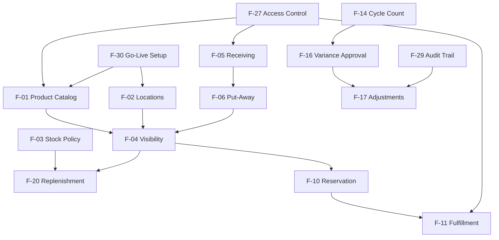

# Feature Catalog: Inventory Management System

**Document Owner:** Product Owner  
**Purpose:** Organize functional requirements into logical, deliverable business features for planning, prioritization, and stakeholder communication  
**Audience:** Product owners, business stakeholders, delivery teams, and QA  
**Scope:** Business features and capabilities only — no implementation or technical design  
**Based On:** Functional Requirements Document (FR-001 – FR-090), Business Actor Analysis, Project Scope, and Business Vision

---

## How to Read This Catalog

Each **feature** is a cohesive business capability that delivers value to one or more user groups. Features group related functional requirements (FR-xxx) that should be planned, tested, and released together where possible.

**Business priority** reflects delivery importance aligned with the phased product roadmap:

| Priority | Meaning | Typical Phase |
|----------|---------|---------------|
| **Critical (P1)** | Must-have for MVP; initiative fails without it | Phase 1 — Stabilize & Centralize |
| **High (P2)** | Essential for operational performance after MVP adoption | Phase 2 — Improve Performance |
| **Medium (P3)** | Important for strategic maturity, analytics, and financial alignment | Phase 3 — Enable Smarter Decisions |

**Primary actors** are the business roles that most directly initiate, consume, or approve the feature. Actor IDs reference the Business Actor Analysis (A-01 through A-25).

---

## Feature Catalog Summary

| # | Feature | Priority | Requirements | Phase |
|---|---------|----------|--------------|-------|
| F-01 | Product Catalog Management | Critical (P1) | 4 | MVP |
| F-02 | Location & Network Setup | Critical (P1) | 4 | MVP |
| F-03 | Stock Policy & Product Classification | Critical (P1) | 4 | MVP / Phase 2 |
| F-04 | Inventory Visibility & Search | Critical (P1) | 6 | MVP / Phase 2 |
| F-05 | Goods Receiving & Verification | Critical (P1) | 6 | MVP |
| F-06 | Put-Away Management | Critical (P1) | 1 | MVP |
| F-07 | Purchase Order & Inbound Supply Management | High (P2) | 6 | Phase 2 |
| F-08 | Inter-Location Stock Transfers | Critical (P1) | 5 | MVP / Phase 2 |
| F-09 | Network Stock Rebalancing | Medium (P3) | 1 | Phase 3 |
| F-10 | Order Availability & Reservation | Critical (P1) | 4 | MVP |
| F-11 | Pick, Pack & Ship Fulfillment | Critical (P1) | 2 | MVP |
| F-12 | Partial Fulfillment & Backorder Management | Critical (P1) | 2 | MVP / Phase 2 |
| F-13 | Fulfillment Exception Handling | High (P2) | 3 | Phase 2 / Phase 3 |
| F-14 | Cycle Counting | Critical (P1) | 3 | MVP |
| F-15 | Full Physical Inventory Count | Critical (P1) | 1 | MVP |
| F-16 | Count Variance Investigation & Approval | Critical (P1) | 3 | MVP |
| F-17 | Stock Adjustments & Write-Offs | Critical (P1) | 4 | MVP |
| F-18 | Quarantine & Hold Stock Management | High (P2) | 1 | Phase 2 |
| F-19 | Shrinkage & Obsolescence Analysis | High (P2) | 2 | Phase 2 / Phase 3 |
| F-20 | Low-Stock Alerting & Replenishment | Critical (P1) | 5 | MVP / Phase 2 |
| F-21 | Returns Management | High (P2) | 4 | Phase 2 |
| F-22 | Inventory Reporting & Dashboards | Critical (P1) | 5 | MVP / Phase 2 |
| F-23 | Inventory Performance KPIs | Medium (P3) | 1 | Phase 3 |
| F-24 | Financial Inventory Reconciliation | Medium (P3) | 2 | Phase 3 |
| F-25 | Promotional & Launch Stock Readiness | Medium (P3) | 1 | Phase 3 |
| F-26 | Operational Notifications & Alerts | Critical (P1) | 5 | MVP / Phase 2 / Phase 3 |
| F-27 | User Access & Role Management | Critical (P1) | 3 | MVP |
| F-28 | Operational Accountability & Controls | Critical (P1) | 2 | MVP |
| F-29 | Audit Trail & Compliance | Critical (P1) | 3 | MVP / Phase 2 |
| F-30 | System Go-Live & Initial Data Setup | Critical (P1) | 1 | MVP |
| **Total** | **30 Features** | | **90 FRs** | |

---

## F-01: Product Catalog Management

| Attribute | Detail |
|-----------|--------|
| **Business Purpose** | Establish and maintain a single, trusted product catalog so every location and department references the same product identity, attributes, and lifecycle status — eliminating duplicate records and ordering errors. |
| **Included Functional Requirements** | FR-001, FR-002, FR-003, FR-004 |
| **Primary Actors** | Inventory Controller (A-05), Purchasing Manager (A-15), Operations Director (A-04), Warehouse Manager (A-06), Receiving Clerk (A-07), Warehouse Picker / Packer (A-08) |
| **Business Priority** | **Critical (P1)** |

**Capabilities covered:** Create and maintain product master records; manage active/inactive/discontinued status; operational product lookup by SKU or barcode; duplicate product detection and resolution.

---

## F-02: Location & Network Setup

| Attribute | Detail |
|-----------|--------|
| **Business Purpose** | Define and maintain the organization's inventory location network so stock can be assigned, tracked, and reported at the correct warehouses, stores, and distribution points with clear accountability. |
| **Included Functional Requirements** | FR-005, FR-006, FR-007, FR-010 |
| **Primary Actors** | COO (A-02), Operations Director (A-04), Warehouse Manager (A-06), Regional / Store Manager (A-10), Finance Manager (A-17), Inventory Controller (A-05) |
| **Business Priority** | **Critical (P1)** |

**Capabilities covered:** Configure inventory locations; manage location hierarchy; establish verified opening stock balances at go-live; plan stock disposition for location closure or consolidation.

---

## F-03: Stock Policy & Product Classification

| Attribute | Detail |
|-----------|--------|
| **Business Purpose** | Define replenishment thresholds, safety stock rules, and product priority classification so the business can proactively manage stock levels and direct operational effort toward high-impact items. |
| **Included Functional Requirements** | FR-008, FR-009, FR-012, FR-056 |
| **Primary Actors** | Inventory Controller (A-05), Purchasing Manager (A-15), Operations Director (A-04), Sales Manager (A-11) |
| **Business Priority** | **Critical (P1)** — threshold definition is MVP; ABC classification and governance policies are **High (P2)** extensions |

**Capabilities covered:** Define reorder levels and minimum thresholds; ABC product classification; inventory governance policy reference; safety stock protection rules.

---

## F-04: Inventory Visibility & Search

| Attribute | Detail |
|-----------|--------|
| **Business Purpose** | Provide a trusted, real-time view of inventory across the network — answering what stock exists, where it is, what is reserved, and what is available to promise — without manual spreadsheets or warehouse calls. |
| **Included Functional Requirements** | FR-023, FR-024, FR-025, FR-026, FR-027, FR-028 |
| **Primary Actors** | Operations Director (A-04), Inventory Controller (A-05), Warehouse Manager (A-06), Sales Representative (A-12), Customer Service Representative (A-13), Purchasing Manager (A-15), Regional / Store Manager (A-10) |
| **Business Priority** | **Critical (P1)** — core visibility is MVP; network-wide and inbound projection views are **High (P2)** |

**Capabilities covered:** On-hand quantity by product and location; available-to-promise calculation; reserved and committed stock display; stock status indicators; multi-criteria search and filter; expected inbound and network-wide availability.

---

## F-05: Goods Receiving & Verification

| Attribute | Detail |
|-----------|--------|
| **Business Purpose** | Accept inbound shipments with verified quantity, product identity, and condition — ensuring inventory records reflect physical reality from the point of entry and protecting supplier accountability. |
| **Included Functional Requirements** | FR-015, FR-016, FR-017, FR-019, FR-020, FR-029 |
| **Primary Actors** | Receiving Clerk (A-07), Warehouse Manager (A-06), Purchasing Manager (A-15), Buyer (A-16), Supplier (A-20) |
| **Business Priority** | **Critical (P1)** — receipt tolerance evaluation is **High (P2)** |

**Capabilities covered:** Receive and verify inbound goods against purchase orders; document and resolve receipt discrepancies; enforce PO reference with authorized ad-hoc exceptions; receive return and non-PO inbound stock; receipt quantity tolerance evaluation; full movement transaction history.

---

## F-06: Put-Away Management

| Attribute | Detail |
|-----------|--------|
| **Business Purpose** | Distinguish received stock from operationally available stock by confirming put-away completion — ensuring pickers can locate goods and availability promises reflect locatable inventory. |
| **Included Functional Requirements** | FR-018 |
| **Primary Actors** | Warehouse Staff (A-09), Warehouse Manager (A-06), Receiving Clerk (A-07) |
| **Business Priority** | **Critical (P1)** |

**Capabilities covered:** Track received vs. available stock states; confirm put-away before updating sellable availability.

---

## F-07: Purchase Order & Inbound Supply Management

| Attribute | Detail |
|-----------|--------|
| **Business Purpose** | Manage the inbound supply pipeline from purchase commitment through expected delivery — giving operations, sales, and purchasing visibility into when low-stock conditions will be resolved. |
| **Included Functional Requirements** | FR-013, FR-014, FR-021, FR-022, FR-055, FR-079 |
| **Primary Actors** | Purchasing Manager (A-15), Buyer (A-16), Warehouse Manager (A-06), Operations Director (A-04), Customer Service Representative (A-13) |
| **Business Priority** | **High (P2)** — supplier performance insights are **Medium (P3)** |

**Capabilities covered:** Record purchase order commitments; plan and communicate expected inbound deliveries; cancel or amend open purchase orders; track inbound supply status; supplier delivery performance recording; inbound delay notifications.

---

## F-08: Inter-Location Stock Transfers

| Attribute | Detail |
|-----------|--------|
| **Business Purpose** | Move stock between locations to resolve local stockouts and imbalances using existing network inventory — without waiting for supplier replenishment — while protecting source location service levels. |
| **Included Functional Requirements** | FR-058, FR-059, FR-060, FR-061, FR-063 |
| **Primary Actors** | Regional / Store Manager (A-10), Operations Director (A-04), Warehouse Manager (A-06), Inventory Controller (A-05), Logistics / Carrier Partner (A-21) |
| **Business Priority** | **Critical (P1)** — request, approval, and execution are MVP; in-transit monitoring is **High (P2)** |

**Capabilities covered:** Initiate transfer requests; approve or reject transfers; execute dispatch and receipt with balanced location updates; monitor in-transit inventory; enforce source location minimum thresholds.

---

## F-09: Network Stock Rebalancing

| Attribute | Detail |
|-----------|--------|
| **Business Purpose** | Proactively analyze stock distribution across the location network and recommend redistribution to reduce enterprise-wide overstock and stockout conditions. |
| **Included Functional Requirements** | FR-062 |
| **Primary Actors** | Operations Director (A-04), COO (A-02), Inventory Controller (A-05), Regional / Store Manager (A-10), Purchasing Manager (A-15) |
| **Business Priority** | **Medium (P3)** |

**Capabilities covered:** Network-wide imbalance analysis; rebalancing recommendations convertible to transfer requests.

---

## F-10: Order Availability & Reservation

| Attribute | Detail |
|-----------|--------|
| **Business Purpose** | Verify stock availability before customer commitments and reserve inventory against confirmed orders — preventing overselling and double-allocation of the same physical stock. |
| **Included Functional Requirements** | FR-041, FR-042, FR-043, FR-048 |
| **Primary Actors** | Sales Representative (A-12), Customer Service Representative (A-13), Operations Director (A-04), Warehouse Manager (A-06), Sales Manager (A-11) |
| **Business Priority** | **Critical (P1)** — multi-location split fulfillment is **High (P2)** |

**Capabilities covered:** Confirm order availability before commitment; reserve inventory for confirmed orders; release reservations on cancellation or fulfillment; multi-location split fulfillment allocation.

---

## F-11: Pick, Pack & Ship Fulfillment

| Attribute | Detail |
|-----------|--------|
| **Business Purpose** | Execute the physical fulfillment cycle from pick list through shipment confirmation — deducting inventory only when goods are verified, packed, and dispatched. |
| **Included Functional Requirements** | FR-044, FR-049 |
| **Primary Actors** | Warehouse Picker / Packer (A-08), Warehouse Manager (A-06), Customer Service Representative (A-13), Logistics / Carrier Partner (A-21) |
| **Business Priority** | **Critical (P1)** |

**Capabilities covered:** Pick, pack, and ship workflow with pick verification; order fulfillment status visibility.

---

## F-12: Partial Fulfillment & Backorder Management

| Attribute | Detail |
|-----------|--------|
| **Business Purpose** | Handle situations where full order quantity cannot be fulfilled immediately — shipping available items, managing backorders with customer acknowledgment, and prioritizing fulfillment when stock arrives. |
| **Included Functional Requirements** | FR-045, FR-046 |
| **Primary Actors** | Warehouse Manager (A-06), Customer Service Representative (A-13), Sales Manager (A-11), Operations Director (A-04), Purchasing Manager (A-15) |
| **Business Priority** | **Critical (P1)** — partial fulfillment is MVP; backorder priority queue is **High (P2)** |

**Capabilities covered:** Partial shipment processing; backorder creation with customer acknowledgment; backorder priority sequencing and auto-reservation when stock available.

---

## F-13: Fulfillment Exception Handling

| Attribute | Detail |
|-----------|--------|
| **Business Purpose** | Resolve fulfillment disruptions such as pick failures, damaged items, order cancellations, and product unavailability — minimizing customer impact and correcting inventory records. |
| **Included Functional Requirements** | FR-047, FR-050, FR-078 |
| **Primary Actors** | Warehouse Picker / Packer (A-08), Warehouse Manager (A-06), Customer Service Representative (A-13), Inventory Controller (A-05), Sales Manager (A-11) |
| **Business Priority** | **High (P2)** — authorized product substitution is **Medium (P3)** |

**Capabilities covered:** Pick failure and damage exception resolution; fulfillment exception alerts; authorized product substitution with approval.

---

## F-14: Cycle Counting

| Attribute | Detail |
|-----------|--------|
| **Business Purpose** | Verify physical stock against recorded balances on a rotating schedule to detect discrepancies early, sustain inventory accuracy, and reduce reliance on disruptive full-wall counts. |
| **Included Functional Requirements** | FR-030, FR-031, FR-071 |
| **Primary Actors** | Inventory Controller (A-05), Warehouse Staff (A-09), Warehouse Manager (A-06), Operations Director (A-04) |
| **Business Priority** | **Critical (P1)** |

**Capabilities covered:** Schedule and assign cycle counts; blind counting; accuracy reporting from count results.

---

## F-15: Full Physical Inventory Count

| Attribute | Detail |
|-----------|--------|
| **Business Purpose** | Conduct comprehensive location-wide counts to establish verified baselines, support financial substantiation, and correct accumulated discrepancies that cycle counts may not fully address. |
| **Included Functional Requirements** | FR-032 |
| **Primary Actors** | Inventory Controller (A-05), Warehouse Manager (A-06), Finance Manager (A-17), Internal Auditor (A-18) |
| **Business Priority** | **Critical (P1)** |

**Capabilities covered:** Full location count execution; movement freeze during count; comprehensive variance reporting.

---

## F-16: Count Variance Investigation & Approval

| Attribute | Detail |
|-----------|--------|
| **Business Purpose** | Investigate root causes of count variances and apply corrections only through independent approval — maintaining segregation of duties and inventory record integrity. |
| **Included Functional Requirements** | FR-033, FR-034, FR-037 |
| **Primary Actors** | Inventory Controller (A-05), Warehouse Manager (A-06), Operations Director (A-04), Internal Auditor (A-18) |
| **Business Priority** | **Critical (P1)** |

**Capabilities covered:** Variance identification and tolerance classification; investigation and independent approval workflow; adjustment approval threshold enforcement.

---

## F-17: Stock Adjustments & Write-Offs

| Attribute | Detail |
|-----------|--------|
| **Business Purpose** | Correct inventory records when physical reality differs from system balances — with mandatory reason codes, authorization, and full audit trail — for damage, shrinkage, obsolescence, and data corrections. |
| **Included Functional Requirements** | FR-011, FR-035, FR-036, FR-077 |
| **Primary Actors** | Warehouse Manager (A-06), Inventory Controller (A-05), Operations Director (A-04), Finance Manager (A-17), CFO (A-03) |
| **Business Priority** | **Critical (P1)** |

**Capabilities covered:** Standard reason code management; stock adjustments with mandatory reason codes; write-offs with documented evidence and authorization; pending approval notifications.

---

## F-18: Quarantine & Hold Stock Management

| Attribute | Detail |
|-----------|--------|
| **Business Purpose** | Isolate stock pending quality investigation, return inspection, or clearance — excluding it from sellable availability to prevent shipping defective or uninspected goods. |
| **Included Functional Requirements** | FR-038 |
| **Primary Actors** | Warehouse Manager (A-06), Receiving Clerk (A-07), Inventory Controller (A-05) |
| **Business Priority** | **High (P2)** |

**Capabilities covered:** Place stock on quarantine or hold status; exclude from available-to-promise; release to available or route to write-off upon inspection decision.

---

## F-19: Shrinkage & Obsolescence Analysis

| Attribute | Detail |
|-----------|--------|
| **Business Purpose** | Analyze inventory loss trends and identify slow-moving or obsolete stock — enabling targeted loss prevention, clearance actions, and working capital recovery. |
| **Included Functional Requirements** | FR-039, FR-040 |
| **Primary Actors** | Inventory Controller (A-05), Operations Director (A-04), Finance Manager (A-17), CFO (A-03), Purchasing Manager (A-15) |
| **Business Priority** | **High (P2)** — shrinkage analysis; **Medium (P3)** — obsolescence review |

**Capabilities covered:** Shrinkage and loss trend analysis by reason code and location; slow-moving and obsolete stock identification with disposition support.

---

## F-20: Low-Stock Alerting & Replenishment

| Attribute | Detail |
|-----------|--------|
| **Business Purpose** | Detect low-stock and out-of-stock conditions proactively and convert them into actionable replenishment decisions — moving purchasing from reactive crisis response to threshold-driven discipline. |
| **Included Functional Requirements** | FR-051, FR-052, FR-053, FR-054, FR-074 |
| **Primary Actors** | Purchasing Manager (A-15), Buyer (A-16), Inventory Controller (A-05), Operations Director (A-04) |
| **Business Priority** | **Critical (P1)** — alerts and suggestions are MVP; purchase requisitions are **High (P2)** |

**Capabilities covered:** Automatic low-stock and out-of-stock alert generation; alert review and acknowledgment; replenishment suggestions with network check; purchase requisition creation and tracking; replenishment reporting.

---

## F-21: Returns Management

| Attribute | Detail |
|-----------|--------|
| **Business Purpose** | Manage the full customer return lifecycle from authorization through inspection and disposition — ensuring returned goods are tracked, customers receive appropriate resolution, and inventory impact is captured accurately. |
| **Included Functional Requirements** | FR-064, FR-065, FR-066, FR-067 |
| **Primary Actors** | Customer Service Representative (A-13), Warehouse Manager (A-06), Receiving Clerk (A-07), Inventory Controller (A-05), B2B Customer (A-23), B2C Customer (A-24) |
| **Business Priority** | **High (P2)** |

**Capabilities covered:** Return authorization linked to original orders; returned goods receipt and inspection; restock or write-off disposition; return processing status visibility.

---

## F-22: Inventory Reporting & Dashboards

| Attribute | Detail |
|-----------|--------|
| **Business Purpose** | Provide operational and management reports and dashboards so leaders can monitor inventory health, identify problems, and drive improvement without manual data compilation. |
| **Included Functional Requirements** | FR-068, FR-069, FR-070, FR-072, FR-074 |
| **Primary Actors** | Operations Director (A-04), Inventory Controller (A-05), COO (A-02), CEO (A-01), Warehouse Manager (A-06), Purchasing Manager (A-15) |
| **Business Priority** | **Critical (P1)** — summary, movement, stockout, and variance reports are MVP; location performance snapshots are **High (P2)** |

**Capabilities covered:** Inventory summary dashboard; stock movement reports; stockout and overstock reports; inventory accuracy and variance reports; location performance snapshots; replenishment reporting.

---

## F-23: Inventory Performance KPIs

| Attribute | Detail |
|-----------|--------|
| **Business Purpose** | Measure inventory operational maturity through standard KPIs — fill rate, turnover, days of supply, and record accuracy — enabling management to track progress toward strategic objectives. |
| **Included Functional Requirements** | FR-073 |
| **Primary Actors** | COO (A-02), CEO (A-01), Operations Director (A-04), Inventory Controller (A-05), CFO (A-03) |
| **Business Priority** | **Medium (P3)** |

**Capabilities covered:** KPI calculation and trend display; comparison against defined targets; executive and role-specific performance views.

---

## F-24: Financial Inventory Reconciliation

| Attribute | Detail |
|-----------|--------|
| **Business Purpose** | Align operational inventory records with financial reporting needs — supporting month-end reconciliation, valuation substantiation, and audit readiness without replacing the general ledger. |
| **Included Functional Requirements** | FR-075, FR-089 |
| **Primary Actors** | Finance Manager (A-17), CFO (A-03), Inventory Controller (A-05), External Auditor (A-19) |
| **Business Priority** | **Medium (P3)** |

**Capabilities covered:** Inventory valuation summary views; operational-to-financial reconciliation support; period-end quantity and adjustment substantiation.

---

## F-25: Promotional & Launch Stock Readiness

| Attribute | Detail |
|-----------|--------|
| **Business Purpose** | Ensure adequate inventory is positioned before marketing campaigns and product launches — identifying gaps early and ring-fencing promotional stock from general availability. |
| **Included Functional Requirements** | FR-057, FR-080 |
| **Primary Actors** | Marketing Manager (A-14), Purchasing Manager (A-15), Operations Director (A-04), Warehouse Manager (A-06), Sales Manager (A-11) |
| **Business Priority** | **Medium (P3)** |

**Capabilities covered:** Campaign stock readiness review against targets; promotional stock ring-fencing; go/no-go readiness indication; campaign readiness alerts.

---

## F-26: Operational Notifications & Alerts

| Attribute | Detail |
|-----------|--------|
| **Business Purpose** | Deliver timely notifications to the right roles when stock conditions, approvals, exceptions, or supply delays require action — reducing decision latency and preventing issues from escalating. |
| **Included Functional Requirements** | FR-076, FR-077, FR-078, FR-079, FR-080 |
| **Primary Actors** | All operational roles; primary recipients: Purchasing Manager (A-15), Warehouse Manager (A-06), Operations Director (A-04), Customer Service Representative (A-13) |
| **Business Priority** | **Critical (P1)** — low-stock and approval notifications are MVP; exception, inbound delay, and campaign alerts extend through **High (P2)** and **Medium (P3)** |

**Capabilities covered:** Low-stock and out-of-stock notifications; pending approval notifications; transfer and fulfillment exception alerts; inbound supply delay notifications; campaign and launch readiness alerts.

**Note:** FR-076 and FR-080 also appear in F-20 and F-25 respectively. They are listed here as the cross-cutting notification delivery capability that supports multiple features.

---

## F-27: User Access & Role Management

| Attribute | Detail |
|-----------|--------|
| **Business Purpose** | Control who can view, transact, approve, and configure inventory operations — aligning system access with organizational accountability and location scope. |
| **Included Functional Requirements** | FR-081, FR-082, FR-085 |
| **Primary Actors** | System Administrator (operational role), Operations Director (A-04), COO (A-02) |
| **Business Priority** | **Critical (P1)** |

**Capabilities covered:** Role-based access control; location-scoped visibility and transaction authority; user account and role assignment management.

---

## F-28: Operational Accountability & Controls

| Attribute | Detail |
|-----------|--------|
| **Business Purpose** | Enforce segregation of duties and log user activity so inventory changes are traceable to individuals — strengthening loss prevention and internal control. |
| **Included Functional Requirements** | FR-083, FR-084 |
| **Primary Actors** | All internal actors; enforced on Warehouse Manager (A-06), Warehouse Staff (A-09), Inventory Controller (A-05), Internal Auditor (A-18) |
| **Business Priority** | **Critical (P1)** |

**Capabilities covered:** User activity logging for all material actions; segregation of duties enforcement preventing self-approval and conflicting role actions.

---

## F-29: Audit Trail & Compliance

| Attribute | Detail |
|-----------|--------|
| **Business Purpose** | Maintain complete, queryable records of all inventory changes and support structured audit review — demonstrating control effectiveness to internal and external auditors. |
| **Included Functional Requirements** | FR-086, FR-087, FR-088 |
| **Primary Actors** | Internal Auditor (A-18), External Auditor (A-19), Finance Manager (A-17), Inventory Controller (A-05), Operations Director (A-04) |
| **Business Priority** | **Critical (P1)** — audit trail is MVP; structured audit queries and breach detection are **High (P2)** |

**Capabilities covered:** Complete immutable audit trail of inventory changes; audit and control review query support; control policy breach detection and recording.

---

## F-30: System Go-Live & Initial Data Setup

| Attribute | Detail |
|-----------|--------|
| **Business Purpose** | Enable practical deployment at primary locations through controlled import of product catalog and opening stock balances — accelerating adoption without manual entry of entire datasets. |
| **Included Functional Requirements** | FR-090 |
| **Primary Actors** | Inventory Controller (A-05), Operations Director (A-04), Warehouse Manager (A-06) |
| **Business Priority** | **Critical (P1)** |

**Capabilities covered:** Controlled import of product master data and opening stock balances; validation and authorized approval before activation.

---

## Feature-to-Requirement Traceability

Complete mapping confirming all 90 functional requirements are assigned to exactly one primary feature (notification FRs are primary-owned by their domain feature; F-26 represents the shared delivery capability).

| Requirement | Primary Feature | Requirement | Primary Feature |
|-------------|-----------------|-------------|-----------------|
| FR-001 | F-01 | FR-046 | F-12 |
| FR-002 | F-01 | FR-047 | F-13 |
| FR-003 | F-01 | FR-048 | F-10 |
| FR-004 | F-01 | FR-049 | F-11 |
| FR-005 | F-02 | FR-050 | F-13 |
| FR-006 | F-02 | FR-051 | F-20 |
| FR-007 | F-02 | FR-052 | F-20 |
| FR-008 | F-03 | FR-053 | F-20 |
| FR-009 | F-03 | FR-054 | F-20 |
| FR-010 | F-02 | FR-055 | F-07 |
| FR-011 | F-17 | FR-056 | F-03 |
| FR-012 | F-03 | FR-057 | F-25 |
| FR-013 | F-07 | FR-058 | F-08 |
| FR-014 | F-07 | FR-059 | F-08 |
| FR-015 | F-05 | FR-060 | F-08 |
| FR-016 | F-05 | FR-061 | F-08 |
| FR-017 | F-05 | FR-062 | F-09 |
| FR-018 | F-06 | FR-063 | F-08 |
| FR-019 | F-05 | FR-064 | F-21 |
| FR-020 | F-05 | FR-065 | F-21 |
| FR-021 | F-07 | FR-066 | F-21 |
| FR-022 | F-07 | FR-067 | F-21 |
| FR-023 | F-04 | FR-068 | F-22 |
| FR-024 | F-04 | FR-069 | F-22 |
| FR-025 | F-04 | FR-070 | F-22 |
| FR-026 | F-04 | FR-071 | F-14 |
| FR-027 | F-04 | FR-072 | F-22 |
| FR-028 | F-04 | FR-073 | F-23 |
| FR-029 | F-05 | FR-074 | F-20, F-22 |
| FR-030 | F-14 | FR-075 | F-24 |
| FR-031 | F-14 | FR-076 | F-20, F-26 |
| FR-032 | F-15 | FR-077 | F-17, F-26 |
| FR-033 | F-16 | FR-078 | F-13, F-26 |
| FR-034 | F-16 | FR-079 | F-07, F-26 |
| FR-035 | F-17 | FR-080 | F-25, F-26 |
| FR-036 | F-17 | FR-081 | F-27 |
| FR-037 | F-16 | FR-082 | F-27 |
| FR-038 | F-18 | FR-083 | F-28 |
| FR-039 | F-19 | FR-084 | F-28 |
| FR-040 | F-19 | FR-085 | F-27 |
| FR-041 | F-10 | FR-086 | F-29 |
| FR-042 | F-10 | FR-087 | F-29 |
| FR-043 | F-10 | FR-088 | F-29 |
| FR-044 | F-11 | FR-089 | F-24 |
| FR-045 | F-12 | FR-090 | F-30 |

*Note: FR-074 supports both replenishment (F-20) and reporting (F-22). FR-076, FR-077, FR-078, FR-079, and FR-080 are owned by their domain features and collectively delivered through F-26.*

---

## MVP Feature Set (Phase 1)

The following **18 features** constitute the Minimum Viable Product — establishing a trusted, centralized inventory view and supporting core daily operations:

| Feature | Name |
|---------|------|
| F-01 | Product Catalog Management |
| F-02 | Location & Network Setup |
| F-03 | Stock Policy & Product Classification (thresholds only) |
| F-04 | Inventory Visibility & Search (core views) |
| F-05 | Goods Receiving & Verification |
| F-06 | Put-Away Management |
| F-08 | Inter-Location Stock Transfers (request, approval, execution) |
| F-10 | Order Availability & Reservation |
| F-11 | Pick, Pack & Ship Fulfillment |
| F-12 | Partial Fulfillment & Backorder Management (partial ship only) |
| F-14 | Cycle Counting |
| F-15 | Full Physical Inventory Count |
| F-16 | Count Variance Investigation & Approval |
| F-17 | Stock Adjustments & Write-Offs |
| F-20 | Low-Stock Alerting & Replenishment (alerts and suggestions) |
| F-22 | Inventory Reporting & Dashboards (standard reports) |
| F-26 | Operational Notifications & Alerts (stock and approval) |
| F-27 | User Access & Role Management |
| F-28 | Operational Accountability & Controls |
| F-29 | Audit Trail & Compliance (audit trail) |
| F-30 | System Go-Live & Initial Data Setup |

---

## Feature Dependency Overview

---

## Alignment with Business Objectives

| Business Objective | Supporting Features |
|--------------------|---------------------|
| BO-01: Single trusted inventory view | F-04, F-22, F-30 |
| BO-02: Improve inventory record accuracy | F-14, F-15, F-16, F-17, F-19 |
| BO-03: Standardize movement recording | F-05, F-06, F-08, F-11, F-29 |
| BO-04: Reduce manual reconciliation | F-04, F-22, F-24 |
| BO-05: Reduce stockouts and overstock | F-03, F-07, F-08, F-09, F-20, F-26 |
| BO-06: Improve fulfillment reliability | F-10, F-11, F-12, F-13, F-21 |
| BO-07: Financial inventory alignment | F-24, F-29 |

---

*End of Feature Catalog Document*
