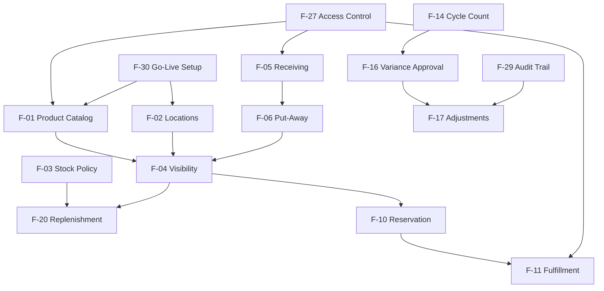
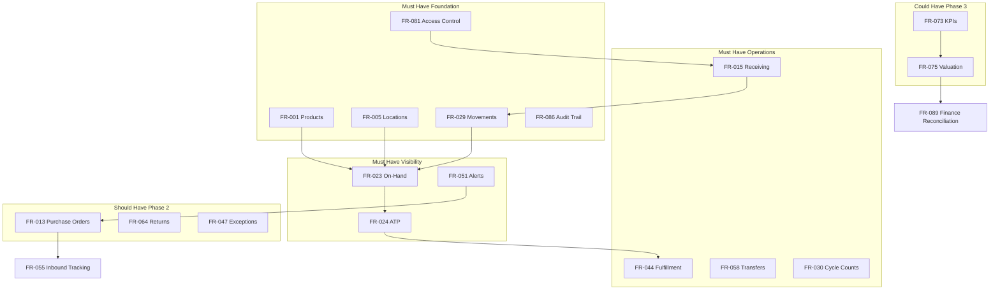
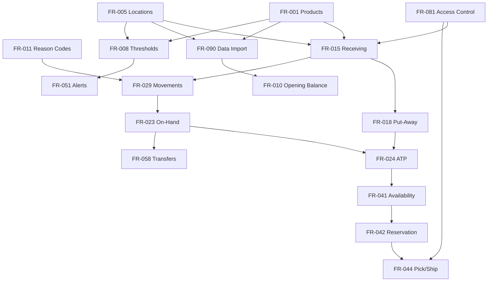

# Functional Requirements Specification (FRS)
## Inventory Management System

| Attribute | Detail |
|-----------|--------|
| **Document ID** | FRS-IMS-001 |
| **Version** | 1.0 |
| **Status** | For Stakeholder Review |
| **Document Owner** | Senior Business Analyst |
| **Prepared For** | Business stakeholders, product owners, delivery planners, QA |
| **Date** | July 3, 2026 |
| **Scope** | Functional and business behavior only - no technical design, architecture, or implementation |

---

## Document Purpose

This Functional Requirements Specification consolidates all Requirements Definition phase deliverables into a single authoritative document for stakeholder review and delivery planning. It defines **what** the Inventory Management System must do from a business perspective.

**Source phases:** Business Discovery, Domain Analysis, Domain Knowledge, Requirements Definition.

---

## Table of Contents

1. [Introduction](#part-0-introduction)
2. [Feature Catalog](#part-1-feature-catalog)
3. [Functional Requirements](#part-2-functional-requirements)
4. [User Stories](#part-3-user-stories)
5. [Acceptance Criteria](#part-4-acceptance-criteria)
6. [Requirement Priorities](#part-5-requirement-priorities)
7. [Requirement Dependencies](#part-6-requirement-dependencies)
8. [Appendices](#appendices)

---

## Specification Summary

| Artifact | Count | Identifier Range |
|----------|-------|------------------|
| Features | 30 | F-01 to F-30 |
| Functional Requirements | 90 | FR-001 to FR-090 |
| User Stories | 90 | US-001 to US-090 |
| Acceptance Criteria | 360+ | AC-{Story}-{Category}{Seq} |
| Dependency Relationships | 185 | DEP-001 to DEP-185 |
| Business Processes (traceability) | 32 | BP-01 to BP-32 |

### MoSCoW Distribution

| Priority | Count | Percentage |
|----------|-------|------------|
| Must Have | 55 | 61% |
| Should Have | 26 | 29% |
| Could Have | 6 | 7% |
| Won't Have (Current Release) | 3 | 3% |

### Foundational Requirements

- **FR-001** - Product master
- **FR-005** - Location master
- **FR-011** - Reason codes
- **FR-081** - Access control

---

# Part 0: Introduction

## Scope

This specification covers inventory management capabilities for a multi-location distribution and retail organization, including master data, inbound logistics, visibility, control, fulfillment, replenishment, transfers, returns, reporting, notifications, access control, and governance.

## Out of Scope

Per project scope, this specification excludes: ERP/finance modules, CRM, manufacturing/MRP, transportation management, 3PL/VMI portals, AI forecasting, marketplace integrations, and dedicated regulatory compliance modules.

## Conventions

| Convention | Meaning |
|------------|---------|
| **F-xx** | Feature identifier |
| **FR-xxx** | Functional requirement identifier |
| **US-xxx** | User story identifier |
| **AC-xxx** | Acceptance criterion identifier |
| **BP-xx** | Business process |
| **DEP-xxx** | Dependency relationship identifier |

## Traceability Model

Business Process (BP) -> Feature (F) -> Functional Requirement (FR) -> User Story (US) -> Acceptance Criteria (AC), with MoSCoW Priority and Dependency (DEP).

---

---

# Part 1: Feature Catalog


## How to Read This Catalog

Each **feature** is a cohesive business capability that delivers value to one or more user groups. Features group related functional requirements (FR-xxx) that should be planned, tested, and released together where possible.

**Business priority** reflects delivery importance aligned with the phased product roadmap:

| Priority | Meaning | Typical Phase |
|----------|---------|---------------|
| **Critical (P1)** | Must-have for MVP; initiative fails without it | Phase 1 — Stabilize & Centralize |
| **High (P2)** | Essential for operational performance after MVP adoption | Phase 2 — Improve Performance |
| **Medium (P3)** | Important for strategic maturity, analytics, and financial alignment | Phase 3 — Enable Smarter Decisions |

**Primary actors** are the business roles that most directly initiate, consume, or approve the feature. Actor IDs reference the Business Actor Analysis (A-01 through A-25).

---

## Feature Catalog Summary

| # | Feature | Priority | Requirements | Phase |
|---|---------|----------|--------------|-------|
| F-01 | Product Catalog Management | Critical (P1) | 4 | MVP |
| F-02 | Location & Network Setup | Critical (P1) | 4 | MVP |
| F-03 | Stock Policy & Product Classification | Critical (P1) | 4 | MVP / Phase 2 |
| F-04 | Inventory Visibility & Search | Critical (P1) | 6 | MVP / Phase 2 |
| F-05 | Goods Receiving & Verification | Critical (P1) | 6 | MVP |
| F-06 | Put-Away Management | Critical (P1) | 1 | MVP |
| F-07 | Purchase Order & Inbound Supply Management | High (P2) | 6 | Phase 2 |
| F-08 | Inter-Location Stock Transfers | Critical (P1) | 5 | MVP / Phase 2 |
| F-09 | Network Stock Rebalancing | Medium (P3) | 1 | Phase 3 |
| F-10 | Order Availability & Reservation | Critical (P1) | 4 | MVP |
| F-11 | Pick, Pack & Ship Fulfillment | Critical (P1) | 2 | MVP |
| F-12 | Partial Fulfillment & Backorder Management | Critical (P1) | 2 | MVP / Phase 2 |
| F-13 | Fulfillment Exception Handling | High (P2) | 3 | Phase 2 / Phase 3 |
| F-14 | Cycle Counting | Critical (P1) | 3 | MVP |
| F-15 | Full Physical Inventory Count | Critical (P1) | 1 | MVP |
| F-16 | Count Variance Investigation & Approval | Critical (P1) | 3 | MVP |
| F-17 | Stock Adjustments & Write-Offs | Critical (P1) | 4 | MVP |
| F-18 | Quarantine & Hold Stock Management | High (P2) | 1 | Phase 2 |
| F-19 | Shrinkage & Obsolescence Analysis | High (P2) | 2 | Phase 2 / Phase 3 |
| F-20 | Low-Stock Alerting & Replenishment | Critical (P1) | 5 | MVP / Phase 2 |
| F-21 | Returns Management | High (P2) | 4 | Phase 2 |
| F-22 | Inventory Reporting & Dashboards | Critical (P1) | 5 | MVP / Phase 2 |
| F-23 | Inventory Performance KPIs | Medium (P3) | 1 | Phase 3 |
| F-24 | Financial Inventory Reconciliation | Medium (P3) | 2 | Phase 3 |
| F-25 | Promotional & Launch Stock Readiness | Medium (P3) | 1 | Phase 3 |
| F-26 | Operational Notifications & Alerts | Critical (P1) | 5 | MVP / Phase 2 / Phase 3 |
| F-27 | User Access & Role Management | Critical (P1) | 3 | MVP |
| F-28 | Operational Accountability & Controls | Critical (P1) | 2 | MVP |
| F-29 | Audit Trail & Compliance | Critical (P1) | 3 | MVP / Phase 2 |
| F-30 | System Go-Live & Initial Data Setup | Critical (P1) | 1 | MVP |
| **Total** | **30 Features** | | **90 FRs** | |

---

## F-01: Product Catalog Management

| Attribute | Detail |
|-----------|--------|
| **Business Purpose** | Establish and maintain a single, trusted product catalog so every location and department references the same product identity, attributes, and lifecycle status — eliminating duplicate records and ordering errors. |
| **Included Functional Requirements** | FR-001, FR-002, FR-003, FR-004 |
| **Primary Actors** | Inventory Controller (A-05), Purchasing Manager (A-15), Operations Director (A-04), Warehouse Manager (A-06), Receiving Clerk (A-07), Warehouse Picker / Packer (A-08) |
| **Business Priority** | **Critical (P1)** |

**Capabilities covered:** Create and maintain product master records; manage active/inactive/discontinued status; operational product lookup by SKU or barcode; duplicate product detection and resolution.

---

## F-02: Location & Network Setup

| Attribute | Detail |
|-----------|--------|
| **Business Purpose** | Define and maintain the organization's inventory location network so stock can be assigned, tracked, and reported at the correct warehouses, stores, and distribution points with clear accountability. |
| **Included Functional Requirements** | FR-005, FR-006, FR-007, FR-010 |
| **Primary Actors** | COO (A-02), Operations Director (A-04), Warehouse Manager (A-06), Regional / Store Manager (A-10), Finance Manager (A-17), Inventory Controller (A-05) |
| **Business Priority** | **Critical (P1)** |

**Capabilities covered:** Configure inventory locations; manage location hierarchy; establish verified opening stock balances at go-live; plan stock disposition for location closure or consolidation.

---

## F-03: Stock Policy & Product Classification

| Attribute | Detail |
|-----------|--------|
| **Business Purpose** | Define replenishment thresholds, safety stock rules, and product priority classification so the business can proactively manage stock levels and direct operational effort toward high-impact items. |
| **Included Functional Requirements** | FR-008, FR-009, FR-012, FR-056 |
| **Primary Actors** | Inventory Controller (A-05), Purchasing Manager (A-15), Operations Director (A-04), Sales Manager (A-11) |
| **Business Priority** | **Critical (P1)** — threshold definition is MVP; ABC classification and governance policies are **High (P2)** extensions |

**Capabilities covered:** Define reorder levels and minimum thresholds; ABC product classification; inventory governance policy reference; safety stock protection rules.

---

## F-04: Inventory Visibility & Search

| Attribute | Detail |
|-----------|--------|
| **Business Purpose** | Provide a trusted, real-time view of inventory across the network — answering what stock exists, where it is, what is reserved, and what is available to promise — without manual spreadsheets or warehouse calls. |
| **Included Functional Requirements** | FR-023, FR-024, FR-025, FR-026, FR-027, FR-028 |
| **Primary Actors** | Operations Director (A-04), Inventory Controller (A-05), Warehouse Manager (A-06), Sales Representative (A-12), Customer Service Representative (A-13), Purchasing Manager (A-15), Regional / Store Manager (A-10) |
| **Business Priority** | **Critical (P1)** — core visibility is MVP; network-wide and inbound projection views are **High (P2)** |

**Capabilities covered:** On-hand quantity by product and location; available-to-promise calculation; reserved and committed stock display; stock status indicators; multi-criteria search and filter; expected inbound and network-wide availability.

---

## F-05: Goods Receiving & Verification

| Attribute | Detail |
|-----------|--------|
| **Business Purpose** | Accept inbound shipments with verified quantity, product identity, and condition — ensuring inventory records reflect physical reality from the point of entry and protecting supplier accountability. |
| **Included Functional Requirements** | FR-015, FR-016, FR-017, FR-019, FR-020, FR-029 |
| **Primary Actors** | Receiving Clerk (A-07), Warehouse Manager (A-06), Purchasing Manager (A-15), Buyer (A-16), Supplier (A-20) |
| **Business Priority** | **Critical (P1)** — receipt tolerance evaluation is **High (P2)** |

**Capabilities covered:** Receive and verify inbound goods against purchase orders; document and resolve receipt discrepancies; enforce PO reference with authorized ad-hoc exceptions; receive return and non-PO inbound stock; receipt quantity tolerance evaluation; full movement transaction history.

---

## F-06: Put-Away Management

| Attribute | Detail |
|-----------|--------|
| **Business Purpose** | Distinguish received stock from operationally available stock by confirming put-away completion — ensuring pickers can locate goods and availability promises reflect locatable inventory. |
| **Included Functional Requirements** | FR-018 |
| **Primary Actors** | Warehouse Staff (A-09), Warehouse Manager (A-06), Receiving Clerk (A-07) |
| **Business Priority** | **Critical (P1)** |

**Capabilities covered:** Track received vs. available stock states; confirm put-away before updating sellable availability.

---

## F-07: Purchase Order & Inbound Supply Management

| Attribute | Detail |
|-----------|--------|
| **Business Purpose** | Manage the inbound supply pipeline from purchase commitment through expected delivery — giving operations, sales, and purchasing visibility into when low-stock conditions will be resolved. |
| **Included Functional Requirements** | FR-013, FR-014, FR-021, FR-022, FR-055, FR-079 |
| **Primary Actors** | Purchasing Manager (A-15), Buyer (A-16), Warehouse Manager (A-06), Operations Director (A-04), Customer Service Representative (A-13) |
| **Business Priority** | **High (P2)** — supplier performance insights are **Medium (P3)** |

**Capabilities covered:** Record purchase order commitments; plan and communicate expected inbound deliveries; cancel or amend open purchase orders; track inbound supply status; supplier delivery performance recording; inbound delay notifications.

---

## F-08: Inter-Location Stock Transfers

| Attribute | Detail |
|-----------|--------|
| **Business Purpose** | Move stock between locations to resolve local stockouts and imbalances using existing network inventory — without waiting for supplier replenishment — while protecting source location service levels. |
| **Included Functional Requirements** | FR-058, FR-059, FR-060, FR-061, FR-063 |
| **Primary Actors** | Regional / Store Manager (A-10), Operations Director (A-04), Warehouse Manager (A-06), Inventory Controller (A-05), Logistics / Carrier Partner (A-21) |
| **Business Priority** | **Critical (P1)** — request, approval, and execution are MVP; in-transit monitoring is **High (P2)** |

**Capabilities covered:** Initiate transfer requests; approve or reject transfers; execute dispatch and receipt with balanced location updates; monitor in-transit inventory; enforce source location minimum thresholds.

---

## F-09: Network Stock Rebalancing

| Attribute | Detail |
|-----------|--------|
| **Business Purpose** | Proactively analyze stock distribution across the location network and recommend redistribution to reduce enterprise-wide overstock and stockout conditions. |
| **Included Functional Requirements** | FR-062 |
| **Primary Actors** | Operations Director (A-04), COO (A-02), Inventory Controller (A-05), Regional / Store Manager (A-10), Purchasing Manager (A-15) |
| **Business Priority** | **Medium (P3)** |

**Capabilities covered:** Network-wide imbalance analysis; rebalancing recommendations convertible to transfer requests.

---

## F-10: Order Availability & Reservation

| Attribute | Detail |
|-----------|--------|
| **Business Purpose** | Verify stock availability before customer commitments and reserve inventory against confirmed orders — preventing overselling and double-allocation of the same physical stock. |
| **Included Functional Requirements** | FR-041, FR-042, FR-043, FR-048 |
| **Primary Actors** | Sales Representative (A-12), Customer Service Representative (A-13), Operations Director (A-04), Warehouse Manager (A-06), Sales Manager (A-11) |
| **Business Priority** | **Critical (P1)** — multi-location split fulfillment is **High (P2)** |

**Capabilities covered:** Confirm order availability before commitment; reserve inventory for confirmed orders; release reservations on cancellation or fulfillment; multi-location split fulfillment allocation.

---

## F-11: Pick, Pack & Ship Fulfillment

| Attribute | Detail |
|-----------|--------|
| **Business Purpose** | Execute the physical fulfillment cycle from pick list through shipment confirmation — deducting inventory only when goods are verified, packed, and dispatched. |
| **Included Functional Requirements** | FR-044, FR-049 |
| **Primary Actors** | Warehouse Picker / Packer (A-08), Warehouse Manager (A-06), Customer Service Representative (A-13), Logistics / Carrier Partner (A-21) |
| **Business Priority** | **Critical (P1)** |

**Capabilities covered:** Pick, pack, and ship workflow with pick verification; order fulfillment status visibility.

---

## F-12: Partial Fulfillment & Backorder Management

| Attribute | Detail |
|-----------|--------|
| **Business Purpose** | Handle situations where full order quantity cannot be fulfilled immediately — shipping available items, managing backorders with customer acknowledgment, and prioritizing fulfillment when stock arrives. |
| **Included Functional Requirements** | FR-045, FR-046 |
| **Primary Actors** | Warehouse Manager (A-06), Customer Service Representative (A-13), Sales Manager (A-11), Operations Director (A-04), Purchasing Manager (A-15) |
| **Business Priority** | **Critical (P1)** — partial fulfillment is MVP; backorder priority queue is **High (P2)** |

**Capabilities covered:** Partial shipment processing; backorder creation with customer acknowledgment; backorder priority sequencing and auto-reservation when stock available.

---

## F-13: Fulfillment Exception Handling

| Attribute | Detail |
|-----------|--------|
| **Business Purpose** | Resolve fulfillment disruptions such as pick failures, damaged items, order cancellations, and product unavailability — minimizing customer impact and correcting inventory records. |
| **Included Functional Requirements** | FR-047, FR-050, FR-078 |
| **Primary Actors** | Warehouse Picker / Packer (A-08), Warehouse Manager (A-06), Customer Service Representative (A-13), Inventory Controller (A-05), Sales Manager (A-11) |
| **Business Priority** | **High (P2)** — authorized product substitution is **Medium (P3)** |

**Capabilities covered:** Pick failure and damage exception resolution; fulfillment exception alerts; authorized product substitution with approval.

---

## F-14: Cycle Counting

| Attribute | Detail |
|-----------|--------|
| **Business Purpose** | Verify physical stock against recorded balances on a rotating schedule to detect discrepancies early, sustain inventory accuracy, and reduce reliance on disruptive full-wall counts. |
| **Included Functional Requirements** | FR-030, FR-031, FR-071 |
| **Primary Actors** | Inventory Controller (A-05), Warehouse Staff (A-09), Warehouse Manager (A-06), Operations Director (A-04) |
| **Business Priority** | **Critical (P1)** |

**Capabilities covered:** Schedule and assign cycle counts; blind counting; accuracy reporting from count results.

---

## F-15: Full Physical Inventory Count

| Attribute | Detail |
|-----------|--------|
| **Business Purpose** | Conduct comprehensive location-wide counts to establish verified baselines, support financial substantiation, and correct accumulated discrepancies that cycle counts may not fully address. |
| **Included Functional Requirements** | FR-032 |
| **Primary Actors** | Inventory Controller (A-05), Warehouse Manager (A-06), Finance Manager (A-17), Internal Auditor (A-18) |
| **Business Priority** | **Critical (P1)** |

**Capabilities covered:** Full location count execution; movement freeze during count; comprehensive variance reporting.

---

## F-16: Count Variance Investigation & Approval

| Attribute | Detail |
|-----------|--------|
| **Business Purpose** | Investigate root causes of count variances and apply corrections only through independent approval — maintaining segregation of duties and inventory record integrity. |
| **Included Functional Requirements** | FR-033, FR-034, FR-037 |
| **Primary Actors** | Inventory Controller (A-05), Warehouse Manager (A-06), Operations Director (A-04), Internal Auditor (A-18) |
| **Business Priority** | **Critical (P1)** |

**Capabilities covered:** Variance identification and tolerance classification; investigation and independent approval workflow; adjustment approval threshold enforcement.

---

## F-17: Stock Adjustments & Write-Offs

| Attribute | Detail |
|-----------|--------|
| **Business Purpose** | Correct inventory records when physical reality differs from system balances — with mandatory reason codes, authorization, and full audit trail — for damage, shrinkage, obsolescence, and data corrections. |
| **Included Functional Requirements** | FR-011, FR-035, FR-036, FR-077 |
| **Primary Actors** | Warehouse Manager (A-06), Inventory Controller (A-05), Operations Director (A-04), Finance Manager (A-17), CFO (A-03) |
| **Business Priority** | **Critical (P1)** |

**Capabilities covered:** Standard reason code management; stock adjustments with mandatory reason codes; write-offs with documented evidence and authorization; pending approval notifications.

---

## F-18: Quarantine & Hold Stock Management

| Attribute | Detail |
|-----------|--------|
| **Business Purpose** | Isolate stock pending quality investigation, return inspection, or clearance — excluding it from sellable availability to prevent shipping defective or uninspected goods. |
| **Included Functional Requirements** | FR-038 |
| **Primary Actors** | Warehouse Manager (A-06), Receiving Clerk (A-07), Inventory Controller (A-05) |
| **Business Priority** | **High (P2)** |

**Capabilities covered:** Place stock on quarantine or hold status; exclude from available-to-promise; release to available or route to write-off upon inspection decision.

---

## F-19: Shrinkage & Obsolescence Analysis

| Attribute | Detail |
|-----------|--------|
| **Business Purpose** | Analyze inventory loss trends and identify slow-moving or obsolete stock — enabling targeted loss prevention, clearance actions, and working capital recovery. |
| **Included Functional Requirements** | FR-039, FR-040 |
| **Primary Actors** | Inventory Controller (A-05), Operations Director (A-04), Finance Manager (A-17), CFO (A-03), Purchasing Manager (A-15) |
| **Business Priority** | **High (P2)** — shrinkage analysis; **Medium (P3)** — obsolescence review |

**Capabilities covered:** Shrinkage and loss trend analysis by reason code and location; slow-moving and obsolete stock identification with disposition support.

---

## F-20: Low-Stock Alerting & Replenishment

| Attribute | Detail |
|-----------|--------|
| **Business Purpose** | Detect low-stock and out-of-stock conditions proactively and convert them into actionable replenishment decisions — moving purchasing from reactive crisis response to threshold-driven discipline. |
| **Included Functional Requirements** | FR-051, FR-052, FR-053, FR-054, FR-074 |
| **Primary Actors** | Purchasing Manager (A-15), Buyer (A-16), Inventory Controller (A-05), Operations Director (A-04) |
| **Business Priority** | **Critical (P1)** — alerts and suggestions are MVP; purchase requisitions are **High (P2)** |

**Capabilities covered:** Automatic low-stock and out-of-stock alert generation; alert review and acknowledgment; replenishment suggestions with network check; purchase requisition creation and tracking; replenishment reporting.

---

## F-21: Returns Management

| Attribute | Detail |
|-----------|--------|
| **Business Purpose** | Manage the full customer return lifecycle from authorization through inspection and disposition — ensuring returned goods are tracked, customers receive appropriate resolution, and inventory impact is captured accurately. |
| **Included Functional Requirements** | FR-064, FR-065, FR-066, FR-067 |
| **Primary Actors** | Customer Service Representative (A-13), Warehouse Manager (A-06), Receiving Clerk (A-07), Inventory Controller (A-05), B2B Customer (A-23), B2C Customer (A-24) |
| **Business Priority** | **High (P2)** |

**Capabilities covered:** Return authorization linked to original orders; returned goods receipt and inspection; restock or write-off disposition; return processing status visibility.

---

## F-22: Inventory Reporting & Dashboards

| Attribute | Detail |
|-----------|--------|
| **Business Purpose** | Provide operational and management reports and dashboards so leaders can monitor inventory health, identify problems, and drive improvement without manual data compilation. |
| **Included Functional Requirements** | FR-068, FR-069, FR-070, FR-072, FR-074 |
| **Primary Actors** | Operations Director (A-04), Inventory Controller (A-05), COO (A-02), CEO (A-01), Warehouse Manager (A-06), Purchasing Manager (A-15) |
| **Business Priority** | **Critical (P1)** — summary, movement, stockout, and variance reports are MVP; location performance snapshots are **High (P2)** |

**Capabilities covered:** Inventory summary dashboard; stock movement reports; stockout and overstock reports; inventory accuracy and variance reports; location performance snapshots; replenishment reporting.

---

## F-23: Inventory Performance KPIs

| Attribute | Detail |
|-----------|--------|
| **Business Purpose** | Measure inventory operational maturity through standard KPIs — fill rate, turnover, days of supply, and record accuracy — enabling management to track progress toward strategic objectives. |
| **Included Functional Requirements** | FR-073 |
| **Primary Actors** | COO (A-02), CEO (A-01), Operations Director (A-04), Inventory Controller (A-05), CFO (A-03) |
| **Business Priority** | **Medium (P3)** |

**Capabilities covered:** KPI calculation and trend display; comparison against defined targets; executive and role-specific performance views.

---

## F-24: Financial Inventory Reconciliation

| Attribute | Detail |
|-----------|--------|
| **Business Purpose** | Align operational inventory records with financial reporting needs — supporting month-end reconciliation, valuation substantiation, and audit readiness without replacing the general ledger. |
| **Included Functional Requirements** | FR-075, FR-089 |
| **Primary Actors** | Finance Manager (A-17), CFO (A-03), Inventory Controller (A-05), External Auditor (A-19) |
| **Business Priority** | **Medium (P3)** |

**Capabilities covered:** Inventory valuation summary views; operational-to-financial reconciliation support; period-end quantity and adjustment substantiation.

---

## F-25: Promotional & Launch Stock Readiness

| Attribute | Detail |
|-----------|--------|
| **Business Purpose** | Ensure adequate inventory is positioned before marketing campaigns and product launches — identifying gaps early and ring-fencing promotional stock from general availability. |
| **Included Functional Requirements** | FR-057, FR-080 |
| **Primary Actors** | Marketing Manager (A-14), Purchasing Manager (A-15), Operations Director (A-04), Warehouse Manager (A-06), Sales Manager (A-11) |
| **Business Priority** | **Medium (P3)** |

**Capabilities covered:** Campaign stock readiness review against targets; promotional stock ring-fencing; go/no-go readiness indication; campaign readiness alerts.

---

## F-26: Operational Notifications & Alerts

| Attribute | Detail |
|-----------|--------|
| **Business Purpose** | Deliver timely notifications to the right roles when stock conditions, approvals, exceptions, or supply delays require action — reducing decision latency and preventing issues from escalating. |
| **Included Functional Requirements** | FR-076, FR-077, FR-078, FR-079, FR-080 |
| **Primary Actors** | All operational roles; primary recipients: Purchasing Manager (A-15), Warehouse Manager (A-06), Operations Director (A-04), Customer Service Representative (A-13) |
| **Business Priority** | **Critical (P1)** — low-stock and approval notifications are MVP; exception, inbound delay, and campaign alerts extend through **High (P2)** and **Medium (P3)** |

**Capabilities covered:** Low-stock and out-of-stock notifications; pending approval notifications; transfer and fulfillment exception alerts; inbound supply delay notifications; campaign and launch readiness alerts.

**Note:** FR-076 and FR-080 also appear in F-20 and F-25 respectively. They are listed here as the cross-cutting notification delivery capability that supports multiple features.

---

## F-27: User Access & Role Management

| Attribute | Detail |
|-----------|--------|
| **Business Purpose** | Control who can view, transact, approve, and configure inventory operations — aligning system access with organizational accountability and location scope. |
| **Included Functional Requirements** | FR-081, FR-082, FR-085 |
| **Primary Actors** | System Administrator (operational role), Operations Director (A-04), COO (A-02) |
| **Business Priority** | **Critical (P1)** |

**Capabilities covered:** Role-based access control; location-scoped visibility and transaction authority; user account and role assignment management.

---

## F-28: Operational Accountability & Controls

| Attribute | Detail |
|-----------|--------|
| **Business Purpose** | Enforce segregation of duties and log user activity so inventory changes are traceable to individuals — strengthening loss prevention and internal control. |
| **Included Functional Requirements** | FR-083, FR-084 |
| **Primary Actors** | All internal actors; enforced on Warehouse Manager (A-06), Warehouse Staff (A-09), Inventory Controller (A-05), Internal Auditor (A-18) |
| **Business Priority** | **Critical (P1)** |

**Capabilities covered:** User activity logging for all material actions; segregation of duties enforcement preventing self-approval and conflicting role actions.

---

## F-29: Audit Trail & Compliance

| Attribute | Detail |
|-----------|--------|
| **Business Purpose** | Maintain complete, queryable records of all inventory changes and support structured audit review — demonstrating control effectiveness to internal and external auditors. |
| **Included Functional Requirements** | FR-086, FR-087, FR-088 |
| **Primary Actors** | Internal Auditor (A-18), External Auditor (A-19), Finance Manager (A-17), Inventory Controller (A-05), Operations Director (A-04) |
| **Business Priority** | **Critical (P1)** — audit trail is MVP; structured audit queries and breach detection are **High (P2)** |

**Capabilities covered:** Complete immutable audit trail of inventory changes; audit and control review query support; control policy breach detection and recording.

---

## F-30: System Go-Live & Initial Data Setup

| Attribute | Detail |
|-----------|--------|
| **Business Purpose** | Enable practical deployment at primary locations through controlled import of product catalog and opening stock balances — accelerating adoption without manual entry of entire datasets. |
| **Included Functional Requirements** | FR-090 |
| **Primary Actors** | Inventory Controller (A-05), Operations Director (A-04), Warehouse Manager (A-06) |
| **Business Priority** | **Critical (P1)** |

**Capabilities covered:** Controlled import of product master data and opening stock balances; validation and authorized approval before activation.

---

## Feature-to-Requirement Traceability

Complete mapping confirming all 90 functional requirements are assigned to exactly one primary feature (notification FRs are primary-owned by their domain feature; F-26 represents the shared delivery capability).

| Requirement | Primary Feature | Requirement | Primary Feature |
|-------------|-----------------|-------------|-----------------|
| FR-001 | F-01 | FR-046 | F-12 |
| FR-002 | F-01 | FR-047 | F-13 |
| FR-003 | F-01 | FR-048 | F-10 |
| FR-004 | F-01 | FR-049 | F-11 |
| FR-005 | F-02 | FR-050 | F-13 |
| FR-006 | F-02 | FR-051 | F-20 |
| FR-007 | F-02 | FR-052 | F-20 |
| FR-008 | F-03 | FR-053 | F-20 |
| FR-009 | F-03 | FR-054 | F-20 |
| FR-010 | F-02 | FR-055 | F-07 |
| FR-011 | F-17 | FR-056 | F-03 |
| FR-012 | F-03 | FR-057 | F-25 |
| FR-013 | F-07 | FR-058 | F-08 |
| FR-014 | F-07 | FR-059 | F-08 |
| FR-015 | F-05 | FR-060 | F-08 |
| FR-016 | F-05 | FR-061 | F-08 |
| FR-017 | F-05 | FR-062 | F-09 |
| FR-018 | F-06 | FR-063 | F-08 |
| FR-019 | F-05 | FR-064 | F-21 |
| FR-020 | F-05 | FR-065 | F-21 |
| FR-021 | F-07 | FR-066 | F-21 |
| FR-022 | F-07 | FR-067 | F-21 |
| FR-023 | F-04 | FR-068 | F-22 |
| FR-024 | F-04 | FR-069 | F-22 |
| FR-025 | F-04 | FR-070 | F-22 |
| FR-026 | F-04 | FR-071 | F-14 |
| FR-027 | F-04 | FR-072 | F-22 |
| FR-028 | F-04 | FR-073 | F-23 |
| FR-029 | F-05 | FR-074 | F-20, F-22 |
| FR-030 | F-14 | FR-075 | F-24 |
| FR-031 | F-14 | FR-076 | F-20, F-26 |
| FR-032 | F-15 | FR-077 | F-17, F-26 |
| FR-033 | F-16 | FR-078 | F-13, F-26 |
| FR-034 | F-16 | FR-079 | F-07, F-26 |
| FR-035 | F-17 | FR-080 | F-25, F-26 |
| FR-036 | F-17 | FR-081 | F-27 |
| FR-037 | F-16 | FR-082 | F-27 |
| FR-038 | F-18 | FR-083 | F-28 |
| FR-039 | F-19 | FR-084 | F-28 |
| FR-040 | F-19 | FR-085 | F-27 |
| FR-041 | F-10 | FR-086 | F-29 |
| FR-042 | F-10 | FR-087 | F-29 |
| FR-043 | F-10 | FR-088 | F-29 |
| FR-044 | F-11 | FR-089 | F-24 |
| FR-045 | F-12 | FR-090 | F-30 |

*Note: FR-074 supports both replenishment (F-20) and reporting (F-22). FR-076, FR-077, FR-078, FR-079, and FR-080 are owned by their domain features and collectively delivered through F-26.*

---

## MVP Feature Set (Phase 1)

The following **18 features** constitute the Minimum Viable Product — establishing a trusted, centralized inventory view and supporting core daily operations:

| Feature | Name |
|---------|------|
| F-01 | Product Catalog Management |
| F-02 | Location & Network Setup |
| F-03 | Stock Policy & Product Classification (thresholds only) |
| F-04 | Inventory Visibility & Search (core views) |
| F-05 | Goods Receiving & Verification |
| F-06 | Put-Away Management |
| F-08 | Inter-Location Stock Transfers (request, approval, execution) |
| F-10 | Order Availability & Reservation |
| F-11 | Pick, Pack & Ship Fulfillment |
| F-12 | Partial Fulfillment & Backorder Management (partial ship only) |
| F-14 | Cycle Counting |
| F-15 | Full Physical Inventory Count |
| F-16 | Count Variance Investigation & Approval |
| F-17 | Stock Adjustments & Write-Offs |
| F-20 | Low-Stock Alerting & Replenishment (alerts and suggestions) |
| F-22 | Inventory Reporting & Dashboards (standard reports) |
| F-26 | Operational Notifications & Alerts (stock and approval) |
| F-27 | User Access & Role Management |
| F-28 | Operational Accountability & Controls |
| F-29 | Audit Trail & Compliance (audit trail) |
| F-30 | System Go-Live & Initial Data Setup |

---

## Feature Dependency Overview



---

## Alignment with Business Objectives

| Business Objective | Supporting Features |
|--------------------|---------------------|
| BO-01: Single trusted inventory view | F-04, F-22, F-30 |
| BO-02: Improve inventory record accuracy | F-14, F-15, F-16, F-17, F-19 |
| BO-03: Standardize movement recording | F-05, F-06, F-08, F-11, F-29 |
| BO-04: Reduce manual reconciliation | F-04, F-22, F-24 |
| BO-05: Reduce stockouts and overstock | F-03, F-07, F-08, F-09, F-20, F-26 |
| BO-06: Improve fulfillment reliability | F-10, F-11, F-12, F-13, F-21 |
| BO-07: Financial inventory alignment | F-24, F-29 |

---

*End of Feature Catalog Document*

---

# Part 2: Functional Requirements


## Document Conventions

| Convention | Meaning |
|------------|---------|
| **FR-xxx** | Functional Requirement identifier |
| **BP-xx** | Related business process from Business Process Analysis |
| **BE-xx** | Related business event from Business Events Catalog |
| **BR-xx** | Related industry business rule from Domain Knowledge |

Requirements are grouped by functional domain. Each requirement describes *what* the system must do from a business perspective, not *how* it is built.

### Phase Applicability

| Tag | Meaning |
|-----|---------|
| **MVP** | Required for Minimum Viable Product (Phase 1) |
| **Phase 2** | Near-term release after MVP stabilization |
| **Phase 3** | Business intelligence and financial alignment release |

Phase tags indicate delivery priority derived from Project Scope; all listed requirements represent valid functional behavior for the product initiative.

---

## Requirements Summary

| Domain | Requirement IDs | Count |
|--------|-----------------|-------|
| Master Data & Governance | FR-001 – FR-012 | 12 |
| Inbound & Receiving | FR-013 – FR-022 | 10 |
| Inventory Visibility & Status | FR-023 – FR-028 | 6 |
| Inventory Control & Accuracy | FR-029 – FR-040 | 12 |
| Order Fulfillment | FR-041 – FR-050 | 10 |
| Replenishment & Inbound Supply | FR-051 – FR-057 | 7 |
| Network Balance & Transfers | FR-058 – FR-063 | 6 |
| Returns Management | FR-064 – FR-067 | 4 |
| Reporting & Dashboards | FR-068 – FR-075 | 8 |
| Notifications & Alerts | FR-076 – FR-080 | 5 |
| User Access & Accountability | FR-081 – FR-085 | 5 |
| Governance, Audit & Compliance | FR-086 – FR-090 | 5 |
| **Total** | | **90** |

---

## Domain 1: Master Data & Governance

---

### FR-001: Create and Maintain Product Master Records

| Attribute | Detail |
|-----------|--------|
| **Phase** | MVP |
| **Description** | The system shall allow authorized users to create and maintain core product master records including SKU, product name, description, unit of measure, category, and inventory tracking attributes required for operational use. |
| **Business Value** | Ensures all locations and departments reference a single, consistent product identity — eliminating duplicate records, ordering errors, and fulfillment mismatches (addresses PP-07, PP-01). |
| **Trigger** | New product introduction requested (BE-02); product data change requested (BE-01); data quality review identifies errors or duplicates. |
| **Expected System Behavior** | Accept product data submissions; validate completeness and uniqueness of SKU; allow review and confirmation workflow; persist approved product records; make updated records visible to all authorized users and locations. |
| **Related Business Process** | BP-01: Product Master Data Management |

---

### FR-002: Manage Product Status Lifecycle

| Attribute | Detail |
|-----------|--------|
| **Phase** | MVP |
| **Description** | The system shall support product status management across active, inactive, and discontinued states, with status changes controlling whether a product may be received, ordered, reserved, or fulfilled. |
| **Business Value** | Prevents obsolete or withdrawn products from entering the supply chain, supports assortment rationalization, and protects against reordering discontinued items (BR-27). |
| **Trigger** | Product discontinuation requested (BE-03); product reactivation or deactivation decision; new product approved for sale. |
| **Expected System Behavior** | Allow authorized users to set and change product status; enforce business rules tied to status (e.g., block replenishment for discontinued products); flag remaining stock on discontinued products for clearance or write-off planning; record status change history. |
| **Related Business Process** | BP-01: Product Master Data Management |

---

### FR-003: Support Product Identifier Lookup

| Attribute | Detail |
|-----------|--------|
| **Phase** | MVP |
| **Description** | The system shall support operational lookup of products by SKU, barcode, or other assigned product identifier to support receiving, counting, picking, and inquiry activities. |
| **Business Value** | Reduces identification errors on the warehouse floor, speeds operational transactions, and minimizes mis-picks and receipt mismatches. |
| **Trigger** | User initiates product search during receiving, counting, picking, transfer, or inquiry; barcode or identifier scanned or entered at point of operation. |
| **Expected System Behavior** | Return matching product record(s) for valid identifiers; display core product attributes and current stock context; handle ambiguous or unknown identifiers with clear feedback to the user. |
| **Related Business Process** | BP-01: Product Master Data Management; BP-07: Goods Receipt & Verification; BP-11: Cycle Counting; BP-18: Pick, Pack & Ship |

---

### FR-004: Detect and Resolve Duplicate Product Records

| Attribute | Detail |
|-----------|--------|
| **Phase** | MVP |
| **Description** | The system shall identify potential duplicate or conflicting product records during product creation or update and support correction or merge without creating parallel product identities. |
| **Business Value** | Prevents fragmented stock records for the same physical product, which causes inaccurate availability and reconciliation effort (PP-07). |
| **Trigger** | New product record submitted; product attribute change affects identifier or naming; periodic data quality review. |
| **Expected System Behavior** | Check for existing records with matching or similar identifiers and attributes; alert the user to potential duplicates; support correction of existing records rather than creating duplicates; maintain traceability of merge or correction actions. |
| **Related Business Process** | BP-01: Product Master Data Management |

---

### FR-005: Configure and Maintain Inventory Locations

| Attribute | Detail |
|-----------|--------|
| **Phase** | MVP |
| **Description** | The system shall allow authorized users to define and maintain inventory-holding locations (warehouses, stores, distribution points) including name, type, operational status, and position within the location network. |
| **Business Value** | Establishes the organizational structure required to assign, track, and report stock at the correct level — foundational for network visibility (BO-01). |
| **Trigger** | Inventory location change approved (BE-04); new location opening; location closure or consolidation; network reorganization. |
| **Expected System Behavior** | Create, update, and deactivate location records; assign location type and operational status; associate accountable manager; prevent transactions at deactivated locations except authorized disposition activities; communicate location changes to affected operational views. |
| **Related Business Process** | BP-02: Location & Warehouse Setup |

---

### FR-006: Manage Location Hierarchy

| Attribute | Detail |
|-----------|--------|
| **Phase** | MVP |
| **Description** | The system shall support a location hierarchy that reflects how inventory locations relate within the distribution network (e.g., regional groupings, parent-child relationships). |
| **Business Value** | Enables network-level reporting, accountability assignment, and structured stock redistribution decisions across the enterprise. |
| **Trigger** | Network design change; new location added to hierarchy; location reorganization or consolidation. |
| **Expected System Behavior** | Allow definition and maintenance of hierarchical relationships between locations; roll up stock visibility and reporting by hierarchy level; reflect hierarchy in search, filter, and report outputs. |
| **Related Business Process** | BP-02: Location & Warehouse Setup |

---

### FR-007: Plan Location Closure and Stock Disposition

| Attribute | Detail |
|-----------|--------|
| **Phase** | Phase 2 |
| **Description** | The system shall support planning and execution of stock disposition when a location is closed or consolidated, including transfer out, sell-through, or write-off of remaining inventory. |
| **Business Value** | Prevents stranded inventory and record orphans when locations exit the network; protects asset value during network changes. |
| **Trigger** | Location closure approved; consolidation decision requiring stock movement or disposition. |
| **Expected System Behavior** | Display remaining stock at closing location; support disposition actions (transfer, adjustment, status hold); block new inbound and fulfillment activity at closing location once disposition begins; retain history after deactivation. |
| **Related Business Process** | BP-02: Location & Warehouse Setup |

---

### FR-008: Define Stock Policy and Replenishment Thresholds

| Attribute | Detail |
|-----------|--------|
| **Phase** | MVP |
| **Description** | The system shall allow authorized users to define and maintain reorder levels, minimum stock thresholds, and safety stock parameters per product and location. |
| **Business Value** | Enables proactive identification of low-stock conditions and aligns purchasing with operational needs — reducing reactive stockouts (PP-06, BO-05). |
| **Trigger** | Stock policy review due (BE-05); demand or supply condition changed (BE-06); new product onboarded; performance review showing chronic stockouts or overstock. |
| **Expected System Behavior** | Store threshold parameters by product and location; validate threshold values against business policy; make thresholds available for alert evaluation and replenishment suggestions; record threshold change history with effective dates. |
| **Related Business Process** | BP-03: Stock Policy & Threshold Definition |

---

### FR-009: Classify Products by ABC Priority

| Attribute | Detail |
|-----------|--------|
| **Phase** | Phase 2 |
| **Description** | The system shall support ABC product classification based on business importance (revenue, velocity, criticality) and apply classification to count schedules, alert priorities, and monitoring intensity. |
| **Business Value** | Directs operational effort toward high-impact items, improving fill rate on priority products while optimizing counting and monitoring effort (BR-32). |
| **Trigger** | ABC classification review due (BE-07); significant shift in sales mix; new product line introduction. |
| **Expected System Behavior** | Assign and maintain ABC class per SKU; allow classification review and bulk update; reflect classification in count scheduling, alert priority, and reporting groupings; record classification change history. |
| **Related Business Process** | BP-04: ABC Product Classification |

---

### FR-010: Establish Opening Stock Balance at Location Go-Live

| Attribute | Detail |
|-----------|--------|
| **Phase** | MVP |
| **Description** | The system shall support establishment of verified opening stock balances when a new location becomes operational or when the system is first adopted, requiring documented count results before the location is activated for transactions. |
| **Business Value** | Prevents go-live with embedded inventory errors that undermine trust and cause cascading fulfillment failures (BR opening balance, BA-16). |
| **Trigger** | New location setup completed; system cutover for existing location; leadership mandates baseline inventory substantiation. |
| **Expected System Behavior** | Support opening balance entry from verified physical count; require authorized approval before location activation; prevent operational transactions until opening balance is confirmed; record opening balance as auditable baseline with user attribution and timestamp. |
| **Related Business Process** | BP-02: Location & Warehouse Setup; BP-12: Full Physical Inventory Count |

---

### FR-011: Maintain Standard Reason Codes

| Attribute | Detail |
|-----------|--------|
| **Phase** | MVP |
| **Description** | The system shall maintain a controlled list of reason codes for inventory adjustments, write-offs, receipt discrepancies, and exceptions, supporting categorized tracking of inventory changes. |
| **Business Value** | Enables shrinkage analysis, trend identification, and audit substantiation — adjustments without reason codes are analytically useless (BR-20). |
| **Trigger** | Adjustment, write-off, or discrepancy recorded; governance review of reason code list; new exception type identified. |
| **Expected System Behavior** | Provide mandatory reason code selection for applicable transactions; support corporate standard list with authorized extensions if policy permits; prevent uncategorized adjustments; include reason code in audit trail and reporting. |
| **Related Business Process** | BP-14: Stock Adjustment & Write-Off; BP-08: Receipt Discrepancy Resolution; BP-13: Count Variance Investigation & Approval |

---

### FR-012: Manage Inventory Governance Policies

| Attribute | Detail |
|-----------|--------|
| **Phase** | Phase 2 |
| **Description** | The system shall support documentation and reference of inventory management policies (approval thresholds, count tolerances, reservation timing, partial shipment rules) that govern operational decisions. |
| **Business Value** | Establishes formal accountability and consistent decision-making across locations — addressing lack of formal inventory governance (PP-09). |
| **Trigger** | Policy creation or revision approved; audit finding requires policy update; organizational readiness milestone. |
| **Expected System Behavior** | Store and display current policy parameters accessible to authorized users; reflect policy values in approval routing and validation behavior; record policy version history; link policy references to affected operational workflows. |
| **Related Business Process** | BP-03: Stock Policy & Threshold Definition; BP-32: Inventory Audit & Control Review |

---

## Domain 2: Inbound & Receiving

---

### FR-013: Record Purchase Order Commitments

| Attribute | Detail |
|-----------|--------|
| **Phase** | Phase 2 |
| **Description** | The system shall allow recording of purchase orders issued to suppliers, capturing product, quantity, expected delivery, supplier reference, and receiving location — representing committed inbound expected stock. |
| **Business Value** | Creates visibility into inbound supply, supports receiving verification, and enables availability projections for sales and operations (BP-23). |
| **Trigger** | Replenishment need identified (BE-08); purchase requisition approved (BE-09); emergency stockout declared (BE-10); promotional stock build authorized (BE-11). |
| **Expected System Behavior** | Create and maintain purchase order records; associate PO lines with products and receiving locations; track PO status (open, partially received, closed, cancelled); make expected inbound quantities visible for availability and replenishment views. |
| **Related Business Process** | BP-05: Purchase Order Placement |

---

### FR-014: Plan and Communicate Expected Inbound Deliveries

| Attribute | Detail |
|-----------|--------|
| **Phase** | Phase 2 |
| **Description** | The system shall support visibility of expected inbound deliveries by date and receiving location so receiving teams and operations can prepare for incoming shipments. |
| **Business Value** | Reduces receiving dock congestion, improves receipt processing timeliness, and gives sales and customer service realistic inbound availability dates. |
| **Trigger** | Supplier shipment confirmed (BE-12); inbound delivery date approaching (BE-13); purchase order created or updated with delivery expectation. |
| **Expected System Behavior** | Display scheduled inbound deliveries by location and date; show expected products and quantities; allow receiving readiness review; support communication of inbound expectations to operational roles. |
| **Related Business Process** | BP-06: Inbound Shipment Planning |

---

### FR-015: Receive and Verify Inbound Goods

| Attribute | Detail |
|-----------|--------|
| **Phase** | MVP |
| **Description** | The system shall support goods receipt workflows that verify inbound shipment quantity, product identity, and condition against delivery documentation and purchase order reference before accepting stock into inventory. |
| **Business Value** | Ensures on-hand balances reflect physical reality from the point of entry — preventing phantom inventory and payment for undelivered goods (BR-4, BR-6). |
| **Trigger** | Supplier shipment arrived (BE-14); return shipment received; ad-hoc receipt authorized per policy. |
| **Expected System Behavior** | Capture receipt against PO or authorized ad-hoc receipt; require product identification and quantity entry; support condition assessment; record accepted quantity separately from rejected or damaged quantity; create receipt transaction with user attribution; update on-hand only for verified accepted quantity. |
| **Related Business Process** | BP-07: Goods Receipt & Verification |

---

### FR-016: Document and Resolve Receipt Discrepancies

| Attribute | Detail |
|-----------|--------|
| **Phase** | MVP |
| **Description** | The system shall support documentation of receipt discrepancies (short shipment, over-shipment, wrong item, damage) and track resolution before final acceptance into inventory. |
| **Business Value** | Protects supplier accountability, prevents inaccurate inventory records, and supports claims and credit resolution (BR-6, PP-03). |
| **Trigger** | Receipt discrepancy identified (BE-15); receiver notes mismatch during verification. |
| **Expected System Behavior** | Record discrepancy type, quantity variance, and supporting notes; hold disputed quantity from sellable availability; track discrepancy status through resolution; apply corrected quantities upon resolution; retain discrepancy history for supplier performance analysis. |
| **Related Business Process** | BP-08: Receipt Discrepancy Resolution |

---

### FR-017: Enforce Purchase Order Reference for Supplier Receipts

| Attribute | Detail |
|-----------|--------|
| **Phase** | MVP (with authorized ad-hoc exception) |
| **Description** | The system shall require a valid purchase order reference for standard supplier receipts and support a controlled exception path for authorized ad-hoc or emergency receipts. |
| **Business Value** | Maintains procurement control, prevents unauthorized receiving, and supports financial matching discipline (BR-7). |
| **Trigger** | Receipt initiated for supplier shipment; emergency receipt requested without PO. |
| **Expected System Behavior** | Require PO reference for standard receipts; validate PO line eligibility (product, quantity, location); block receipt against closed or invalid PO lines; allow ad-hoc receipt only with authorized approval and documented reason; record exception for audit. |
| **Related Business Process** | BP-07: Goods Receipt & Verification; BP-05: Purchase Order Placement |

---

### FR-018: Manage Put-Away and Stock Availability Timing

| Attribute | Detail |
|-----------|--------|
| **Phase** | MVP |
| **Description** | The system shall distinguish between received stock (verified at dock) and available stock (put-away complete), updating sellable availability only when put-away is confirmed. |
| **Business Value** | Prevents promising stock that pickers cannot locate, reduces pick failures, and reflects operational reality (BR-5). |
| **Trigger** | Goods receipt completed (BE-16); put-away assignment issued; put-away confirmed by warehouse staff. |
| **Expected System Behavior** | Record receipt in receiving state upon verification; require put-away confirmation to move stock to available status; track quantity in receiving vs. available states; reflect availability change in ATP only after put-away completion. |
| **Related Business Process** | BP-09: Stock Put-Away & Storage |

---

### FR-019: Receive Return and Non-PO Inbound Stock

| Attribute | Detail |
|-----------|--------|
| **Phase** | MVP |
| **Description** | The system shall support inbound receipt of customer returns and other non-purchase-order inbound movements with appropriate reference linkage and disposition routing. |
| **Business Value** | Captures all inventory increases in one system, maintaining complete movement history and accurate balances (BO-03). |
| **Trigger** | Returned goods received at warehouse (BE-48); authorized return-to-stock decision; other authorized inbound without PO. |
| **Expected System Behavior** | Accept inbound receipt with return authorization or alternative reference; route received goods to inspection, quarantine, or restock path based on disposition rules; update inventory only after inspection approval where required; record full transaction history. |
| **Related Business Process** | BP-07: Goods Receipt & Verification; BP-28: Return-to-Stock or Disposal Decision |

---

### FR-020: Support Receipt Quantity Tolerance Evaluation

| Attribute | Detail |
|-----------|--------|
| **Phase** | Phase 2 |
| **Description** | The system shall evaluate received quantities against purchase order expected quantities using defined tolerance rules and flag over-receipt or under-receipt beyond acceptable limits for approval. |
| **Business Value** | Balances operational flexibility with control — preventing silent acceptance of material variances that affect payment and inventory accuracy. |
| **Trigger** | Receipt quantity entered against PO line; receipt discrepancy identified. |
| **Expected System Behavior** | Compare received quantity to expected quantity; apply tolerance rules by product class or policy; auto-accept within tolerance; require approval for receipt beyond tolerance; document tolerance decision in receipt record. |
| **Related Business Process** | BP-07: Goods Receipt & Verification; BP-08: Receipt Discrepancy Resolution |

---

### FR-021: Cancel or Amend Open Purchase Orders

| Attribute | Detail |
|-----------|--------|
| **Phase** | Phase 2 |
| **Description** | The system shall support cancellation or amendment of open purchase orders before receipt is complete, updating expected inbound quantities accordingly. |
| **Business Value** | Prevents receiving against obsolete orders, maintains accurate inbound projections, and reflects real supplier commitments. |
| **Trigger** | Supplier cancellation; demand change; duplicate order identified; purchasing decision to amend quantity or date. |
| **Expected System Behavior** | Allow authorized cancellation or amendment of open PO lines; prevent amendment of fully received lines; update expected inbound visibility; retain PO change history; notify affected roles of material changes. |
| **Related Business Process** | BP-05: Purchase Order Placement; BP-23: Inbound Supply Tracking |

---

### FR-022: Record Supplier Delivery Performance

| Attribute | Detail |
|-----------|--------|
| **Phase** | Phase 3 |
| **Description** | The system shall capture supplier delivery performance data (on-time delivery, quantity accuracy, discrepancy frequency) derived from receipt and PO records for operational review. |
| **Business Value** | Supports supplier relationship management and informed replenishment decisions based on actual lead time and fill performance. |
| **Trigger** | Receipt completed; discrepancy resolved; scheduled supplier performance review. |
| **Expected System Behavior** | Calculate and display delivery timeliness and quantity accuracy metrics by supplier; highlight recurring discrepancy patterns; make performance data available in replenishment and reporting views. |
| **Related Business Process** | BP-08: Receipt Discrepancy Resolution; BP-23: Inbound Supply Tracking |

---

## Domain 3: Inventory Visibility & Status

---

### FR-023: Display On-Hand Quantity by Product and Location

| Attribute | Detail |
|-----------|--------|
| **Phase** | MVP |
| **Description** | The system shall provide a real-time view of on-hand inventory quantity for any product at any location, reflecting all recorded receipts, movements, adjustments, and fulfillments. |
| **Business Value** | Delivers the foundational single source of truth — enabling any authorized user to answer "what do we have and where?" without manual spreadsheets (BO-01, PP-01). |
| **Trigger** | User inventory inquiry; business day inventory review due (BE-17); inventory movement recorded (BE-18). |
| **Expected System Behavior** | Display current on-hand quantity by product and location; update balances immediately upon recorded movements; support search and navigation by product, location, category, and identifier. |
| **Related Business Process** | BP-10: Inventory Status Monitoring |

---

### FR-024: Display Available-to-Promise (ATP) Quantity

| Attribute | Detail |
|-----------|--------|
| **Phase** | MVP |
| **Description** | The system shall calculate and display available-to-promise quantity — representing stock not reserved, committed, quarantined, or otherwise unavailable for new customer commitments. |
| **Business Value** | Prevents overselling and overpromising — the primary cause of fulfillment failures and customer dissatisfaction (BR-1, PP-04). |
| **Trigger** | Availability inquiry; order availability confirmation (BE-28); reservation created or released; stock status change affecting availability. |
| **Expected System Behavior** | Calculate ATP from on-hand minus reservations and non-sellable holds; display ATP alongside on-hand and reserved quantities; update ATP in real time as movements and reservations occur; make ATP visible to sales, customer service, and operations roles. |
| **Related Business Process** | BP-10: Inventory Status Monitoring; BP-16: Order Availability Confirmation |

---

### FR-025: Display Reserved and Committed Stock

| Attribute | Detail |
|-----------|--------|
| **Phase** | MVP |
| **Description** | The system shall display inventory quantities reserved or committed to confirmed orders, linked to the originating order reference. |
| **Business Value** | Provides transparency into why available stock differs from on-hand — reducing disputes between sales and warehouse teams and supporting accurate fulfillment planning. |
| **Trigger** | Order confirmed for fulfillment (BE-30); reservation created or released; order cancelled (BE-35). |
| **Expected System Behavior** | Show reserved quantity by product, location, and order; distinguish reserved from available and on-hand; update reservation balances upon fulfillment, cancellation, or partial shipment; support inquiry by order or by product. |
| **Related Business Process** | BP-10: Inventory Status Monitoring; BP-17: Inventory Reservation |

---

### FR-026: Indicate Stock Status (In Stock, Low Stock, Out of Stock)

| Attribute | Detail |
|-----------|--------|
| **Phase** | MVP |
| **Description** | The system shall derive and display stock status indicators (in stock, low stock, out of stock) based on defined thresholds and current availability at each location. |
| **Business Value** | Enables rapid identification of problem items without manual threshold comparison — supporting daily operational reviews and prioritization. |
| **Trigger** | Stock threshold breached (BE-19); inventory movement changes availability; threshold parameter updated. |
| **Expected System Behavior** | Evaluate current ATP against reorder level and minimum thresholds; assign and display status indicator; update status automatically upon movement or threshold change; support filtering and reporting by status. |
| **Related Business Process** | BP-10: Inventory Status Monitoring; BP-21: Low-Stock Alert Review |

---

### FR-027: Search and Filter Inventory Views

| Attribute | Detail |
|-----------|--------|
| **Phase** | MVP |
| **Description** | The system shall allow users to search and filter inventory views by product, location, category, status, ABC class, and other defined attributes. |
| **Business Value** | Reduces time to find relevant stock information, supports self-service availability checks, and decreases warehouse interruption from ad-hoc stock inquiries (PP-20). |
| **Trigger** | User initiates inventory search; management requests filtered view; operational review by category or location. |
| **Expected System Behavior** | Support multi-criteria search and filter; return results with on-hand, reserved, ATP, and status; allow export or print of filtered views for operational use; respect user location access permissions. |
| **Related Business Process** | BP-10: Inventory Status Monitoring |

---

### FR-028: Display Expected Inbound and Network-Wide Availability

| Attribute | Detail |
|-----------|--------|
| **Phase** | Phase 2 |
| **Description** | The system shall display expected inbound stock (open PO quantities) and support network-wide availability views aggregating stock across all locations for a given product. |
| **Business Value** | Enables network-level replenishment decisions and transfer-before-purchase discipline (BR-11); gives sales realistic dates for out-of-stock recovery. |
| **Trigger** | Inbound stock inquiry received (BE-40); network imbalance identified (BE-42); replenishment planning initiated. |
| **Expected System Behavior** | Show expected inbound quantity and expected availability date by product and location; aggregate network ATP across locations; highlight locations with excess vs. shortage for the same product; support transfer vs. purchase decision support. |
| **Related Business Process** | BP-10: Inventory Status Monitoring; BP-23: Inbound Supply Tracking; BP-26: Network Stock Rebalancing |

---

## Domain 4: Inventory Control & Accuracy

---

### FR-029: Record All Inventory Movements with Full History

| Attribute | Detail |
|-----------|--------|
| **Phase** | MVP |
| **Description** | The system shall record every inventory movement (receipt, transfer, adjustment, fulfillment, return) with product, quantity, location, user, timestamp, and transaction type. |
| **Business Value** | Creates complete traceability for accountability, audit, and root-cause investigation — addressing limited accountability in current operations (PP-08, BO-03). |
| **Trigger** | Any inventory movement business event (BE-18); receipt, transfer, adjustment, shipment, or return completed. |
| **Expected System Behavior** | Create immutable movement record for each transaction; update balances atomically with movement; support movement history inquiry by product, location, user, date range, and transaction type. |
| **Related Business Process** | BP-10: Inventory Status Monitoring; all movement processes (BP-07, BP-14, BP-18, BP-25) |

---

### FR-030: Schedule and Assign Cycle Counts

| Attribute | Detail |
|-----------|--------|
| **Phase** | MVP |
| **Description** | The system shall support scheduling and assignment of cycle counts by location, product category, or ABC class according to the count calendar. |
| **Business Value** | Sustains inventory accuracy through rotating verification — detecting discrepancies early without disruptive full-wall counts (BO-02). |
| **Trigger** | Cycle count assignment due (BE-20); SKU flagged for verification count (BE-21); count program setup. |
| **Expected System Behavior** | Generate count assignments per schedule; assign counters and supervisors; display count tasks with product and location; track count completion status; support rescheduling and priority override for high-variance SKUs. |
| **Related Business Process** | BP-11: Cycle Counting |

---

### FR-031: Perform Blind Cycle Counts

| Attribute | Detail |
|-----------|--------|
| **Phase** | MVP |
| **Description** | The system shall support blind cycle counting where counters record physical quantities without visibility of the system's expected quantity until after count submission. |
| **Business Value** | Produces unbiased accuracy measurement — counts that validate bad data instead of detecting errors destroy metric credibility (BR-18). |
| **Trigger** | Counter begins assigned cycle count task. |
| **Expected System Behavior** | Present count task showing product and location only; accept physical quantity entry; calculate variance only after submission; prevent counter from viewing expected quantity during active count. |
| **Related Business Process** | BP-11: Cycle Counting |

---

### FR-032: Conduct Full Physical Inventory Count

| Attribute | Detail |
|-----------|--------|
| **Phase** | MVP |
| **Description** | The system shall support full physical inventory counts at a location, including count freeze of movements during the count period and comprehensive variance reporting. |
| **Business Value** | Establishes verified baseline for financial substantiation and corrects accumulated discrepancies that cycle counts may not fully address (BR-24). |
| **Trigger** | Full physical count scheduled (BE-22); audit requires inventory substantiation (BE-23); opening balance establishment. |
| **Expected System Behavior** | Initiate full count for a location; enforce movement freeze during active count per policy; support full location SKU listing and count entry; generate total variance report upon completion; require approval before applying count adjustments. |
| **Related Business Process** | BP-12: Full Physical Inventory Count |

---

### FR-033: Identify and Report Count Variances

| Attribute | Detail |
|-----------|--------|
| **Phase** | MVP |
| **Description** | The system shall identify variances between physical count results and recorded system quantities and report variances exceeding defined tolerance for investigation. |
| **Business Value** | Focuses investigation effort on material discrepancies and prevents uncorrected accuracy drift (BR-22). |
| **Trigger** | Count variance identified (BE-24); cycle or full count submitted. |
| **Expected System Behavior** | Calculate variance (physical minus system) per count line; classify variance against tolerance rules; route material variances for investigation; display variance summary by location, product, and counter; support recount assignment. |
| **Related Business Process** | BP-13: Count Variance Investigation & Approval |

---

### FR-034: Investigate and Approve Count Adjustments

| Attribute | Detail |
|-----------|--------|
| **Phase** | MVP |
| **Description** | The system shall support investigation, documentation, and independent approval of count variances before inventory balances are adjusted. |
| **Business Value** | Prevents unauthorized or unexplained inventory changes; ensures segregation of duties between counter and approver (BR-19, BR-21). |
| **Trigger** | Material count variance identified; investigation completed; approver reviews variance package. |
| **Expected System Behavior** | Present variance with transaction history context; require investigation notes and root cause documentation; route to authorized approver independent of counter; apply adjustment only upon approval; reject adjustment with documented reason if not justified. |
| **Related Business Process** | BP-13: Count Variance Investigation & Approval |

---

### FR-035: Process Stock Adjustments with Mandatory Reason Codes

| Attribute | Detail |
|-----------|--------|
| **Phase** | MVP |
| **Description** | The system shall support stock adjustments (increase or decrease) with mandatory reason codes, quantity, product identification, and user attribution. |
| **Business Value** | Maintains record integrity while enabling corrections for damage, shrinkage, obsolescence, and data errors — with full accountability (BR-20). |
| **Trigger** | Stock correction required (BE-25); approved count variance; discovered damage or spoilage; data entry correction. |
| **Expected System Behavior** | Accept adjustment request with product, location, quantity, direction, and reason code; validate user authorization; route high-value adjustments for independent approval per policy; update on-hand and ATP upon approval; record adjustment in movement history and audit trail. |
| **Related Business Process** | BP-14: Stock Adjustment & Write-Off |

---

### FR-036: Process Inventory Write-Offs with Authorization

| Attribute | Detail |
|-----------|--------|
| **Phase** | MVP |
| **Description** | The system shall support write-off of inventory that is obsolete, damaged beyond sale, stolen, or otherwise permanently removed from sellable stock, requiring documented evidence and authorized approval. |
| **Business Value** | Protects against fraudulent disposal and ensures financial and operational records align on removed stock (BR-23). |
| **Trigger** | Significant loss or adjustment event (BE-27); obsolete stock review; inspection failure on returned goods. |
| **Expected System Behavior** | Accept write-off request with evidence documentation; require reason code and approver per policy threshold; deduct from on-hand and ATP; record write-off in movement history; make write-off visible for shrinkage and financial reconciliation reporting. |
| **Related Business Process** | BP-14: Stock Adjustment & Write-Off; BP-15: Shrinkage & Loss Management |

---

### FR-037: Enforce Adjustment Approval Thresholds

| Attribute | Detail |
|-----------|--------|
| **Phase** | MVP |
| **Description** | The system shall route inventory adjustments and write-offs exceeding defined quantity or value thresholds to independent authorized approvers before application. |
| **Business Value** | Provides oversight proportional to financial impact — preventing large-scale fraud or error (BR-21). |
| **Trigger** | Adjustment or write-off submitted; threshold evaluation on submission. |
| **Expected System Behavior** | Evaluate adjustment against configured thresholds by role; auto-approve within threshold for authorized users; route above-threshold requests to designated approver; prevent self-approval where segregation of duties applies; notify pending approvers. |
| **Related Business Process** | BP-14: Stock Adjustment & Write-Off; BP-13: Count Variance Investigation & Approval |

---

### FR-038: Manage Quarantine and Hold Stock Status

| Attribute | Detail |
|-----------|--------|
| **Phase** | Phase 2 |
| **Description** | The system shall support quarantine or hold status for stock pending quality investigation, inspection, or regulatory clearance, excluding held stock from sellable availability. |
| **Business Value** | Prevents shipping defective, damaged, or uninspected goods; protects customers and brand (BR-13). |
| **Trigger** | Damaged goods identified; return received pending inspection; quality hold placed; recall response. |
| **Expected System Behavior** | Move specified quantity to quarantine/hold status; exclude from ATP immediately; prevent fulfillment from quarantined stock; support release to available or route to write-off upon inspection decision; record hold and release in movement history. |
| **Related Business Process** | BP-14: Stock Adjustment & Write-Off; BP-28: Return-to-Stock or Disposal Decision |

---

### FR-039: Analyze Shrinkage and Loss Trends

| Attribute | Detail |
|-----------|--------|
| **Phase** | Phase 2 |
| **Description** | The system shall aggregate adjustment, write-off, and count variance data by reason code, location, and period to support shrinkage and loss analysis. |
| **Business Value** | Enables targeted loss prevention and process improvement — converting transaction data into actionable management insight (BP-15). |
| **Trigger** | Monthly shrinkage review due (BE-26); management requests loss analysis; pattern of recurring variances detected. |
| **Expected System Behavior** | Summarize adjustments and write-offs by reason code, location, and time period; highlight recurring variance SKUs and locations; support trend comparison across periods; present data for review meetings without requiring manual spreadsheet compilation. |
| **Related Business Process** | BP-15: Shrinkage & Loss Management |

---

### FR-040: Review and Action Obsolete and Slow-Moving Stock

| Attribute | Detail |
|-----------|--------|
| **Phase** | Phase 3 |
| **Description** | The system shall identify slow-moving and obsolete stock based on movement history and product status, supporting clearance, transfer, or write-off decisions. |
| **Business Value** | Releases working capital trapped in dead stock and reduces carrying costs — addressing overstock and obsolescence pain points (PP-15). |
| **Trigger** | Scheduled aging review; product discontinued; overstock report review; finance month-end review. |
| **Expected System Behavior** | Identify products with no movement beyond defined aging threshold; flag discontinued products with remaining stock; support clearance status and disposition actions; report aging inventory by location and category. |
| **Related Business Process** | BP-01: Product Master Data Management; BP-14: Stock Adjustment & Write-Off; BP-29: Inventory Performance Reporting |

---

## Domain 5: Order Fulfillment

---

### FR-041: Confirm Order Availability Before Commitment

| Attribute | Detail |
|-----------|--------|
| **Phase** | MVP |
| **Description** | The system shall allow verification that requested products are available in sufficient ATP quantity at the appropriate fulfillment location before confirming delivery commitments to customers. |
| **Business Value** | Prevents overpromising and order failures — reducing cancellations, customer complaints, and expedited shipping costs (PP-04, BR-1). |
| **Trigger** | Customer order or quote received (BE-28); large or strategic order submitted (BE-29). |
| **Expected System Behavior** | Accept order line inquiry with product, quantity, and preferred location; return availability confirmation or shortfall detail; recommend alternative fulfillment location if primary location insufficient; display expected inbound date if out of stock with open supply. |
| **Related Business Process** | BP-16: Order Availability Confirmation |

---

### FR-042: Reserve Inventory for Confirmed Orders

| Attribute | Detail |
|-----------|--------|
| **Phase** | MVP |
| **Description** | The system shall reserve specific inventory quantities against confirmed orders at the designated fulfillment location, reducing ATP immediately upon reservation. |
| **Business Value** | Prevents double-allocation of the same physical stock to multiple orders during the fulfillment window (BR-2). |
| **Trigger** | Order confirmed for fulfillment (BE-30); backordered stock became available (BE-31). |
| **Expected System Behavior** | Create reservation tied to order line, product, quantity, and location; reduce ATP by reserved quantity; reject reservation if insufficient ATP unless authorized override; confirm reservation to requesting role; place order in fulfillment queue. |
| **Related Business Process** | BP-17: Inventory Reservation |

---

### FR-043: Release Inventory Reservations

| Attribute | Detail |
|-----------|--------|
| **Phase** | MVP |
| **Description** | The system shall release inventory reservations when orders are cancelled, modified, expired per policy, or fully fulfilled — restoring ATP for other commitments. |
| **Business Value** | Prevents stock from being indefinitely locked to unfulfilled or cancelled orders, which artificially reduces sellable availability. |
| **Trigger** | Customer order cancelled (BE-35); order line quantity reduced; reservation expiry policy triggered; shipment completed for reserved lines. |
| **Expected System Behavior** | Release reserved quantity back to ATP; update order and reservation status; record release reason; support partial release for quantity changes; notify affected roles of material availability restoration. |
| **Related Business Process** | BP-17: Inventory Reservation; BP-20: Outbound Exception Handling |

---

### FR-044: Support Pick, Pack, and Ship Workflow

| Attribute | Detail |
|-----------|--------|
| **Phase** | MVP |
| **Description** | The system shall support the pick, pack, and ship fulfillment workflow including pick list generation, pick confirmation, and shipment recording with inventory deduction. |
| **Business Value** | Completes the physical fulfillment cycle with accurate inventory deduction — ensuring records match goods dispatched (BR-3). |
| **Trigger** | Order released to fulfillment queue (BE-32); daily pick wave schedule; priority or expedited order flag. |
| **Expected System Behavior** | Generate pick list with product, quantity, and location; accept pick confirmation against order lines; require pick verification before shipment; deduct inventory upon confirmed shipment; record shipment with user attribution and timestamp; update order fulfillment status. |
| **Related Business Process** | BP-18: Pick, Pack & Ship |

---

### FR-045: Handle Partial Fulfillment

| Attribute | Detail |
|-----------|--------|
| **Phase** | MVP |
| **Description** | The system shall support partial fulfillment when full order quantity is unavailable — shipping available quantity and placing remaining lines on backorder with documented customer acknowledgment. |
| **Business Value** | Balances customer service (partial delivery) with inventory reality — avoiding complete order holds when partial shipment is acceptable (BR-28). |
| **Trigger** | Insufficient stock at fulfillment (BE-34); pick-time shortfall; customer acceptance of partial delivery policy. |
| **Expected System Behavior** | Identify fulfillable vs. unfulfillable lines; process partial shipment for available quantity; create backorder record for remainder; reduce reservation and ATP for shipped quantity only; retain backorder reservation or queue for remainder per policy; record customer acknowledgment of backorder. |
| **Related Business Process** | BP-19: Partial Fulfillment & Backorder Management |

---

### FR-046: Manage Backorders and Replenishment Priority

| Attribute | Detail |
|-----------|--------|
| **Phase** | Phase 2 |
| **Description** | The system shall maintain backorder records with priority sequencing and automatically offer reservation when stock becomes available. |
| **Business Value** | Ensures fair and policy-driven fulfillment of delayed orders — reducing customer wait time and manual backorder tracking. |
| **Trigger** | Partial fulfillment creates backorder; backordered stock became available (BE-31); stock receipt increases ATP. |
| **Expected System Behavior** | Maintain backorder queue with priority rules (order date, customer tier, SKU class); notify when stock available for backorder fulfillment; support automatic or manual reservation for backorders; display backorder status to customer service and operations. |
| **Related Business Process** | BP-19: Partial Fulfillment & Backorder Management; BP-17: Inventory Reservation |

---

### FR-047: Handle Outbound Fulfillment Exceptions

| Attribute | Detail |
|-----------|--------|
| **Phase** | Phase 2 |
| **Description** | The system shall support resolution of fulfillment exceptions including pick failures (stock not found), damaged items during pick, order cancellations, and shipment delays. |
| **Business Value** | Minimizes customer impact from operational disruptions and ensures inventory records are corrected when physical reality differs from system (PP-03). |
| **Trigger** | Pick exception reported (BE-33); customer order cancelled (BE-35); damaged item found during pick. |
| **Expected System Behavior** | Record exception type and details; support re-pick, substitution (if authorized), cancellation, or adjustment paths; update order status and inventory records accordingly; notify customer service of customer-impacting exceptions; track exception frequency by SKU and location. |
| **Related Business Process** | BP-20: Outbound Exception Handling |

---

### FR-048: Support Multi-Location Split Fulfillment

| Attribute | Detail |
|-----------|--------|
| **Phase** | Phase 2 |
| **Description** | The system shall support fulfillment of a single customer order from multiple locations when no single location holds sufficient ATP for all lines. |
| **Business Value** | Maximizes fill rate across the network — fulfilling orders that would otherwise be rejected or heavily backordered. |
| **Trigger** | Availability check reveals insufficient stock at primary location but network ATP sufficient; strategic order requiring split shipment. |
| **Expected System Behavior** | Identify fulfillment location allocation per order line; create reservations at multiple locations; generate coordinated pick lists; track partial shipments from each location against single order; present unified order fulfillment status. |
| **Related Business Process** | BP-16: Order Availability Confirmation; BP-18: Pick, Pack & Ship |

---

### FR-049: Display Order Fulfillment Status

| Attribute | Detail |
|-----------|--------|
| **Phase** | MVP |
| **Description** | The system shall provide visibility into order fulfillment status (reserved, picking, shipped, partially shipped, backordered, cancelled) for operations and customer service teams. |
| **Business Value** | Reduces customer service inquiry time and prevents conflicting information given to customers about order status. |
| **Trigger** | User inquiry on order status; fulfillment state change; customer service request. |
| **Expected System Behavior** | Display current fulfillment status per order and line; show reserved, picked, shipped, and backordered quantities; indicate fulfillment location; show shipment date and reference when shipped. |
| **Related Business Process** | BP-18: Pick, Pack & Ship; BP-19: Partial Fulfillment & Backorder Management |

---

### FR-050: Support Authorized Product Substitution

| Attribute | Detail |
|-----------|--------|
| **Phase** | Phase 3 |
| **Description** | The system shall support authorized substitution of ordered products with approved alternate SKUs when primary product is unavailable, with documented approval. |
| **Business Value** | Recovers revenue from orders that would otherwise fail fulfillment while maintaining control over acceptable substitutes. |
| **Trigger** | Pick exception or availability shortfall; customer accepts substitute; authorized substitute list exists for product. |
| **Expected System Behavior** | Present approved substitute options for unavailable SKU; require authorized approval for substitution; reserve and ship substitute SKU; record substitution on order with original and fulfilled product reference; update inventory for actual product shipped. |
| **Related Business Process** | BP-20: Outbound Exception Handling |

---

## Domain 6: Replenishment & Inbound Supply

---

### FR-051: Generate Low-Stock and Out-of-Stock Alerts

| Attribute | Detail |
|-----------|--------|
| **Phase** | MVP |
| **Description** | The system shall automatically generate alerts when stock levels fall below defined reorder thresholds or reach zero ATP at a location. |
| **Business Value** | Converts passive monitoring into actionable signals — enabling replenishment before customer-facing stockouts (BR-9, PP-06). |
| **Trigger** | Stock threshold breached (BE-19); inventory movement reduces ATP below reorder level; out-of-stock condition detected. |
| **Expected System Behavior** | Evaluate thresholds after each movement or on scheduled review; create alert with product, location, current ATP, threshold, and ABC priority; deliver alert to purchasing and operations roles; prevent duplicate alert noise for same condition until resolved or acknowledged. |
| **Related Business Process** | BP-21: Low-Stock Alert Review |

---

### FR-052: Review and Acknowledge Stock Alerts

| Attribute | Detail |
|-----------|--------|
| **Phase** | MVP |
| **Description** | The system shall support review, validation, acknowledgment, and dismissal of low-stock alerts with documented rationale for dismissed or deferred alerts. |
| **Business Value** | Ensures alerts drive action rather than alert fatigue — distinguishing genuine replenishment needs from false positives. |
| **Trigger** | Low-stock alert issued (BE-36); purchasing daily review cycle. |
| **Expected System Behavior** | Present active alerts sorted by priority; allow acknowledgment with action taken (requisition, transfer, dismiss); require documented reason for dismissal; track alert age and escalation for unresolved critical alerts. |
| **Related Business Process** | BP-21: Low-Stock Alert Review |

---

### FR-053: Generate Replenishment Suggestions

| Attribute | Detail |
|-----------|--------|
| **Phase** | MVP |
| **Description** | The system shall generate replenishment suggestions based on current stock levels, defined thresholds, open orders, and consumption patterns — recommending what to order and approximate quantity. |
| **Business Value** | Moves replenishment from reactive gut-feel to threshold-driven discipline — reducing both stockouts and emergency purchasing (PP-06). |
| **Trigger** | Validated low-stock alert; scheduled replenishment cycle due (BE-37); post-stockout recovery. |
| **Expected System Behavior** | Calculate suggested order quantity based on threshold parameters and current ATP; consider open PO inbound quantity; present suggestion with rationale; allow buyer to accept, modify, or reject; check network availability before suggesting new purchase (BR-11). |
| **Related Business Process** | BP-22: Replenishment Planning & Requisition |

---

### FR-054: Create and Track Purchase Requisitions

| Attribute | Detail |
|-----------|--------|
| **Phase** | Phase 2 |
| **Description** | The system shall support creation, approval, and tracking of purchase requisitions derived from replenishment suggestions or manual requests. |
| **Business Value** | Formalizes the handoff from replenishment planning to procurement with approval accountability. |
| **Trigger** | Purchase requisition prepared (BE-38); approved replenishment suggestion; emergency stockout action. |
| **Expected System Behavior** | Create requisition with product, quantity, location, and justification; route for approval per policy; track requisition status; convert approved requisition to purchase order; retain requisition history. |
| **Related Business Process** | BP-22: Replenishment Planning & Requisition; BP-05: Purchase Order Placement |

---

### FR-055: Track Inbound Supply Status

| Attribute | Detail |
|-----------|--------|
| **Phase** | Phase 2 |
| **Description** | The system shall provide visibility into open purchase orders and expected inbound deliveries, including status updates for delays and partial receipts. |
| **Business Value** | Enables operations, sales, and customer service to communicate realistic restock dates — reducing unnecessary escalations (BP-23). |
| **Trigger** | Purchase order placed; supplier delivery delay reported (BE-39); receipt partially completed. |
| **Expected System Behavior** | Display open PO summary by product, location, and expected date; show received vs. outstanding quantity; support delay notation with revised ETA; make inbound status available in availability inquiry responses. |
| **Related Business Process** | BP-23: Inbound Supply Tracking |

---

### FR-056: Enforce Safety Stock Protection Rules

| Attribute | Detail |
|-----------|--------|
| **Phase** | Phase 2 |
| **Description** | The system shall prevent routine fulfillment or transfer actions from consuming safety stock below defined minimum without authorized exception and documented replenishment plan. |
| **Business Value** | Preserves the buffer protecting against demand and supply uncertainty — safety stock consumed without plan guarantees the next stockout (BR-10). |
| **Trigger** | Reservation or transfer request would reduce stock below safety threshold; override requested. |
| **Expected System Behavior** | Evaluate impact on safety stock before reservation or transfer; block or warn when safety stock would be breached; allow authorized exception with approver, reason, and replenishment plan documented; record exception for audit. |
| **Related Business Process** | BP-03: Stock Policy & Threshold Definition; BP-17: Inventory Reservation; BP-24: Inter-Location Transfer Request |

---

### FR-057: Support Promotional Stock Readiness Review

| Attribute | Detail |
|-----------|--------|
| **Phase** | Phase 3 |
| **Description** | The system shall support review of stock readiness against promotional or launch targets, identifying gaps and ring-fencing promotional inventory from general availability. |
| **Business Value** | Prevents campaign stockouts that damage marketing ROI and brand reputation (BR-29, PP-21). |
| **Trigger** | Marketing campaign scheduled (BE-55); new product launch date set (BE-56); promotional stock build authorized (BE-11). |
| **Expected System Behavior** | Compare current and inbound stock to campaign target by SKU and location; identify gaps with lead-time-aware warnings; support promotional stock allocation ring-fence; provide go/no-go readiness indication; alert marketing and sales if readiness at risk. |
| **Related Business Process** | BP-31: Promotional & Launch Stock Readiness |

---

## Domain 7: Network Balance & Transfers

---

### FR-058: Request Inter-Location Stock Transfers

| Attribute | Detail |
|-----------|--------|
| **Phase** | MVP |
| **Description** | The system shall support initiation of inter-location transfer requests specifying product, quantity, source location, destination location, and business justification. |
| **Business Value** | Enables network balancing without waiting for supplier replenishment — correcting local stockouts using existing network inventory (PP-02, BR-11). |
| **Trigger** | Inter-location transfer requested (BE-41); network imbalance identified (BE-42); sales request for location-specific fulfillment. |
| **Expected System Behavior** | Accept transfer request with source, destination, product, and quantity; validate source ATP sufficiency; check source minimum threshold protection (BR-12); route for approval per policy; track request status from submission through completion. |
| **Related Business Process** | BP-24: Inter-Location Transfer Request |

---

### FR-059: Approve or Reject Transfer Requests

| Attribute | Detail |
|-----------|--------|
| **Phase** | MVP |
| **Description** | The system shall route transfer requests to authorized approvers and support approval, rejection, or modification with documented rationale. |
| **Business Value** | Prevents unauthorized stock movements that could create new imbalances or deplete source locations below service levels. |
| **Trigger** | Transfer request submitted; approver reviews pending requests. |
| **Expected System Behavior** | Present transfer request with source and destination stock context; allow approve, reject, or quantity modification; require rejection reason; notify requester of decision; release approved transfers for execution. |
| **Related Business Process** | BP-24: Inter-Location Transfer Request |

---

### FR-060: Execute and Record Inter-Location Transfers

| Attribute | Detail |
|-----------|--------|
| **Phase** | MVP |
| **Description** | The system shall support execution of approved transfers including dispatch from source, in-transit tracking, and receipt at destination with balanced inventory updates at both locations. |
| **Business Value** | Ensures both sending and receiving location balances are accurate — preventing stock appearing lost between locations (BO-03). |
| **Trigger** | Transfer request approved (BE-43); transfer shipment dispatched (BE-45); transfer shipment received (BE-46). |
| **Expected System Behavior** | Deduct quantity from source upon dispatch confirmation; record in-transit quantity; add quantity to destination upon receipt confirmation; support partial receipt and variance handling; maintain complete transfer transaction history; update ATP at both locations appropriately through each stage. |
| **Related Business Process** | BP-25: Inter-Location Transfer Execution |

---

### FR-061: Monitor In-Transit Inventory

| Attribute | Detail |
|-----------|--------|
| **Phase** | Phase 2 |
| **Description** | The system shall track inventory in transit between locations separately from on-hand at source or destination until receipt is confirmed. |
| **Business Value** | Provides network visibility during transfer lead time and supports accountability for goods between dispatch and receipt. |
| **Trigger** | Transfer dispatched; in-transit inquiry; network stock review. |
| **Expected System Behavior** | Display in-transit quantity by product, source, destination, and dispatch date; flag overdue in-transit shipments per policy; exclude in-transit from source ATP and destination on-hand until receipt; support in-transit loss or exception recording. |
| **Related Business Process** | BP-25: Inter-Location Transfer Execution |

---

### FR-062: Analyze and Recommend Network Rebalancing

| Attribute | Detail |
|-----------|--------|
| **Phase** | Phase 3 |
| **Description** | The system shall analyze stock distribution across the network and present rebalancing recommendations identifying excess and shortage locations by product. |
| **Business Value** | Proactively reduces network-wide overstock and stockout conditions — optimizing inventory investment across the enterprise (PP-02). |
| **Trigger** | Network rebalancing review due (BE-44); persistent imbalance patterns; overstock and stockout report review. |
| **Expected System Behavior** | Compare demand patterns and stock levels across locations; identify surplus at one location and shortage at another for same product; recommend transfer quantities respecting source minimums; present rebalancing summary for operations review; support conversion of recommendations to transfer requests. |
| **Related Business Process** | BP-26: Network Stock Rebalancing |

---

### FR-063: Enforce Source Location Minimum on Transfers

| Attribute | Detail |
|-----------|--------|
| **Phase** | MVP |
| **Description** | The system shall prevent transfer approval when the proposed quantity would deplete the source location below its defined minimum threshold or safety stock. |
| **Business Value** | Prevents solving one location's shortage by creating another — avoiding cascading network stockouts (BR-12). |
| **Trigger** | Transfer request submitted or modified; approval evaluation. |
| **Expected System Behavior** | Calculate maximum transferable quantity given source ATP and minimum threshold; block or reduce transfer quantity exceeding allowable amount; inform requester of constraint; suggest alternative source locations if available. |
| **Related Business Process** | BP-24: Inter-Location Transfer Request; BP-25: Inter-Location Transfer Execution |

---

## Domain 8: Returns Management

---

### FR-064: Authorize and Record Customer Returns

| Attribute | Detail |
|-----------|--------|
| **Phase** | Phase 2 |
| **Description** | The system shall support return authorization linked to original orders and recording of return intake with product, quantity, reason, and expected resolution. |
| **Business Value** | Connects physical returns to commercial transactions — preventing unauthorized returns and enabling accurate inventory and customer resolution (BR-25). |
| **Trigger** | Customer return requested (BE-47); customer service initiates return authorization. |
| **Expected System Behavior** | Create return authorization linked to original order; specify expected return product and quantity; communicate authorization reference for warehouse receipt; track return status from authorization through completion. |
| **Related Business Process** | BP-27: Customer Return Intake |

---

### FR-065: Receive and Inspect Returned Goods

| Attribute | Detail |
|-----------|--------|
| **Phase** | Phase 2 |
| **Description** | The system shall support physical receipt of returned goods against return authorization and inspection workflow before restocking or disposal. |
| **Business Value** | Ensures only resalable goods re-enter sellable inventory — preventing damaged returns from being shipped as new (BR-26). |
| **Trigger** | Returned goods received at warehouse (BE-48); return inspection completed (BE-49). |
| **Expected System Behavior** | Validate return against authorization; record received quantity and condition; route to inspection queue; capture inspection outcome (restock, rework, write-off); prevent restock without passed inspection. |
| **Related Business Process** | BP-28: Return-to-Stock or Disposal Decision |

---

### FR-066: Restock or Write Off Returned Inventory

| Attribute | Detail |
|-----------|--------|
| **Phase** | Phase 2 |
| **Description** | The system shall apply disposition decisions for returned goods — restocking resalable quantity to available inventory or writing off non-resalable quantity with reason codes. |
| **Business Value** | Maintains accurate inventory records reflecting true sellable stock after returns processing. |
| **Trigger** | Return inspection completed with disposition decision. |
| **Expected System Behavior** | Increase on-hand and ATP for approved restock quantity at designated location; process write-off for rejected quantity with reason code; link disposition to original return and order; complete return processing status. |
| **Related Business Process** | BP-28: Return-to-Stock or Disposal Decision |

---

### FR-067: Track Return Processing Status

| Attribute | Detail |
|-----------|--------|
| **Phase** | Phase 2 |
| **Description** | The system shall provide visibility into return processing status from authorization through receipt, inspection, and final disposition for customer service and operations. |
| **Business Value** | Enables accurate customer communication on refund, replacement, or credit timing — reducing return-related customer service escalations. |
| **Trigger** | Customer service inquiry; return status change at any processing stage. |
| **Expected System Behavior** | Display return status (authorized, in transit, received, inspecting, restocked, written off, complete); show linkage to original order; indicate disposition outcome and inventory impact. |
| **Related Business Process** | BP-27: Customer Return Intake; BP-28: Return-to-Stock or Disposal Decision |

---

## Domain 9: Reporting & Dashboards

---

### FR-068: Display Inventory Summary Dashboard

| Attribute | Detail |
|-----------|--------|
| **Phase** | MVP |
| **Description** | The system shall provide an inventory summary dashboard showing total stock levels, low-stock and out-of-stock counts, and inventory health indicators across authorized locations. |
| **Business Value** | Gives management a single operational view of inventory health — supporting daily oversight without manual report compilation (BO-01). |
| **Trigger** | User accesses dashboard; scheduled reporting cycle due (BE-50); management review meeting. |
| **Expected System Behavior** | Display aggregate on-hand, reserved, and ATP metrics; highlight count of low-stock and out-of-stock SKUs; support filtering by location, category, and ABC class; refresh based on current data. |
| **Related Business Process** | BP-29: Inventory Performance Reporting |

---

### FR-069: Generate Stock Movement Reports

| Attribute | Detail |
|-----------|--------|
| **Phase** | MVP |
| **Description** | The system shall produce stock movement reports showing receipts, transfers, adjustments, fulfillments, and returns over a selectable period, by product, location, and transaction type. |
| **Business Value** | Supports operational review, audit substantiation, and trend analysis — replacing manual movement reconstruction (BO-04). |
| **Trigger** | Management requests inventory report (BE-52); scheduled reporting cycle; audit request. |
| **Expected System Behavior** | Summarize movements by type, product, location, and period; include quantity, user, timestamp, and reference; support export for offline review; respect user access permissions by location. |
| **Related Business Process** | BP-29: Inventory Performance Reporting |

---

### FR-070: Generate Stockout and Overstock Reports

| Attribute | Detail |
|-----------|--------|
| **Phase** | MVP |
| **Description** | The system shall produce reports identifying products and locations in stockout or overstock condition based on defined thresholds and consumption patterns. |
| **Business Value** | Directs purchasing and transfer action toward problem areas — reducing lost sales from stockouts and capital tied in excess stock (BO-05). |
| **Trigger** | Scheduled reporting cycle; KPI threshold breached (BE-51); replenishment planning session. |
| **Expected System Behavior** | List stockout items with duration and demand context; list overstock items relative to threshold and movement rate; support sorting by severity, ABC class, and location; include recommended action indicators where applicable. |
| **Related Business Process** | BP-29: Inventory Performance Reporting; BP-21: Low-Stock Alert Review; BP-26: Network Stock Rebalancing |

---

### FR-071: Generate Inventory Accuracy and Variance Reports

| Attribute | Detail |
|-----------|--------|
| **Phase** | MVP |
| **Description** | The system shall produce inventory accuracy and count variance reports based on cycle count and full count results, by location and period. |
| **Business Value** | Measures progress toward accuracy objectives and identifies locations or SKUs requiring corrective attention (BO-02). |
| **Trigger** | Count cycle completed; scheduled reporting cycle; audit request. |
| **Expected System Behavior** | Calculate accuracy rate as percentage of SKUs with zero variance; summarize variance by location, category, and reason; trend accuracy over periods; highlight recurring variance SKUs. |
| **Related Business Process** | BP-29: Inventory Performance Reporting; BP-11: Cycle Counting; BP-13: Count Variance Investigation & Approval |

---

### FR-072: Provide Location Performance Snapshots

| Attribute | Detail |
|-----------|--------|
| **Phase** | Phase 2 |
| **Description** | The system shall provide location-level performance snapshots comparing accuracy, stockout frequency, shrinkage, and fulfillment metrics across the network. |
| **Business Value** | Enables fair comparison and accountability across locations — addressing inconsistent processes (PP-08). |
| **Trigger** | Regional or executive review; scheduled reporting cycle; location manager self-assessment. |
| **Expected System Behavior** | Present key metrics per location side-by-side; highlight locations above and below network average; support drill-down to detail; filter by region or location type. |
| **Related Business Process** | BP-29: Inventory Performance Reporting |

---

### FR-073: Report Inventory Performance KPIs

| Attribute | Detail |
|-----------|--------|
| **Phase** | Phase 3 |
| **Description** | The system shall calculate and display inventory performance KPIs including fill rate, inventory turnover, days of supply, and record accuracy percentage. |
| **Business Value** | Enables management to measure operational maturity and progress toward strategic inventory objectives (BO-06, Phase 3 vision). |
| **Trigger** | Scheduled KPI reporting cycle; steering committee review; KPI threshold breached (BE-51). |
| **Expected System Behavior** | Calculate defined KPIs from movement, fulfillment, and count data; display trends over time; compare against targets; support executive and role-specific views. |
| **Related Business Process** | BP-29: Inventory Performance Reporting |

---

### FR-074: Support Basic Replenishment Reporting

| Attribute | Detail |
|-----------|--------|
| **Phase** | MVP |
| **Description** | The system shall provide replenishment-focused reports showing items below threshold, active alerts, open requisitions, and expected inbound supply by product and location. |
| **Business Value** | Consolidates replenishment decision information in one view — reducing time spent gathering data from multiple sources. |
| **Trigger** | Daily purchasing review; scheduled replenishment cycle; emergency stockout response. |
| **Expected System Behavior** | List items below reorder level with current ATP and threshold; show alert status and age; include open PO and expected date; support export for buyer workflow. |
| **Related Business Process** | BP-22: Replenishment Planning & Requisition; BP-21: Low-Stock Alert Review |

---

### FR-075: Support Inventory Valuation Summary Views

| Attribute | Detail |
|-----------|--------|
| **Phase** | Phase 3 |
| **Description** | The system shall provide inventory valuation summary views based on operational quantities and agreed unit costs, supporting operational-to-financial reconciliation. |
| **Business Value** | Bridges operations and finance inventory records — reducing month-end reconciliation effort and misstatement risk (PP-05, BO-07). |
| **Trigger** | Month-end financial close initiated (BE-53); finance reconciliation review; significant write-off recorded (BE-54). |
| **Expected System Behavior** | Calculate extended value by product and location using defined costing method; summarize total inventory value; present comparison view for finance reconciliation; export substantiation data for finance review. |
| **Related Business Process** | BP-30: Inventory Valuation & Financial Reconciliation |

---

## Domain 10: Notifications & Alerts

---

### FR-076: Deliver Low-Stock and Out-of-Stock Notifications

| Attribute | Detail |
|-----------|--------|
| **Phase** | MVP |
| **Description** | The system shall deliver notifications to designated roles when low-stock or out-of-stock conditions are detected for priority products. |
| **Business Value** | Ensures critical stock conditions reach decision-makers promptly — reducing time-to-action on preventable stockouts. |
| **Trigger** | Stock threshold breached (BE-19); low-stock alert issued (BE-36); emergency stockout declared (BE-10). |
| **Expected System Behavior** | Send notification to configured recipients by alert priority; include product, location, current ATP, and threshold; support acknowledgment tracking; escalate unacknowledged critical alerts per policy. |
| **Related Business Process** | BP-21: Low-Stock Alert Review |

---

### FR-077: Deliver Pending Approval Notifications

| Attribute | Detail |
|-----------|--------|
| **Phase** | MVP |
| **Description** | The system shall notify authorized approvers when adjustments, count variances, transfers, or requisitions require their approval. |
| **Business Value** | Reduces approval bottlenecks that delay replenishment, corrections, and transfers — addressing operational decision backlog (BN-01, BN-02). |
| **Trigger** | Adjustment, variance, transfer, or requisition submitted for approval; approval pending beyond defined age. |
| **Expected System Behavior** | Notify designated approver with transaction summary and action link; remind on pending items past escalation threshold; notify requester upon approval decision. |
| **Related Business Process** | BP-13: Count Variance Investigation & Approval; BP-14: Stock Adjustment & Write-Off; BP-24: Inter-Location Transfer Request |

---

### FR-078: Deliver Transfer and Fulfillment Exception Alerts

| Attribute | Detail |
|-----------|--------|
| **Phase** | Phase 2 |
| **Description** | The system shall alert relevant roles to transfer delays, in-transit exceptions, pick failures, and fulfillment disruptions requiring intervention. |
| **Business Value** | Enables rapid response to operational exceptions before they escalate to customer complaints. |
| **Trigger** | Pick exception reported (BE-33); in-transit shipment overdue; transfer receipt variance; fulfillment delay. |
| **Expected System Behavior** | Send targeted alert to warehouse manager, operations, or customer service as appropriate; include exception type, affected order or transfer, and recommended action; track alert resolution status. |
| **Related Business Process** | BP-20: Outbound Exception Handling; BP-25: Inter-Location Transfer Execution |

---

### FR-079: Deliver Inbound Supply Delay Notifications

| Attribute | Detail |
|-----------|--------|
| **Phase** | Phase 2 |
| **Description** | The system shall notify purchasing and operations when supplier deliveries are delayed beyond expected date, affecting replenishment plans. |
| **Business Value** | Enables proactive communication to sales and customer service about restock delays — reducing surprise stockouts. |
| **Trigger** | Supplier delivery delay reported (BE-39); expected delivery date passed without receipt. |
| **Expected System Behavior** | Identify overdue open PO lines; notify purchasing and affected location manager; include product, original and revised ETA; link to affected backorders and low-stock alerts. |
| **Related Business Process** | BP-23: Inbound Supply Tracking |

---

### FR-080: Deliver Campaign and Launch Readiness Alerts

| Attribute | Detail |
|-----------|--------|
| **Phase** | Phase 3 |
| **Description** | The system shall alert marketing, sales, and operations when promotional or launch stock readiness falls below target within the campaign preparation window. |
| **Business Value** | Provides early warning to delay or adjust campaigns before public commitment — protecting brand and promotional ROI. |
| **Trigger** | Campaign readiness review; stock gap identified within launch preparation period. |
| **Expected System Behavior** | Compare stock and inbound against campaign target; alert when gap exceeds tolerance at defined milestones before launch; notify designated commercial and operations roles; support go/no-go readiness indication. |
| **Related Business Process** | BP-31: Promotional & Launch Stock Readiness |

---

## Domain 11: User Access & Accountability

---

### FR-081: Enforce Role-Based Access Control

| Attribute | Detail |
|-----------|--------|
| **Phase** | MVP |
| **Description** | The system shall enforce role-based access for warehouse staff, supervisors, purchasing, sales support, operations managers, finance viewers, and administrators — controlling what functions each role may perform. |
| **Business Value** | Protects inventory integrity through appropriate permission boundaries — supporting segregation of duties and operational accountability (PP-09). |
| **Trigger** | User authentication; user attempts operational or configuration action. |
| **Expected System Behavior** | Authenticate users; enforce role permissions for view, transact, approve, and configure actions; deny unauthorized actions with clear feedback; support defined roles: warehouse operator, supervisor, purchasing, sales support, administrator (MVP); expanded roles in later phases. |
| **Related Business Process** | BP-32: Inventory Audit & Control Review; all operational processes |

---

### FR-082: Restrict Access by Location

| Attribute | Detail |
|-----------|--------|
| **Phase** | MVP |
| **Description** | The system shall restrict user visibility and transaction authority by assigned location scope, allowing network-wide access only for authorized roles. |
| **Business Value** | Aligns system access with operational accountability — preventing unauthorized cross-location changes and supporting location manager ownership. |
| **Trigger** | User login; user attempts to view or transact at a location. |
| **Expected System Behavior** | Assign users to one or more locations or network-wide scope; filter views and transactions to authorized locations; allow administrators and designated network roles unrestricted or multi-location access; log attempts to access unauthorized locations. |
| **Related Business Process** | BP-02: Location & Warehouse Setup; BP-32: Inventory Audit & Control Review |

---

### FR-083: Log User Activity for Accountability

| Attribute | Detail |
|-----------|--------|
| **Phase** | MVP |
| **Description** | The system shall log user activity for inventory transactions, approvals, configuration changes, and login events to support accountability and investigation. |
| **Business Value** | Enables traceability of who performed each action — strengthening loss prevention and audit readiness (PP-08). |
| **Trigger** | Any user action affecting inventory, configuration, or access; user login and logout. |
| **Expected System Behavior** | Record user identity, action type, timestamp, and affected entity for all material actions; make activity log queryable by administrators and auditors; retain activity history per policy retention period. |
| **Related Business Process** | BP-32: Inventory Audit & Control Review |

---

### FR-084: Enforce Segregation of Duties

| Attribute | Detail |
|-----------|--------|
| **Phase** | MVP |
| **Description** | The system shall enforce segregation of duties rules preventing the same user from performing conflicting actions (e.g., count and approve own count adjustment) unless explicitly authorized exception applies. |
| **Business Value** | Reduces fraud and undetected error risk — a core internal control requirement (BR-19). |
| **Trigger** | User attempts approval of own transaction; conflicting role assignment detected. |
| **Expected System Behavior** | Block self-approval where policy prohibits; route to independent approver; document authorized exceptions for small teams per policy; alert administrators to segregation conflicts in role assignment. |
| **Related Business Process** | BP-13: Count Variance Investigation & Approval; BP-14: Stock Adjustment & Write-Off; BP-32: Inventory Audit & Control Review |

---

### FR-085: Manage User Accounts and Role Assignments

| Attribute | Detail |
|-----------|--------|
| **Phase** | MVP |
| **Description** | The system shall allow administrators to create, deactivate, and manage user accounts and role assignments including location scope. |
| **Business Value** | Ensures access reflects current organizational structure — preventing orphaned accounts and unauthorized continued access after role changes. |
| **Trigger** | New employee onboarding; role change; employee departure; location assignment change. |
| **Expected System Behavior** | Create and deactivate user accounts; assign and modify roles and location scope; prevent deactivated users from accessing system; record account change history; support periodic access review export. |
| **Related Business Process** | BP-32: Inventory Audit & Control Review |

---

## Domain 12: Governance, Audit & Compliance

---

### FR-086: Maintain Complete Audit Trail of Inventory Changes

| Attribute | Detail |
|-----------|--------|
| **Phase** | MVP |
| **Description** | The system shall maintain a complete, immutable audit trail of all inventory quantity changes including before and after balances, transaction type, reason code, user, and timestamp. |
| **Business Value** | Provides evidence for internal and external audit, dispute resolution, and root-cause investigation — core accountability capability. |
| **Trigger** | Any inventory balance change; auditor requests evidence. |
| **Expected System Behavior** | Record audit entry for every balance-affecting transaction; prevent modification or deletion of audit records; support inquiry by product, location, user, date range, and transaction type; export audit trail for audit packages. |
| **Related Business Process** | BP-32: Inventory Audit & Control Review; all movement and adjustment processes |

---

### FR-087: Support Audit and Control Review Queries

| Attribute | Detail |
|-----------|--------|
| **Phase** | Phase 2 |
| **Description** | The system shall support structured queries and evidence packages for internal and external audit review of inventory controls, transactions, and count records. |
| **Business Value** | Reduces audit preparation effort and demonstrates control effectiveness — supporting timely audit completion. |
| **Trigger** | Internal audit cycle due (BE-57); external audit initiated (BE-58); control incident identified (BE-59). |
| **Expected System Behavior** | Provide audit views for transaction samples, adjustment approvals, count variance resolutions, and segregation of duties compliance; export evidence packages by period and location; support auditor read-only access role. |
| **Related Business Process** | BP-32: Inventory Audit & Control Review |

---

### FR-088: Detect and Record Control Policy Breaches

| Attribute | Detail |
|-----------|--------|
| **Phase** | Phase 2 |
| **Description** | The system shall detect and record instances where operational actions breach defined control policies (e.g., receipt without PO, self-approval, safety stock override) for governance review. |
| **Business Value** | Makes control weaknesses visible for corrective action rather than discoverable only at audit time. |
| **Trigger** | Control incident or policy breach identified (BE-59); authorized exception recorded; audit sampling. |
| **Expected System Behavior** | Log policy breach or authorized exception with user, action, policy reference, and approver if excepted; include in governance review reports; support trend analysis of breach frequency by location and type. |
| **Related Business Process** | BP-32: Inventory Audit & Control Review |

---

### FR-089: Support Financial Inventory Reconciliation

| Attribute | Detail |
|-----------|--------|
| **Phase** | Phase 3 |
| **Description** | The system shall support operational-to-financial inventory reconciliation by providing quantity summaries, adjustment logs, and valuation views aligned with finance reporting periods. |
| **Business Value** | Enables timely month-end close and reduces operations-finance misalignment (PP-05, BO-07). |
| **Trigger** | Month-end financial close initiated (BE-53); finance requests reconciliation data. |
| **Expected System Behavior** | Provide period-end inventory quantity summary by location and category; export adjustment and write-off log for finance; present operational vs. finance comparison view with variance explanation support; retain reconciliation snapshots. |
| **Related Business Process** | BP-30: Inventory Valuation & Financial Reconciliation |

---

### FR-090: Support Initial Data Import for Product and Stock Setup

| Attribute | Detail |
|-----------|--------|
| **Phase** | MVP |
| **Description** | The system shall support controlled import of initial product master data and opening stock balances to accelerate deployment at go-live. |
| **Business Value** | Enables practical adoption at primary locations without manual entry of entire product catalog — reducing go-live timeline and entry errors. |
| **Trigger** | Location or system go-live preparation; cutover planning completed. |
| **Expected System Behavior** | Accept structured import of product records and opening balances; validate data completeness and referential integrity before load; require authorized approval before import activation; report import errors for correction; record import as auditable event with user attribution. |
| **Related Business Process** | BP-01: Product Master Data Management; BP-02: Location & Warehouse Setup; BP-10: Opening Stock Balance Establishment |

---

## Traceability Matrix (Summary)

| Business Process | Functional Requirements |
|------------------|-------------------------|
| BP-01 Product Master Data Management | FR-001, FR-002, FR-003, FR-004, FR-040, FR-090 |
| BP-02 Location & Warehouse Setup | FR-005, FR-006, FR-007, FR-010, FR-082, FR-090 |
| BP-03 Stock Policy & Threshold Definition | FR-008, FR-012, FR-056 |
| BP-04 ABC Product Classification | FR-009 |
| BP-05 Purchase Order Placement | FR-013, FR-017, FR-021, FR-054 |
| BP-06 Inbound Shipment Planning | FR-014 |
| BP-07 Goods Receipt & Verification | FR-015, FR-017, FR-019, FR-020 |
| BP-08 Receipt Discrepancy Resolution | FR-016, FR-020, FR-022 |
| BP-09 Stock Put-Away & Storage | FR-018 |
| BP-10 Inventory Status Monitoring | FR-023, FR-024, FR-025, FR-026, FR-027, FR-028, FR-029 |
| BP-11 Cycle Counting | FR-030, FR-031, FR-071 |
| BP-12 Full Physical Inventory Count | FR-010, FR-032 |
| BP-13 Count Variance Investigation & Approval | FR-033, FR-034, FR-037, FR-077 |
| BP-14 Stock Adjustment & Write-Off | FR-011, FR-035, FR-036, FR-037, FR-038, FR-040 |
| BP-15 Shrinkage & Loss Management | FR-039 |
| BP-16 Order Availability Confirmation | FR-024, FR-041, FR-048 |
| BP-17 Inventory Reservation | FR-025, FR-042, FR-043, FR-056 |
| BP-18 Pick, Pack & Ship | FR-044, FR-049 |
| BP-19 Partial Fulfillment & Backorder Management | FR-045, FR-046 |
| BP-20 Outbound Exception Handling | FR-043, FR-047, FR-050, FR-078 |
| BP-21 Low-Stock Alert Review | FR-026, FR-051, FR-052, FR-074, FR-076 |
| BP-22 Replenishment Planning & Requisition | FR-053, FR-054, FR-074 |
| BP-23 Inbound Supply Tracking | FR-014, FR-028, FR-055, FR-079 |
| BP-24 Inter-Location Transfer Request | FR-058, FR-059, FR-063 |
| BP-25 Inter-Location Transfer Execution | FR-060, FR-061, FR-078 |
| BP-26 Network Stock Rebalancing | FR-028, FR-062, FR-070 |
| BP-27 Customer Return Intake | FR-064, FR-067 |
| BP-28 Return-to-Stock or Disposal Decision | FR-019, FR-038, FR-065, FR-066 |
| BP-29 Inventory Performance Reporting | FR-068, FR-069, FR-070, FR-071, FR-072, FR-073, FR-074 |
| BP-30 Inventory Valuation & Financial Reconciliation | FR-075, FR-089 |
| BP-31 Promotional & Launch Stock Readiness | FR-057, FR-080 |
| BP-32 Inventory Audit & Control Review | FR-081, FR-082, FR-083, FR-084, FR-085, FR-086, FR-087, FR-088 |

---

## Explicitly Excluded Functional Scope

The following capabilities are **out of scope** for this product initiative per Project Scope and are not represented in this document:

- General ledger, accounts payable, accounts receivable, and payment processing
- Full ERP modules (HR, manufacturing, MRP, fixed assets)
- CRM, sales pipeline, pricing, promotions engine, and e-commerce storefront
- Transportation management, 3PL portals, and warehouse automation hardware control
- AI/ML demand forecasting and automated purchase order generation (initial release)
- Marketplace, POS, supplier EDI, and external system integrations (initial release)
- Regulatory compliance modules (serialization, pharmaceutical track-and-trace, hazmat compliance)
- Batch/lot tracking, bin-level management, kitting, and mobile-first warehouse apps (deferred to future phases)

---

## Document Summary

This document defines **90 functional requirements** derived from Business Discovery, Domain Analysis (32 business processes, 52 business events), and Domain Knowledge (32 industry business rules, 25 business scenarios). Requirements span twelve functional domains covering the complete in-scope inventory management capability for a multi-location distribution and retail organization.

Each requirement is traceable to one or more business processes and aligned with business objectives BO-01 through BO-07 and documented pain points. Phase tags reflect MVP and roadmap prioritization from Project Scope without limiting the completeness of the functional specification.

---

*End of Functional Requirements Document*

---

# Part 3: User Stories


## Document Conventions

| Convention | Meaning |
|------------|---------|
| **US-xxx** | User Story identifier (one story per functional requirement) |
| **FR-xxx** | Related functional requirement |

Each user story follows the standard format:

> **As a** \<role\>,  
> **I want** \<goal\>,  
> **So that** \<business value\>.

---

## User Story Index

| Domain | Story IDs | Count |
|--------|-----------|-------|
| Master Data & Governance | US-001 – US-012 | 12 |
| Inbound & Receiving | US-013 – US-022 | 10 |
| Inventory Visibility & Status | US-023 – US-028 | 6 |
| Inventory Control & Accuracy | US-029 – US-040 | 12 |
| Order Fulfillment | US-041 – US-050 | 10 |
| Replenishment & Inbound Supply | US-051 – US-057 | 7 |
| Network Balance & Transfers | US-058 – US-063 | 6 |
| Returns Management | US-064 – US-067 | 4 |
| Reporting & Dashboards | US-068 – US-075 | 8 |
| Notifications & Alerts | US-076 – US-080 | 5 |
| User Access & Accountability | US-081 – US-085 | 5 |
| Governance, Audit & Compliance | US-086 – US-090 | 5 |
| **Total** | | **90** |

---

## Domain 1: Master Data & Governance

---

### US-001

| Attribute | Detail |
|-----------|--------|
| **User Role** | Inventory Controller |
| **User Story** | As an **Inventory Controller**, I want to **create and maintain product master records including SKU, name, description, unit of measure, and category**, so that **all locations and departments reference a single, consistent product identity and ordering and fulfillment errors are eliminated**. |
| **Related Functional Requirement** | FR-001 |
| **Business Value** | Ensures all locations and departments reference a single, consistent product identity — eliminating duplicate records, ordering errors, and fulfillment mismatches. |

---

### US-002

| Attribute | Detail |
|-----------|--------|
| **User Role** | Inventory Controller |
| **User Story** | As an **Inventory Controller**, I want to **manage product status across active, inactive, and discontinued states with rules that control receiving, ordering, and fulfillment**, so that **obsolete or withdrawn products do not re-enter the supply chain and remaining stock can be planned for clearance or write-off**. |
| **Related Functional Requirement** | FR-002 |
| **Business Value** | Prevents obsolete or withdrawn products from entering the supply chain, supports assortment rationalization, and protects against reordering discontinued items. |

---

### US-003

| Attribute | Detail |
|-----------|--------|
| **User Role** | Warehouse Operator (Receiving Clerk / Picker) |
| **User Story** | As a **Warehouse Operator**, I want to **look up products by SKU, barcode, or other identifier during receiving, counting, and picking**, so that **I can identify products quickly and accurately without manual cross-referencing or misidentification errors**. |
| **Related Functional Requirement** | FR-003 |
| **Business Value** | Reduces identification errors on the warehouse floor, speeds operational transactions, and minimizes mis-picks and receipt mismatches. |

---

### US-004

| Attribute | Detail |
|-----------|--------|
| **User Role** | Inventory Controller |
| **User Story** | As an **Inventory Controller**, I want the system to **detect potential duplicate product records during creation or update and support correction without creating parallel identities**, so that **stock for the same physical product is not fragmented across multiple records causing inaccurate availability**. |
| **Related Functional Requirement** | FR-004 |
| **Business Value** | Prevents fragmented stock records for the same physical product, which causes inaccurate availability and reconciliation effort. |

---

### US-005

| Attribute | Detail |
|-----------|--------|
| **User Role** | Operations Director |
| **User Story** | As an **Operations Director**, I want to **configure and maintain inventory locations including warehouses, stores, and distribution points with type and operational status**, so that **stock can be assigned, tracked, and reported at the correct locations across the network**. |
| **Related Functional Requirement** | FR-005 |
| **Business Value** | Establishes the organizational structure required to assign, track, and report stock at the correct level — foundational for network visibility. |

---

### US-006

| Attribute | Detail |
|-----------|--------|
| **User Role** | Operations Director |
| **User Story** | As an **Operations Director**, I want to **define and maintain a location hierarchy reflecting how sites relate within the distribution network**, so that **I can roll up stock visibility, reporting, and accountability at regional and network levels**. |
| **Related Functional Requirement** | FR-006 |
| **Business Value** | Enables network-level reporting, accountability assignment, and structured stock redistribution decisions across the enterprise. |

---

### US-007

| Attribute | Detail |
|-----------|--------|
| **User Role** | Operations Director |
| **User Story** | As an **Operations Director**, I want to **plan and execute stock disposition when a location is closed or consolidated**, so that **no inventory is stranded or orphaned when a site exits the network and asset value is protected**. |
| **Related Functional Requirement** | FR-007 |
| **Business Value** | Prevents stranded inventory and record orphans when locations exit the network; protects asset value during network changes. |

---

### US-008

| Attribute | Detail |
|-----------|--------|
| **User Role** | Inventory Controller |
| **User Story** | As an **Inventory Controller**, I want to **define and maintain reorder levels, minimum thresholds, and safety stock parameters per product and location**, so that **low-stock conditions are identified proactively and purchasing aligns with operational needs**. |
| **Related Functional Requirement** | FR-008 |
| **Business Value** | Enables proactive identification of low-stock conditions and aligns purchasing with operational needs — reducing reactive stockouts. |

---

### US-009

| Attribute | Detail |
|-----------|--------|
| **User Role** | Inventory Controller |
| **User Story** | As an **Inventory Controller**, I want to **classify products by ABC priority based on revenue, velocity, and criticality**, so that **counting effort, alert priority, and monitoring intensity focus on the items that matter most to the business**. |
| **Related Functional Requirement** | FR-009 |
| **Business Value** | Directs operational effort toward high-impact items, improving fill rate on priority products while optimizing counting and monitoring effort. |

---

### US-010

| Attribute | Detail |
|-----------|--------|
| **User Role** | Inventory Controller |
| **User Story** | As an **Inventory Controller**, I want to **establish verified opening stock balances from a physical count before a new location becomes operational**, so that **the location starts with a trusted inventory baseline and avoids cascading fulfillment errors from embedded go-live errors**. |
| **Related Functional Requirement** | FR-010 |
| **Business Value** | Prevents go-live with embedded inventory errors that undermine trust and cause cascading fulfillment failures. |

---

### US-011

| Attribute | Detail |
|-----------|--------|
| **User Role** | Inventory Controller |
| **User Story** | As an **Inventory Controller**, I want to **maintain a controlled list of reason codes for adjustments, write-offs, and receipt discrepancies**, so that **every inventory change is categorized for shrinkage analysis, trend identification, and audit substantiation**. |
| **Related Functional Requirement** | FR-011 |
| **Business Value** | Enables shrinkage analysis, trend identification, and audit substantiation — adjustments without reason codes are analytically useless. |

---

### US-012

| Attribute | Detail |
|-----------|--------|
| **User Role** | Operations Director |
| **User Story** | As an **Operations Director**, I want to **document and reference inventory governance policies such as approval thresholds, count tolerances, and reservation rules**, so that **operational decisions are consistent across locations and formally accountable**. |
| **Related Functional Requirement** | FR-012 |
| **Business Value** | Establishes formal accountability and consistent decision-making across locations — addressing lack of formal inventory governance. |

---

## Domain 2: Inbound & Receiving

---

### US-013

| Attribute | Detail |
|-----------|--------|
| **User Role** | Buyer |
| **User Story** | As a **Buyer**, I want to **record purchase orders with product, quantity, expected delivery, supplier, and receiving location**, so that **inbound supply is visible to receiving, operations, and sales before goods arrive**. |
| **Related Functional Requirement** | FR-013 |
| **Business Value** | Creates visibility into inbound supply, supports receiving verification, and enables availability projections for sales and operations. |

---

### US-014

| Attribute | Detail |
|-----------|--------|
| **User Role** | Warehouse Manager |
| **User Story** | As a **Warehouse Manager**, I want to **view expected inbound deliveries by date and receiving location**, so that **I can prepare dock capacity, staffing, and storage before shipments arrive**. |
| **Related Functional Requirement** | FR-014 |
| **Business Value** | Reduces receiving dock congestion, improves receipt processing timeliness, and gives sales and customer service realistic inbound availability dates. |

---

### US-015

| Attribute | Detail |
|-----------|--------|
| **User Role** | Receiving Clerk |
| **User Story** | As a **Receiving Clerk**, I want to **receive and verify inbound goods against delivery documentation and purchase order reference before accepting stock into inventory**, so that **on-hand balances reflect what was actually received in acceptable condition**. |
| **Related Functional Requirement** | FR-015 |
| **Business Value** | Ensures on-hand balances reflect physical reality from the point of entry — preventing phantom inventory and payment for undelivered goods. |

---

### US-016

| Attribute | Detail |
|-----------|--------|
| **User Role** | Receiving Clerk |
| **User Story** | As a **Receiving Clerk**, I want to **document receipt discrepancies such as short shipments, over-shipments, wrong items, and damage and track them through resolution**, so that **supplier accountability is preserved and inventory records are not corrupted by unverified variances**. |
| **Related Functional Requirement** | FR-016 |
| **Business Value** | Protects supplier accountability, prevents inaccurate inventory records, and supports claims and credit resolution. |

---

### US-017

| Attribute | Detail |
|-----------|--------|
| **User Role** | Receiving Clerk |
| **User Story** | As a **Receiving Clerk**, I want the system to **require a valid purchase order reference for standard supplier receipts with a controlled path for authorized emergency receipts**, so that **procurement controls are maintained and unauthorized receiving is prevented**. |
| **Related Functional Requirement** | FR-017 |
| **Business Value** | Maintains procurement control, prevents unauthorized receiving, and supports financial matching discipline. |

---

### US-018

| Attribute | Detail |
|-----------|--------|
| **User Role** | Warehouse Staff |
| **User Story** | As **Warehouse Staff**, I want to **confirm put-away completion so that received stock becomes available for sale and fulfillment only after it is stored in its designated location**, so that **pickers can locate goods and customers are not promised stock sitting in the receiving area**. |
| **Related Functional Requirement** | FR-018 |
| **Business Value** | Prevents promising stock that pickers cannot locate, reduces pick failures, and reflects operational reality. |

---

### US-019

| Attribute | Detail |
|-----------|--------|
| **User Role** | Receiving Clerk |
| **User Story** | As a **Receiving Clerk**, I want to **receive customer returns and other non-purchase-order inbound stock with appropriate reference linkage and disposition routing**, so that **all inventory increases are captured in one system with complete movement history**. |
| **Related Functional Requirement** | FR-019 |
| **Business Value** | Captures all inventory increases in one system, maintaining complete movement history and accurate balances. |

---

### US-020

| Attribute | Detail |
|-----------|--------|
| **User Role** | Receiving Clerk |
| **User Story** | As a **Receiving Clerk**, I want the system to **evaluate received quantities against purchase order expectations using defined tolerance rules and flag variances beyond acceptable limits**, so that **material over-receipts or under-receipts are not silently accepted**. |
| **Related Functional Requirement** | FR-020 |
| **Business Value** | Balances operational flexibility with control — preventing silent acceptance of material variances that affect payment and inventory accuracy. |

---

### US-021

| Attribute | Detail |
|-----------|--------|
| **User Role** | Buyer |
| **User Story** | As a **Buyer**, I want to **cancel or amend open purchase orders before receipt is complete**, so that **inbound projections stay accurate and receiving is not performed against obsolete or changed orders**. |
| **Related Functional Requirement** | FR-021 |
| **Business Value** | Prevents receiving against obsolete orders, maintains accurate inbound projections, and reflects real supplier commitments. |

---

### US-022

| Attribute | Detail |
|-----------|--------|
| **User Role** | Purchasing Manager |
| **User Story** | As a **Purchasing Manager**, I want to **review supplier delivery performance including on-time delivery, quantity accuracy, and discrepancy frequency**, so that **replenishment decisions and supplier relationships are informed by actual performance data**. |
| **Related Functional Requirement** | FR-022 |
| **Business Value** | Supports supplier relationship management and informed replenishment decisions based on actual lead time and fill performance. |

---

## Domain 3: Inventory Visibility & Status

---

### US-023

| Attribute | Detail |
|-----------|--------|
| **User Role** | Operations Manager |
| **User Story** | As an **Operations Manager**, I want to **view real-time on-hand inventory quantity for any product at any location**, so that **I can answer what stock exists and where without relying on manual spreadsheets or warehouse calls**. |
| **Related Functional Requirement** | FR-023 |
| **Business Value** | Delivers the foundational single source of truth — enabling any authorized user to answer "what do we have and where?" without manual spreadsheets. |

---

### US-024

| Attribute | Detail |
|-----------|--------|
| **User Role** | Sales Representative |
| **User Story** | As a **Sales Representative**, I want to **view available-to-promise quantity that excludes reserved and non-sellable stock**, so that **I promise customers only what can actually be fulfilled and avoid overselling**. |
| **Related Functional Requirement** | FR-024 |
| **Business Value** | Prevents overselling and overpromising — the primary cause of fulfillment failures and customer dissatisfaction. |

---

### US-025

| Attribute | Detail |
|-----------|--------|
| **User Role** | Customer Service Representative |
| **User Story** | As a **Customer Service Representative**, I want to **view inventory quantities reserved or committed to specific orders**, so that **I understand why available stock differs from on-hand and can explain fulfillment status accurately to customers**. |
| **Related Functional Requirement** | FR-025 |
| **Business Value** | Provides transparency into why available stock differs from on-hand — reducing disputes between sales and warehouse teams and supporting accurate fulfillment planning. |

---

### US-026

| Attribute | Detail |
|-----------|--------|
| **User Role** | Operations Manager |
| **User Story** | As an **Operations Manager**, I want to **see stock status indicators such as in stock, low stock, and out of stock based on defined thresholds**, so that **I can quickly identify problem items during daily operational reviews without manual comparison**. |
| **Related Functional Requirement** | FR-026 |
| **Business Value** | Enables rapid identification of problem items without manual threshold comparison — supporting daily operational reviews and prioritization. |

---

### US-027

| Attribute | Detail |
|-----------|--------|
| **User Role** | Sales Representative |
| **User Story** | As a **Sales Representative**, I want to **search and filter inventory views by product, location, category, and status**, so that **I can find stock information quickly without interrupting warehouse operations for ad-hoc inquiries**. |
| **Related Functional Requirement** | FR-027 |
| **Business Value** | Reduces time to find relevant stock information, supports self-service availability checks, and decreases warehouse interruption from ad-hoc stock inquiries. |

---

### US-028

| Attribute | Detail |
|-----------|--------|
| **User Role** | Purchasing Manager |
| **User Story** | As a **Purchasing Manager**, I want to **view expected inbound stock and network-wide availability aggregated across all locations for a product**, so that **I can check network stock before placing a new purchase and sales can communicate realistic restock timelines**. |
| **Related Functional Requirement** | FR-028 |
| **Business Value** | Enables network-level replenishment decisions and transfer-before-purchase discipline; gives sales realistic dates for out-of-stock recovery. |

---

## Domain 4: Inventory Control & Accuracy

---

### US-029

| Attribute | Detail |
|-----------|--------|
| **User Role** | Inventory Controller |
| **User Story** | As an **Inventory Controller**, I want **every inventory movement recorded with product, quantity, location, user, timestamp, and transaction type**, so that **there is complete traceability for accountability, audit, and root-cause investigation**. |
| **Related Functional Requirement** | FR-029 |
| **Business Value** | Creates complete traceability for accountability, audit, and root-cause investigation — addressing limited accountability in current operations. |

---

### US-030

| Attribute | Detail |
|-----------|--------|
| **User Role** | Inventory Controller |
| **User Story** | As an **Inventory Controller**, I want to **schedule and assign cycle counts by location, category, or ABC class according to a count calendar**, so that **physical stock is verified on a rotating basis without waiting for disruptive full-wall counts**. |
| **Related Functional Requirement** | FR-030 |
| **Business Value** | Sustains inventory accuracy through rotating verification — detecting discrepancies early without disruptive full-wall counts. |

---

### US-031

| Attribute | Detail |
|-----------|--------|
| **User Role** | Warehouse Staff |
| **User Story** | As **Warehouse Staff**, I want to **perform cycle counts without seeing the system's expected quantity until after I submit my count**, so that **count results are unbiased and accurately measure true inventory record accuracy**. |
| **Related Functional Requirement** | FR-031 |
| **Business Value** | Produces unbiased accuracy measurement — counts that validate bad data instead of detecting errors destroy metric credibility. |

---

### US-032

| Attribute | Detail |
|-----------|--------|
| **User Role** | Inventory Controller |
| **User Story** | As an **Inventory Controller**, I want to **conduct a full physical inventory count at a location with movement freeze and comprehensive variance reporting**, so that **a verified baseline is established for financial substantiation and accumulated discrepancies are corrected**. |
| **Related Functional Requirement** | FR-032 |
| **Business Value** | Establishes verified baseline for financial substantiation and corrects accumulated discrepancies that cycle counts may not fully address. |

---

### US-033

| Attribute | Detail |
|-----------|--------|
| **User Role** | Inventory Controller |
| **User Story** | As an **Inventory Controller**, I want the system to **identify variances between physical count results and recorded quantities and flag those exceeding defined tolerance**, so that **investigation effort focuses on material discrepancies rather than immaterial noise**. |
| **Related Functional Requirement** | FR-033 |
| **Business Value** | Focuses investigation effort on material discrepancies and prevents uncorrected accuracy drift. |

---

### US-034

| Attribute | Detail |
|-----------|--------|
| **User Role** | Warehouse Manager |
| **User Story** | As a **Warehouse Manager**, I want to **investigate count variances, document root causes, and approve adjustments independently of the person who performed the count**, so that **inventory corrections are authorized, explained, and subject to proper oversight**. |
| **Related Functional Requirement** | FR-034 |
| **Business Value** | Prevents unauthorized or unexplained inventory changes; ensures segregation of duties between counter and approver. |

---

### US-035

| Attribute | Detail |
|-----------|--------|
| **User Role** | Warehouse Manager |
| **User Story** | As a **Warehouse Manager**, I want to **process stock adjustments with mandatory reason codes, quantity, and user attribution**, so that **inventory records are corrected for damage, shrinkage, or errors with full accountability**. |
| **Related Functional Requirement** | FR-035 |
| **Business Value** | Maintains record integrity while enabling corrections for damage, shrinkage, obsolescence, and data errors — with full accountability. |

---

### US-036

| Attribute | Detail |
|-----------|--------|
| **User Role** | Warehouse Manager |
| **User Story** | As a **Warehouse Manager**, I want to **process inventory write-offs for obsolete, damaged, or stolen stock with documented evidence and authorized approval**, so that **removed stock is accurately reflected in operational records and protected against unauthorized disposal**. |
| **Related Functional Requirement** | FR-036 |
| **Business Value** | Protects against fraudulent disposal and ensures financial and operational records align on removed stock. |

---

### US-037

| Attribute | Detail |
|-----------|--------|
| **User Role** | Operations Director |
| **User Story** | As an **Operations Director**, I want **adjustments and write-offs exceeding defined quantity or value thresholds routed to me for independent approval**, so that **high-impact inventory changes receive oversight proportional to their financial risk**. |
| **Related Functional Requirement** | FR-037 |
| **Business Value** | Provides oversight proportional to financial impact — preventing large-scale fraud or error. |

---

### US-038

| Attribute | Detail |
|-----------|--------|
| **User Role** | Warehouse Manager |
| **User Story** | As a **Warehouse Manager**, I want to **place stock on quarantine or hold status pending quality investigation or inspection**, so that **defective, damaged, or uninspected goods are excluded from sellable availability and cannot be shipped to customers**. |
| **Related Functional Requirement** | FR-038 |
| **Business Value** | Prevents shipping defective, damaged, or uninspected goods; protects customers and brand. |

---

### US-039

| Attribute | Detail |
|-----------|--------|
| **User Role** | Inventory Controller |
| **User Story** | As an **Inventory Controller**, I want to **analyze shrinkage and loss trends aggregated by reason code, location, and period**, so that **I can identify recurring loss patterns and target corrective action without manual spreadsheet analysis**. |
| **Related Functional Requirement** | FR-039 |
| **Business Value** | Enables targeted loss prevention and process improvement — converting transaction data into actionable management insight. |

---

### US-040

| Attribute | Detail |
|-----------|--------|
| **User Role** | Purchasing Manager |
| **User Story** | As a **Purchasing Manager**, I want to **identify slow-moving and obsolete stock based on movement history and product status**, so that **working capital trapped in dead stock can be released through clearance, transfer, or write-off action**. |
| **Related Functional Requirement** | FR-040 |
| **Business Value** | Releases working capital trapped in dead stock and reduces carrying costs — addressing overstock and obsolescence. |

---

## Domain 5: Order Fulfillment

---

### US-041

| Attribute | Detail |
|-----------|--------|
| **User Role** | Sales Representative |
| **User Story** | As a **Sales Representative**, I want to **verify that requested products are available in sufficient quantity at the appropriate location before confirming delivery to a customer**, so that **I do not overpromise and create order failures, cancellations, or customer complaints**. |
| **Related Functional Requirement** | FR-041 |
| **Business Value** | Prevents overpromising and order failures — reducing cancellations, customer complaints, and expedited shipping costs. |

---

### US-042

| Attribute | Detail |
|-----------|--------|
| **User Role** | Operations Manager |
| **User Story** | As an **Operations Manager**, I want to **reserve specific inventory quantities against confirmed orders at the designated fulfillment location**, so that **stock is protected from allocation to other orders and available-to-promise reflects what can still be sold**. |
| **Related Functional Requirement** | FR-042 |
| **Business Value** | Prevents double-allocation of the same physical stock to multiple orders during the fulfillment window. |

---

### US-043

| Attribute | Detail |
|-----------|--------|
| **User Role** | Customer Service Representative |
| **User Story** | As a **Customer Service Representative**, I want to **release inventory reservations when orders are cancelled, modified, or fully fulfilled**, so that **stock is not indefinitely locked to unfulfilled orders and becomes available for other customers**. |
| **Related Functional Requirement** | FR-043 |
| **Business Value** | Prevents stock from being indefinitely locked to unfulfilled or cancelled orders, which artificially reduces sellable availability. |

---

### US-044

| Attribute | Detail |
|-----------|--------|
| **User Role** | Warehouse Picker |
| **User Story** | As a **Warehouse Picker**, I want to **receive pick lists, confirm picks, and record shipments with inventory deducted only after verified pick completion**, so that **fulfilled orders accurately reflect goods dispatched and inventory records stay aligned with physical stock**. |
| **Related Functional Requirement** | FR-044 |
| **Business Value** | Completes the physical fulfillment cycle with accurate inventory deduction — ensuring records match goods dispatched. |

---

### US-045

| Attribute | Detail |
|-----------|--------|
| **User Role** | Customer Service Representative |
| **User Story** | As a **Customer Service Representative**, I want to **process partial fulfillment by shipping available quantity and placing remaining lines on backorder with documented customer acknowledgment**, so that **customers receive partial delivery promptly rather than waiting for a complete order hold**. |
| **Related Functional Requirement** | FR-045 |
| **Business Value** | Balances customer service with inventory reality — avoiding complete order holds when partial shipment is acceptable. |

---

### US-046

| Attribute | Detail |
|-----------|--------|
| **User Role** | Operations Manager |
| **User Story** | As an **Operations Manager**, I want to **maintain a prioritized backorder queue that offers reservation automatically when stock becomes available**, so that **delayed orders are fulfilled fairly and efficiently without manual backorder tracking**. |
| **Related Functional Requirement** | FR-046 |
| **Business Value** | Ensures fair and policy-driven fulfillment of delayed orders — reducing customer wait time and manual backorder tracking. |

---

### US-047

| Attribute | Detail |
|-----------|--------|
| **User Role** | Warehouse Manager |
| **User Story** | As a **Warehouse Manager**, I want to **resolve fulfillment exceptions such as pick failures, damaged items during pick, and order cancellations**, so that **customer impact is minimized and inventory records are corrected when physical reality differs from the system**. |
| **Related Functional Requirement** | FR-047 |
| **Business Value** | Minimizes customer impact from operational disruptions and ensures inventory records are corrected when physical reality differs from system. |

---

### US-048

| Attribute | Detail |
|-----------|--------|
| **User Role** | Operations Manager |
| **User Story** | As an **Operations Manager**, I want to **fulfill a single customer order from multiple locations when no single site holds sufficient stock**, so that **network fill rate is maximized and orders are not rejected when aggregate network availability is sufficient**. |
| **Related Functional Requirement** | FR-048 |
| **Business Value** | Maximizes fill rate across the network — fulfilling orders that would otherwise be rejected or heavily backordered. |

---

### US-049

| Attribute | Detail |
|-----------|--------|
| **User Role** | Customer Service Representative |
| **User Story** | As a **Customer Service Representative**, I want to **view order fulfillment status including reserved, picking, shipped, partially shipped, backordered, and cancelled states**, so that **I can give customers accurate and consistent information without calling the warehouse**. |
| **Related Functional Requirement** | FR-049 |
| **Business Value** | Reduces customer service inquiry time and prevents conflicting information given to customers about order status. |

---

### US-050

| Attribute | Detail |
|-----------|--------|
| **User Role** | Warehouse Manager |
| **User Story** | As a **Warehouse Manager**, I want to **substitute an ordered product with an authorized alternate SKU when the primary product is unavailable**, so that **orders can still be fulfilled while maintaining control over acceptable substitutes**. |
| **Related Functional Requirement** | FR-050 |
| **Business Value** | Recovers revenue from orders that would otherwise fail fulfillment while maintaining control over acceptable substitutes. |

---

## Domain 6: Replenishment & Inbound Supply

---

### US-051

| Attribute | Detail |
|-----------|--------|
| **User Role** | Purchasing Manager |
| **User Story** | As a **Purchasing Manager**, I want the system to **automatically generate alerts when stock falls below reorder thresholds or reaches zero at a location**, so that **I can act on replenishment needs before customers experience stockouts**. |
| **Related Functional Requirement** | FR-051 |
| **Business Value** | Converts passive monitoring into actionable signals — enabling replenishment before customer-facing stockouts. |

---

### US-052

| Attribute | Detail |
|-----------|--------|
| **User Role** | Purchasing Manager |
| **User Story** | As a **Purchasing Manager**, I want to **review, acknowledge, and dismiss low-stock alerts with documented rationale**, so that **alerts drive genuine action rather than creating noise and alert fatigue**. |
| **Related Functional Requirement** | FR-052 |
| **Business Value** | Ensures alerts drive action rather than alert fatigue — distinguishing genuine replenishment needs from false positives. |

---

### US-053

| Attribute | Detail |
|-----------|--------|
| **User Role** | Buyer |
| **User Story** | As a **Buyer**, I want the system to **generate replenishment suggestions based on current stock, thresholds, open orders, and consumption patterns**, so that **my ordering decisions are driven by data rather than reactive gut-feel**. |
| **Related Functional Requirement** | FR-053 |
| **Business Value** | Moves replenishment from reactive gut-feel to threshold-driven discipline — reducing both stockouts and emergency purchasing. |

---

### US-054

| Attribute | Detail |
|-----------|--------|
| **User Role** | Buyer |
| **User Story** | As a **Buyer**, I want to **create, submit, and track purchase requisitions derived from replenishment suggestions or manual requests**, so that **the handoff from replenishment planning to procurement is formalized with approval accountability**. |
| **Related Functional Requirement** | FR-054 |
| **Business Value** | Formalizes the handoff from replenishment planning to procurement with approval accountability. |

---

### US-055

| Attribute | Detail |
|-----------|--------|
| **User Role** | Customer Service Representative |
| **User Story** | As a **Customer Service Representative**, I want to **view the status of open purchase orders and expected inbound deliveries including delays and partial receipts**, so that **I can communicate realistic restock dates to customers asking about out-of-stock items**. |
| **Related Functional Requirement** | FR-055 |
| **Business Value** | Enables operations, sales, and customer service to communicate realistic restock dates — reducing unnecessary escalations. |

---

### US-056

| Attribute | Detail |
|-----------|--------|
| **User Role** | Operations Director |
| **User Story** | As an **Operations Director**, I want the system to **prevent fulfillment or transfer actions from consuming safety stock below defined minimum without authorized exception**, so that **the buffer protecting against demand and supply uncertainty is not eroded by routine operations**. |
| **Related Functional Requirement** | FR-056 |
| **Business Value** | Preserves the buffer protecting against demand and supply uncertainty — safety stock consumed without plan guarantees the next stockout. |

---

### US-057

| Attribute | Detail |
|-----------|--------|
| **User Role** | Marketing Manager |
| **User Story** | As a **Marketing Manager**, I want to **review stock readiness against promotional or launch targets and ring-fence promotional inventory**, so that **campaigns and product launches are not undermined by stockouts at the worst possible moment**. |
| **Related Functional Requirement** | FR-057 |
| **Business Value** | Prevents campaign stockouts that damage marketing ROI and brand reputation. |

---

## Domain 7: Network Balance & Transfers

---

### US-058

| Attribute | Detail |
|-----------|--------|
| **User Role** | Regional / Store Manager |
| **User Story** | As a **Regional / Store Manager**, I want to **request inter-location stock transfers specifying product, quantity, source, destination, and justification**, so that **local stockouts can be resolved using excess inventory elsewhere in the network without waiting for supplier delivery**. |
| **Related Functional Requirement** | FR-058 |
| **Business Value** | Enables network balancing without waiting for supplier replenishment — correcting local stockouts using existing network inventory. |

---

### US-059

| Attribute | Detail |
|-----------|--------|
| **User Role** | Operations Director |
| **User Story** | As an **Operations Director**, I want to **approve, reject, or modify inter-location transfer requests with documented rationale**, so that **stock movements are authorized and do not create new imbalances or deplete source locations below service levels**. |
| **Related Functional Requirement** | FR-059 |
| **Business Value** | Prevents unauthorized stock movements that could create new imbalances or deplete source locations below service levels. |

---

### US-060

| Attribute | Detail |
|-----------|--------|
| **User Role** | Warehouse Manager |
| **User Story** | As a **Warehouse Manager**, I want to **execute approved transfers by recording dispatch from source and receipt at destination with balanced inventory updates at both locations**, so that **stock is never lost between locations and both sites reflect accurate balances**. |
| **Related Functional Requirement** | FR-060 |
| **Business Value** | Ensures both sending and receiving location balances are accurate — preventing stock appearing lost between locations. |

---

### US-061

| Attribute | Detail |
|-----------|--------|
| **User Role** | Operations Director |
| **User Story** | As an **Operations Director**, I want to **monitor inventory in transit between locations separately from on-hand at source or destination**, so that **network visibility is maintained during transfer lead time and accountability exists for goods between dispatch and receipt**. |
| **Related Functional Requirement** | FR-061 |
| **Business Value** | Provides network visibility during transfer lead time and supports accountability for goods between dispatch and receipt. |

---

### US-062

| Attribute | Detail |
|-----------|--------|
| **User Role** | Operations Director |
| **User Story** | As an **Operations Director**, I want the system to **analyze stock distribution across the network and recommend rebalancing transfers identifying excess and shortage locations**, so that **inventory investment is optimized enterprise-wide rather than trapped at overstocked sites while others stockout**. |
| **Related Functional Requirement** | FR-062 |
| **Business Value** | Proactively reduces network-wide overstock and stockout conditions — optimizing inventory investment across the enterprise. |

---

### US-063

| Attribute | Detail |
|-----------|--------|
| **User Role** | Operations Director |
| **User Story** | As an **Operations Director**, I want the system to **prevent transfer approval when the proposed quantity would deplete the source below its minimum threshold**, so that **fixing one location's shortage does not create a shortage at the sending location**. |
| **Related Functional Requirement** | FR-063 |
| **Business Value** | Prevents solving one location's shortage by creating another — avoiding cascading network stockouts. |

---

## Domain 8: Returns Management

---

### US-064

| Attribute | Detail |
|-----------|--------|
| **User Role** | Customer Service Representative |
| **User Story** | As a **Customer Service Representative**, I want to **authorize and record customer returns linked to original orders with product, quantity, reason, and expected resolution**, so that **returns are connected to commercial transactions and the warehouse knows what to expect**. |
| **Related Functional Requirement** | FR-064 |
| **Business Value** | Connects physical returns to commercial transactions — preventing unauthorized returns and enabling accurate inventory and customer resolution. |

---

### US-065

| Attribute | Detail |
|-----------|--------|
| **User Role** | Receiving Clerk |
| **User Story** | As a **Receiving Clerk**, I want to **receive returned goods against return authorization and route them through an inspection workflow**, so that **only goods passing inspection can re-enter sellable inventory**. |
| **Related Functional Requirement** | FR-065 |
| **Business Value** | Ensures only resalable goods re-enter sellable inventory — preventing damaged returns from being shipped as new. |

---

### US-066

| Attribute | Detail |
|-----------|--------|
| **User Role** | Warehouse Manager |
| **User Story** | As a **Warehouse Manager**, I want to **restock resalable returned goods or write off non-resalable quantity based on inspection outcome**, so that **inventory records accurately reflect true sellable stock after returns processing**. |
| **Related Functional Requirement** | FR-066 |
| **Business Value** | Maintains accurate inventory records reflecting true sellable stock after returns processing. |

---

### US-067

| Attribute | Detail |
|-----------|--------|
| **User Role** | Customer Service Representative |
| **User Story** | As a **Customer Service Representative**, I want to **track return processing status from authorization through receipt, inspection, and final disposition**, so that **I can inform customers accurately about refund, replacement, or credit timing**. |
| **Related Functional Requirement** | FR-067 |
| **Business Value** | Enables accurate customer communication on refund, replacement, or credit timing — reducing return-related customer service escalations. |

---

## Domain 9: Reporting & Dashboards

---

### US-068

| Attribute | Detail |
|-----------|--------|
| **User Role** | Operations Director |
| **User Story** | As an **Operations Director**, I want to **view an inventory summary dashboard showing stock levels, low-stock counts, and out-of-stock counts across authorized locations**, so that **I have a single operational view of inventory health without compiling reports manually**. |
| **Related Functional Requirement** | FR-068 |
| **Business Value** | Gives management a single operational view of inventory health — supporting daily oversight without manual report compilation. |

---

### US-069

| Attribute | Detail |
|-----------|--------|
| **User Role** | Inventory Controller |
| **User Story** | As an **Inventory Controller**, I want to **generate stock movement reports showing receipts, transfers, adjustments, fulfillments, and returns over a selectable period**, so that **operational review and audit substantiation do not require manual reconstruction of transaction history**. |
| **Related Functional Requirement** | FR-069 |
| **Business Value** | Supports operational review, audit substantiation, and trend analysis — replacing manual movement reconstruction. |

---

### US-070

| Attribute | Detail |
|-----------|--------|
| **User Role** | Purchasing Manager |
| **User Story** | As a **Purchasing Manager**, I want to **generate reports identifying products and locations in stockout or overstock condition**, so that **purchasing and transfer action is directed toward the areas causing lost sales or trapped capital**. |
| **Related Functional Requirement** | FR-070 |
| **Business Value** | Directs purchasing and transfer action toward problem areas — reducing lost sales from stockouts and capital tied in excess stock. |

---

### US-071

| Attribute | Detail |
|-----------|--------|
| **User Role** | Inventory Controller |
| **User Story** | As an **Inventory Controller**, I want to **generate inventory accuracy and count variance reports by location and period**, so that **I can measure progress toward accuracy targets and identify locations or SKUs requiring corrective attention**. |
| **Related Functional Requirement** | FR-071 |
| **Business Value** | Measures progress toward accuracy objectives and identifies locations or SKUs requiring corrective attention. |

---

### US-072

| Attribute | Detail |
|-----------|--------|
| **User Role** | COO |
| **User Story** | As a **COO**, I want to **view location performance snapshots comparing accuracy, stockout frequency, shrinkage, and fulfillment metrics across the network**, so that **I can hold locations accountable and identify best and worst performers fairly**. |
| **Related Functional Requirement** | FR-072 |
| **Business Value** | Enables fair comparison and accountability across locations — addressing inconsistent processes. |

---

### US-073

| Attribute | Detail |
|-----------|--------|
| **User Role** | CEO |
| **User Story** | As a **CEO**, I want to **view inventory performance KPIs including fill rate, turnover, days of supply, and record accuracy with trends against targets**, so that **I can measure operational maturity and progress toward strategic inventory objectives**. |
| **Related Functional Requirement** | FR-073 |
| **Business Value** | Enables management to measure operational maturity and progress toward strategic inventory objectives. |

---

### US-074

| Attribute | Detail |
|-----------|--------|
| **User Role** | Buyer |
| **User Story** | As a **Buyer**, I want to **view a replenishment report showing items below threshold, active alerts, open requisitions, and expected inbound supply**, so that **all information needed for daily purchasing decisions is consolidated in one view**. |
| **Related Functional Requirement** | FR-074 |
| **Business Value** | Consolidates replenishment decision information in one view — reducing time spent gathering data from multiple sources. |

---

### US-075

| Attribute | Detail |
|-----------|--------|
| **User Role** | Finance Manager |
| **User Story** | As a **Finance Manager**, I want to **view inventory valuation summaries based on operational quantities and agreed unit costs**, so that **operations and finance inventory records can be reconciled without manual cross-department investigation**. |
| **Related Functional Requirement** | FR-075 |
| **Business Value** | Bridges operations and finance inventory records — reducing month-end reconciliation effort and misstatement risk. |

---

## Domain 10: Notifications & Alerts

---

### US-076

| Attribute | Detail |
|-----------|--------|
| **User Role** | Purchasing Manager |
| **User Story** | As a **Purchasing Manager**, I want to **receive notifications when low-stock or out-of-stock conditions are detected for priority products**, so that **critical stock situations reach me promptly and I can act before customers are affected**. |
| **Related Functional Requirement** | FR-076 |
| **Business Value** | Ensures critical stock conditions reach decision-makers promptly — reducing time-to-action on preventable stockouts. |

---

### US-077

| Attribute | Detail |
|-----------|--------|
| **User Role** | Operations Director |
| **User Story** | As an **Operations Director**, I want to **receive notifications when adjustments, count variances, transfers, or requisitions require my approval**, so that **pending decisions do not create bottlenecks that delay replenishment, corrections, or stock movements**. |
| **Related Functional Requirement** | FR-077 |
| **Business Value** | Reduces approval bottlenecks that delay replenishment, corrections, and transfers — addressing operational decision backlog. |

---

### US-078

| Attribute | Detail |
|-----------|--------|
| **User Role** | Warehouse Manager |
| **User Story** | As a **Warehouse Manager**, I want to **receive alerts for transfer delays, in-transit exceptions, pick failures, and fulfillment disruptions**, so that **I can respond to operational problems before they escalate to customer complaints**. |
| **Related Functional Requirement** | FR-078 |
| **Business Value** | Enables rapid response to operational exceptions before they escalate to customer complaints. |

---

### US-079

| Attribute | Detail |
|-----------|--------|
| **User Role** | Purchasing Manager |
| **User Story** | As a **Purchasing Manager**, I want to **receive notifications when supplier deliveries are delayed beyond the expected date**, so that **I can proactively inform operations and customer service about restock delays before they become surprises**. |
| **Related Functional Requirement** | FR-079 |
| **Business Value** | Enables proactive communication to sales and customer service about restock delays — reducing surprise stockouts. |

---

### US-080

| Attribute | Detail |
|-----------|--------|
| **User Role** | Marketing Manager |
| **User Story** | As a **Marketing Manager**, I want to **receive alerts when promotional or launch stock readiness falls below target within the campaign preparation window**, so that **I have early warning to delay or adjust campaigns before public commitment**. |
| **Related Functional Requirement** | FR-080 |
| **Business Value** | Provides early warning to delay or adjust campaigns before public commitment — protecting brand and promotional ROI. |

---

## Domain 11: User Access & Accountability

---

### US-081

| Attribute | Detail |
|-----------|--------|
| **User Role** | System Administrator |
| **User Story** | As a **System Administrator**, I want to **enforce role-based access so each user can only perform actions appropriate to their role**, so that **inventory integrity is protected through proper permission boundaries and segregation of duties**. |
| **Related Functional Requirement** | FR-081 |
| **Business Value** | Protects inventory integrity through appropriate permission boundaries — supporting segregation of duties and operational accountability. |

---

### US-082

| Attribute | Detail |
|-----------|--------|
| **User Role** | System Administrator |
| **User Story** | As a **System Administrator**, I want to **restrict user visibility and transaction authority by assigned location scope**, so that **users can only view and transact at locations they are accountable for unless explicitly granted network-wide access**. |
| **Related Functional Requirement** | FR-082 |
| **Business Value** | Aligns system access with operational accountability — preventing unauthorized cross-location changes and supporting location manager ownership. |

---

### US-083

| Attribute | Detail |
|-----------|--------|
| **User Role** | Internal Auditor |
| **User Story** | As an **Internal Auditor**, I want **user activity logged for inventory transactions, approvals, configuration changes, and login events**, so that **I can trace who performed each action during investigations and control testing**. |
| **Related Functional Requirement** | FR-083 |
| **Business Value** | Enables traceability of who performed each action — strengthening loss prevention and audit readiness. |

---

### US-084

| Attribute | Detail |
|-----------|--------|
| **User Role** | System Administrator |
| **User Story** | As a **System Administrator**, I want the system to **prevent the same user from performing conflicting actions such as counting and approving their own adjustment**, so that **segregation of duties is enforced and fraud or undetected error risk is reduced**. |
| **Related Functional Requirement** | FR-084 |
| **Business Value** | Reduces fraud and undetected error risk — a core internal control requirement. |

---

### US-085

| Attribute | Detail |
|-----------|--------|
| **User Role** | System Administrator |
| **User Story** | As a **System Administrator**, I want to **create, deactivate, and manage user accounts and role assignments including location scope**, so that **system access always reflects the current organization and departed employees cannot retain access**. |
| **Related Functional Requirement** | FR-085 |
| **Business Value** | Ensures access reflects current organizational structure — preventing orphaned accounts and unauthorized continued access after role changes. |

---

## Domain 12: Governance, Audit & Compliance

---

### US-086

| Attribute | Detail |
|-----------|--------|
| **User Role** | Internal Auditor |
| **User Story** | As an **Internal Auditor**, I want a **complete, immutable audit trail of all inventory quantity changes with before and after balances, reason codes, user, and timestamp**, so that **I have reliable evidence for audit, dispute resolution, and root-cause investigation**. |
| **Related Functional Requirement** | FR-086 |
| **Business Value** | Provides evidence for internal and external audit, dispute resolution, and root-cause investigation — core accountability capability. |

---

### US-087

| Attribute | Detail |
|-----------|--------|
| **User Role** | Internal Auditor |
| **User Story** | As an **Internal Auditor**, I want to **run structured queries and export evidence packages for review of inventory controls, transactions, and count records**, so that **audit preparation effort is reduced and control effectiveness can be demonstrated efficiently**. |
| **Related Functional Requirement** | FR-087 |
| **Business Value** | Reduces audit preparation effort and demonstrates control effectiveness — supporting timely audit completion. |

---

### US-088

| Attribute | Detail |
|-----------|--------|
| **User Role** | Internal Auditor |
| **User Story** | As an **Internal Auditor**, I want the system to **detect and record instances where operational actions breach defined control policies**, so that **control weaknesses are visible for corrective action rather than discovered only at audit time**. |
| **Related Functional Requirement** | FR-088 |
| **Business Value** | Makes control weaknesses visible for corrective action rather than discoverable only at audit time. |

---

### US-089

| Attribute | Detail |
|-----------|--------|
| **User Role** | Finance Manager |
| **User Story** | As a **Finance Manager**, I want to **reconcile operational inventory records with finance reporting using quantity summaries, adjustment logs, and valuation views by period**, so that **month-end close is timely and operations-finance misalignment is reduced**. |
| **Related Functional Requirement** | FR-089 |
| **Business Value** | Enables timely month-end close and reduces operations-finance misalignment. |

---

### US-090

| Attribute | Detail |
|-----------|--------|
| **User Role** | Inventory Controller |
| **User Story** | As an **Inventory Controller**, I want to **import initial product master data and opening stock balances with validation and authorized approval before activation**, so that **primary locations can go live efficiently without manual entry of the entire product catalog**. |
| **Related Functional Requirement** | FR-090 |
| **Business Value** | Enables practical adoption at primary locations without manual entry of entire product catalog — reducing go-live timeline and entry errors. |

---

## Traceability: User Story to Functional Requirement

| User Story | Functional Requirement | User Story | Functional Requirement |
|------------|------------------------|------------|------------------------|
| US-001 | FR-001 | US-046 | FR-046 |
| US-002 | FR-002 | US-047 | FR-047 |
| US-003 | FR-003 | US-048 | FR-048 |
| US-004 | FR-004 | US-049 | FR-049 |
| US-005 | FR-005 | US-050 | FR-050 |
| US-006 | FR-006 | US-051 | FR-051 |
| US-007 | FR-007 | US-052 | FR-052 |
| US-008 | FR-008 | US-053 | FR-053 |
| US-009 | FR-009 | US-054 | FR-054 |
| US-010 | FR-010 | US-055 | FR-055 |
| US-011 | FR-011 | US-056 | FR-056 |
| US-012 | FR-012 | US-057 | FR-057 |
| US-013 | FR-013 | US-058 | FR-058 |
| US-014 | FR-014 | US-059 | FR-059 |
| US-015 | FR-015 | US-060 | FR-060 |
| US-016 | FR-016 | US-061 | FR-061 |
| US-017 | FR-017 | US-062 | FR-062 |
| US-018 | FR-018 | US-063 | FR-063 |
| US-019 | FR-019 | US-064 | FR-064 |
| US-020 | FR-020 | US-065 | FR-065 |
| US-021 | FR-021 | US-066 | FR-066 |
| US-022 | FR-022 | US-067 | FR-067 |
| US-023 | FR-023 | US-068 | FR-068 |
| US-024 | FR-024 | US-069 | FR-069 |
| US-025 | FR-025 | US-070 | FR-070 |
| US-026 | FR-026 | US-071 | FR-071 |
| US-027 | FR-027 | US-072 | FR-072 |
| US-028 | FR-028 | US-073 | FR-073 |
| US-029 | FR-029 | US-074 | FR-074 |
| US-030 | FR-030 | US-075 | FR-075 |
| US-031 | FR-031 | US-076 | FR-076 |
| US-032 | FR-032 | US-077 | FR-077 |
| US-033 | FR-033 | US-078 | FR-078 |
| US-034 | FR-034 | US-079 | FR-079 |
| US-035 | FR-035 | US-080 | FR-080 |
| US-036 | FR-036 | US-081 | FR-081 |
| US-037 | FR-037 | US-082 | FR-082 |
| US-038 | FR-038 | US-083 | FR-083 |
| US-039 | FR-039 | US-084 | FR-084 |
| US-040 | FR-040 | US-085 | FR-085 |
| US-041 | FR-041 | US-086 | FR-086 |
| US-042 | FR-042 | US-087 | FR-087 |
| US-043 | FR-043 | US-088 | FR-088 |
| US-044 | FR-044 | US-089 | FR-089 |
| US-045 | FR-045 | US-090 | FR-090 |

---

## Document Summary

This document defines **90 user stories** — one for each functional requirement in the Inventory Management System. Each story is written from the perspective of the primary business role most directly responsible for or benefiting from the capability.

Acceptance criteria for each user story will be defined in a subsequent document, derived from expected system behavior in the Functional Requirements Document and business workflows from Domain Analysis.

---

*End of User Stories Document*

---

# Part 4: Acceptance Criteria


## How to Read This Document

Each user story includes acceptance criteria grouped into four categories:

| Category | Purpose |
|----------|---------|
| **Happy Path** | Standard successful business outcome |
| **Validation Scenarios** | Required data, business rules, and authorization checks |
| **Error Scenarios** | Failures the business must handle clearly |
| **Edge Cases** | Boundary conditions, exceptions, and unusual but valid situations |

**Criterion ID format:** `AC-{StoryNumber}-{Category}{Sequence}` (e.g., AC-001-H1 = US-001 Happy Path 1)

---

## Domain 1: Master Data & Governance

### US-001 — Create and Maintain Product Master Records
**Role:** Inventory Controller | **FR:** FR-001

#### Happy Path
- **AC-001-H1:** Given I am an authorized Inventory Controller and all required product attributes are provided, When I create a new product record with a unique SKU, Then the product is saved as active and visible to all authorized users and locations.
- **AC-001-H2:** Given an existing active product, When I update its name, description, category, or unit of measure, Then the changes are saved and reflected in all operational views referencing that product.

#### Validation Scenarios
- **AC-001-V1:** Given I submit a product without a SKU, name, or unit of measure, When I attempt to save, Then the system prevents save and indicates which required fields are missing.
- **AC-001-V2:** Given I enter a SKU that already exists, When I attempt to save a new product, Then the system prevents duplicate SKU creation and informs me of the existing record.

#### Error Scenarios
- **AC-001-E1:** Given I am a user without product maintenance authority, When I attempt to create or edit a product, Then the action is denied and I receive a clear unauthorized message.
- **AC-001-E2:** Given a product update fails mid-review, When I cancel or abandon the change, Then no partial or unapproved product record is published to operational users.

#### Edge Cases
- **AC-001-X1:** Given a product has existing stock or open orders, When I update non-identity attributes (e.g., description), Then historical transactions and balances remain correctly linked to the same SKU.
- **AC-001-X2:** Given a new product is created, When no stock policy thresholds exist yet, Then the product is still receivable and visible but excluded from threshold-based alerts until thresholds are defined.

---

### US-002 — Manage Product Status Lifecycle
**Role:** Inventory Controller | **FR:** FR-002

#### Happy Path
- **AC-002-H1:** Given an approved new product, When I set status to active, Then the product may be received, replenished, reserved, and fulfilled per business policy.
- **AC-002-H2:** Given a product marked discontinued, When remaining stock exists, Then the system flags remaining quantity for clearance or write-off planning and blocks new replenishment.

#### Validation Scenarios
- **AC-002-V1:** Given a product is inactive, When a user attempts to reserve or fulfill it, Then the system blocks the action unless policy explicitly allows inactive product fulfillment.
- **AC-002-V2:** Given a status change is submitted, When I confirm the change, Then the status change is recorded with user, date, and prior status for audit purposes.

#### Error Scenarios
- **AC-002-E1:** Given I lack authority to discontinue products, When I attempt to set status to discontinued, Then the action is denied.
- **AC-002-E2:** Given a product has open purchase orders or unfulfilled reservations, When I attempt to discontinue it, Then the system warns me of dependent activity before allowing the change.

#### Edge Cases
- **AC-002-X1:** Given a discontinued product with zero on-hand and no open activity, When I view the product, Then it remains searchable for history but excluded from active operational lists by default.
- **AC-002-X2:** Given a product is reactivated from inactive, When status returns to active, Then threshold alerts and replenishment eligibility resume based on current stock levels.

---

### US-003 — Product Identifier Lookup
**Role:** Warehouse Operator | **FR:** FR-003

#### Happy Path
- **AC-003-H1:** Given a valid SKU or barcode for an active product, When I search or scan during receiving, counting, or picking, Then the matching product is returned with core attributes and current stock context for my location.
- **AC-003-H2:** Given multiple lookup methods are supported, When I enter any assigned identifier for a product, Then the same product record is returned consistently.

#### Validation Scenarios
- **AC-003-V1:** Given I search by partial product name, When matches exist, Then the system returns a list of candidate products for selection.
- **AC-003-V2:** Given I am restricted to a specific location, When I look up a product, Then stock context shown reflects only locations I am authorized to view.

#### Error Scenarios
- **AC-003-E1:** Given an unknown or invalid identifier, When I search or scan, Then the system reports no match found and does not create a new product implicitly.
- **AC-003-E2:** Given a discontinued or inactive product identifier, When I scan during fulfillment, Then the system identifies the product and indicates its status before proceeding.

#### Edge Cases
- **AC-003-X1:** Given two products share similar names but different SKUs, When I search by name, Then both are listed with distinguishing SKU and category for correct selection.
- **AC-003-X2:** Given a product exists at multiple locations, When I look it up without specifying location, Then on-hand and ATP for my authorized default location are shown first.

---

### US-004 — Detect and Resolve Duplicate Product Records
**Role:** Inventory Controller | **FR:** FR-004

#### Happy Path
- **AC-004-H1:** Given I create a product with a SKU or name similar to an existing record, When I submit, Then the system alerts me to the potential duplicate and offers to correct the existing record instead.
- **AC-004-H2:** Given a duplicate is confirmed and merged, When merge completes, Then all stock and transaction history remain associated with a single product identity.

#### Validation Scenarios
- **AC-004-V1:** Given a potential duplicate is flagged, When I review the comparison, Then the system shows matching identifiers, names, and categories side by side.
- **AC-004-V2:** Given I choose to proceed with a genuinely new product despite similarity, When I document the justification, Then a new SKU is created and the decision is auditable.

#### Error Scenarios
- **AC-004-E1:** Given two products both have stock on hand, When I attempt an unauthorized merge, Then the system blocks merge without Inventory Controller approval.
- **AC-004-E2:** Given duplicate detection is inconclusive, When I cancel the create action, Then no duplicate or partial record is saved.

#### Edge Cases
- **AC-004-X1:** Given the same barcode was erroneously assigned to two SKUs, When duplicate is detected, Then I can reassign barcode to the correct SKU without losing movement history.
- **AC-004-X2:** Given periodic data quality review runs, When duplicates are found in existing catalog, Then they are surfaced in a review list for correction.

---

### US-005 — Configure and Maintain Inventory Locations
**Role:** Operations Director | **FR:** FR-005

#### Happy Path
- **AC-005-H1:** Given I am authorized, When I create a new warehouse, store, or distribution point with name, type, and operational status, Then the location is available for stock assignment and reporting.
- **AC-005-H2:** Given an existing location, When I update its name, type, or accountable manager, Then changes are reflected in all location-scoped views and reports.

#### Validation Scenarios
- **AC-005-V1:** Given required location attributes are missing, When I attempt to save, Then the system prevents save and identifies missing fields.
- **AC-005-V2:** Given a location is deactivated, When deactivation is confirmed, Then new receipts, reservations, and fulfillments are blocked except authorized disposition activities.

#### Error Scenarios
- **AC-005-E1:** Given I lack location configuration authority, When I attempt to create or modify a location, Then the action is denied.
- **AC-005-E2:** Given a location has not completed opening balance setup, When I attempt to activate it for transactions, Then activation is blocked until opening balance is approved.

#### Edge Cases
- **AC-005-X1:** Given a location is renamed, When I view historical reports, Then past transactions remain linked to the same location identity.
- **AC-005-X2:** Given two locations share a similar name, When I search locations, Then both are distinguishable by type, code, or address in results.

---

### US-006 — Manage Location Hierarchy
**Role:** Operations Director | **FR:** FR-006

#### Happy Path
- **AC-006-H1:** Given authorized access, When I assign a location to a parent region or group, Then stock visibility and reports can be rolled up to that hierarchy level.
- **AC-006-H2:** Given a hierarchy exists, When I view network inventory for a region, Then quantities aggregate all child locations under that region.

#### Validation Scenarios
- **AC-006-V1:** Given I attempt to assign a location as its own parent, When I save, Then the system prevents circular hierarchy creation.
- **AC-006-V2:** Given a parent location is selected for reporting, When no stock exists at child locations, Then the rollup correctly shows zero rather than omitting the region.

#### Error Scenarios
- **AC-006-E1:** Given a location reassignment would create a circular reference, When I submit, Then the change is rejected with an explanatory message.
- **AC-006-E2:** Given I lack hierarchy maintenance authority, When I attempt to modify hierarchy, Then the action is denied.

#### Edge Cases
- **AC-006-X1:** Given a location is moved from one region to another, When the change is saved, Then historical reports by period still reflect the hierarchy in effect at that time.
- **AC-006-X2:** Given a parent region has no direct stock (only children hold inventory), When I run a regional summary, Then only child location stock appears in the rollup.

---

### US-007 — Plan Location Closure and Stock Disposition
**Role:** Operations Director | **FR:** FR-007

#### Happy Path
- **AC-007-H1:** Given a location closure is approved, When I view remaining stock, Then all on-hand products and quantities at that location are listed for disposition planning.
- **AC-007-H2:** Given disposition actions are executed (transfer out, sell-through, or write-off), When all stock is cleared, Then the location can be deactivated without orphaned inventory records.

#### Validation Scenarios
- **AC-007-V1:** Given disposition is in progress, When new inbound or fulfillment is attempted at the closing location, Then those transactions are blocked unless explicitly authorized as part of closure.
- **AC-007-V2:** Given stock is transferred out during closure, When transfer completes, Then source location balance decreases and destination balance increases correctly.

#### Error Scenarios
- **AC-007-E1:** Given remaining stock exists, When I attempt to deactivate the location without a disposition plan, Then the system prevents closure until stock is addressed or explicitly waived by authorized approver.
- **AC-007-E2:** Given an unauthorized user initiates closure disposition, When they submit transfer or write-off, Then the action is denied.

#### Edge Cases
- **AC-007-X1:** Given partial disposition is complete, When some SKUs remain, Then closure status shows progress and only remaining items require action.
- **AC-007-X2:** Given a closing location has in-transit stock, When closure is planned, Then in-transit items are visible and must be received or resolved before final deactivation.

---

### US-008 — Define Stock Policy and Replenishment Thresholds
**Role:** Inventory Controller | **FR:** FR-008

#### Happy Path
- **AC-008-H1:** Given an active product at a location, When I set reorder level, minimum threshold, and safety stock, Then those values are stored and used for alert evaluation and replenishment suggestions.
- **AC-008-H2:** Given thresholds are updated, When I save with an effective date, Then the new values apply from that date and prior values are retained in history.

#### Validation Scenarios
- **AC-008-V1:** Given reorder level is set below minimum threshold, When I attempt to save, Then the system warns or prevents illogical threshold combinations per policy.
- **AC-008-V2:** Given safety stock exceeds reorder level, When I save, Then the system validates the configuration against business policy rules.

#### Error Scenarios
- **AC-008-E1:** Given I enter negative or non-numeric threshold values, When I save, Then the system rejects the input with a clear validation message.
- **AC-008-E2:** Given I lack threshold maintenance authority, When I attempt to change stock policy, Then the action is denied.

#### Edge Cases
- **AC-008-X1:** Given a product is sold at multiple locations, When I set thresholds for one location only, Then alerts and suggestions apply only at that location until others are configured.
- **AC-008-X2:** Given thresholds are removed or zeroed, When ATP monitoring runs, Then the product is excluded from threshold alerts until new values are defined.

---

### US-009 — Classify Products by ABC Priority
**Role:** Inventory Controller | **FR:** FR-009

#### Happy Path
- **AC-009-H1:** Given ABC classification is performed, When I assign class A, B, or C to a SKU, Then the classification is saved and reflected in count schedules, alert priority, and reporting groupings.
- **AC-009-H2:** Given a bulk classification review, When I update multiple SKUs, Then all selected products receive the new class with change history recorded.

#### Validation Scenarios
- **AC-009-V1:** Given a product has no classification assigned, When count scheduling runs, Then it follows the default frequency for unclassified items per policy.
- **AC-009-V2:** Given class A is assigned, When low-stock alert is generated, Then the alert receives higher priority than class C alerts for the same condition.

#### Error Scenarios
- **AC-009-E1:** Given I attempt to assign an invalid classification value, When I save, Then the system rejects the entry.
- **AC-009-E2:** Given I lack classification authority, When I attempt bulk update, Then the action is denied.

#### Edge Cases
- **AC-009-X1:** Given a product is reclassified from B to A mid-period, When cycle count schedule is evaluated, Then the higher frequency applies from the reclassification effective date.
- **AC-009-X2:** Given two products share the same revenue rank boundary, When classification is reviewed, Then business rules for tie-breaking are applied consistently.

---

### US-010 — Establish Opening Stock Balance at Location Go-Live
**Role:** Inventory Controller | **FR:** FR-010

#### Happy Path
- **AC-010-H1:** Given a new location is configured, When I enter opening balances from a verified physical count and receive authorized approval, Then the location is activated with trusted starting inventory.
- **AC-010-H2:** Given opening balance is approved, When operational transactions begin, Then all subsequent movements adjust from the approved baseline.

#### Validation Scenarios
- **AC-010-V1:** Given opening balance entry is incomplete for required SKUs, When I attempt to activate the location, Then activation is blocked until required items are counted and approved.
- **AC-010-V2:** Given opening balance requires approver sign-off, When submission occurs, Then the approver sees count details, location, and submitter before approval.

#### Error Scenarios
- **AC-010-E1:** Given opening balance is not approved, When a user attempts receipt or fulfillment at the location, Then transactions are blocked.
- **AC-010-E2:** Given count quantities are negative or non-numeric, When I submit, Then the system rejects invalid entries.

#### Edge Cases
- **AC-010-X1:** Given opening balance includes a SKU not yet in the product catalog, When I submit, Then the system flags the unknown product for resolution before activation.
- **AC-010-X2:** Given opening balance is revised before activation, When a correction is approved, Then only the latest approved baseline is used and prior draft is retained in audit history.

---

### US-011 — Maintain Standard Reason Codes
**Role:** Inventory Controller | **FR:** FR-011

#### Happy Path
- **AC-011-H1:** Given a corporate reason code list exists, When a user records an adjustment, write-off, or discrepancy, Then they must select from approved reason codes before submission.
- **AC-011-H2:** Given an authorized user adds a new reason code, When it is approved per policy, Then it becomes available for applicable transaction types.

#### Validation Scenarios
- **AC-011-V1:** Given reason code is mandatory for adjustments, When a user submits without selecting a code, Then submission is blocked.
- **AC-011-V2:** Given a reason code is retired, When users view selection lists, Then retired codes are hidden from new transactions but remain visible on historical records.

#### Error Scenarios
- **AC-011-E1:** Given I attempt to delete a reason code used on historical transactions, When I confirm deletion, Then the system prevents deletion or marks it inactive without breaking history.
- **AC-011-E2:** Given I lack reason code maintenance authority, When I attempt to add or retire codes, Then the action is denied.

#### Edge Cases
- **AC-011-X1:** Given location-extensible codes are permitted, When a location adds a local code, Then it is usable only at authorized locations unless promoted to corporate list.
- **AC-011-X2:** Given the same adjustment type supports multiple reason categories, When displayed, Then only applicable codes for that transaction type are shown.

---

### US-012 — Manage Inventory Governance Policies
**Role:** Operations Director | **FR:** FR-012

#### Happy Path
- **AC-012-H1:** Given governance policies are defined (approval thresholds, count tolerances, reservation timing), When authorized users view policy reference, Then current policy values and effective dates are displayed.
- **AC-012-H2:** Given a policy is updated, When the new version is published, Then operational workflows use the updated values from the effective date forward.

#### Validation Scenarios
- **AC-012-V1:** Given an adjustment exceeds the configured approval threshold, When submitted, Then it routes to the approver defined in policy automatically.
- **AC-012-V2:** Given count variance is within tolerance per policy, When count is submitted, Then it may auto-accept without investigation per configured rules.

#### Error Scenarios
- **AC-012-E1:** Given conflicting policy versions exist, When a transaction is evaluated, Then the system applies the single current effective policy without ambiguity.
- **AC-012-E2:** Given I lack policy maintenance authority, When I attempt to change governance parameters, Then the action is denied.

#### Edge Cases
- **AC-012-X1:** Given policy changes mid-day, When transactions submitted before the change are pending approval, Then they are evaluated against the policy in effect at submission time.
- **AC-012-X2:** Given a policy parameter is undefined, When a dependent workflow runs, Then the system flags the gap and prevents silent default behavior without authorized fallback.

---

## Domain 2: Inbound & Receiving

### US-013 — Record Purchase Order Commitments
**Role:** Buyer | **FR:** FR-013

#### Happy Path
- **AC-013-H1:** Given replenishment need is approved, When I create a purchase order with product, quantity, supplier, expected delivery, and receiving location, Then the PO is saved as open and expected inbound quantity is visible to operations and sales.
- **AC-013-H2:** Given a PO is partially received, When I view the PO, Then received and outstanding quantities are shown separately and status reflects partial receipt.

#### Validation Scenarios
- **AC-013-V1:** Given required PO fields are missing, When I submit, Then save is blocked and missing fields are identified.
- **AC-013-V2:** Given the receiving location is deactivated, When I create a PO, Then the system prevents assignment to that location.

#### Error Scenarios
- **AC-013-E1:** Given I lack PO creation authority, When I submit a PO, Then the action is denied.
- **AC-013-E2:** Given the product is discontinued, When I add it to a PO, Then the system blocks or warns per policy before save.

#### Edge Cases
- **AC-013-X1:** Given multiple PO lines exist for the same product at one location, When inbound visibility is displayed, Then total expected inbound aggregates all open lines correctly.
- **AC-013-X2:** Given a PO expected date passes with no receipt, When inbound tracking is viewed, Then the PO appears as overdue for follow-up.

---

### US-014 — Plan and Communicate Expected Inbound Deliveries
**Role:** Warehouse Manager | **FR:** FR-014

#### Happy Path
- **AC-014-H1:** Given open POs with expected delivery dates exist, When I view the receiving schedule for my location, Then I see expected arrivals by date with products and quantities.
- **AC-014-H2:** Given a supplier confirms shipment, When expected delivery is updated, Then receiving teams see the revised date and contents.

#### Validation Scenarios
- **AC-014-V1:** Given I filter by date range, When I view inbound schedule, Then only deliveries within that range are shown.
- **AC-014-V2:** Given no inbound deliveries are scheduled, When I open the schedule, Then an empty state message is shown rather than stale data.

#### Error Scenarios
- **AC-014-E1:** Given I am restricted to Location A, When I attempt to view Location B inbound schedule, Then access is denied or data is hidden.
- **AC-014-E2:** Given delivery date is invalid, When a buyer updates expected delivery, Then the update is rejected.

#### Edge Cases
- **AC-014-X1:** Given multiple POs arrive on the same day, When schedule is viewed, Then all shipments are listed with combined dock workload visible.
- **AC-014-X2:** Given expected delivery is today but goods have not arrived, When schedule is viewed, Then the shipment appears as due/overdue for receiving attention.

---

### US-015 — Receive and Verify Inbound Goods
**Role:** Receiving Clerk | **FR:** FR-015

#### Happy Path
- **AC-015-H1:** Given a supplier shipment arrives with valid PO reference, When I verify quantity, product identity, and condition and record accepted quantity, Then on-hand increases only for verified accepted units and a receipt transaction is logged.
- **AC-015-H2:** Given accepted goods include damaged units, When I record accepted and rejected quantities separately, Then only accepted quantity enters receivable inventory.

#### Validation Scenarios
- **AC-015-V1:** Given received quantity exceeds PO open quantity, When I submit receipt, Then the system flags over-receipt per tolerance or approval rules.
- **AC-015-V2:** Given product identity does not match PO line, When I attempt receipt, Then the system prevents mismatched product acceptance without override.

#### Error Scenarios
- **AC-015-E1:** Given no PO or authorized ad-hoc approval exists, When I attempt standard supplier receipt, Then receipt is blocked.
- **AC-015-E2:** Given I enter zero or negative accepted quantity, When I submit, Then the receipt is rejected.

#### Edge Cases
- **AC-015-X1:** Given partial receipt against a PO line, When I receive remaining quantity later, Then cumulative received cannot exceed PO plus allowed tolerance without approval.
- **AC-015-X2:** Given receipt is recorded but put-away is not complete, When availability is queried, Then stock appears as received but not yet available for fulfillment.

---

### US-016 — Document and Resolve Receipt Discrepancies
**Role:** Receiving Clerk | **FR:** FR-016

#### Happy Path
- **AC-016-H1:** Given a quantity or condition mismatch at receipt, When I document discrepancy type, variance, and notes, Then disputed quantity is held from sellable availability until resolved.
- **AC-016-H2:** Given discrepancy is resolved with supplier credit or adjusted acceptance, When resolution is recorded, Then inventory and PO receipt status update to reflect the outcome.

#### Validation Scenarios
- **AC-016-V1:** Given a discrepancy is open, When I view the receipt, Then discrepancy status, type, and quantity are visible to receiving and purchasing roles.
- **AC-016-V2:** Given resolution requires purchasing approval, When I submit resolution, Then it routes to the authorized approver before inventory is finalized.

#### Error Scenarios
- **AC-016-E1:** Given I attempt to accept full PO quantity while discrepancy is unresolved, When I submit, Then the system prevents silent acceptance of disputed quantity.
- **AC-016-E2:** Given I lack authority to close a discrepancy, When I attempt resolution, Then the action is denied.

#### Edge Cases
- **AC-016-X1:** Given both short shipment and damage occur on the same line, When documented, Then each discrepancy type and quantity is captured separately.
- **AC-016-X2:** Given discrepancy remains unresolved beyond policy age, When purchasing reviews overdue list, Then the item appears for escalation.

---

### US-017 — Enforce Purchase Order Reference for Supplier Receipts
**Role:** Receiving Clerk | **FR:** FR-017

#### Happy Path
- **AC-017-H1:** Given a valid open PO exists for the shipment, When I receive goods against that PO, Then receipt proceeds and PO line eligibility is validated for product, location, and remaining quantity.
- **AC-017-H2:** Given emergency ad-hoc receipt is authorized, When I receive with approval reference and documented reason, Then receipt is accepted and exception is recorded for audit.

#### Validation Scenarios
- **AC-017-V1:** Given PO line is fully received, When I attempt additional receipt against that line, Then the system blocks unless over-receipt is approved per policy.
- **AC-017-V2:** Given ad-hoc receipt is attempted without approval, When I submit, Then receipt is blocked with instruction to obtain authorization.

#### Error Scenarios
- **AC-017-E1:** Given PO is cancelled, When I attempt receipt against it, Then receipt is rejected.
- **AC-017-E2:** Given PO belongs to a different receiving location, When I receive at my location, Then receipt is blocked unless PO allows cross-location receipt per policy.

#### Edge Cases
- **AC-017-X1:** Given supplier delivers early before PO is visible to receiving, When PO is confirmed later, When receipt is linked retroactively per policy, Then audit trail shows timing and authorization.
- **AC-017-X2:** Given one delivery covers multiple PO lines, When I receive, Then I can allocate quantities across eligible PO lines in one session.

---

### US-018 — Manage Put-Away and Stock Availability Timing
**Role:** Warehouse Staff | **FR:** FR-018

#### Happy Path
- **AC-018-H1:** Given goods are verified at receipt, When put-away is confirmed, Then stock moves from receiving status to available and ATP increases accordingly.
- **AC-018-H2:** Given put-away is pending, When availability is queried, Then received quantity is visible as not yet available for sale or fulfillment.

#### Validation Scenarios
- **AC-018-V1:** Given partial put-away is completed, When I confirm put-away for a portion of received quantity, Then only that portion becomes available and remainder stays in receiving status.
- **AC-018-V2:** Given put-away requires supervisor assignment, When unauthorized staff attempt confirmation, Then action is denied per role policy.

#### Error Scenarios
- **AC-018-E1:** Given put-away quantity exceeds received quantity, When I submit, Then the system rejects the over-put-away attempt.
- **AC-018-E2:** Given receipt was rejected or cancelled, When put-away is attempted, Then put-away is blocked.

#### Edge Cases
- **AC-018-X1:** Given put-away is delayed overnight, When sales checks ATP, Then stock remains unavailable until put-away confirmation even though physically on site.
- **AC-018-X2:** Given multiple operators put away the same receipt, When concurrent confirmations occur, Then total put-away cannot exceed received quantity.

---

### US-019 — Receive Return and Non-PO Inbound Stock
**Role:** Receiving Clerk | **FR:** FR-019

#### Happy Path
- **AC-019-H1:** Given a valid return authorization exists, When I receive returned goods and record quantity and condition, Then return receipt is linked to the original order and routed to inspection or restock path.
- **AC-019-H2:** Given authorized non-PO inbound is approved, When I receive with reference and reason, Then inventory increase is recorded with full transaction history.

#### Validation Scenarios
- **AC-019-V1:** Given return receipt without valid authorization, When I submit, Then receipt is blocked or flagged for supervisor review per policy.
- **AC-019-V2:** Given inspection is required before restock, When receipt is recorded, Then quantity is not added to sellable ATP until inspection passes.

#### Error Scenarios
- **AC-019-E1:** Given returned product does not match authorization line, When I receive, Then mismatch is flagged and quantity is not silently accepted.
- **AC-019-E2:** Given I lack return receipt authority, When I attempt receipt, Then action is denied.

#### Edge Cases
- **AC-019-X1:** Given customer returns partial quantity against authorization, When received, Then remaining authorized quantity stays open for future receipt.
- **AC-019-X2:** Given multiple return authorizations arrive in one shipment, When processed, Then each authorization is matched and recorded separately.

---

### US-020 — Support Receipt Quantity Tolerance Evaluation
**Role:** Receiving Clerk | **FR:** FR-020

#### Happy Path
- **AC-020-H1:** Given received quantity is within defined tolerance of PO expected quantity, When I submit receipt, Then receipt auto-accepts without additional approval.
- **AC-020-H2:** Given tolerance rules differ by product class, When receipt is evaluated, Then the correct tolerance band is applied automatically.

#### Validation Scenarios
- **AC-020-V1:** Given over-receipt exceeds tolerance, When I submit, Then approval is required before acceptance is finalized.
- **AC-020-V2:** Given under-receipt is within tolerance, When I submit, Then PO line closes or remains open per policy with documented variance.

#### Error Scenarios
- **AC-020-E1:** Given tolerance policy is undefined for a product class, When receipt is submitted, Then the system applies default corporate tolerance or blocks pending policy definition per configuration.
- **AC-020-E2:** Given approver rejects over-receipt, When decision is recorded, Then only approved quantity enters inventory.

#### Edge Cases
- **AC-020-X1:** Given receipt is exactly at tolerance boundary, When evaluated, Then behavior matches policy definition for inclusive/exclusive boundary consistently.
- **AC-020-X2:** Given cumulative receipts across multiple deliveries, When tolerance is evaluated, Then total received against PO line is considered not just single delivery.

---

### US-021 — Cancel or Amend Open Purchase Orders
**Role:** Buyer | **FR:** FR-021

#### Happy Path
- **AC-021-H1:** Given a PO line is open with no receipt, When I cancel the line or entire PO, Then expected inbound quantity is removed and PO status reflects cancellation.
- **AC-021-H2:** Given demand changes, When I amend open quantity or expected delivery date, Then inbound projections update and change history is retained.

#### Validation Scenarios
- **AC-021-V1:** Given a PO line is partially received, When I amend quantity below received amount, Then amendment is blocked.
- **AC-021-V2:** Given cancellation requires approval, When I submit, Then it routes to approver before taking effect.

#### Error Scenarios
- **AC-021-E1:** Given PO is fully received, When I attempt cancellation, Then the action is rejected.
- **AC-021-E2:** Given I lack amend authority, When I attempt PO change, Then action is denied.

#### Edge Cases
- **AC-021-X1:** Given supplier confirms partial cancellation, When I amend multiple lines, Then each line history shows independent change records.
- **AC-021-X2:** Given cancelled PO had linked replenishment alert, When cancellation completes, Then alert re-evaluates and may reopen if stock still below threshold.

---

### US-022 — Record Supplier Delivery Performance
**Role:** Purchasing Manager | **FR:** FR-022

#### Happy Path
- **AC-022-H1:** Given receipts and PO records exist, When I view supplier performance, Then on-time delivery rate, quantity accuracy, and discrepancy frequency are displayed by supplier.
- **AC-022-H2:** Given a reporting period is selected, When performance is calculated, Then metrics reflect only transactions within that period.

#### Validation Scenarios
- **AC-022-V1:** Given a supplier has no receipts in period, When I view performance, Then metrics show no activity rather than zero-percent inaccurately.
- **AC-022-V2:** Given discrepancy was resolved, When accuracy is calculated, Then final accepted quantity determines accuracy metric per policy.

#### Error Scenarios
- **AC-022-E1:** Given I lack purchasing management reporting access, When I request supplier performance, Then access is denied.
- **AC-022-E2:** Given data is incomplete for a receipt date, When metrics run, Then those records are excluded or flagged rather than skewing results silently.

#### Edge Cases
- **AC-022-X1:** Given supplier had both early and late deliveries, When on-time metric is shown, Then calculation follows defined on-time business rule consistently.
- **AC-022-X2:** Given same supplier serves multiple locations, When I filter by location, Then performance metrics scope to selected locations only.

---

## Domain 3: Inventory Visibility & Status

### US-023 — Display On-Hand Quantity by Product and Location
**Role:** Operations Manager | **FR:** FR-023

#### Happy Path
- **AC-023-H1:** Given inventory movements have been recorded, When I query on-hand for a product at a location, Then the quantity reflects all receipts, transfers, adjustments, and fulfillments to date.
- **AC-023-H2:** Given a movement occurs, When I refresh or view on-hand immediately after, Then the balance reflects the latest transaction without manual recalculation.

#### Validation Scenarios
- **AC-023-V1:** Given I am authorized for multiple locations, When I view the same product, Then I see separate on-hand per location accurately.
- **AC-023-V2:** Given product has zero on-hand, When I query, Then zero is displayed clearly rather than omitting the product.

#### Error Scenarios
- **AC-023-E1:** Given I am not authorized for a location, When I query its on-hand, Then data is hidden or access is denied.
- **AC-023-E2:** Given product SKU does not exist, When I query on-hand, Then a not-found result is returned without error crash.

#### Edge Cases
- **AC-023-X1:** Given concurrent movements at same location, When balances update, Then final on-hand remains consistent with transaction sequence.
- **AC-023-X2:** Given product exists but never had activity at a location, When queried, Then on-hand shows zero with no misleading historical balance.

---

### US-024 — Display Available-to-Promise (ATP) Quantity
**Role:** Sales Representative | **FR:** FR-024

#### Happy Path
- **AC-024-H1:** Given on-hand stock exists with no reservations or holds, When I view ATP, Then ATP equals sellable on-hand at that location.
- **AC-024-H2:** Given reservations exist, When I view ATP, Then ATP equals on-hand minus reserved and non-sellable held quantity.

#### Validation Scenarios
- **AC-024-V1:** Given quarantined stock exists, When ATP is calculated, Then quarantined quantity is excluded from ATP.
- **AC-024-V2:** Given stock is in receiving pending put-away, When ATP is shown, Then receiving quantity is excluded from ATP.

#### Error Scenarios
- **AC-024-E1:** Given ATP would display negative due to data exception, When viewed, Then system shows zero or flags data issue per policy rather than negative sellable quantity.
- **AC-024-E2:** Given I query ATP for unauthorized location, Then access is denied.

#### Edge Cases
- **AC-024-X1:** Given reservation is partially released, When ATP updates, Then released quantity immediately returns to ATP.
- **AC-024-X2:** Given safety stock policy reserves buffer, When ATP is displayed, Then safety stock treatment follows defined business rule consistently.

---

### US-025 — Display Reserved and Committed Stock
**Role:** Customer Service Representative | **FR:** FR-025

#### Happy Path
- **AC-025-H1:** Given orders have reserved stock, When I view reservations by order, Then product, quantity, location, and order reference are shown for each reservation.
- **AC-025-H2:** Given I view reservations by product, When reservations exist, Then total reserved quantity aggregates all orders at that location.

#### Validation Scenarios
- **AC-025-V1:** Given an order is partially shipped, When I view reservations, Then shipped quantity is deducted and remaining reservation is shown accurately.
- **AC-025-V2:** Given order is cancelled, When I view reservations, Then reservation no longer appears and ATP is restored.

#### Error Scenarios
- **AC-025-E1:** Given I search for a non-existent order, When I query reservations, Then no reservation data is returned with clear not-found indication.
- **AC-025-E2:** Given I lack access to the fulfillment location, When I query its reservations, Then data is restricted.

#### Edge Cases
- **AC-025-X1:** Given same product reserved across multiple orders, When total reserved exceeds on-hand, Then system flags oversold condition for operations review.
- **AC-025-X2:** Given split fulfillment across locations, When reservations are viewed at order level, Then all location reservations appear under one order summary.

---

### US-026 — Indicate Stock Status (In Stock, Low Stock, Out of Stock)
**Role:** Operations Manager | **FR:** FR-026

#### Happy Path
- **AC-026-H1:** Given ATP is above reorder level, When status is displayed, Then product shows as in stock at that location.
- **AC-026-H2:** Given ATP falls below reorder level but above zero, When status updates, Then product shows as low stock.

#### Validation Scenarios
- **AC-026-V1:** Given ATP reaches zero, When status is evaluated, Then product shows as out of stock.
- **AC-026-V2:** Given thresholds are updated, When status is recalculated, Then status reflects new thresholds without manual refresh beyond normal update cycle.

#### Error Scenarios
- **AC-026-E1:** Given no threshold is defined, When status is derived, Then product shows neutral/unclassified status rather than incorrect low-stock flag.
- **AC-026-E2:** Given location is deactivated, When status lists are viewed, Then deactivated location stock is excluded from active operational status views by default.

#### Edge Cases
- **AC-026-X1:** Given ATP exactly equals reorder level, When status is assigned, Then boundary behavior matches policy definition consistently.
- **AC-026-X2:** Given product is discontinued with remaining stock, When status is shown, Then status reflects quantity and discontinued flag together.

---

### US-027 — Search and Filter Inventory Views
**Role:** Sales Representative | **FR:** FR-027

#### Happy Path
- **AC-027-H1:** Given I apply filters for location, category, and status, When search runs, Then results show matching products with on-hand, reserved, ATP, and status.
- **AC-027-H2:** Given I export or print filtered results, When export completes, Then output matches on-screen filtered data for my authorized scope.

#### Validation Scenarios
- **AC-027-V1:** Given no products match filters, When search runs, Then empty results message is shown.
- **AC-027-V2:** Given multiple filters are combined, When search runs, Then only products meeting all selected criteria are returned.

#### Error Scenarios
- **AC-027-E1:** Given I include unauthorized location in filter, When search runs, Then unauthorized location data is excluded from results.
- **AC-027-E2:** Given invalid filter values are entered, When search runs, Then validation message is shown and search does not return misleading results.

#### Edge Cases
- **AC-027-X1:** Given large result set, When search returns, Then results remain usable and accurately paginated or summarized per policy.
- **AC-027-X2:** Given ABC class filter is applied before ABC is configured, When search runs, Then unclassified products behave per defined default filter rule.

---

### US-028 — Display Expected Inbound and Network-Wide Availability
**Role:** Purchasing Manager | **FR:** FR-028

#### Happy Path
- **AC-028-H1:** Given open POs exist, When I view expected inbound for a product, Then expected quantity and date are shown by receiving location.
- **AC-028-H2:** Given I view network-wide availability, When aggregating ATP across locations, Then total network ATP and location breakdown are both visible.

#### Validation Scenarios
- **AC-028-V1:** Given one location is out of stock but another has excess, When network view is shown, Then transfer-before-purchase opportunity is identifiable.
- **AC-028-V2:** Given inbound PO is partially received, When expected inbound is shown, Then only outstanding PO quantity appears as expected.

#### Error Scenarios
- **AC-028-E1:** Given no open inbound supply exists, When expected inbound is queried, Then zero expected inbound is shown clearly.
- **AC-028-E2:** Given I lack network-wide access, When I request all-location aggregation, Then only authorized locations are included.

#### Edge Cases
- **AC-028-X1:** Given expected inbound date is past due, When displayed, Then item is flagged overdue for replenishment follow-up.
- **AC-028-X2:** Given same SKU is stocked at many locations, When network ATP is calculated, Then sum matches sum of individual location ATP values.

---

## Domain 4: Inventory Control & Accuracy

### US-029 — Record All Inventory Movements with Full History
**Role:** Inventory Controller | **FR:** FR-029

#### Happy Path
- **AC-029-H1:** Given any receipt, transfer, adjustment, fulfillment, or return is completed, When the transaction is saved, Then a movement record is created with product, quantity, location, user, timestamp, and transaction type.
- **AC-029-H2:** Given I query movement history for a product, When results display, Then all movement types appear in chronological order with complete attribution.

#### Validation Scenarios
- **AC-029-V1:** Given I filter history by date range and transaction type, When query runs, Then only matching movements are returned.
- **AC-029-V2:** Given movement affects two locations (transfer), When recorded, Then both outbound and inbound legs appear in history with linked reference.

#### Error Scenarios
- **AC-029-E1:** Given unauthorized user attempts a movement, When blocked, Then no movement record or balance change occurs.
- **AC-029-E2:** Given movement submission fails validation, When rejected, Then no partial movement record corrupts balances.

#### Edge Cases
- **AC-029-X1:** Given high transaction volume day, When history is queried, Then results remain accurate and complete for the period.
- **AC-029-X2:** Given reversal or correction of prior movement, When recorded, Then history shows corrective entry linked to original without deleting original audit record.

---

### US-030 — Schedule and Assign Cycle Counts
**Role:** Inventory Controller | **FR:** FR-030

#### Happy Path
- **AC-030-H1:** Given count calendar defines assignments, When schedule date arrives, Then count tasks are generated with product, location, and assigned counter.
- **AC-030-H2:** Given high-variance SKU is flagged, When priority override is applied, Then expedited count task is created outside normal schedule.

#### Validation Scenarios
- **AC-030-V1:** Given ABC class drives frequency, When schedule generates, Then class A items appear more frequently than class C per policy.
- **AC-030-V2:** Given count task is completed, When status updates, Then task shows complete and is removed from open assignment list.

#### Error Scenarios
- **AC-030-E1:** Given location is deactivated, When schedule runs, Then no new count tasks are generated for that location.
- **AC-030-E2:** Given no counter is assigned, When task is released, Then task remains unassigned and visible for supervisor action.

#### Edge Cases
- **AC-030-X1:** Given count is rescheduled, When new date is set, Then original task history retains reschedule audit and new task date applies.
- **AC-030-X2:** Given same SKU scheduled at two locations same day, When tasks generate, Then separate location-specific tasks are created.

---

### US-031 — Perform Blind Cycle Counts
**Role:** Warehouse Staff | **FR:** FR-031

#### Happy Path
- **AC-031-H1:** Given I open an assigned count task, When count screen displays, Then I see product and location only without system expected quantity.
- **AC-031-H2:** Given I submit physical count quantity, When submission completes, Then variance is calculated and shown only after submission.

#### Validation Scenarios
- **AC-031-V1:** Given I attempt to view expected quantity before submit, When restricted, Then expected quantity remains hidden per blind count policy.
- **AC-031-V2:** Given count quantity is zero, When I submit, Then zero physical count is accepted as valid result.

#### Error Scenarios
- **AC-031-E1:** Given I am not assigned counter for task, When I attempt count entry, Then action is denied.
- **AC-031-E2:** Given non-numeric count entered, When I submit, Then submission is rejected.

#### Edge Cases
- **AC-031-X1:** Given I save draft count and resume later, When I return, Then expected quantity remains hidden until final submission.
- **AC-031-X2:** Given recount is ordered after variance, When new blind count task opens, Then prior submitted count remains in history and new count is independent.

---

### US-032 — Conduct Full Physical Inventory Count
**Role:** Inventory Controller | **FR:** FR-032

#### Happy Path
- **AC-032-H1:** Given full count is initiated for a location, When movement freeze is active, Then receipts, shipments, transfers, and adjustments are blocked per policy until count completes.
- **AC-032-H2:** Given all SKUs are counted and submitted, When count closes, Then comprehensive variance report is generated for approval.

#### Validation Scenarios
- **AC-032-V1:** Given movement freeze exception is authorized for emergency, When recorded, Then exception is logged and visible in count audit.
- **AC-032-V2:** Given partial location count progress exists, When count status is viewed, Then completion percentage and remaining SKUs are visible.

#### Error Scenarios
- **AC-032-E1:** Given movement attempted during freeze without authorization, When submitted, Then transaction is blocked.
- **AC-032-E2:** Given count closed without approval, When adjustment from count is attempted, Then adjustments remain pending until approved.

#### Edge Cases
- **AC-032-X1:** Given count spans multiple days per policy, When freeze extends, Then freeze status and authorized exceptions remain auditable across days.
- **AC-032-X2:** Given SKU with zero on-hand is included, When counted as zero, Then variance report includes zero lines for completeness.

---

### US-033 — Identify and Report Count Variances
**Role:** Inventory Controller | **FR:** FR-033

#### Happy Path
- **AC-033-H1:** Given physical count differs from system quantity, When count is submitted, Then variance quantity and direction (short/over) are calculated automatically.
- **AC-033-H2:** Given variance exceeds tolerance, When evaluated, Then item is routed for investigation rather than auto-adjusted.

#### Validation Scenarios
- **AC-033-V1:** Given variance is within tolerance, When policy allows auto-accept, Then item may proceed without investigation per rules.
- **AC-033-V2:** Given variance summary is requested, When report runs, Then variances group by location, product, and counter accurately.

#### Error Scenarios
- **AC-033-E1:** Given count submission missing quantity, When evaluated, Then variance is not calculated until valid quantity provided.
- **AC-033-E2:** Given tolerance policy undefined, When variance evaluated, Then item defaults to investigation route rather than silent adjust.

#### Edge Cases
- **AC-033-X1:** Given variance exactly equals tolerance limit, When evaluated, Then boundary behavior matches policy consistently.
- **AC-033-X2:** Given recurring variance on same SKU, When summary viewed, Then trend highlights repeat variances for root-cause review.

---

### US-034 — Investigate and Approve Count Adjustments
**Role:** Warehouse Manager | **FR:** FR-034

#### Happy Path
- **AC-034-H1:** Given material variance requires investigation, When I review with transaction history and document root cause, Then investigation notes are saved with variance record.
- **AC-034-H2:** Given investigation supports adjustment, When independent approver approves, Then inventory balance updates and variance is closed.

#### Validation Scenarios
- **AC-034-V1:** Given counter and approver are same person, When approval attempted, Then self-approval is blocked per segregation of duties.
- **AC-034-V2:** Given approver rejects adjustment, When rejection recorded with reason, Then balance remains unchanged and variance stays open or closed per policy.

#### Error Scenarios
- **AC-034-E1:** Given investigation notes are missing for material variance, When approval attempted, Then approval is blocked per policy.
- **AC-034-E2:** Given unauthorized approver attempts approval, Then action is denied.

#### Edge Cases
- **AC-034-X1:** Given recount changes variance before approval, When new count submitted, Then approval package updates to latest count result.
- **AC-034-X2:** Given multiple variances from same count event, When bulk approval attempted, Then each line retains individual investigation and approval record.

---

### US-035 — Process Stock Adjustments with Mandatory Reason Codes
**Role:** Warehouse Manager | **FR:** FR-035

#### Happy Path
- **AC-035-H1:** Given I submit adjustment with product, location, quantity, direction, and reason code, When approved per policy, Then on-hand and ATP update and movement history records the change.
- **AC-035-H2:** Given positive adjustment (increase), When approved, Then inventory increases with same accountability as decreases.

#### Validation Scenarios
- **AC-035-V1:** Given reason code is not selected, When I submit, Then adjustment is blocked.
- **AC-035-V2:** Given adjustment exceeds my approval limit, When submitted, Then it routes to higher approver automatically.

#### Error Scenarios
- **AC-035-E1:** Given adjustment would drive on-hand negative, When submitted, Then adjustment is rejected unless negative inventory explicitly allowed by policy.
- **AC-035-E2:** Given unauthorized user submits adjustment, Then action is denied.

#### Edge Cases
- **AC-035-X1:** Given adjustment pending approval, When on-hand changes due to other transactions, When approved, Then adjustment applies to current balance with audit showing timing.
- **AC-035-X2:** Given duplicate adjustment requests for same event, When second is submitted, Then system warns of potential duplicate per policy.

---

### US-036 — Process Inventory Write-Offs with Authorization
**Role:** Warehouse Manager | **FR:** FR-036

#### Happy Path
- **AC-036-H1:** Given obsolete or damaged stock must be removed, When I submit write-off with evidence, reason code, and quantity, Then upon approval on-hand and ATP decrease permanently for that quantity.
- **AC-036-H2:** Given write-off is approved, When recorded, Then write-off appears in shrinkage reporting and movement history.

#### Validation Scenarios
- **AC-036-V1:** Given write-off exceeds threshold, When submitted, Then higher-level approval is required before inventory is reduced.
- **AC-036-V2:** Given evidence attachment is required by policy, When missing, Then submission is blocked.

#### Error Scenarios
- **AC-036-E1:** Given write-off quantity exceeds on-hand, When submitted, Then write-off is rejected.
- **AC-036-E2:** Given approver denies write-off, When decision saved, Then inventory remains unchanged.

#### Edge Cases
- **AC-036-X1:** Given partial write-off of damaged lot, When approved, Then remaining sellable quantity stays available if any.
- **AC-036-X2:** Given write-off submitted for product under investigation, When policy requires hold, Then write-off is blocked until investigation closes.

---

### US-037 — Enforce Adjustment Approval Thresholds
**Role:** Operations Director | **FR:** FR-037

#### Happy Path
- **AC-037-H1:** Given adjustment is within my delegated threshold, When I submit as authorized approver, Then it may auto-approve per role policy.
- **AC-037-H2:** Given adjustment exceeds threshold, When submitted, Then it routes to Operations Director or designated approver with full context.

#### Validation Scenarios
- **AC-037-V1:** Given threshold is defined by both quantity and value, When either limit exceeded, Then escalation triggers per policy.
- **AC-037-V2:** Given approver is unavailable, When delegation rule exists, Then alternate approver receives notification per policy.

#### Error Scenarios
- **AC-037-E1:** Given self-approval attempted above threshold, When submitted, Then blocked and rerouted to independent approver.
- **AC-037-E2:** Given threshold configuration missing, When adjustment submitted, Then system routes to default approver rather than auto-approving silently.

#### Edge Cases
- **AC-037-X1:** Given currency/value threshold uses product cost, When cost missing, Then escalation follows defined fallback policy.
- **AC-037-X2:** Given batch of small adjustments same day same SKU, When cumulative impact exceeds threshold, Then policy defines whether batch escalation applies.

---

### US-038 — Manage Quarantine and Hold Stock Status
**Role:** Warehouse Manager | **FR:** FR-038

#### Happy Path
- **AC-038-H1:** Given stock requires quality hold, When I place quantity on quarantine, Then that quantity is immediately excluded from ATP and cannot be fulfilled.
- **AC-038-H2:** Given inspection passes, When I release from quarantine, Then quantity returns to available ATP with release recorded in history.

#### Validation Scenarios
- **AC-038-V1:** Given partial quantity held, When ATP viewed, Then only held portion is excluded and remainder stays available.
- **AC-038-V2:** Given inspection fails, When disposition is write-off, Then quarantined quantity routes to write-off workflow without returning to ATP.

#### Error Scenarios
- **AC-038-E1:** Given fulfillment attempted from quarantined stock, When processed, Then fulfillment is blocked.
- **AC-038-E2:** Given hold quantity exceeds on-hand, When hold submitted, Then action is rejected.

#### Edge Cases
- **AC-038-X1:** Given hold expires per policy without decision, When expiry triggers, Then item escalates for supervisor review rather than auto-releasing silently.
- **AC-038-X2:** Given return stock and damaged inbound both require hold, When viewed, Then hold reason distinguishes sources in status views.

---

### US-039 — Analyze Shrinkage and Loss Trends
**Role:** Inventory Controller | **FR:** FR-039

#### Happy Path
- **AC-039-H1:** Given adjustments and write-offs exist for a period, When I run shrinkage analysis, Then totals group by reason code, location, and period accurately.
- **AC-039-H2:** Given recurring variance SKUs exist, When analysis runs, Then repeat offenders are highlighted for investigation.

#### Validation Scenarios
- **AC-039-V1:** Given date range filter applied, When report runs, Then only transactions in range are included.
- **AC-039-V2:** Given comparison to prior period requested, When displayed, Then trend direction (increase/decrease) is shown per category.

#### Error Scenarios
- **AC-039-E1:** Given no loss activity in period, When report runs, Then zero-activity report displays rather than error.
- **AC-039-E2:** Given unauthorized location data requested, Then excluded from report scope.

#### Edge Cases
- **AC-039-X1:** Given same event generated adjustment and write-off, When analyzed, Then reporting avoids double-counting per defined business rule.
- **AC-039-X2:** Given reason code was reclassified historically, When trend spans periods, Then report notes classification changes if they affect comparability.

---

### US-040 — Review and Action Obsolete and Slow-Moving Stock
**Role:** Purchasing Manager | **FR:** FR-040

#### Happy Path
- **AC-040-H1:** Given products exceed defined aging threshold without movement, When aging report runs, Then slow movers are listed by location with last movement date.
- **AC-040-H2:** Given discontinued products have remaining stock, When report runs, Then they are flagged for clearance, transfer, or write-off action.

#### Validation Scenarios
- **AC-040-V1:** Given aging threshold varies by category, When evaluated, Then correct threshold applies per product category.
- **AC-040-V2:** Given clearance action initiated from report, When recorded, Then product status or disposition workflow begins with audit trail.

#### Error Scenarios
- **AC-040-E1:** Given movement history incomplete, When aging calculated, Then items with missing data are flagged rather than excluded silently.
- **AC-040-E2:** Given unauthorized user attempts bulk clearance, Then action denied.

#### Edge Cases
- **AC-040-X1:** Given seasonal SKU has no movement off-season, When aging evaluated, Then seasonal exclusion rule applies if configured.
- **AC-040-X2:** Given slow mover has inbound PO open, When listed, Then report shows inbound context to avoid duplicate ordering decisions.

---

## Domain 5: Order Fulfillment

### US-041 — Confirm Order Availability Before Commitment
**Role:** Sales Representative | **FR:** FR-041

#### Happy Path
- **AC-041-H1:** Given customer order lines and preferred fulfillment location, When I check availability, Then system confirms sufficient ATP or reports shortfall by line.
- **AC-041-H2:** Given primary location insufficient but alternate location has stock, When checked, Then alternative fulfillment location is recommended.

#### Validation Scenarios
- **AC-041-V1:** Given product out of stock but inbound PO exists, When checked, Then expected inbound date is shown with availability indication.
- **AC-041-V2:** Given large order submitted, When checked, Then all lines evaluated and aggregate fulfillment feasibility is clear.

#### Error Scenarios
- **AC-041-E1:** Given product is discontinued, When availability checked for new order, Then system indicates product not available for new commitments.
- **AC-041-E2:** Given unauthorized location queried, Then access denied or location excluded.

#### Edge Cases
- **AC-041-X1:** Given ATP changes between check and confirmation, When order confirmed immediately after, Then reservation reflects latest ATP or fails clearly if insufficient.
- **AC-041-X2:** Given multi-line order with mixed availability, When checked, Then each line shows independent availability status.

---

### US-042 — Reserve Inventory for Confirmed Orders
**Role:** Operations Manager | **FR:** FR-042

#### Happy Path
- **AC-042-H1:** Given sufficient ATP at fulfillment location, When order is confirmed, Then reservation is created tied to order line and ATP decreases immediately.
- **AC-042-H2:** Given reservation succeeds, When viewed, Then order appears in fulfillment queue with reserved quantity visible.

#### Validation Scenarios
- **AC-042-V1:** Given insufficient ATP, When reservation attempted, Then reservation fails unless authorized override per policy.
- **AC-042-V2:** Given partial ATP available, When partial reservation policy applies, Then partial reservation behaves per defined business rules.

#### Error Scenarios
- **AC-042-E1:** Given order already fully reserved, When duplicate reservation attempted, Then system prevents double reservation.
- **AC-042-E2:** Given product on hold/quarantine, When reservation attempted, Then held quantity is not available for reservation.

#### Edge Cases
- **AC-042-X1:** Given two orders compete for last units, When reservations processed in sequence, Then first confirmed reservation succeeds and second fails clearly.
- **AC-042-X2:** Given backordered stock arrives, When auto-reservation policy enabled, Then backorder queue receives priority reservation per rules.

---

### US-043 — Release Inventory Reservations
**Role:** Customer Service Representative | **FR:** FR-043

#### Happy Path
- **AC-043-H1:** Given customer cancels order, When cancellation processed, Then reservation is released and ATP restored for affected lines.
- **AC-043-H2:** Given order line quantity reduced, When update processed, Then excess reservation is partially released proportionally.

#### Validation Scenarios
- **AC-043-V1:** Given order fully shipped, When shipment confirmed, Then reservation for shipped quantity is consumed and not released back to ATP.
- **AC-043-V2:** Given reservation expiry policy applies, When expiry reached, Then reservation releases with notification per policy.

#### Error Scenarios
- **AC-043-E1:** Given cancel attempted on already shipped order, When processed, Then cancellation handles only unshipped reserved quantity.
- **AC-043-E2:** Given unauthorized user attempts release, Then action denied.

#### Edge Cases
- **AC-043-X1:** Given partial ship then cancel remainder, When processed, Then shipped portion stays fulfilled and unshipped reservation releases.
- **AC-043-X2:** Given reservation released, When another order waits in queue, Then newly available ATP is visible immediately for new reservations.

---

### US-044 — Support Pick, Pack, and Ship Workflow
**Role:** Warehouse Picker | **FR:** FR-044

#### Happy Path
- **AC-044-H1:** Given order is released to fulfillment, When pick list generated, Then product, quantity, and location appear for each line.
- **AC-044-H2:** Given pick verified and shipment confirmed, When completed, Then inventory deducts, order status updates to shipped, and shipment is logged with user and timestamp.

#### Validation Scenarios
- **AC-044-V1:** Given partial pick completed, When confirmed, Then only picked quantity ships and remainder follows partial fulfillment policy.
- **AC-044-V2:** Given pick verification fails mismatch, When submitted, Then shipment is blocked until corrected.

#### Error Scenarios
- **AC-044-E1:** Given pick attempted without reservation, When processed, Then pick blocked or flagged per policy.
- **AC-044-E2:** Given ship confirmed without pick verification, When policy requires verification, Then shipment blocked.

#### Edge Cases
- **AC-044-X1:** Given expedited order flagged, When released, Then pick list priority reflects expedite status in queue ordering.
- **AC-044-X2:** Given multi-location split order, When each location picks, Then shipments link to same order with location-specific pick confirmation.

---

### US-045 — Handle Partial Fulfillment
**Role:** Customer Service Representative | **FR:** FR-045

#### Happy Path
- **AC-045-H1:** Given full quantity unavailable at pick, When partial fulfillment processed with customer acknowledgment, Then available quantity ships and remainder placed on backorder.
- **AC-045-H2:** Given partial shipment completes, When viewed, Then order shows partially shipped with backordered quantity visible.

#### Validation Scenarios
- **AC-045-V1:** Given customer acknowledgment required, When partial ship attempted without acknowledgment, Then shipment blocked per policy.
- **AC-045-V2:** Given backorder created, When stock arrives, Then backorder line eligible for fulfillment per priority rules.

#### Error Scenarios
- **AC-045-E1:** Given zero quantity available, When partial fulfillment attempted, Then full backorder or cancel path applies with no empty shipment.
- **AC-045-E2:** Given policy prohibits partial ship for customer/order type, When attempted, Then partial fulfillment blocked with clear message.

#### Edge Cases
- **AC-045-X1:** Given multiple partial shipments over time, When order viewed, Then cumulative shipped and remaining backorder totals reconcile to original order quantity.
- **AC-045-X2:** Given partial ship reduces reservation, When ATP recalculated, Then only unshipped reservation remains or backorder holds remainder per policy.

---

### US-046 — Manage Backorders and Replenishment Priority
**Role:** Operations Manager | **FR:** FR-046

#### Happy Path
- **AC-046-H1:** Given backorders exist, When stock becomes available, Then system notifies operations and offers reservation per priority queue rules.
- **AC-046-H2:** Given priority rules by order date and customer tier, When multiple backorders compete, Then highest priority receives stock first per policy.

#### Validation Scenarios
- **AC-046-V1:** Given automatic reservation enabled, When stock received, Then top-priority backorder receives reservation without manual step if policy allows.
- **AC-046-V2:** Given backorder fulfilled, When shipment completes, Then backorder line closes and queue updates.

#### Error Scenarios
- **AC-046-E1:** Given insufficient stock for all backorders, When stock arrives, Then partial allocation follows priority rules and remainder stays backordered with clear allocation record.
- **AC-046-E2:** Given backorder cancelled by customer, When processed, Then line removed from queue and no reservation retained.

#### Edge Cases
- **AC-046-X1:** Given same customer has multiple backorder lines, When stock limited, Then policy defines whether line-level or order-level priority applies consistently.
- **AC-046-X2:** Given backorder aged beyond SLA, When reviewed, Then aged backorders highlighted for customer service escalation.

---

### US-047 — Handle Outbound Fulfillment Exceptions
**Role:** Warehouse Manager | **FR:** FR-047

#### Happy Path
- **AC-047-H1:** Given picker reports stock not found, When exception recorded, Then order pauses, investigation path opens, and inventory correction or re-pick initiated.
- **AC-047-H2:** Given damaged item found during pick, When exception recorded, Then damaged quantity routes to adjustment/write-off and order line re-evaluated.

#### Validation Scenarios
- **AC-047-V1:** Given re-pick succeeds, When confirmed, Then order proceeds without duplicate inventory deduction.
- **AC-047-V2:** Given customer cancellation during exception, When processed, Then reservation released and exception closed.

#### Error Scenarios
- **AC-047-E1:** Given exception unresolved, When ship attempted, Then shipment blocked until exception resolved or cancelled.
- **AC-047-E2:** Given unauthorized user closes exception with inventory impact, Then action denied.

#### Edge Cases
- **AC-047-X1:** Given recurring pick failures on same SKU/location, When frequency threshold exceeded, Then item flagged for cycle count or inventory investigation.
- **AC-047-X2:** Given carrier failed pickup recorded as exception, When resolved, Then order status reflects delay without incorrect inventory deduction.

---

### US-048 — Support Multi-Location Split Fulfillment
**Role:** Operations Manager | **FR:** FR-048

#### Happy Path
- **AC-048-H1:** Given no single location has full ATP but network total suffices, When split fulfillment planned, Then each line assigned to fulfillment location with reservations at each site.
- **AC-048-H2:** Given split shipments occur, When customer service views order, Then unified status shows shipments from all locations under one order.

#### Validation Scenarios
- **AC-048-V1:** Given shipping costs or policy restrict splits, When plan generated, Then system respects maximum locations or split rules per policy.
- **AC-048-V2:** Given one location fails to ship its portion, When exception occurs, Then other locations' shipments still track independently on same order.

#### Error Scenarios
- **AC-048-E1:** Given network total still insufficient, When split attempted, Then order remains partially backordered or rejected with clear shortfall.
- **AC-048-E2:** Given unauthorized location included in split, Then location excluded or action denied.

#### Edge Cases
- **AC-048-X1:** Given customer accepts split with multiple delivery dates, When scheduled, Then each shipment promise tracked separately on order lines.
- **AC-048-X2:** Given same SKU split across two locations for one line, When both ship, Then total shipped quantity matches line quantity without double-counting reservation.

---

### US-049 — Display Order Fulfillment Status
**Role:** Customer Service Representative | **FR:** FR-049

#### Happy Path
- **AC-049-H1:** Given order exists in fulfillment process, When I query status, Then I see reserved, picking, shipped, partially shipped, backordered, or cancelled state per line.
- **AC-049-H2:** Given order shipped, When I query, Then shipment date and reference appear with shipped quantities by line.

#### Validation Scenarios
- **AC-049-V1:** Given split fulfillment order, When status viewed, Then all location shipments aggregate to coherent order-level status.
- **AC-049-V2:** Given real-time status change occurs, When I refresh, Then latest status displays without stale state beyond normal refresh timing.

#### Error Scenarios
- **AC-049-E1:** Given invalid order reference, When queried, Then not-found returned clearly.
- **AC-049-E2:** Given order belongs to restricted customer segment, When unauthorized user queries, Then access denied.

#### Edge Cases
- **AC-049-X1:** Given order partially shipped and partially backordered, When displayed, Then both states visible simultaneously on respective lines.
- **AC-049-X2:** Given cancelled line coexists with shipped lines on same order, When viewed, Then line-level status differs correctly within one order.

---

### US-050 — Support Authorized Product Substitution
**Role:** Warehouse Manager | **FR:** FR-050

#### Happy Path
- **AC-050-H1:** Given primary SKU unavailable and approved substitute exists, When substitution authorized, Then substitute is reserved, picked, and shipped with substitution recorded on order.
- **AC-050-H2:** Given substitution completed, When order history viewed, Then both original ordered SKU and fulfilled substitute SKU are visible.

#### Validation Scenarios
- **AC-050-V1:** Given substitute not on approved list, When substitution attempted, Then blocked unless elevated approval obtained.
- **AC-050-V2:** Given customer acceptance required, When substitution attempted without acceptance, Then blocked per policy.

#### Error Scenarios
- **AC-050-E1:** Given substitute also unavailable, When attempted, Then substitution fails and exception path opens.
- **AC-050-E2:** Given unauthorized user approves substitution, Then action denied.

#### Edge Cases
- **AC-050-X1:** Given substitute has different unit of measure, When substituted, Then quantity conversion follows product master rules consistently.
- **AC-050-X2:** Given partial line substitution (some units primary, some substitute), When recorded, Then line split documented clearly on order.

---

## Domain 6: Replenishment & Inbound Supply

### US-051 — Generate Low-Stock and Out-of-Stock Alerts
**Role:** Purchasing Manager | **FR:** FR-051

#### Happy Path
- **AC-051-H1:** Given ATP falls below reorder level, When threshold evaluation runs, Then low-stock alert is created with product, location, current ATP, and threshold.
- **AC-051-H2:** Given ATP reaches zero, When evaluated, Then out-of-stock alert is created with higher urgency than low-stock per policy.

#### Validation Scenarios
- **AC-051-V1:** Given alert already open for same condition, When evaluation runs again, Then duplicate alert noise is suppressed until resolved or acknowledged per policy.
- **AC-051-V2:** Given ABC class assigned, When alert created, Then class A alerts receive higher priority indicator.

#### Error Scenarios
- **AC-051-E1:** Given no threshold defined, When evaluation runs, Then no threshold alert generated for that product-location.
- **AC-051-E2:** Given location deactivated, Then alerts suppressed for that location.

#### Edge Cases
- **AC-051-X1:** Given ATP restored above threshold before alert acknowledged, When evaluated, Then alert auto-closes or marks resolved per policy.
- **AC-051-X2:** Given inbound PO will arrive before stockout, When alert generated, Then alert includes expected inbound context if available.

---

### US-052 — Review and Acknowledge Stock Alerts
**Role:** Purchasing Manager | **FR:** FR-052

#### Happy Path
- **AC-052-H1:** Given active alerts exist, When I open alert queue sorted by priority, Then I see all open low-stock and out-of-stock alerts for my scope.
- **AC-052-H2:** Given I acknowledge alert with action taken (requisition, transfer), When saved, Then alert status updates and action is recorded.

#### Validation Scenarios
- **AC-052-V1:** Given I dismiss alert as false positive, When I provide documented reason, Then alert closes without replenishment action.
- **AC-052-V2:** Given critical alert unacknowledged beyond escalation window, When time elapsed, Then escalation notification sent per policy.

#### Error Scenarios
- **AC-052-E1:** Given dismiss attempted without reason, When submitted, Then dismissal blocked per policy.
- **AC-052-E2:** Given unauthorized user accesses alert queue, Then access denied.

#### Edge Cases
- **AC-052-X1:** Given same SKU alerts at multiple locations, When acknowledged centrally, Then each location alert handled independently unless bulk action selected.
- **AC-052-X2:** Given alert acknowledged but stock drops further before action completes, Then alert severity may increase or new alert suppressed per rules.

---

### US-053 — Generate Replenishment Suggestions
**Role:** Buyer | **FR:** FR-053

#### Happy Path
- **AC-053-H1:** Given validated low-stock condition, When suggestion generated, Then recommended order quantity and rationale based on thresholds and ATP are displayed.
- **AC-053-H2:** Given open PO inbound exists, When suggestion calculated, Then suggested quantity considers expected inbound to avoid over-ordering.

#### Validation Scenarios
- **AC-053-V1:** Given network location has excess stock, When suggestion evaluated, Then transfer recommendation appears before purchase recommendation per policy.
- **AC-053-V2:** Given I modify suggested quantity, When saved, Then modified value and reason can be recorded for audit.

#### Error Scenarios
- **AC-053-E1:** Given product discontinued, When suggestion attempted, Then system blocks replenishment suggestion.
- **AC-053-E2:** Given missing threshold parameters, When suggestion runs, Then item flagged for policy setup rather than generating misleading quantity.

#### Edge Cases
- **AC-053-X1:** Given emergency stockout override, When suggestion generated, Then expedited indicator shown with shorter lead-time assumption if configured.
- **AC-053-X2:** Given seasonal product with temporary threshold, When suggestion runs, Then seasonal threshold in effect is used.

---

### US-054 — Create and Track Purchase Requisitions
**Role:** Buyer | **FR:** FR-054

#### Happy Path
- **AC-054-H1:** Given approved replenishment suggestion, When I create requisition with product, quantity, location, and justification, Then requisition enters approval workflow with trackable status.
- **AC-054-H2:** Given requisition approved, When converted to PO, Then requisition status shows converted and links to resulting PO.

#### Validation Scenarios
- **AC-054-V1:** Given requisition requires approval, When submitted, Then approver notified and requisition remains pending until decision.
- **AC-054-V2:** Given manual requisition without suggestion, When created with justification, Then it follows same approval path.

#### Error Scenarios
- **AC-054-E1:** Given requisition rejected, When decision recorded, Then status shows rejected with reason and no PO created.
- **AC-054-E2:** Given unauthorized user creates requisition, Then action denied.

#### Edge Cases
- **AC-054-X1:** Given partial approval of multi-line requisition, When processed, Then approved lines proceed and rejected lines documented separately if policy allows.
- **AC-054-X2:** Given requisition open while stock replenished via transfer, When transfer completes, Then requisition may auto-cancel or flag for review per policy.

---

### US-055 — Track Inbound Supply Status
**Role:** Customer Service Representative | **FR:** FR-055

#### Happy Path
- **AC-055-H1:** Given open POs exist, When I query inbound status for a product, Then I see expected date, outstanding quantity, and received-to-date totals.
- **AC-055-H2:** Given supplier delay recorded, When I view status, Then revised ETA displays with delay notation.

#### Validation Scenarios
- **AC-055-V1:** Given partial receipt occurred, When status viewed, Then outstanding PO quantity reflects only unreceived portion.
- **AC-055-V2:** Given multiple POs for same SKU, When queried, Then all open inbound lines listed with separate dates and quantities.

#### Error Scenarios
- **AC-055-E1:** Given PO cancelled, When status queried, Then cancelled PO excluded from active inbound expectations.
- **AC-055-E2:** Given unauthorized access to purchasing data, Then restricted fields hidden or access denied.

#### Edge Cases
- **AC-055-X1:** Given ETA passed with no receipt, When viewed, Then PO flagged overdue for customer communication context.
- **AC-055-X2:** Given inbound supports backorder promise, When CS queries, Then link between backorder lines and inbound PO visible if configured.

---

### US-056 — Enforce Safety Stock Protection Rules
**Role:** Operations Director | **FR:** FR-056

#### Happy Path
- **AC-056-H1:** Given reservation or transfer would consume quantity below safety stock, When submitted without exception, Then action blocked or reduced to allowable quantity per policy.
- **AC-056-H2:** Given authorized exception with replenishment plan approved, When recorded, Then action proceeds with exception logged for audit.

#### Validation Scenarios
- **AC-056-V1:** Given available quantity above safety stock but below total demand, When evaluated, Then system shows maximum fulfillable/transferable without breaching safety stock.
- **AC-056-V2:** Given safety stock replenished after exception, When stock rises, Then normal rules resume without manual reset.

#### Error Scenarios
- **AC-056-E1:** Given exception attempted without approver, When submitted, Then blocked.
- **AC-056-E2:** Given safety stock undefined, When rule evaluated, Then policy defines fallback (block, warn, or ignore) consistently.

#### Edge Cases
- **AC-056-X1:** Given emergency customer order conflicts with safety stock, When override requested, Then approver sees impact on buffer and replenishment plan requirement.
- **AC-056-X2:** Given network transfer would breach safety stock at source but fix stockout at destination, When evaluated, Then policy balances transfer limits with network rules.

---

### US-057 — Support Promotional Stock Readiness Review
**Role:** Marketing Manager | **FR:** FR-057

#### Happy Path
- **AC-057-H1:** Given campaign targets defined by SKU and location, When readiness review runs, Then current plus inbound stock compared to target with gap identified.
- **AC-057-H2:** Given promotional stock ring-fenced, When campaign active, Then ring-fenced quantity excluded from general ATP for non-promotional channels per policy.

#### Validation Scenarios
- **AC-057-V1:** Given gap exists with insufficient lead time, When review runs, Then go/no-go indication shows at-risk status.
- **AC-057-V2:** Given inbound PO will close gap before launch, When review runs, Then projected readiness date reflects inbound timing.

#### Error Scenarios
- **AC-057-E1:** Given campaign target undefined, When review attempted, Then setup required before readiness calculated.
- **AC-057-E2:** Given unauthorized user ring-fences stock, Then action denied.

#### Edge Cases
- **AC-057-X1:** Given campaign delayed, When dates updated, Then readiness review recalculates against new launch date.
- **AC-057-X2:** Given partial network readiness (some locations ready, others not), When displayed, Then location-level readiness breakdown shown.

---

## Domain 7: Network Balance & Transfers

### US-058 — Request Inter-Location Stock Transfers
**Role:** Regional / Store Manager | **FR:** FR-058

#### Happy Path
- **AC-058-H1:** Given destination location needs stock, When I submit transfer request with source, product, quantity, and justification, Then request enters approval workflow with trackable status.
- **AC-058-H2:** Given source has sufficient ATP above minimum, When request validated, Then request proceeds to approval; otherwise quantity limited or blocked per rules.

#### Validation Scenarios
- **AC-058-V1:** Given network view shows alternate source with more excess, When I select source, Then system may suggest better source per policy.
- **AC-058-V2:** Given mandatory justification field empty, When submitted, Then request blocked.

#### Error Scenarios
- **AC-058-E1:** Given source ATP insufficient, When request submitted, Then rejected or quantity auto-reduced with explanation.
- **AC-058-E2:** Given unauthorized user requests transfer, Then action denied.

#### Edge Cases
- **AC-058-X1:** Given urgent transfer flagged, When submitted, Then expedited approval routing applies if configured.
- **AC-058-X2:** Given same SKU requested from same source repeatedly same day, When submitted, Then duplicate request warning may appear per policy.

---

### US-059 — Approve or Reject Transfer Requests
**Role:** Operations Director | **FR:** FR-059

#### Happy Path
- **AC-059-H1:** Given pending transfer request, When I review with source and destination stock context, Then I can approve, reject, or modify quantity with rationale.
- **AC-059-H2:** Given approval granted, When saved, Then requester notified and transfer released for execution.

#### Validation Scenarios
- **AC-059-V1:** Given modified quantity approved, When saved, Then approved quantity may differ from requested with documented reason.
- **AC-059-V2:** Given rejection requires reason, When rejected without reason, Then submission blocked.

#### Error Scenarios
- **AC-059-E1:** Given source stock changed since request making approval invalid, When approver opens request, Then updated stock context shown and revalidation required.
- **AC-059-E2:** Given unauthorized approver attempts decision, Then action denied.

#### Edge Cases
- **AC-059-X1:** Given approver delegates during absence, When delegate approves, Then audit shows delegator and delegate per policy.
- **AC-059-X2:** Given partial approval across multi-line transfer request, When processed, Then each line status independent if policy allows line-level approval.

---

### US-060 — Execute and Record Inter-Location Transfers
**Role:** Warehouse Manager | **FR:** FR-060

#### Happy Path
- **AC-060-H1:** Given approved transfer, When source confirms dispatch, Then source on-hand decreases and in-transit quantity recorded if policy tracks in transit.
- **AC-060-H2:** Given destination confirms receipt, When received quantity matches dispatch, Then destination on-hand increases and transfer closes.

#### Validation Scenarios
- **AC-060-V1:** Given partial receipt at destination, When recorded, Then remaining quantity stays in transit or exception workflow opens per policy.
- **AC-060-V2:** Given receipt variance at destination, When documented, Then variance investigation follows count/adjustment rules.

#### Error Scenarios
- **AC-060-E1:** Given dispatch attempted without approval, Then blocked.
- **AC-060-E2:** Given receipt quantity exceeds dispatched quantity, When submitted, Then rejected or flagged for investigation.

#### Edge Cases
- **AC-060-X1:** Given transfer cancelled after dispatch but before receipt, When processed, Then inventory restored at source or exception recorded per policy.
- **AC-060-X2:** Given same transfer reference used for multiple products, When executed, Then each product line tracked independently under one transfer authorization.

---

### US-061 — Monitor In-Transit Inventory
**Role:** Operations Director | **FR:** FR-061

#### Happy Path
- **AC-061-H1:** Given transfer dispatched, When I view in-transit report, Then product, quantity, source, destination, and dispatch date appear.
- **AC-061-H2:** Given transfer received, When completed, Then in-transit quantity clears and no longer appears in in-transit views.

#### Validation Scenarios
- **AC-061-V1:** Given in-transit exceeds expected lead time, When report viewed, Then overdue transfers flagged.
- **AC-061-V2:** Given in-transit inquiry by product, When searched, Then all in-flight transfers for that SKU listed.

#### Error Scenarios
- **AC-061-E1:** Given in-transit loss recorded, When exception saved, Then quantities adjusted at source or destination per investigation outcome.
- **AC-061-E2:** Given unauthorized network view, Then in-transit data restricted to authorized locations.

#### Edge Cases
- **AC-061-X1:** Given multiple transfers same lane same day, When monitored, Then each transfer distinguishable by reference and timestamp.
- **AC-061-X2:** Given destination receives before source dispatch recorded (data error), When detected, Then reconciliation exception flagged.

---

### US-062 — Analyze and Recommend Network Rebalancing
**Role:** Operations Director | **FR:** FR-062

#### Happy Path
- **AC-062-H1:** Given network stock data exists, When rebalancing analysis runs, Then products with surplus at one location and shortage at another are identified with recommended transfer quantities.
- **AC-062-H2:** Given I accept recommendation, When converted to transfer request, Then pre-filled transfer request created respecting source minimums.

#### Validation Scenarios
- **AC-062-V1:** Given recommended transfer would breach source minimum, When displayed, Then recommendation quantity reduced to allowable maximum.
- **AC-062-V2:** Given no rebalancing opportunity exists, When analysis runs, Then report indicates balanced network for criteria selected.

#### Error Scenarios
- **AC-062-E1:** Given incomplete stock data at a location, When analysis runs, Then location flagged as excluded or data quality warning shown.
- **AC-062-E2:** Given unauthorized user runs network analysis, Then access denied.

#### Edge Cases
- **AC-062-X1:** Given demand spike temporary at one location, When analysis runs, Then recommendations may be filtered by demand confidence per policy.
- **AC-062-X2:** Given multiple excess locations can supply one shortage, When recommendations generated, Then prioritization rule selects preferred source consistently.

---

### US-063 — Enforce Source Location Minimum on Transfers
**Role:** Operations Director | **FR:** FR-063

#### Happy Path
- **AC-063-H1:** Given transfer request submitted, When evaluated against source minimum threshold, Then maximum transferable quantity calculated and displayed to requester and approver.
- **AC-063-H2:** Given requested quantity exceeds allowable maximum, When submitted, Then quantity auto-reduced or request blocked with explanation.

#### Validation Scenarios
- **AC-063-V1:** Given alternate source locations available, When primary source insufficient, Then system suggests alternate source if configured.
- **AC-063-V2:** Given source minimum updated after request submitted, When revalidated at approval, Then latest minimum applied.

#### Error Scenarios
- **AC-063-E1:** Given source minimum undefined, When evaluated, Then policy fallback applies consistently (warn, block, or use zero minimum).
- **AC-063-E2:** Given override attempted without authorization, Then blocked.

#### Edge Cases
- **AC-063-X1:** Given source ATP exactly equals minimum, When transfer requested, Then zero transferable quantity unless emergency override approved.
- **AC-063-X2:** Given concurrent transfers from same source, When second transfer evaluated, Then remaining transferable quantity reflects first approved transfer impact.

---

## Domain 8: Returns Management

### US-064 — Authorize and Record Customer Returns
**Role:** Customer Service Representative | **FR:** FR-064

#### Happy Path
- **AC-064-H1:** Given customer return request against original order, When I issue return authorization with product, quantity, and reason, Then RA reference is generated and linked to order for warehouse use.
- **AC-064-H2:** Given RA issued, When customer ships return, Then return status shows authorized awaiting receipt.

#### Validation Scenarios
- **AC-064-V1:** Given return quantity exceeds original order line quantity, When RA attempted, Then blocked or requires override per policy.
- **AC-064-V2:** Given return window expired per policy, When RA attempted, Then blocked or requires supervisor approval.

#### Error Scenarios
- **AC-064-E1:** Given order not found, When RA attempted, Then RA blocked with clear message.
- **AC-064-E2:** Given unauthorized user issues RA, Then action denied.

#### Edge Cases
- **AC-064-X1:** Given partial return on multi-quantity line, When RA issued, Then remaining returnable quantity on line tracked for future RAs.
- **AC-064-X2:** Given replacement and return paired resolution, When RA created, Then resolution type recorded for downstream processing.

---

### US-065 — Receive and Inspect Returned Goods
**Role:** Receiving Clerk | **FR:** FR-065

#### Happy Path
- **AC-065-H1:** Given return arrives with valid RA, When I receive and record quantity and condition, Then return linked to authorization and routed to inspection queue.
- **AC-065-H2:** Given inspection completed, When outcome recorded as restock, rework, or write-off, Then disposition path determined before sellable ATP changes.

#### Validation Scenarios
- **AC-065-V1:** Given received quantity differs from RA quantity, When recorded, Then variance flagged for customer service review.
- **AC-065-V2:** Given inspection fails resellable standard, When outcome saved, Then restock to ATP blocked.

#### Error Scenarios
- **AC-065-E1:** Given RA invalid or expired, When receipt attempted, Then blocked or supervisor review required per policy.
- **AC-065-E2:** Given product on RA does not match physical return, When received, Then mismatch flagged and restock blocked pending resolution.

#### Edge Cases
- **AC-065-X1:** Given return package contains items from multiple RAs, When processed, Then each RA matched separately in same receiving session.
- **AC-065-X2:** Given inspection delayed, When return in inspection queue, Then quantity remains non-sellable until inspection completes.

---

### US-066 — Restock or Write Off Returned Inventory
**Role:** Warehouse Manager | **FR:** FR-066

#### Happy Path
- **AC-066-H1:** Given inspection approves restock, When disposition confirmed, Then approved quantity added to on-hand and ATP at designated location.
- **AC-066-H2:** Given inspection rejects restock, When write-off processed, Then quantity removed with reason code linked to return record.

#### Validation Scenarios
- **AC-066-V1:** Given partial restock partial write-off, When disposition saved, Then quantities sum to inspected received quantity.
- **AC-066-V2:** Given restock requires secondary cleaning/repack workflow, When recorded, Then status reflects rework before ATP increase if policy requires.

#### Error Scenarios
- **AC-066-E1:** Given restock attempted without completed inspection, Then blocked.
- **AC-066-E2:** Given write-off exceeds received return quantity, Then rejected.

#### Edge Cases
- **AC-066-X1:** Given restock to different location than origin, When processed, Then inventory increases at chosen location with audit linkage to return.
- **AC-066-X2:** Given customer refund already issued before restock, When restock completes, Then return status shows complete with financial resolution noted externally per process.

---

### US-067 — Track Return Processing Status
**Role:** Customer Service Representative | **FR:** FR-067

#### Happy Path
- **AC-067-H1:** Given RA exists, When I query return status, Then I see authorized, in transit, received, inspecting, restocked, written off, or complete states.
- **AC-067-H2:** Given return completes, When queried, Then disposition outcome and inventory impact summary visible.

#### Validation Scenarios
- **AC-067-V1:** Given search by order number, When returns exist, Then all RAs for that order listed with current status.
- **AC-067-V2:** Given status changes at warehouse, When CS refreshes, Then latest status reflects warehouse progress.

#### Error Scenarios
- **AC-067-E1:** Given invalid RA reference searched, Then not-found returned clearly.
- **AC-067-E2:** Given customer data restricted, When unauthorized user queries, Then access denied.

#### Edge Cases
- **AC-067-X1:** Given return stalled in inspection beyond SLA, When viewed, Then aged inspection flag visible for escalation.
- **AC-067-X2:** Given multiple return lines on one RA, When tracked, Then line-level status may differ within same RA.

---

## Domain 9: Reporting & Dashboards

### US-068 — Display Inventory Summary Dashboard
**Role:** Operations Director | **FR:** FR-068

#### Happy Path
- **AC-068-H1:** Given authorized access, When I open inventory dashboard, Then aggregate on-hand, reserved, ATP, low-stock count, and out-of-stock count display for my scope.
- **AC-068-H2:** Given I filter dashboard by location or category, When applied, Then metrics recalculate for selected filters only.

#### Validation Scenarios
- **AC-068-V1:** Given no stock data for filter, When displayed, Then zero or empty state shown accurately not omitted misleadingly.
- **AC-068-V2:** Given dashboard refreshed after movement, When updated, Then figures reflect current balances.

#### Error Scenarios
- **AC-068-E1:** Given unauthorized location in scope attempt, Then excluded from metrics.
- **AC-068-E2:** Given partial data load failure, When dashboard renders, Then affected widgets show error state rather than incorrect numbers silently.

#### Edge Cases
- **AC-068-X1:** Given user has single-location scope, When dashboard opens, Then defaults to that location without exposing unauthorized network totals.
- **AC-068-X2:** Given large SKU count network, When dashboard aggregates, Then performance remains acceptable and totals mathematically correct.

---

### US-069 — Generate Stock Movement Reports
**Role:** Inventory Controller | **FR:** FR-069

#### Happy Path
- **AC-069-H1:** Given date range and optional filters selected, When movement report runs, Then receipts, transfers, adjustments, fulfillments, and returns listed with quantity, user, timestamp, and reference.
- **AC-069-H2:** Given export requested, When generated, Then export matches report filters and authorized scope.

#### Validation Scenarios
- **AC-069-V1:** Given filter by transaction type only, When run, Then only selected types appear.
- **AC-069-V2:** Given filter by product and location together, When run, Then intersection of criteria applied correctly.

#### Error Scenarios
- **AC-069-E1:** Given date range invalid (end before start), When run, Then validation error shown.
- **AC-069-E2:** Given unauthorized location data in range, Then excluded from report.

#### Edge Cases
- **AC-069-X1:** Given high-volume day, When report runs, Then all transactions included without truncation unless pagination explicitly indicated.
- **AC-069-X2:** Given transfer reported, When viewed, Then both source decrease and destination increase traceable via reference linkage.

---

### US-070 — Generate Stockout and Overstock Reports
**Role:** Purchasing Manager | **FR:** FR-070

#### Happy Path
- **AC-070-H1:** Given reporting period selected, When stockout report runs, Then products/locations at zero ATP listed with stockout duration where available.
- **AC-070-H2:** Given overstock criteria defined, When overstock report runs, Then products exceeding threshold relative to movement listed for action.

#### Validation Scenarios
- **AC-070-V1:** Given sort by severity or ABC class, When displayed, Then sort order correct and stable.
- **AC-070-V2:** Given recommended action indicators configured, When shown, Then suggest transfer vs purchase contextually where rules support.

#### Error Scenarios
- **AC-070-E1:** Given no stockouts in period, When report runs, Then empty result with clear message.
- **AC-070-E2:** Given overstock threshold undefined for category, Then items flagged using default or excluded per policy consistently.

#### Edge Cases
- **AC-070-X1:** Given intermittent stockout (in and out same day), When duration calculated, Then policy defines minimum duration threshold for inclusion.
- **AC-070-X2:** Given overstock at one location and stockout at another for same SKU, When network report viewed, Then rebalancing opportunity highlighted if configured.

---

### US-071 — Generate Inventory Accuracy and Variance Reports
**Role:** Inventory Controller | **FR:** FR-071

#### Happy Path
- **AC-071-H1:** Given count results exist for period, When accuracy report runs, Then accuracy rate calculated as SKUs with zero variance divided by SKUs counted.
- **AC-071-H2:** Given variance summary requested, When run, Then variances grouped by location, category, and counter with amounts and directions.

#### Validation Scenarios
- **AC-071-V1:** Given trend over multiple periods, When displayed, Then accuracy trend line or table shows period-over-period change.
- **AC-071-V2:** Given recurring variance SKUs configured, When run, Then repeat SKUs highlighted.

#### Error Scenarios
- **AC-071-E1:** Given no counts in period, When report runs, Then no-data state not zero-percent accuracy misleadingly.
- **AC-071-E2:** Given unauthorized location counts, Then excluded from accuracy rollup.

#### Edge Cases
- **AC-071-X1:** Given full count and cycle counts mixed in period, When accuracy calculated, Then policy defines weighting or separate sections for each count type.
- **AC-071-X2:** Given immaterial variances excluded per tolerance, When accuracy calculated, Then calculation documents exclusion rule applied.

---

### US-072 — Provide Location Performance Snapshots
**Role:** COO | **FR:** FR-072

#### Happy Path
- **AC-072-H1:** Given network locations active, When performance snapshot viewed, Then each location shows accuracy, stockout frequency, shrinkage, and fulfillment metrics side by side.
- **AC-072-H2:** Given location below network average, When displayed, Then visual indicator highlights underperformance for review.

#### Validation Scenarios
- **AC-072-V1:** Given filter by region, When applied, Then only locations in region compared.
- **AC-072-V2:** Given drill-down to location detail, When selected, Then underlying metric components accessible from snapshot.

#### Error Scenarios
- **AC-072-E1:** Given location missing metric data, When displayed, Then gap flagged rather than showing misleading zero benchmark.
- **AC-072-E2:** Given unauthorized executive view restricted locations, Then excluded.

#### Edge Cases
- **AC-072-X1:** Given new location with short history, When included, Then metrics note insufficient history or use partial period per policy.
- **AC-072-X2:** Given metric definitions change mid-period, When snapshot spans period, Then footnote indicates comparability limitation if applicable.

---

### US-073 — Report Inventory Performance KPIs
**Role:** CEO | **FR:** FR-073

#### Happy Path
- **AC-073-H1:** Given KPI period selected, When executive KPI view opened, Then fill rate, turnover, days of supply, and record accuracy display with values and trends.
- **AC-073-H2:** Given targets configured, When KPIs rendered, Then actual vs target comparison shown for each metric.

#### Validation Scenarios
- **AC-073-V1:** Given role-specific executive view, When opened, Then only authorized KPI set visible per role configuration.
- **AC-073-V2:** Given KPI threshold breached, When viewed, Then breach indicator highlights metric requiring attention.

#### Error Scenarios
- **AC-073-E1:** Given insufficient data for KPI calculation, When rendered, Then KPI marked unavailable with reason not fabricated value.
- **AC-073-E2:** Given unauthorized user accesses executive KPIs, Then access denied.

#### Edge Cases
- **AC-073-X1:** Given partial month-to-date view, When KPIs calculated, Then annualized projections distinguished from full-period metrics if both shown.
- **AC-073-X2:** Given fill rate definition has organizational variant, When displayed, Then definition reference available to avoid misinterpretation.

---

### US-074 — Support Basic Replenishment Reporting
**Role:** Buyer | **FR:** FR-074

#### Happy Path
- **AC-074-H1:** Given replenishment report run, When displayed, Then items below threshold, active alerts, open requisitions, and expected inbound listed by product and location.
- **AC-074-H2:** Given export for buyer workflow, When exported, Then data supports daily purchasing review without supplementary spreadsheets.

#### Validation Scenarios
- **AC-074-V1:** Given filter to urgent items only, When applied, Then only out-of-stock and critical low-stock appear per policy.
- **AC-074-V2:** Given alert age shown, When reviewed, Then oldest unactioned alerts sort to top if configured.

#### Error Scenarios
- **AC-074-E1:** Given no items below threshold, When report runs, Then clear empty state message.
- **AC-074-E2:** Given unauthorized purchasing data, Then restricted.

#### Edge Cases
- **AC-074-X1:** Given same SKU on report from alerts and open requisition, When displayed, Then duplication handled clearly (linked or deduplicated per policy).
- **AC-074-X2:** Given inbound PO covers threshold breach imminently, When report shows, Then inbound context displayed on same line.

---

### US-075 — Support Inventory Valuation Summary Views
**Role:** Finance Manager | **FR:** FR-075

#### Happy Path
- **AC-075-H1:** Given unit costs configured, When valuation summary run, Then extended value by product and location and total inventory value calculated using agreed costing method.
- **AC-075-H2:** Given finance reconciliation view opened, When displayed, Then operational quantity summary available alongside valuation for comparison workflow.

#### Validation Scenarios
- **AC-075-V1:** Given product missing unit cost, When valuation calculated, Then item flagged in exception list rather than valued at zero silently without flag.
- **AC-075-V2:** Given period-end snapshot requested, When generated, Then snapshot timestamp and scope recorded for audit.

#### Error Scenarios
- **AC-075-E1:** Given costing method not defined organizationally, When valuation attempted, Then blocked pending configuration.
- **AC-075-E2:** Given unauthorized finance view, Then access denied.

#### Edge Cases
- **AC-075-X1:** Given large write-off same day as snapshot, When both occur, Then snapshot timing rules define inclusion consistently.
- **AC-075-X2:** Given multi-location rollup to enterprise total, When calculated, Then sum of location values equals enterprise total without rounding discrepancy beyond defined tolerance.

---

## Domain 10: Notifications & Alerts

### US-076 — Deliver Low-Stock and Out-of-Stock Notifications
**Role:** Purchasing Manager | **FR:** FR-076

#### Happy Path
- **AC-076-H1:** Given low-stock or out-of-stock alert created, When notification rules apply, Then designated recipients receive notification with product, location, ATP, and threshold.
- **AC-076-H2:** Given I acknowledge alert from notification, When processed, Then acknowledgment recorded and escalation timer reset if applicable.

#### Validation Scenarios
- **AC-076-V1:** Given priority product (class A), When notified, Then notification indicates higher priority than standard alerts.
- **AC-076-V2:** Given notification preferences by role, When alert fires, Then only configured channels/recipients used.

#### Error Scenarios
- **AC-076-E1:** Given recipient unavailable in notification list, When alert fires, Then fallback recipient or escalation path applies per policy.
- **AC-076-E2:** Given alert condition resolves before notification sent, Then duplicate or stale notification suppressed if still in queue.

#### Edge Cases
- **AC-076-X1:** Given burst of alerts same SKU multiple locations, When delivered, Then notifications grouped or summarized per policy to reduce noise.
- **AC-076-X2:** Given critical alert unacknowledged, When escalation triggers, Then secondary recipients notified per escalation ladder.

---

### US-077 — Deliver Pending Approval Notifications
**Role:** Operations Director | **FR:** FR-077

#### Happy Path
- **AC-077-H1:** Given adjustment, variance, transfer, or requisition submitted for my approval, When submission completes, Then I receive notification with summary and link to review.
- **AC-077-H2:** Given I approve or reject, When decision saved, Then requester receives notification of outcome.

#### Validation Scenarios
- **AC-077-V1:** Given approval pending beyond escalation threshold, When time elapsed, Then reminder notification sent.
- **AC-077-V2:** Given multiple pending items, When notification digest enabled, Then items may batch per user preference policy.

#### Error Scenarios
- **AC-077-E1:** Given approver role misassigned, When notification sent, Then also flagged to administrator for role correction if undeliverable.
- **AC-077-E2:** Given item already approved by delegate, When original approver opens notification, Then status shows completed to prevent duplicate action.

#### Edge Cases
- **AC-077-X1:** Given high-value item requires COO approval, When threshold exceeded, Then notification routes to correct hierarchy level automatically.
- **AC-077-X2:** Given request withdrawn before approval, When approver opens notification, Then item shows cancelled status.

---

### US-078 — Deliver Transfer and Fulfillment Exception Alerts
**Role:** Warehouse Manager | **FR:** FR-078

#### Happy Path
- **AC-078-H1:** Given pick exception or transfer delay occurs, When exception recorded, Then warehouse manager and relevant operations roles receive targeted alert with type and affected reference.
- **AC-078-H2:** Given exception resolved, When closed, Then alert status updated and resolution visible in alert history.

#### Validation Scenarios
- **AC-078-V1:** Given customer-impacting fulfillment exception, When created, Then customer service also notified if policy requires.
- **AC-078-V2:** Given in-transit overdue, When threshold passed, Then transfer exception alert generated.

#### Error Scenarios
- **AC-078-E1:** Given alert cannot be routed to any owner, Then fallback operations queue receives alert per policy.
- **AC-078-E2:** Given duplicate exception records for same event, When detected, Then user warned to prevent duplicate processing.

#### Edge Cases
- **AC-078-X1:** Given after-hours exception, When created, Then on-call routing rules apply if configured.
- **AC-078-X2:** Given exception reopens after prior closure, When recorded, Then alert history shows reopen with reason.

---

### US-079 — Deliver Inbound Supply Delay Notifications
**Role:** Purchasing Manager | **FR:** FR-079

#### Happy Path
- **AC-079-H1:** Given open PO expected date passed without receipt, When delay detected, Then purchasing manager and affected location manager notified with product and revised ETA if known.
- **AC-079-H2:** Given supplier reports revised ETA, When updated, Then delay notification updated or follow-up sent if material change.

#### Validation Scenarios
- **AC-079-V1:** Given delay affects active backorders, When notification sent, Then backorder linkage included for CS visibility if configured.
- **AC-079-V2:** Given partial receipt occurred (not full delay), When evaluated, Then notification distinguishes partial vs full delay per policy.

#### Error Scenarios
- **AC-079-E1:** Given PO cancelled after delay notification, When status changes, Then follow-up cancellation notice sent or alert auto-closed.
- **AC-079-E2:** Given false delay (receipt logged late), When reconciled, Then alert cleared with correction note.

#### Edge Cases
- **AC-079-X1:** Given supplier delay affects multiple PO lines, When notified, Then grouped notification lists all affected lines.
- **AC-079-X2:** Given chronic delay same supplier, When pattern detected, Then supplier highlighted on performance context in notification if configured.

---

### US-080 — Deliver Campaign and Launch Readiness Alerts
**Role:** Marketing Manager | **FR:** FR-080

#### Happy Path
- **AC-080-H1:** Given campaign milestone date approaches and stock below target, When readiness check runs, Then marketing, sales, and operations receive readiness gap alert.
- **AC-080-H2:** Given readiness restored before launch, When reassessed, Then all-clear or updated status notification sent if previously at risk.

#### Validation Scenarios
- **AC-080-V1:** Given multiple campaigns concurrent, When alerts fire, Then each campaign identified distinctly in notification.
- **AC-080-V2:** Given go/no-go decision point reached, When readiness still at risk, Then escalation severity increases per milestone policy.

#### Error Scenarios
- **AC-080-E1:** Given campaign targets incomplete, When milestone check runs, Then setup alert sent instead of misleading readiness score.
- **AC-080-E2:** Given notification recipients misconfigured, Then administrator alerted to configuration gap.

#### Edge Cases
- **AC-080-X1:** Given inbound PO closes gap after alert sent, When reassessed, Then follow-up notification indicates risk reduced with new projected readiness date.
- **AC-080-X2:** Given launch delayed, When campaign dates shift, Then alert schedule realigns to new milestone dates.

---

## Domain 11: User Access & Accountability

### US-081 — Enforce Role-Based Access Control
**Role:** System Administrator | **FR:** FR-081

#### Happy Path
- **AC-081-H1:** Given user authenticated with warehouse operator role, When attempting permitted transaction (e.g., receipt), Then action succeeds; when attempting configuration, Then denied.
- **AC-081-H2:** Given role permissions updated, When user next accesses system, Then new permissions apply to subsequent actions.

#### Validation Scenarios
- **AC-081-V1:** Given user has multiple roles, When permissions overlap, Then effective permission follows defined precedence rule consistently.
- **AC-081-V2:** Given read-only finance viewer role, When attempting transaction, Then all write actions denied.

#### Error Scenarios
- **AC-081-E1:** Given deactivated user attempts login, Then access denied.
- **AC-081-E2:** Given session expires, When action attempted, Then re-authentication required before continuing.

#### Edge Cases
- **AC-081-X1:** Given temporary elevated permission granted for cover period, When expiry reached, Then elevation auto-revokes.
- **AC-081-X2:** Given role renamed but permissions unchanged, When users assigned, Then behavior identical with updated role label only.

---

### US-082 — Restrict Access by Location
**Role:** System Administrator | **FR:** FR-082

#### Happy Path
- **AC-082-H1:** Given user assigned to Location A only, When viewing inventory or transacting, Then only Location A data accessible and Location B hidden or denied.
- **AC-082-H2:** Given network-wide role assigned, When user accesses system, Then all authorized network locations visible per role scope.

#### Validation Scenarios
- **AC-082-V1:** Given user assigned multiple locations, When acting, Then can switch or aggregate only within assigned set.
- **AC-082-V2:** Given location assignment changed, When user logs in after change, Then new scope applies immediately.

#### Error Scenarios
- **AC-082-E1:** Given transaction attempted at unauthorized location, Then blocked and attempt logged per policy.
- **AC-082-E2:** Given user with no location assignment, When accessing operational functions, Then blocked pending administrator assignment.

#### Edge Cases
- **AC-082-X1:** Given regional manager oversees child locations, When hierarchy role used, Then access includes all child locations automatically per hierarchy assignment.
- **AC-082-X2:** Given report spans authorized and unauthorized locations, When run, Then report silently excludes unauthorized or prompts scope correction per policy.

---

### US-083 — Log User Activity for Accountability
**Role:** Internal Auditor | **FR:** FR-083

#### Happy Path
- **AC-083-H1:** Given user performs inventory transaction, When saved, Then activity log records user, action type, timestamp, and affected entity.
- **AC-083-H2:** Given administrator queries activity log by user and date range, When run, Then complete activity list returned for authorized audit scope.

#### Validation Scenarios
- **AC-083-V1:** Given login and logout events, When occur, Then authentication events logged separately from business transactions.
- **AC-083-V2:** Given configuration change made, When saved, Then before/after or change description captured in activity log per policy.

#### Error Scenarios
- **AC-083-E1:** Given unauthorized auditor queries restricted user logs, Then access denied.
- **AC-083-E2:** Given logging subsystem unavailable, When transaction attempted, Then transaction blocked or queued per fail-safe policy — never silent unlogged write if policy requires logging.

#### Edge Cases
- **AC-083-X1:** Given delegated approval performed, When logged, Then both delegator context and acting user captured.
- **AC-083-X2:** Given bulk import performed, When completed, Then bulk action logged as single event with summary count and initiator.

---

### US-084 — Enforce Segregation of Duties
**Role:** System Administrator | **FR:** FR-084

#### Happy Path
- **AC-084-H1:** Given user performed cycle count, When same user attempts to approve resulting adjustment, Then self-approval blocked and routed to independent approver.
- **AC-084-H2:** Given role assignment creates segregation conflict, When administrator saves roles, Then conflict warning displayed before save completes.

#### Validation Scenarios
- **AC-084-V1:** Given small team authorized exception documented, When self-approval attempted with valid exception code, Then allowed with enhanced audit flag per policy.
- **AC-084-V2:** Given receiver attempts to approve own discrepancy resolution beyond limit, Then blocked per segregation matrix.

#### Error Scenarios
- **AC-084-E1:** Given segregation rule undefined for action pair, When attempted, Then conservative block or administrator alert per default policy.
- **AC-084-E2:** Given circumvention attempted via alternate account, When detected by same person credentials policy, Then blocked if identity linkage rules exist organizationally.

#### Edge Cases
- **AC-084-X1:** Given approver on leave with formal delegate, When delegate approves, Then segregation satisfied via delegate identity not original counter.
- **AC-084-X2:** Given emergency break-glass override, When used, Then enhanced logging and post-event review notification triggered.

---

### US-085 — Manage User Accounts and Role Assignments
**Role:** System Administrator | **FR:** FR-085

#### Happy Path
- **AC-085-H1:** Given new employee onboarded, When I create account with role and location scope, Then user can authenticate and access permitted functions only.
- **AC-085-H2:** Given employee departs, When I deactivate account, Then user cannot authenticate and active sessions terminated per policy.

#### Validation Scenarios
- **AC-085-V1:** Given role change submitted, When saved, Then account change history records prior and new roles with administrator attribution.
- **AC-085-V2:** Given periodic access review export requested, When generated, Then all active users with roles and locations listed.

#### Error Scenarios
- **AC-085-E1:** Given duplicate username attempted, When saved, Then creation blocked.
- **AC-085-E2:** Given administrator attempts to remove own last admin access without replacement, Then blocked to prevent lockout.

#### Edge Cases
- **AC-085-X1:** Given user rehired, When account reactivated, Then new effective dates applied and prior history retained.
- **AC-085-X2:** Given bulk role update for location reorganization, When applied, Then all affected users updated consistently with batch audit record.

---

## Domain 12: Governance, Audit & Compliance

### US-086 — Maintain Complete Audit Trail of Inventory Changes
**Role:** Internal Auditor | **FR:** FR-086

#### Happy Path
- **AC-086-H1:** Given any inventory balance change occurs, When transaction completes, Then audit entry records before quantity, after quantity, transaction type, reason code, user, and timestamp.
- **AC-086-H2:** Given auditor queries audit trail by product and date range, When run, Then complete immutable history returned in chronological order.

#### Validation Scenarios
- **AC-086-V1:** Given audit entry created, When any user attempts modification or deletion, Then operation blocked preserving immutability.
- **AC-086-V2:** Given export for external audit requested, When generated, Then export matches query criteria and includes required fields per audit policy.

#### Error Scenarios
- **AC-086-E1:** Given unauthorized user queries full audit trail, Then access restricted to authorized audit roles.
- **AC-086-E2:** Given audit logging failure during transaction, Then transaction handling follows fail-safe policy (block or queue) without silent unaudited change if required by policy.

#### Edge Cases
- **AC-086-X1:** Given high-volume period, When audit trail queried, Then completeness verified — no gaps in sequence per location/product if sequence tracking used.
- **AC-086-X2:** Given corrective entry references original, When audit viewed, Then linkage between original and correction visible.

---

### US-087 — Support Audit and Control Review Queries
**Role:** Internal Auditor | **FR:** FR-087

#### Happy Path
- **AC-087-H1:** Given internal audit cycle, When I run control review queries for adjustment approvals, count variances, and segregation compliance, Then structured results returned for sample period and locations.
- **AC-087-H2:** Given evidence package export requested, When generated, Then package includes transactions, approvals, and supporting audit trail for selected scope.

#### Validation Scenarios
- **AC-087-V1:** Given external auditor read-only role, When accessing audit views, Then write actions unavailable but query and export permitted.
- **AC-087-V2:** Given sample size parameter defined, When query runs, Then random or stratified sample follows audit methodology settings.

#### Error Scenarios
- **AC-087-E1:** Given query scope exceeds authorized locations, Then results truncated to authorized scope with notice.
- **AC-087-E2:** Given incomplete approval records in sample, When queried, Then exceptions flagged as control deficiency findings.

#### Edge Cases
- **AC-087-X1:** Given audit spans fiscal year boundary, When queried, Then period filter handles year-end cutover consistently.
- **AC-087-X2:** Given remediation verified after prior finding, When follow-up query runs, Then closed finding status trackable if remediation module referenced externally.

---

### US-088 — Detect and Record Control Policy Breaches
**Role:** Internal Auditor | **FR:** FR-088

#### Happy Path
- **AC-088-H1:** Given user performs action breaching policy (e.g., ad-hoc receipt without PO without approval), When action occurs, Then breach or authorized exception logged with user, action, policy reference, and approver if excepted.
- **AC-088-H2:** Given governance review report run, When generated, Then breach frequency by location and type displayed for management review.

#### Validation Scenarios
- **AC-088-V1:** Given authorized exception properly approved, When logged, Then recorded as exception not breach with approver attribution.
- **AC-088-V2:** Given repeat breach same location, When trend analyzed, Then pattern highlighted in governance report.

#### Error Scenarios
- **AC-088-E1:** Given breach detection rule misconfigured, When administrator reviews config, Then validation prevents contradictory rules if possible.
- **AC-088-E2:** Given unauthorized user attempts to delete breach record, Then blocked preserving integrity.

#### Edge Cases
- **AC-088-X1:** Given policy changes redefine breach, When historical breaches viewed, Then historical records retain evaluation against policy in effect at time of event.
- **AC-088-X2:** Given near-threshold action not quite breach, When evaluated, Then no false breach logged — only true violations recorded.

---

### US-089 — Support Financial Inventory Reconciliation
**Role:** Finance Manager | **FR:** FR-089

#### Happy Path
- **AC-089-H1:** Given month-end close initiated, When reconciliation view opened, Then period-end quantity summary by location and category available for finance comparison.
- **AC-089-H2:** Given adjustment and write-off log exported for period, When generated, Then finance receives complete list supporting GL substantiation workflow externally.

#### Validation Scenarios
- **AC-089-V1:** Given operational vs finance comparison view used, When variance entered on finance side externally, Then operational side provides quantity and movement substantiation references.
- **AC-089-V2:** Given reconciliation snapshot saved, When retrieved later, Then point-in-time quantities match snapshot values not current balances.

#### Error Scenarios
- **AC-089-E1:** Given period not closed but snapshot attempted early, Then snapshot labeled preliminary if policy distinguishes.
- **AC-089-E2:** Given unauthorized finance user accesses reconciliation, Then denied.

#### Edge Cases
- **AC-089-X1:** Given significant write-off same day as close, When reconciliation run, Then write-off included in period if timestamp within close window per policy.
- **AC-089-X2:** Given location deactivated mid-period, When reconciled, Then disposition transactions through deactivation visible in period log.

---

### US-090 — Support Initial Data Import for Product and Stock Setup
**Role:** Inventory Controller | **FR:** FR-090

#### Happy Path
- **AC-090-H1:** Given structured import file with product master data, When validated and approved, Then products created or updated per file with error report for any rejected rows.
- **AC-090-H2:** Given opening balance import for location, When validated and approved, Then opening balances established and location eligible for activation upon approval completion.

#### Validation Scenarios
- **AC-090-V1:** Given import contains invalid SKU references for balances, When validated, Then those rows rejected with line-level error detail before any partial load if policy requires all-or-nothing.
- **AC-090-V2:** Given import requires approver sign-off, When submitted, Then data not active until approver confirms.

#### Error Scenarios
- **AC-090-E1:** Given malformed file or missing required columns, When upload attempted, Then import rejected with format error message.
- **AC-090-E2:** Given unauthorized user attempts import, Then action denied.

#### Edge Cases
- **AC-090-X1:** Given duplicate SKUs within same import file, When validated, Then duplicates flagged before processing.
- **AC-090-X2:** Given import partially succeeds with row errors, When complete, Then successful rows active and failed rows listed for correction and re-import without duplicating successful rows.

---

## Document Summary

This document defines acceptance criteria for all **90 user stories** (US-001 – US-090), totaling **360+ individual Given/When/Then criteria** across happy path, validation, error, and edge case categories.

Each criterion is testable from a business perspective and maps 1:1 to its user story and underlying functional requirement. Criteria intentionally avoid technical implementation details and describe observable business outcomes.

---

## Traceability Summary

| User Story | Functional Requirement | Criteria IDs |
|------------|------------------------|--------------|
| US-001 – US-090 | FR-001 – FR-090 | AC-{001-090}-{H,V,E,X}n |

---

*End of Acceptance Criteria Document*

---

# Part 5: Requirement Priorities


## MoSCoW Definitions

| Priority | Meaning | Release Alignment |
|----------|---------|-------------------|
| **Must Have** | Non-negotiable for go-live. The initiative fails or MVP success criteria are not met without this capability. | Phase 1 — MVP (Months 0–6) |
| **Should Have** | Important for operational performance after MVP stabilization. High business value, but the business can operate briefly without it while MVP matures. | Phase 2 (Months 6–12) |
| **Could Have** | Valuable for strategic maturity, analytics, and financial alignment. Desirable if capacity permits; deferrable without blocking daily operations. | Phase 3 (Months 12–18) |
| **Won't Have (Current Release)** | Not committed for the current 18-month initiative. Documented for traceability but deferred pending organizational readiness, policy decisions, or mature network data. | Beyond current initiative |

---

## Prioritization Summary

| Priority | Count | Percentage |
|----------|-------|------------|
| **Must Have** | 55 | 61% |
| **Should Have** | 26 | 29% |
| **Could Have** | 6 | 7% |
| **Won't Have (Current Release)** | 3 | 3% |
| **Total** | 90 | 100% |

### Priority by Domain

| Domain | Must | Should | Could | Won't |
|--------|------|--------|-------|-------|
| Master Data & Governance | 8 | 3 | 0 | 1 |
| Inbound & Receiving | 5 | 4 | 1 | 0 |
| Inventory Visibility | 5 | 1 | 0 | 0 |
| Inventory Control | 9 | 2 | 1 | 0 |
| Order Fulfillment | 6 | 3 | 1 | 0 |
| Replenishment | 3 | 3 | 0 | 1 |
| Network Transfers | 4 | 1 | 0 | 1 |
| Returns | 0 | 4 | 0 | 0 |
| Reporting & Dashboards | 4 | 1 | 2 | 0 |
| Notifications | 2 | 2 | 0 | 1 |
| User Access & Accountability | 5 | 0 | 0 | 0 |
| Governance & Audit | 4 | 2 | 2 | 0 |

---

## Must Have (55 Requirements)

*Required for MVP — establishes single source of truth, core operations, accountability, and fulfillment reliability.*

---

### FR-001: Create and Maintain Product Master Records

| Attribute | Detail |
|-----------|--------|
| **Priority** | **Must Have** |
| **Business Justification** | Foundational for every inventory operation. Without a unified product catalog, locations cannot receive, count, reserve, or ship consistently — directly addresses PP-07 (fragmented records) and BO-01 (single trusted view). |
| **Dependencies** | None — foundational requirement |
| **Why This Priority** | MVP explicitly requires product master records. No other FR can function without product identity. This is the first data pillar for go-live. |

---

### FR-002: Manage Product Status Lifecycle

| Attribute | Detail |
|-----------|--------|
| **Priority** | **Must Have** |
| **Business Justification** | Prevents discontinued and inactive products from entering replenishment and fulfillment flows — protecting against obsolete stock accumulation and ordering errors (BR-27). |
| **Dependencies** | FR-001 |
| **Why This Priority** | MVP scope includes active/inactive status. Status control is essential from day one to avoid shipping or reordering products the business has withdrawn. |

---

### FR-003: Support Product Identifier Lookup

| Attribute | Detail |
|-----------|--------|
| **Priority** | **Must Have** |
| **Business Justification** | Warehouse operators must identify products quickly and accurately during receiving, counting, and picking — reducing misidentification that causes PP-03 (accuracy failures). |
| **Dependencies** | FR-001 |
| **Why This Priority** | MVP includes barcode/identifier support. Operational speed and accuracy on the floor depend on reliable lookup from go-live. |

---

### FR-004: Detect and Resolve Duplicate Product Records

| Attribute | Detail |
|-----------|--------|
| **Priority** | **Must Have** |
| **Business Justification** | Duplicate SKUs destroy inventory trust at launch — especially during data migration — causing split stock records and false availability (PP-07). |
| **Dependencies** | FR-001 |
| **Why This Priority** | Data quality at go-live is a blocking risk (BR-06). Duplicate detection must be active before and during initial catalog load (FR-090). |

---

### FR-005: Configure and Maintain Inventory Locations

| Attribute | Detail |
|-----------|--------|
| **Priority** | **Must Have** |
| **Business Justification** | Stock cannot be tracked without defined locations. This enables BO-01 and is prerequisite for all location-scoped transactions across warehouses and stores. |
| **Dependencies** | None — foundational requirement |
| **Why This Priority** | MVP explicitly requires location configuration for primary sites. Every movement, count, and report depends on location master data. |

---

### FR-006: Manage Location Hierarchy

| Attribute | Detail |
|-----------|--------|
| **Priority** | **Must Have** |
| **Business Justification** | Supports regional accountability and rolled-up reporting even at MVP scale — preparing the network structure without requiring Phase 2 complexity. |
| **Dependencies** | FR-005 |
| **Why This Priority** | Multi-location MVP requires at minimum a logical network structure. Hierarchy enables filtered reporting and future regional management without rework. |

---

### FR-008: Define Stock Policy and Replenishment Thresholds

| Attribute | Detail |
|-----------|--------|
| **Priority** | **Must Have** |
| **Business Justification** | Enables proactive low-stock detection — MVP includes basic replenishment alerts. Without thresholds, PP-06 (reactive replenishment) persists unchanged. |
| **Dependencies** | FR-001, FR-005 |
| **Why This Priority** | MVP success criteria include low-stock and out-of-stock notifications. Alerts (FR-051) cannot function without threshold parameters. |

---

### FR-010: Establish Opening Stock Balance at Location Go-Live

| Attribute | Detail |
|-----------|--------|
| **Priority** | **Must Have** |
| **Business Justification** | Prevents go-live with embedded inventory errors — a critical risk (BR-06, BA-16) that would undermine all subsequent operations and BO-02 accuracy goals. |
| **Dependencies** | FR-005, FR-032 |
| **Why This Priority** | MVP go-live at primary locations requires verified opening balances. Cannot activate a location for transactions without a trusted baseline. |

---

### FR-011: Maintain Standard Reason Codes

| Attribute | Detail |
|-----------|--------|
| **Priority** | **Must Have** |
| **Business Justification** | Mandatory reason codes are required for adjustments, write-offs, and audit trail (BR-20) — supporting BO-03 standardization and PP-08 accountability. |
| **Dependencies** | None — can be configured at setup |
| **Why This Priority** | MVP requires reason codes for adjustments. Without them, shrinkage analysis and audit substantiation are impossible from day one. |

---

### FR-015: Receive and Verify Inbound Goods

| Attribute | Detail |
|-----------|--------|
| **Priority** | **Must Have** |
| **Business Justification** | Core inbound operation — every stock increase enters through receiving. Directly supports BO-03 (standardized movement recording) and BR-4 (verify before acceptance). |
| **Dependencies** | FR-001, FR-005, FR-003 |
| **Why This Priority** | MVP explicitly includes goods receipt. Without receiving, inventory only decreases and the system cannot reflect inbound supply. |

---

### FR-016: Document and Resolve Receipt Discrepancies

| Attribute | Detail |
|-----------|--------|
| **Priority** | **Must Have** |
| **Business Justification** | Protects inventory accuracy at the point of entry — addresses PP-03 and PP-05 by preventing silent acceptance of short shipments and damage (BR-6). |
| **Dependencies** | FR-015, FR-011 |
| **Why This Priority** | Discrepancies occur several times weekly at active receiving locations. MVP must handle them or accuracy fails immediately at the dock. |

---

### FR-017: Enforce Purchase Order Reference for Supplier Receipts

| Attribute | Detail |
|-----------|--------|
| **Priority** | **Must Have** |
| **Business Justification** | Maintains procurement control from first receipt (BR-7) — with authorized ad-hoc exception path for emergencies per MVP scope note. |
| **Dependencies** | FR-015; optionally FR-013 when PO module delivered |
| **Why This Priority** | MVP receiving requires PO reference with controlled exceptions. Prevents unauthorized receiving that corrupts financial and operational controls. |

---

### FR-018: Manage Put-Away and Stock Availability Timing

| Attribute | Detail |
|-----------|--------|
| **Priority** | **Must Have** |
| **Business Justification** | Ensures ATP reflects locatable stock only (BR-5) — preventing pick failures and overselling of goods in the receiving area. |
| **Dependencies** | FR-015 |
| **Why This Priority** | MVP must distinguish received vs. available stock. Promising dock stock that pickers cannot find recreates PP-04 fulfillment failures. |

---

### FR-019: Receive Return and Non-PO Inbound Stock

| Attribute | Detail |
|-----------|--------|
| **Priority** | **Must Have** |
| **Business Justification** | Captures all inventory increases in one system (BO-03) — including ad-hoc and return receipts at MVP locations even before full returns module (Phase 2). |
| **Dependencies** | FR-015, FR-011 |
| **Why This Priority** | MVP movement recording must be complete. Non-PO inbound occurs at launch; without capture, on-hand balances are immediately wrong. |

---

### FR-023: Display On-Hand Quantity by Product and Location

| Attribute | Detail |
|-----------|--------|
| **Priority** | **Must Have** |
| **Business Justification** | Core MVP promise — answer "what do we have and where?" (BO-01, PP-01). The primary value proposition of the entire initiative. |
| **Dependencies** | FR-001, FR-005, FR-029 |
| **Why This Priority** | MVP success criterion: ≥95% of stock inquiries answered via system. This is the central visibility capability. |

---

### FR-024: Display Available-to-Promise (ATP) Quantity

| Attribute | Detail |
|-----------|--------|
| **Priority** | **Must Have** |
| **Business Justification** | Prevents overselling (PP-04, BR-1) — the most critical customer-facing inventory failure mode cited in business vision and pain points. |
| **Dependencies** | FR-023, FR-025 |
| **Why This Priority** | MVP explicitly includes ATP visibility. Sales and fulfillment cannot operate without knowing what is still sellable. |

---

### FR-025: Display Reserved and Committed Stock

| Attribute | Detail |
|-----------|--------|
| **Priority** | **Must Have** |
| **Business Justification** | Explains the gap between on-hand and ATP — reducing sales/warehouse disputes and enabling accurate fulfillment planning. |
| **Dependencies** | FR-023, FR-042 |
| **Why This Priority** | MVP includes reserved stock visibility. Without it, ATP is distrusted and teams revert to manual warehouse calls. |

---

### FR-026: Indicate Stock Status (In Stock, Low Stock, Out of Stock)

| Attribute | Detail |
|-----------|--------|
| **Priority** | **Must Have** |
| **Business Justification** | Enables rapid daily operational review without manual threshold comparison — supports BO-05 stockout reduction at MVP. |
| **Dependencies** | FR-008, FR-024 |
| **Why This Priority** | MVP dashboard and alert logic depend on status indicators. Operational teams need at-a-glance problem identification from go-live. |

---

### FR-027: Search and Filter Inventory Views

| Attribute | Detail |
|-----------|--------|
| **Priority** | **Must Have** |
| **Business Justification** | Reduces warehouse interruption from ad-hoc inquiries (PP-20) and supports self-service availability checks for sales and operations. |
| **Dependencies** | FR-023 |
| **Why This Priority** | MVP requires search and filter by product, location, category, and status. Visibility without search is impractical at operational scale. |

---

### FR-029: Record All Inventory Movements with Full History

| Attribute | Detail |
|-----------|--------|
| **Priority** | **Must Have** |
| **Business Justification** | Complete movement history supports BO-03 (98% movement capture), PP-08 accountability, and root-cause investigation. |
| **Dependencies** | FR-001, FR-005 |
| **Why This Priority** | MVP audit and reporting depend on movement records. Every other transaction FR assumes movement logging exists. |

---

### FR-030: Schedule and Assign Cycle Counts

| Attribute | Detail |
|-----------|--------|
| **Priority** | **Must Have** |
| **Business Justification** | Sustains inventory accuracy post-go-live (BO-02) — rotating verification without disruptive full-wall counts only. |
| **Dependencies** | FR-001, FR-005 |
| **Why This Priority** | MVP includes cycle counts. Accuracy target of 90% by month 6 requires an active count program from launch. |

---

### FR-031: Perform Blind Cycle Counts

| Attribute | Detail |
|-----------|--------|
| **Priority** | **Must Have** |
| **Business Justification** | Produces credible accuracy metrics (BR-18) — without blind counting, BO-02 measurement is meaningless. |
| **Dependencies** | FR-030 |
| **Why This Priority** | Industry control standard and audit expectation. Non-blind counts would fail internal and external scrutiny. |

---

### FR-032: Conduct Full Physical Inventory Count

| Attribute | Detail |
|-----------|--------|
| **Priority** | **Must Have** |
| **Business Justification** | Required for opening balances (FR-010), annual substantiation, and correcting accumulated drift (BR-24). |
| **Dependencies** | FR-005, FR-030 |
| **Why This Priority** | MVP includes full physical count workflow. Go-live and year-end processes both require this capability. |

---

### FR-033: Identify and Report Count Variances

| Attribute | Detail |
|-----------|--------|
| **Priority** | **Must Have** |
| **Business Justification** | Focuses correction effort on material discrepancies (BR-22) — essential for BO-02 accuracy program effectiveness. |
| **Dependencies** | FR-030, FR-031, FR-032 |
| **Why This Priority** | Counting without variance identification is incomplete. MVP count workflow requires variance detection to close the control loop. |

---

### FR-034: Investigate and Approve Count Adjustments

| Attribute | Detail |
|-----------|--------|
| **Priority** | **Must Have** |
| **Business Justification** | Segregation of duties for count corrections (BR-19, BR-21) — prevents unauthorized inventory changes and supports PP-09 governance. |
| **Dependencies** | FR-033, FR-011 |
| **Why This Priority** | MVP requires approval workflow for count variances. Adjusting without investigation would recreate the trust problems the initiative solves. |

---

### FR-035: Process Stock Adjustments with Mandatory Reason Codes

| Attribute | Detail |
|-----------|--------|
| **Priority** | **Must Have** |
| **Business Justification** | Enables corrections for damage, shrinkage, and errors with accountability (BR-20) — core daily warehouse operation at every location. |
| **Dependencies** | FR-011, FR-037 |
| **Why This Priority** | MVP explicitly includes adjustments with reason codes. Physical reality diverges from records daily; corrections must be supported at launch. |

---

### FR-036: Process Inventory Write-Offs with Authorization

| Attribute | Detail |
|-----------|--------|
| **Priority** | **Must Have** |
| **Business Justification** | Removes unsellable stock from records with control (BR-23) — preventing ghost inventory and supporting loss prevention. |
| **Dependencies** | FR-035, FR-011, FR-037 |
| **Why This Priority** | Write-offs occur regularly at active locations. MVP must handle them or obsolete and damaged stock remains in sellable ATP. |

---

### FR-037: Enforce Adjustment Approval Thresholds

| Attribute | Detail |
|-----------|--------|
| **Priority** | **Must Have** |
| **Business Justification** | Proportional oversight for high-impact changes (BR-21) — addresses BN-02 approval bottlenecks with structured escalation from day one. |
| **Dependencies** | FR-035, FR-036, FR-034 |
| **Why This Priority** | MVP includes approval for adjustments. Even simple threshold rules are essential for internal control at go-live. |

---

### FR-041: Confirm Order Availability Before Commitment

| Attribute | Detail |
|-----------|--------|
| **Priority** | **Must Have** |
| **Business Justification** | Prevents overpromising to customers (PP-04, BR-1) — directly supports BO-06 fulfillment reliability from first order processed. |
| **Dependencies** | FR-024 |
| **Why This Priority** | MVP fulfillment support requires availability confirmation. This is the sales-facing gate that stops overselling. |

---

### FR-042: Reserve Inventory for Confirmed Orders

| Attribute | Detail |
|-----------|--------|
| **Priority** | **Must Have** |
| **Business Justification** | Prevents double-allocation during fulfillment window (BR-2) — essential for reliable ATP and pick operations. |
| **Dependencies** | FR-024, FR-041 |
| **Why This Priority** | MVP explicitly includes order reservation. Without reservation, concurrent orders compete for the same physical stock. |

---

### FR-043: Release Inventory Reservations

| Attribute | Detail |
|-----------|--------|
| **Priority** | **Must Have** |
| **Business Justification** | Restores ATP when orders cancel or complete — prevents stock being indefinitely locked to dead orders. |
| **Dependencies** | FR-042 |
| **Why This Priority** | Reservation without release breaks ATP over time. MVP partial fulfillment and cancellation handling require this paired capability. |

---

### FR-044: Support Pick, Pack, and Ship Workflow

| Attribute | Detail |
|-----------|--------|
| **Priority** | **Must Have** |
| **Business Justification** | Completes physical fulfillment with accurate deduction (BR-3) — core outbound operation and BO-03 movement recording. |
| **Dependencies** | FR-042, FR-003 |
| **Why This Priority** | MVP explicitly includes pick, pack, and ship. Outbound fulfillment is half of the inventory lifecycle and primary revenue enabler. |

---

### FR-045: Handle Partial Fulfillment

| Attribute | Detail |
|-----------|--------|
| **Priority** | **Must Have** |
| **Business Justification** | Balances customer service with inventory reality (BR-28) — MVP includes partial fulfillment; common when PP-04 conditions exist during rollout. |
| **Dependencies** | FR-042, FR-044 |
| **Why This Priority** | MVP scope explicitly includes partial fulfillment. Blocking entire orders when partial stock exists damages customer experience unnecessarily. |

---

### FR-049: Display Order Fulfillment Status

| Attribute | Detail |
|-----------|--------|
| **Priority** | **Must Have** |
| **Business Justification** | Reduces customer service inquiry time and prevents conflicting customer communications during MVP adoption. |
| **Dependencies** | FR-042, FR-044, FR-045 |
| **Why This Priority** | MVP order status visibility for operations and CS is essential. Without status, the system adds work instead of removing it. |

---

### FR-051: Generate Low-Stock and Out-of-Stock Alerts

| Attribute | Detail |
|-----------|--------|
| **Priority** | **Must Have** |
| **Business Justification** | Converts passive monitoring to actionable signals (BR-9, PP-06) — MVP explicitly includes low-stock and out-of-stock notifications. |
| **Dependencies** | FR-008, FR-024, FR-026 |
| **Why This Priority** | BO-05 stockout reduction starts with alerts. MVP success requires proactive notification, not just passive dashboards. |

---

### FR-052: Review and Acknowledge Stock Alerts

| Attribute | Detail |
|-----------|--------|
| **Priority** | **Must Have** |
| **Business Justification** | Ensures alerts drive action and prevents alert fatigue — closes the loop on FR-051 for purchasing daily workflow. |
| **Dependencies** | FR-051 |
| **Why This Priority** | Alerts without acknowledgment tracking recreate the "ignored email" problem. MVP replenishment workflow requires alert lifecycle management. |

---

### FR-053: Generate Replenishment Suggestions

| Attribute | Detail |
|-----------|--------|
| **Priority** | **Must Have** |
| **Business Justification** | Moves purchasing from gut-feel to threshold-driven discipline (PP-06) — MVP includes basic replenishment suggestions, not auto-PO. |
| **Dependencies** | FR-008, FR-051, FR-052 |
| **Why This Priority** | MVP scope includes replenishment suggestions based on thresholds. This is the minimum intelligence needed to act on alerts. |

---

### FR-058: Request Inter-Location Stock Transfers

| Attribute | Detail |
|-----------|--------|
| **Priority** | **Must Have** |
| **Business Justification** | Resolves local stockouts using network inventory (PP-02, BR-11) — MVP explicitly includes transfers between locations. |
| **Dependencies** | FR-005, FR-023, FR-024 |
| **Why This Priority** | Multi-location MVP cannot succeed without transfers. Stock imbalance is a critical pain point from day one of network go-live. |

---

### FR-059: Approve or Reject Transfer Requests

| Attribute | Detail |
|-----------|--------|
| **Priority** | **Must Have** |
| **Business Justification** | Prevents unauthorized stock movements that create new imbalances — control requirement paired with FR-058. |
| **Dependencies** | FR-058, FR-063 |
| **Why This Priority** | MVP transfers require approval per business process BP-24. Request without approval would weaken location accountability. |

---

### FR-060: Execute and Record Inter-Location Transfers

| Attribute | Detail |
|-----------|--------|
| **Priority** | **Must Have** |
| **Business Justification** | Ensures both locations reflect accurate balances (BO-03) — stock must not disappear between sites. |
| **Dependencies** | FR-059, FR-029 |
| **Why This Priority** | MVP transfer execution completes the network balancing loop. Approved transfers must update inventory at both locations. |

---

### FR-063: Enforce Source Location Minimum on Transfers

| Attribute | Detail |
|-----------|--------|
| **Priority** | **Must Have** |
| **Business Justification** | Prevents fixing one stockout by creating another (BR-12) — essential network protection rule from first transfer. |
| **Dependencies** | FR-008, FR-058, FR-059 |
| **Why This Priority** | MVP transfers must enforce source minimums. Without this, transfers could cascade stockouts across the network. |

---

### FR-068: Display Inventory Summary Dashboard

| Attribute | Detail |
|-----------|--------|
| **Priority** | **Must Have** |
| **Business Justification** | Management single view of inventory health (BO-01) — MVP success criterion includes dashboard access for inventory health. |
| **Dependencies** | FR-023, FR-026, FR-051 |
| **Why This Priority** | MVP explicitly includes inventory summary dashboard. Leadership must see network health without requesting manual reports. |

---

### FR-069: Generate Stock Movement Reports

| Attribute | Detail |
|-----------|--------|
| **Priority** | **Must Have** |
| **Business Justification** | Replaces manual movement reconstruction (BO-04) — supports audit, operational review, and BO-03 compliance measurement. |
| **Dependencies** | FR-029 |
| **Why This Priority** | MVP includes movement history reports. Accountability and audit both require exportable movement evidence. |

---

### FR-070: Generate Stockout and Overstock Reports

| Attribute | Detail |
|-----------|--------|
| **Priority** | **Must Have** |
| **Business Justification** | Directs action toward problem areas (BO-05) — purchasing and operations need prioritized lists beyond real-time alerts. |
| **Dependencies** | FR-026, FR-008 |
| **Why This Priority** | MVP includes stockout and overstock reports. Weekly management review depends on this structured output. |

---

### FR-071: Generate Inventory Accuracy and Variance Reports

| Attribute | Detail |
|-----------|--------|
| **Priority** | **Must Have** |
| **Business Justification** | Measures BO-02 accuracy progress — without measurement, the 90%/95% accuracy targets cannot be tracked or managed. |
| **Dependencies** | FR-030, FR-033, FR-034 |
| **Why This Priority** | MVP includes variance reports. Accuracy is a P1 critical objective; reporting proves progress to stakeholders. |

---

### FR-074: Support Basic Replenishment Reporting

| Attribute | Detail |
|-----------|--------|
| **Priority** | **Must Have** |
| **Business Justification** | Consolidates purchasing daily review (FR-051–053) into one view — reduces time spent gathering data from multiple screens. |
| **Dependencies** | FR-051, FR-053 |
| **Why This Priority** | MVP basic replenishment reporting supports buyer daily workflow. Alerts alone are insufficient for batch purchasing decisions. |

---

### FR-076: Deliver Low-Stock and Out-of-Stock Notifications

| Attribute | Detail |
|-----------|--------|
| **Priority** | **Must Have** |
| **Business Justification** | Ensures critical conditions reach decision-makers promptly — alerts (FR-051) must push to people, not wait for dashboard checks. |
| **Dependencies** | FR-051, FR-081 |
| **Why This Priority** | MVP includes notifications. Passive alerts in a queue without delivery fail the proactive replenishment objective. |

---

### FR-077: Deliver Pending Approval Notifications

| Attribute | Detail |
|-----------|--------|
| **Priority** | **Must Have** |
| **Business Justification** | Reduces approval bottlenecks (BN-01, BN-02) for adjustments, counts, and transfers — critical when MVP loads new approval workflows. |
| **Dependencies** | FR-037, FR-034, FR-059, FR-081 |
| **Why This Priority** | MVP introduces approval gates. Without notifications, approvals stall and operations revert to offline escalation. |

---

### FR-081: Enforce Role-Based Access Control

| Attribute | Detail |
|-----------|--------|
| **Priority** | **Must Have** |
| **Business Justification** | Protects inventory integrity (PP-09) — MVP requires basic roles: warehouse operator, supervisor, administrator. |
| **Dependencies** | None — platform requirement |
| **Why This Priority** | Cannot go live without access control. Segregation of duties and location accountability depend on roles from first transaction. |

---

### FR-082: Restrict Access by Location

| Attribute | Detail |
|-----------|--------|
| **Priority** | **Must Have** |
| **Business Justification** | Aligns system access with operational accountability — location managers must not change other locations' stock. |
| **Dependencies** | FR-005, FR-081 |
| **Why This Priority** | Multi-location MVP requires location-scoped access. Network-wide admin access for all users would undermine location ownership. |

---

### FR-083: Log User Activity for Accountability

| Attribute | Detail |
|-----------|--------|
| **Priority** | **Must Have** |
| **Business Justification** | Supports loss prevention and investigation (PP-08) — who did what is essential from first go-live day. |
| **Dependencies** | FR-081 |
| **Why This Priority** | MVP accountability requirement. User attribution on every transaction is a non-negotiable control for adoption trust. |

---

### FR-084: Enforce Segregation of Duties

| Attribute | Detail |
|-----------|--------|
| **Priority** | **Must Have** |
| **Business Justification** | Core internal control (BR-19) — counter cannot approve own count adjustments from go-live. |
| **Dependencies** | FR-081, FR-034, FR-037 |
| **Why This Priority** | MVP control requirement paired with count and adjustment workflows. Launching without SoD would fail audit readiness. |

---

### FR-085: Manage User Accounts and Role Assignments

| Attribute | Detail |
|-----------|--------|
| **Priority** | **Must Have** |
| **Business Justification** | Enables onboarding/offboarding as MVP rolls out to primary locations — prevents orphaned access. |
| **Dependencies** | FR-081 |
| **Why This Priority** | MVP requires administrator user management. Each new location go-live adds users; account lifecycle must be supported immediately. |

---

### FR-086: Maintain Complete Audit Trail of Inventory Changes

| Attribute | Detail |
|-----------|--------|
| **Priority** | **Must Have** |
| **Business Justification** | Immutable audit evidence (PP-08) — MVP explicitly includes audit trail with user and timestamp on all transactions. |
| **Dependencies** | FR-029, FR-083 |
| **Why This Priority** | Audit trail is MVP must-have. Finance and internal audit will not accept the system without complete change history. |

---

### FR-090: Support Initial Data Import for Product and Stock Setup

| Attribute | Detail |
|-----------|--------|
| **Priority** | **Must Have** |
| **Business Justification** | Practical go-live enabler — manual entry of full catalog at each location is infeasible within MVP timeline (BO-01). |
| **Dependencies** | FR-001, FR-005, FR-004, FR-010 |
| **Why This Priority** | MVP boundaries explicitly allow simple data import. Without import, rollout to primary locations is blocked by data entry volume. |

---

## Should Have (26 Requirements)

*Important for Phase 2 operational performance — deliver after MVP stabilization and adoption at primary locations.*

---

### FR-007: Plan Location Closure and Stock Disposition

| Attribute | Detail |
|-----------|--------|
| **Priority** | **Should Have** |
| **Business Justification** | Protects asset value during network changes — not needed for initial go-live at opening locations but required before first closure or consolidation event. |
| **Dependencies** | FR-005, FR-058, FR-060, FR-035 |
| **Why This Priority** | Infrequent but high-impact. MVP focuses on opening and operating locations; closure workflow can follow once core operations are stable. |

---

### FR-009: Classify Products by ABC Priority

| Attribute | Detail |
|-----------|--------|
| **Priority** | **Should Have** |
| **Business Justification** | Directs count and alert effort to high-impact items (BR-32) — improves BO-02 and BO-05 but requires cross-functional agreement (BR-07, BA-18). |
| **Dependencies** | FR-001, FR-030, FR-051 |
| **Why This Priority** | Phase 2 per scope. MVP operates with uniform thresholds; ABC optimization follows once baseline data exists post-go-live. |

---

### FR-012: Manage Inventory Governance Policies

| Attribute | Detail |
|-----------|--------|
| **Priority** | **Should Have** |
| **Business Justification** | Formalizes accountability (PP-09, MP-08) — addresses undefined approval thresholds (Q-06) that block full workflow automation. |
| **Dependencies** | FR-037, FR-034, FR-081 |
| **Why This Priority** | MVP uses hard-coded or configured thresholds; formal policy management follows organizational policy workshop outcomes in Phase 2. |

---

### FR-013: Record Purchase Order Commitments

| Attribute | Detail |
|-----------|--------|
| **Priority** | **Should Have** |
| **Business Justification** | Creates inbound visibility for receiving verification and availability projections — supports BO-05 but MVP can operate with summary-level inbound tracking first. |
| **Dependencies** | FR-001, FR-005, FR-015 |
| **Why This Priority** | Project scope postpones automated PO generation until MVP stable. PO recording is Phase 2 advanced replenishment prerequisite. |

---

### FR-014: Plan and Communicate Expected Inbound Deliveries

| Attribute | Detail |
|-----------|--------|
| **Priority** | **Should Have** |
| **Business Justification** | Improves receiving efficiency and CS restock communication — valuable once PO module (FR-013) exists. |
| **Dependencies** | FR-013 |
| **Why This Priority** | Depends on PO data. MVP receiving operates reactively on arrival; planning view adds value when inbound volume justifies preparation. |

---

### FR-020: Support Receipt Quantity Tolerance Evaluation

| Attribute | Detail |
|-----------|--------|
| **Priority** | **Should Have** |
| **Business Justification** | Balances receiving flexibility with control — requires defined tolerance parameters not yet established organizationally. |
| **Dependencies** | FR-015, FR-016, FR-013 |
| **Why This Priority** | MVP handles discrepancies manually via FR-016. Automated tolerance rules follow receiving policy definition in Phase 2. |

---

### FR-021: Cancel or Amend Open Purchase Orders

| Attribute | Detail |
|-----------|--------|
| **Priority** | **Should Have** |
| **Business Justification** | Maintains accurate inbound projections when supplier commitments change — requires active PO module. |
| **Dependencies** | FR-013 |
| **Why This Priority** | Phase 2 PO lifecycle completion. MVP ad-hoc receiving covers emergencies; full PO lifecycle follows PO recording capability. |

---

### FR-028: Display Expected Inbound and Network-Wide Availability

| Attribute | Detail |
|-----------|--------|
| **Priority** | **Should Have** |
| **Business Justification** | Enables transfer-before-purchase discipline (BR-11) and realistic CS restock dates — high value once PO and network data are trustworthy. |
| **Dependencies** | FR-013, FR-023, FR-024 |
| **Why This Priority** | Phase 2 visibility enhancement. MVP location-level ATP is sufficient initially; network aggregation adds value after multi-site adoption. |

---

### FR-038: Manage Quarantine and Hold Stock Status

| Attribute | Detail |
|-----------|--------|
| **Priority** | **Should Have** |
| **Business Justification** | Prevents shipping defective or uninspected goods (BR-13) — important for returns and damage but not daily MVP path. |
| **Dependencies** | FR-024, FR-035, FR-065 |
| **Why This Priority** | Phase 2 per scope (returns and quarantine deferred). MVP can use adjustments for damage; formal quarantine follows returns workflow. |

---

### FR-039: Analyze Shrinkage and Loss Trends

| Attribute | Detail |
|-----------|--------|
| **Priority** | **Should Have** |
| **Business Justification** | Converts adjustment data into management insight (BP-15) — requires 3–6 months of MVP transaction history to be meaningful. |
| **Dependencies** | FR-035, FR-036, FR-011, FR-071 |
| **Why This Priority** | Phase 2 analytics. Shrinkage trends need baseline data from MVP operations before analysis delivers actionable patterns. |

---

### FR-046: Manage Backorders and Replenishment Priority

| Attribute | Detail |
|-----------|--------|
| **Priority** | **Should Have** |
| **Business Justification** | Fair and efficient delayed-order fulfillment — requires defined backorder priority policy (Q-07) not yet resolved. |
| **Dependencies** | FR-045, FR-042, FR-053 |
| **Why This Priority** | MVP partial fulfillment creates backorders; Phase 2 adds priority queue automation once policy is defined and volume justifies it. |

---

### FR-047: Handle Outbound Fulfillment Exceptions

| Attribute | Detail |
|-----------|--------|
| **Priority** | **Should Have** |
| **Business Justification** | Minimizes customer impact from pick failures and damage (PP-03) — structured exception workflow beyond MVP basic partial ship. |
| **Dependencies** | FR-044, FR-035, FR-049 |
| **Why This Priority** | Phase 2 per feature catalog. MVP handles basic partial fulfillment; formal exception management follows operational volume and CS feedback. |

---

### FR-048: Support Multi-Location Split Fulfillment

| Attribute | Detail |
|-----------|--------|
| **Priority** | **Should Have** |
| **Business Justification** | Maximizes network fill rate — valuable when multi-site MVP is stable and order volume justifies split shipment complexity. |
| **Dependencies** | FR-041, FR-042, FR-044, FR-060 |
| **Why This Priority** | Phase 2 capability. MVP fulfills from single location per order; split fulfillment adds coordination overhead not needed on day one. |

---

### FR-054: Create and Track Purchase Requisitions

| Attribute | Detail |
|-----------|--------|
| **Priority** | **Should Have** |
| **Business Justification** | Formalizes replenishment-to-procurement handoff with approval accountability — Phase 2 advanced replenishment workflow. |
| **Dependencies** | FR-053, FR-013, FR-077 |
| **Why This Priority** | Project scope: advanced replenishment in Phase 2. MVP suggestions suffice initially; requisitions add process formality when purchasing adopts system. |

---

### FR-055: Track Inbound Supply Status

| Attribute | Detail |
|-----------|--------|
| **Priority** | **Should Have** |
| **Business Justification** | Enables realistic CS restock communication (BP-23) — depends on PO module and reduces PP-20 inquiry volume. |
| **Dependencies** | FR-013, FR-028 |
| **Why This Priority** | Phase 2 inbound tracking. MVP buyers track inbound externally; system visibility follows PO integration. |

---

### FR-056: Enforce Safety Stock Protection Rules

| Attribute | Detail |
|-----------|--------|
| **Priority** | **Should Have** |
| **Business Justification** | Preserves buffer stock (BR-10) — requires mature safety stock parameters and exception approval process. |
| **Dependencies** | FR-008, FR-042, FR-058, FR-012 |
| **Why This Priority** | Phase 2 policy enforcement. MVP defines safety stock; automated enforcement with exceptions follows governance policy definition (Q-06). |

---

### FR-061: Monitor In-Transit Inventory

| Attribute | Detail |
|-----------|--------|
| **Priority** | **Should Have** |
| **Business Justification** | Accountability for stock between dispatch and receipt — addresses workflow gap WG-02 identified in domain analysis. |
| **Dependencies** | FR-060 |
| **Why This Priority** | Phase 2 transfer enhancement. MVP records dispatch and receipt; explicit in-transit state adds value when transfer volume grows. |

---

### FR-064: Authorize and Record Customer Returns

| Attribute | Detail |
|-----------|--------|
| **Priority** | **Should Have** |
| **Business Justification** | Connects returns to orders (BR-25) — project scope defers structured returns to Phase 2 after outbound fulfillment accuracy is proven. |
| **Dependencies** | FR-049, FR-019 |
| **Why This Priority** | Phase 2 returns module. MVP captures basic return receipt (FR-019); full RA workflow follows fulfillment stabilization. |

---

### FR-065: Receive and Inspect Returned Goods

| Attribute | Detail |
|-----------|--------|
| **Priority** | **Should Have** |
| **Business Justification** | Ensures only resalable goods re-enter ATP (BR-26) — paired with returns module. |
| **Dependencies** | FR-064, FR-038 |
| **Why This Priority** | Phase 2. Inspection workflow requires return authorization process (FR-064) not in MVP scope. |

---

### FR-066: Restock or Write Off Returned Inventory

| Attribute | Detail |
|-----------|--------|
| **Priority** | **Should Have** |
| **Business Justification** | Accurate post-return inventory state — completes returns lifecycle. |
| **Dependencies** | FR-065, FR-035, FR-036 |
| **Why This Priority** | Phase 2 completion of returns chain. Depends on inspection workflow (FR-065). |

---

### FR-067: Track Return Processing Status

| Attribute | Detail |
|-----------|--------|
| **Priority** | **Should Have** |
| **Business Justification** | Reduces CS escalations on return timing — customer-facing value once returns volume justifies module. |
| **Dependencies** | FR-064, FR-065, FR-066 |
| **Why This Priority** | Phase 2 CS enablement. MVP CS handles returns externally; status tracking follows structured returns go-live. |

---

### FR-072: Provide Location Performance Snapshots

| Attribute | Detail |
|-----------|--------|
| **Priority** | **Should Have** |
| **Business Justification** | Fair cross-location accountability (PP-08) — requires comparable MVP data across sites for 3+ months. |
| **Dependencies** | FR-071, FR-070, FR-068 |
| **Why This Priority** | Phase 2 management reporting. Location comparison is meaningful only after all primary sites operate on system with history. |

---

### FR-078: Deliver Transfer and Fulfillment Exception Alerts

| Attribute | Detail |
|-----------|--------|
| **Priority** | **Should Have** |
| **Business Justification** | Rapid response to operational exceptions — follows formal exception workflows (FR-047, FR-061). |
| **Dependencies** | FR-047, FR-061, FR-076 |
| **Why This Priority** | Phase 2 notification extension. MVP covers stock and approval alerts; exception alerts follow exception module adoption. |

---

### FR-079: Deliver Inbound Supply Delay Notifications

| Attribute | Detail |
|-----------|--------|
| **Priority** | **Should Have** |
| **Business Justification** | Proactive restock delay communication — depends on PO tracking (FR-055). |
| **Dependencies** | FR-055, FR-076 |
| **Why This Priority** | Phase 2. MVP purchasing tracks delays externally; automated delay notifications follow inbound supply tracking. |

---

### FR-087: Support Audit and Control Review Queries

| Attribute | Detail |
|-----------|--------|
| **Priority** | **Should Have** |
| **Business Justification** | Reduces audit preparation effort — first internal audit cycle typically 6–9 months post-go-live. |
| **Dependencies** | FR-086, FR-083, FR-084 |
| **Why This Priority** | Phase 2 audit enablement. MVP audit trail (FR-086) suffices initially; structured audit packages follow first audit cycle planning. |

---

### FR-088: Detect and Record Control Policy Breaches

| Attribute | Detail |
|-----------|--------|
| **Priority** | **Should Have** |
| **Business Justification** | Makes control weaknesses visible proactively (BP-32) — requires mature policy definitions (FR-012). |
| **Dependencies** | FR-012, FR-086, FR-083 |
| **Why This Priority** | Phase 2 governance maturity. Breach detection requires defined policies not finalized at MVP. Automated detection follows governance workshop. |

---

## Could Have (6 Requirements)

*Phase 3 strategic maturity — deliver if Phase 1 and 2 succeed and capacity allows within 12–18 month window.*

---

### FR-022: Record Supplier Delivery Performance

| Attribute | Detail |
|-----------|--------|
| **Priority** | **Could Have** |
| **Business Justification** | Informs supplier relationship management and replenishment timing — valuable but not required for daily operations. |
| **Dependencies** | FR-013, FR-016, FR-015 |
| **Why This Priority** | Phase 3 per FR document. Requires months of PO and receipt data. Long-term supplier analytics per scope Scale & Integration phase. |

---

### FR-040: Review and Action Obsolete and Slow-Moving Stock

| Attribute | Detail |
|-----------|--------|
| **Priority** | **Could Have** |
| **Business Justification** | Releases working capital (PP-15) — requires movement history maturity of 6–12 months to identify slow movers reliably. |
| **Dependencies** | FR-029, FR-002, FR-070, FR-035 |
| **Why This Priority** | Phase 3 aging analysis. MVP focuses on accuracy and availability; obsolescence management follows stable operational data. |

---

### FR-050: Support Authorized Product Substitution

| Attribute | Detail |
|-----------|--------|
| **Priority** | **Could Have** |
| **Business Justification** | Recovers revenue from would-be failed fulfillments — requires substitution policy (Q-08) and approved alternate lists not yet defined. |
| **Dependencies** | FR-047, FR-001, FR-044 |
| **Why This Priority** | Phase 3 exception capability. Domain analysis flagged undefined substitution policy; defer until policy workshop completes. |

---

### FR-073: Report Inventory Performance KPIs

| Attribute | Detail |
|-----------|--------|
| **Priority** | **Could Have** |
| **Business Justification** | Measures BO-06 operational maturity — fill rate, turnover, days of supply require stable baseline data and agreed metric definitions. |
| **Dependencies** | FR-068, FR-071, FR-049, FR-029 |
| **Why This Priority** | Phase 3 per scope (inventory performance KPIs). MVP/Phase 2 operational reports suffice until KPI targets are validated organizationally (Q-12). |

---

### FR-075: Support Inventory Valuation Summary Views

| Attribute | Detail |
|-----------|--------|
| **Priority** | **Could Have** |
| **Business Justification** | Bridges operations and finance (PP-05, BO-07) — requires agreed costing method (Q-11) not yet defined. |
| **Dependencies** | FR-023, FR-035, FR-036; organizational costing method decision |
| **Why This Priority** | Phase 3 financial alignment per scope. Finance reconciliation is explicitly Phase 3; quantity accuracy is MVP/Phase 2 priority. |

---

### FR-089: Support Financial Inventory Reconciliation

| Attribute | Detail |
|-----------|--------|
| **Priority** | **Could Have** |
| **Business Justification** | Enables timely month-end close (BP-30) — high finance value but depends on FR-075 and mature adjustment/write-off processes. |
| **Dependencies** | FR-075, FR-086, FR-071, FR-036 |
| **Why This Priority** | Phase 3 per scope. Project explicitly states finance alignment is Phase 3 goal; MVP focuses on quantity accuracy not valuation. |

---

## Won't Have (Current Release) (3 Requirements)

*Explicitly deferred beyond the current 18-month initiative — documented for traceability and future program planning.*

---

### FR-057: Support Promotional Stock Readiness Review

| Attribute | Detail |
|-----------|--------|
| **Priority** | **Won't Have (Current Release)** |
| **Business Justification** | Protects campaign ROI (BR-29) — valuable for marketing but not required for core inventory control and visibility objectives. |
| **Dependencies** | FR-008, FR-013, FR-028, FR-053; marketing campaign calendar integration |
| **Why This Priority** | Project scope defers campaign-specific capabilities until core operations proven. Requires cross-functional campaign coordination (BP-31) and marketing process maturity. Organizational readiness for ring-fenced promotional stock is not expected within 18 months. Documented for future commercial alignment program. |

---

### FR-062: Analyze and Recommend Network Rebalancing

| Attribute | Detail |
|-----------|--------|
| **Priority** | **Won't Have (Current Release)** |
| **Business Justification** | Optimizes enterprise inventory investment (PP-02) — but project scope warns premature network optimization causes bad transfers without trustworthy data. |
| **Dependencies** | FR-028, FR-058, FR-070, FR-072; trustworthy data across all locations |
| **Why This Priority** | Scope principle: "Network-wide stock optimization — premature recommendations may cause bad transfers." Long-term goal (18+ months). Manual transfer requests (FR-058) cover MVP/Phase 2 needs. Automated rebalancing recommendations deferred until accuracy ≥95% sustained two quarters (BO-02). |

---

### FR-080: Deliver Campaign and Launch Readiness Alerts

| Attribute | Detail |
|-----------|--------|
| **Priority** | **Won't Have (Current Release)** |
| **Business Justification** | Early warning for marketing campaigns — depends on FR-057 which is also deferred. |
| **Dependencies** | FR-057, FR-076, FR-051 |
| **Why This Priority** | Paired with FR-057 — no campaign readiness review means no readiness alerts. Deferred to future commercial alignment release. Low daily operational impact; medium priority process (BP-31) does not justify current release commitment. |

---

## Dependency Overview



---

## Prioritization Principles Applied

| Principle | Application |
|-----------|-------------|
| **Accuracy before intelligence** | Must Have focuses on recording, counting, and visibility; Could Have analytics wait for clean data |
| **Visibility before optimization** | Network rebalancing (FR-062) is Won't Have; basic transfers (FR-058) are Must Have |
| **Core operations before edge cases** | Substitution (FR-050) and split fulfillment (FR-048) are Should/Could Have |
| **Adoption before expansion** | Returns module (FR-064–067) is Should Have after fulfillment proven |
| **Business value over feature volume** | Promotional features (FR-057, FR-080) deferred despite medium process priority |

---

## Alignment with Business Objectives

| Objective | Must Have FRs | Should Have FRs | Could Have FRs |
|-----------|---------------|-----------------|----------------|
| BO-01 Single trusted view | FR-023, FR-024, FR-027, FR-068 | FR-028, FR-072 | FR-073 |
| BO-02 Inventory accuracy | FR-030–034, FR-071 | FR-039, FR-009 | — |
| BO-03 Standardized recording | FR-015, FR-029, FR-044, FR-060 | FR-064–066 | — |
| BO-04 Reduce reconciliation | FR-069, FR-068 | FR-072, FR-087 | FR-089 |
| BO-05 Reduce stockouts | FR-051–053, FR-070 | FR-054–055, FR-056 | FR-040 |
| BO-06 Fulfillment reliability | FR-041–045, FR-049 | FR-046–048 | FR-050 |
| BO-07 Financial alignment | FR-086 | FR-088 | FR-075, FR-089 |

---

## Out of Scope (Not in FR Catalog)

The following capabilities are **Won't Have** for the entire IMS initiative — they are not represented as functional requirements:

- General ledger, AP/AR, and payment processing
- Full ERP, manufacturing, MRP, and BOM management
- CRM, pricing engine, and e-commerce storefront
- AI/ML demand forecasting and automated PO generation
- Marketplace, POS, supplier EDI, and external integrations
- Regulatory compliance modules (serialization, pharma track-and-trace)
- Batch/lot tracking, bin-level management, kitting, mobile apps (deferred per scope)

---

## Document Summary

All **90 functional requirements** are prioritized using MoSCoW:

- **55 Must Have (61%)** — MVP go-live essentials
- **26 Should Have (29%)** — Phase 2 operational performance
- **6 Could Have (7%)** — Phase 3 strategic maturity
- **3 Won't Have (3%)** — Deferred beyond current 18-month initiative

Prioritization aligns with Project Scope phased delivery, SMART business objectives, and domain analysis readiness constraints. Must Have requirements form the critical path; Should Have requirements depend on MVP adoption success; Could Have requirements depend on organizational policy decisions (Q-06, Q-11, Q-12) and data maturity.

---

*End of MoSCoW Prioritization Document*

---

# Part 6: Requirement Dependencies


## How to Read This Document

A **business dependency** exists when one requirement must be in place — or a business process it supports must be operating — before another requirement can deliver correct business outcomes. Dependencies reflect operational sequencing, data prerequisites, policy foundations, and control relationships from a business perspective.

### Dependency Types

| Type | Code | Definition |
|------|------|------------|
| **Master Data Prerequisite** | MDP | Parent provides product, location, or reference data the dependent cannot function without |
| **Process Prerequisite** | PP | Parent business process must be established and operating before dependent process is meaningful |
| **Policy Prerequisite** | POL | Parent defines thresholds, rules, or governance parameters that the dependent applies or enforces |
| **Transactional Data Flow** | TDF | Parent generates inventory movements or balances that the dependent reads, reports on, or acts upon |
| **Control Prerequisite** | CP | Parent establishes authorization, segregation of duties, or accountability the dependent relies on |
| **Decision Prerequisite** | DP | Parent enables a business decision (availability, approval, disposition) required by the dependent |
| **Visibility Prerequisite** | VP | Parent provides inventory status information the dependent consumes for action or communication |

### Relationship Notation

- **Parent Requirement** = must exist or be operational first (predecessor)
- **Dependent Requirement** = relies on the parent (successor)

---

## Executive Summary

| Metric | Value |
|--------|-------|
| Total functional requirements | 90 |
| Documented dependency relationships | 185 |
| Foundational requirements (no in-catalog parent) | 4 (FR-001, FR-005, FR-011, FR-081) |
| Requirements with highest fan-in (most dependents) | FR-001 (28), FR-005 (22), FR-023 (18), FR-029 (14), FR-024 (12) |

### Critical Business Dependency Chains

```
FR-001 (Products) + FR-005 (Locations)
    → FR-029 (Movements) → FR-023 (On-Hand) → FR-024 (ATP)
        → FR-041 (Availability) → FR-042 (Reservation) → FR-044 (Pick/Ship)

FR-005 (Locations) → FR-010 (Opening Balance) → Operational Go-Live

FR-008 (Thresholds) → FR-051 (Alerts) → FR-053 (Suggestions) → FR-013 (POs)

FR-030 (Cycle Count) → FR-033 (Variance) → FR-034 (Approval) → FR-035 (Adjustment)

FR-081 (Access Control) → All operational transactions
```

---

## Dependency Register

### Domain 1: Master Data & Governance

| ID | Parent | Dependent | Type | Reason | Business Impact if Implemented Out of Order |
|----|--------|-----------|------|--------|---------------------------------------------|
| DEP-001 | FR-001 | FR-002 | MDP | Product status applies to an existing product identity | Status changes would have no product to attach to; discontinued/active rules would not apply to any record |
| DEP-002 | FR-001 | FR-003 | MDP | Lookup requires product records with identifiers | Operators cannot find products during receiving, counting, or picking; floor operations halt |
| DEP-003 | FR-001 | FR-004 | MDP | Duplicate detection compares against existing product catalog | Duplicates would not be identified; fragmented stock records created at go-live |
| DEP-004 | FR-001 | FR-008 | MDP | Thresholds are defined per product (and location) | Reorder levels cannot be assigned; alert and replenishment logic has no product context |
| DEP-005 | FR-005 | FR-006 | MDP | Hierarchy organizes existing locations | Regional rollups would reference non-existent or orphan locations; network reporting invalid |
| DEP-006 | FR-005 | FR-007 | PP | Location closure requires an active location with stock | Closure disposition cannot be planned; stranded inventory risk at decommissioned sites |
| DEP-007 | FR-005 | FR-008 | MDP | Thresholds are defined per product and location | Location-specific stock policy impossible; alerts misdirected or absent |
| DEP-008 | FR-005 | FR-010 | PP | Opening balance establishes inventory at a configured location | Balances recorded against undefined locations; go-live baseline invalid |
| DEP-009 | FR-001 | FR-010 | MDP | Opening balance counts require valid product identities | Unknown SKUs at go-live corrupt baseline; fulfillment and receiving fail from day one |
| DEP-010 | FR-032 | FR-010 | PP | Full count methodology supports verified opening balance substantiation | Opening balances lack audit credibility; finance and operations reject go-live baseline |
| DEP-011 | FR-001 | FR-009 | TDF | ABC classification requires product identity and benefits from movement history | Classification assigns to wrong or non-existent products; priority rules misapplied |
| DEP-012 | FR-029 | FR-009 | TDF | ABC classification uses velocity and movement data | Classification based on incomplete data; count and alert priorities misdirected |
| DEP-013 | FR-037 | FR-012 | POL | Governance policies reference approval thresholds already in use | Policy document disconnected from actual approval behavior; audit confusion |
| DEP-014 | FR-034 | FR-012 | PP | Count variance approval experience informs formal governance policy | Policies defined without operational context; impractical rules rejected by warehouse teams |
| DEP-015 | FR-001 | FR-040 | MDP | Obsolete/slow-moving review applies to product records | Aging analysis cannot identify products; working capital review invalid |
| DEP-016 | FR-029 | FR-040 | TDF | Slow-moving identification requires movement history | False obsolescence flags or missed dead stock; wrong clearance/write-off decisions |
| DEP-017 | FR-002 | FR-040 | DP | Discontinued status triggers obsolete stock review | Discontinued products not flagged for clearance; obsolete stock accumulates |
| DEP-018 | FR-001 | FR-090 | MDP | Product import creates product master records | Import loads orphan data without product structure; catalog unusable |
| DEP-019 | FR-004 | FR-090 | CP | Duplicate detection must run during product import | Import embeds duplicate SKUs; split inventory from go-live |
| DEP-020 | FR-005 | FR-090 | MDP | Opening balance import requires valid locations | Balances imported to undefined locations; network totals wrong |

---

### Domain 2: Inbound & Receiving

| ID | Parent | Dependent | Type | Reason | Business Impact if Implemented Out of Order |
|----|--------|-----------|------|--------|---------------------------------------------|
| DEP-021 | FR-001 | FR-013 | MDP | Purchase orders reference valid products | PO lines for unknown SKUs; receiving cannot match and inbound visibility useless |
| DEP-022 | FR-005 | FR-013 | MDP | POs specify receiving location | Inbound directed to undefined site; receipt routing failure |
| DEP-023 | FR-013 | FR-014 | TDF | Inbound planning consumes open PO expected delivery data | Receiving schedule empty; dock unprepared despite outstanding orders |
| DEP-024 | FR-001 | FR-015 | MDP | Receipt requires product identification | Goods received against unknown products; inventory corrupted at entry |
| DEP-025 | FR-005 | FR-015 | MDP | Receipt assigns stock to a location | Received stock not locatable; network visibility broken |
| DEP-026 | FR-003 | FR-015 | PP | Receiving uses product lookup for verification | Slow, error-prone manual identification; receipt mismatches increase |
| DEP-027 | FR-013 | FR-017 | POL | Standard receipt validates against PO reference (BR-7) | Receipt control absent; unauthorized inbound accepted |
| DEP-028 | FR-015 | FR-016 | PP | Discrepancy resolution follows goods receipt verification | Discrepancies without receipt context; supplier disputes lack evidence |
| DEP-029 | FR-011 | FR-016 | POL | Discrepancy documentation uses reason codes | Discrepancies uncategorized; supplier performance analysis impossible |
| DEP-030 | FR-015 | FR-018 | PP | Put-away follows verified goods receipt (BR-5) | Stock marked available before receipt verified; ATP inflated incorrectly |
| DEP-031 | FR-015 | FR-019 | PP | Non-PO inbound follows same receipt foundation as PO receipt | Return/ad-hoc receipts bypass controls; incomplete movement history |
| DEP-032 | FR-013 | FR-020 | POL | Tolerance evaluation compares receipt to PO expected quantity | Tolerance rules operate without benchmark; over/under-ship acceptance arbitrary |
| DEP-033 | FR-015 | FR-020 | PP | Tolerance evaluated at receipt submission | Tolerance logic disconnected from receipt event; variances missed at dock |
| DEP-034 | FR-013 | FR-021 | PP | PO amendment applies to open purchase order records | Amendments to non-existent POs; inbound projections corrupted |
| DEP-035 | FR-013 | FR-022 | TDF | Supplier performance derived from PO and receipt records | Performance metrics without PO context; OTIF and accuracy meaningless |
| DEP-036 | FR-016 | FR-022 | TDF | Discrepancy history feeds supplier quality metrics | Supplier scorecard ignores receipt failures; bad suppliers not identified |
| DEP-037 | FR-081 | FR-015 | CP | Receiving requires authorized warehouse role | Uncontrolled receipts; accountability and audit trail compromised |
| DEP-038 | FR-018 | FR-024 | DP | ATP increases only after put-away complete (BR-5) | Customers promised stock in receiving area; pick failures and overselling |

---

### Domain 3: Inventory Visibility & Status

| ID | Parent | Dependent | Type | Reason | Business Impact if Implemented Out of Order |
|----|--------|-----------|------|--------|---------------------------------------------|
| DEP-039 | FR-029 | FR-023 | TDF | On-hand calculated from recorded movements | On-hand displays without transaction foundation; numbers untrusted (PP-01 persists) |
| DEP-040 | FR-001 | FR-023 | MDP | On-hand viewed per product | Location stock totals without product breakdown useless |
| DEP-041 | FR-005 | FR-023 | MDP | On-hand viewed per location | Enterprise totals without location context; network decisions impossible |
| DEP-042 | FR-023 | FR-024 | TDF | ATP derived from on-hand minus commitments | ATP shown without on-hand basis; availability numbers fabricated |
| DEP-043 | FR-025 | FR-024 | TDF | Reservations reduce ATP | ATP ignores committed stock; overselling resumes (PP-04) |
| DEP-044 | FR-038 | FR-024 | TDF | Quarantined stock excluded from ATP (BR-13) | Defective/held stock promised to customers; quality and compliance risk |
| DEP-045 | FR-018 | FR-024 | TDF | Unput-away stock excluded from ATP | Dock stock sold but unpickable; fulfillment failures |
| DEP-046 | FR-042 | FR-025 | TDF | Reservations created by order confirmation process | Reserved stock view empty while orders pending; sales/warehouse dispute ATP |
| DEP-047 | FR-008 | FR-026 | POL | Status indicators derived from threshold comparison | In stock/low/out status arbitrary without thresholds; daily review unreliable |
| DEP-048 | FR-024 | FR-026 | VP | Status based on current ATP relative to thresholds | Status contradicts availability; false confidence or false alarms |
| DEP-049 | FR-023 | FR-027 | VP | Search returns inventory records with quantities | Search finds products but no stock context; inquiry value lost |
| DEP-050 | FR-013 | FR-028 | TDF | Expected inbound derived from open PO quantities | Inbound projection absent; CS cannot quote restock dates accurately |
| DEP-051 | FR-023 | FR-028 | VP | Network availability aggregates location on-hand/ATP | Network view without location balances; transfer-before-purchase impossible |
| DEP-052 | FR-082 | FR-027 | CP | Search results scoped to authorized locations | Users see or act on unauthorized location data; accountability breach |

---

### Domain 4: Inventory Control & Accuracy

| ID | Parent | Dependent | Type | Reason | Business Impact if Implemented Out of Order |
|----|--------|-----------|------|--------|---------------------------------------------|
| DEP-053 | FR-001 | FR-029 | MDP | Movements reference valid products | Transactions for unknown SKUs; audit trail and balances corrupt |
| DEP-054 | FR-005 | FR-029 | MDP | Movements occur at valid locations | Stock appears at undefined locations; network totals invalid |
| DEP-055 | FR-015 | FR-029 | PP | Receipt is primary inbound movement type | Inbound movements missing; on-hand lower than physical reality |
| DEP-056 | FR-044 | FR-029 | PP | Shipment is primary outbound movement type | Outbound movements missing; on-hand higher than physical; overselling |
| DEP-057 | FR-001 | FR-030 | MDP | Count tasks assign valid products | Counts for unknown SKUs; accuracy program invalid |
| DEP-058 | FR-005 | FR-030 | MDP | Counts scheduled by location | Count program without location scope; wrong site counted |
| DEP-059 | FR-009 | FR-030 | POL | ABC class drives count frequency (BR-32) | All items treated equally; A-items under-counted, stockouts undetected |
| DEP-060 | FR-030 | FR-031 | PP | Blind count executes within assigned cycle count task | Blind count without task structure; uncontrolled counts, no schedule |
| DEP-061 | FR-030 | FR-033 | TDF | Variance calculated from submitted count results | Variances without count submission; false adjustments |
| DEP-062 | FR-032 | FR-033 | TDF | Full count also produces variances for investigation | Full count variances handled outside standard workflow; audit gap |
| DEP-063 | FR-033 | FR-034 | PP | Investigation follows identified variance (BR-22) | Adjustments without investigation; recurring errors continue |
| DEP-064 | FR-011 | FR-034 | POL | Approved adjustments require reason context from investigation | Corrections without categorized cause; shrinkage analysis useless |
| DEP-065 | FR-084 | FR-034 | CP | Counter cannot approve own count (BR-19) | Self-approved adjustments; fraud and error risk; audit failure |
| DEP-066 | FR-011 | FR-035 | POL | Adjustments require mandatory reason codes (BR-20) | Uncategorized corrections; PP-08 accountability not improved |
| DEP-067 | FR-034 | FR-035 | PP | Count-driven adjustments follow approved variance investigation | Unauthorized count corrections; record integrity destroyed |
| DEP-068 | FR-037 | FR-035 | CP | High-value adjustments require independent approval (BR-21) | Large unauthorized changes; financial misstatement risk |
| DEP-069 | FR-011 | FR-036 | POL | Write-offs require reason codes (BR-23) | Write-offs untracked by cause; loss prevention blind |
| DEP-070 | FR-037 | FR-036 | CP | Write-offs above threshold need authorization (BR-23) | Unauthorized disposal; fraud and margin distortion |
| DEP-071 | FR-035 | FR-036 | PP | Write-off is permanent removal; adjustment is general correction | Write-off process confused with reversible adjustment; record inconsistency |
| DEP-072 | FR-012 | FR-037 | POL | Approval thresholds defined in governance policy | Threshold routing arbitrary; approval bottlenecks or control gaps |
| DEP-073 | FR-024 | FR-038 | DP | Quarantine reduces sellable ATP immediately | Quarantined stock still promised; defective goods shipped |
| DEP-074 | FR-035 | FR-038 | PP | Failed inspection may route to write-off via adjustment process | Quarantine release path incomplete; held stock stuck indefinitely |
| DEP-075 | FR-035 | FR-039 | TDF | Shrinkage analysis aggregates adjustment data | Shrinkage report empty despite losses; PP-15 unaddressed |
| DEP-076 | FR-036 | FR-039 | TDF | Write-offs feed shrinkage and loss trends | Write-off patterns invisible; theft and damage trends missed |
| DEP-077 | FR-033 | FR-039 | TDF | Count variances contribute to loss analysis | Recurring count failures not analyzed; accuracy program ineffective |
| DEP-078 | FR-029 | FR-086 | TDF | Audit trail records all balance-affecting movements | Audit trail empty while operations run; PP-08 and audit failure |
| DEP-079 | FR-011 | FR-086 | POL | Audit entries include reason codes for adjustments | Audit evidence incomplete; investigations blocked |
| DEP-080 | FR-023 | FR-041 | VP | Availability confirmation relies on accurate on-hand as ATP foundation | Orders confirmed against stale or missing balances; overselling risk before ATP layer is trusted |

---

### Domain 5: Order Fulfillment

| ID | Parent | Dependent | Type | Reason | Business Impact if Implemented Out of Order |
|----|--------|-----------|------|--------|---------------------------------------------|
| DEP-081 | FR-024 | FR-041 | VP | Availability confirmation checks ATP (BR-1) | Orders confirmed without stock check; PP-04 overselling continues |
| DEP-082 | FR-005 | FR-041 | MDP | Availability checked at fulfillment location | Wrong location promised; shipment from site without stock |
| DEP-083 | FR-002 | FR-041 | DP | Product status must allow fulfillment | Discontinued/inactive products promised and ordered |
| DEP-084 | FR-041 | FR-042 | PP | Reservation follows availability confirmation (BR-2) | Stock reserved without confirming availability; double-commitments |
| DEP-085 | FR-024 | FR-042 | VP | Reservation requires sufficient ATP | Reservations exceed available stock; pick failures guaranteed |
| DEP-086 | FR-042 | FR-043 | PP | Release applies to existing reservations | Cannot unlock stock; ATP permanently reduced after cancellations |
| DEP-087 | FR-042 | FR-044 | PP | Pick/pack/ship executes against reserved orders (BR-3) | Picks without reservation; competing orders for same stock on floor |
| DEP-088 | FR-003 | FR-044 | PP | Picking uses product identification at location | Mis-picks increase; wrong items shipped |
| DEP-089 | FR-044 | FR-049 | TDF | Fulfillment status derived from pick and ship events | Status view static; CS gives customers outdated information |
| DEP-090 | FR-042 | FR-049 | TDF | Status shows reserved quantities before shipment | Order appears unfulfillable while stock is reserved; unnecessary CS escalation |
| DEP-091 | FR-042 | FR-045 | PP | Partial fulfillment applies to reserved order lines | Partial ship without reservation context; ATP and order state inconsistent |
| DEP-092 | FR-044 | FR-045 | PP | Partial ship completes pick for available portion only | Full order shipped incorrectly or blocked entirely when partial acceptable |
| DEP-093 | FR-045 | FR-046 | PP | Backorder queue populated by partial fulfillment outcomes | Backorders not tracked; customers forgotten when stock arrives |
| DEP-094 | FR-042 | FR-046 | PP | Backorder fulfillment re-reserves when stock available (BE-31) | Stock received but not allocated to waiting customers; PP-04 variant |
| DEP-095 | FR-044 | FR-047 | PP | Exceptions arise during pick/pack/ship execution | Exception handling without fulfillment process; orphaned failures |
| DEP-096 | FR-035 | FR-047 | PP | Pick failures may require inventory adjustment | System shows stock that does not exist; recurring pick failures |
| DEP-097 | FR-049 | FR-047 | VP | Exception handling updates order status visible to CS | CS unaware of pick failures; customers not informed |
| DEP-098 | FR-041 | FR-048 | DP | Split fulfillment decided at availability check | Multi-location ship attempted without allocation plan; duplicate or missed shipments |
| DEP-099 | FR-042 | FR-048 | PP | Split fulfillment creates reservations at multiple locations | Shipments from wrong locations; partial network fulfillment chaos |
| DEP-100 | FR-060 | FR-048 | PP | Split fulfillment may require transfer if stock misaligned | Locations ship without stock; emergency transfers outside control |
| DEP-101 | FR-047 | FR-050 | PP | Substitution handled as fulfillment exception path | Substitutes attempted without exception framework; unauthorized product swaps |
| DEP-102 | FR-001 | FR-050 | MDP | Substitute must be valid product with approved alternate relationship | Invalid substitute shipped; customer receives wrong product |
| DEP-103 | FR-056 | FR-042 | POL | Safety stock protection may block reservation (BR-10) | Safety buffer consumed silently; next demand spike causes stockout |

---

### Domain 6: Replenishment & Inbound Supply

| ID | Parent | Dependent | Type | Reason | Business Impact if Implemented Out of Order |
|----|--------|-----------|------|--------|---------------------------------------------|
| DEP-104 | FR-008 | FR-051 | POL | Alerts triggered when ATP crosses reorder threshold (BR-9) | Alerts fire randomly or never; PP-06 reactive purchasing continues |
| DEP-105 | FR-024 | FR-051 | VP | Alert evaluation requires current ATP | Stale alerts; purchasing acts on outdated stock levels |
| DEP-106 | FR-051 | FR-052 | PP | Alert review follows alert generation (BP-21) | Alerts generated but never actioned; alert fatigue without workflow |
| DEP-107 | FR-051 | FR-076 | PP | Notifications deliver generated alerts to recipients | Alerts exist only in queue; purchasing unaware until stockout |
| DEP-108 | FR-052 | FR-053 | PP | Replenishment suggestions follow validated alert review | Suggestions for dismissed false alerts; wasted purchasing effort |
| DEP-109 | FR-008 | FR-053 | POL | Suggestion quantity uses threshold and policy parameters | Suggested order quantities arbitrary; over/under-ordering |
| DEP-110 | FR-028 | FR-053 | DP | Network check before purchase recommendation (BR-11) | Purchases placed while excess stock at other locations; PP-02 worsens |
| DEP-111 | FR-053 | FR-054 | PP | Requisition formalizes approved replenishment suggestion (BP-22) | Requisitions without analytical basis; maverick buying |
| DEP-112 | FR-013 | FR-054 | PP | Approved requisition converts to purchase order (BP-05) | Requisition-to-PO handoff broken; replenishment intent not executed |
| DEP-113 | FR-013 | FR-055 | TDF | Inbound tracking reads open PO status | CS and operations cannot see expected supply; unnecessary escalations |
| DEP-114 | FR-055 | FR-079 | PP | Delay notifications triggered from inbound supply status | Late supplier deliveries unnoticed; surprise stockouts |
| DEP-115 | FR-008 | FR-056 | POL | Safety stock parameters define protection level (BR-10) | Safety stock rule unenforceable; buffer meaningless |
| DEP-116 | FR-042 | FR-056 | PP | Safety stock evaluated at reservation time | Safety stock consumed by transfers/reservations without guard |
| DEP-117 | FR-058 | FR-056 | PP | Safety stock evaluated at transfer request time (BR-12 related) | Transfers drain buffer at source location |
| DEP-118 | FR-008 | FR-057 | POL | Campaign readiness compares stock to targets by SKU/location | Readiness review without thresholds/targets undefined; false go/no-go |
| DEP-119 | FR-013 | FR-057 | TDF | Readiness includes expected inbound from open POs | Campaign launched without knowing inbound will close gap |
| DEP-120 | FR-028 | FR-057 | VP | Network and inbound visibility inform readiness gap analysis | Incomplete readiness picture; marketing commits under-stocked |
| DEP-121 | FR-051 | FR-074 | TDF | Replenishment report includes active alerts | Report missing urgent items; buyer must check multiple views |
| DEP-122 | FR-053 | FR-074 | TDF | Replenishment report includes suggestions | Report incomplete for daily purchasing review |

---

### Domain 7: Network Balance & Transfers

| ID | Parent | Dependent | Type | Reason | Business Impact if Implemented Out of Order |
|----|--------|-----------|------|--------|---------------------------------------------|
| DEP-123 | FR-023 | FR-058 | VP | Transfer request requires source and destination stock visibility | Transfers requested blind; wrong source/quantity selected |
| DEP-124 | FR-024 | FR-058 | VP | Transfer validates source ATP sufficiency | Transfer depletes source below operational needs |
| DEP-125 | FR-058 | FR-059 | PP | Approval follows transfer request submission (BP-24) | Unauthorized transfers executed; network imbalance worsens |
| DEP-126 | FR-063 | FR-059 | POL | Approver sees source minimum constraint before approving (BR-12) | Approver authorizes transfer that creates source stockout |
| DEP-127 | FR-059 | FR-060 | PP | Execution follows approved transfer (BP-25) | Unapproved stock movements; both locations' records corrupt |
| DEP-128 | FR-029 | FR-060 | PP | Transfer records outbound and inbound movements | Transfer without movement history; stock lost between locations |
| DEP-129 | FR-060 | FR-061 | TDF | In-transit state exists between dispatch and receipt | In-transit inventory invisible; accountability gap during transfer |
| DEP-130 | FR-028 | FR-062 | VP | Rebalancing analysis requires network-wide stock visibility | Recommendations based on incomplete network picture; bad transfers |
| DEP-131 | FR-070 | FR-062 | TDF | Rebalancing uses stockout/overstock reports | Recommendations miss imbalance patterns; optimization ineffective |
| DEP-132 | FR-058 | FR-062 | PP | Recommendations convert to transfer requests | Analysis without execution path; recommendations ignored |
| DEP-133 | FR-008 | FR-063 | POL | Source minimum threshold defined in stock policy | Transfer limit calculation impossible; source locations drained |
| DEP-134 | FR-024 | FR-063 | VP | Maximum transferable quantity based on source ATP | Over-transfer attempted; source stockout cascades |

---

### Domain 8: Returns Management

| ID | Parent | Dependent | Type | Reason | Business Impact if Implemented Out of Order |
|----|--------|-----------|------|--------|---------------------------------------------|
| DEP-135 | FR-049 | FR-064 | TDF | Return authorization links to original order fulfillment record | Returns disconnected from orders; refunds without inventory control |
| DEP-136 | FR-064 | FR-065 | PP | Physical receipt follows return authorization (BR-25) | Unauthorized returns accepted; inventory and fraud risk |
| DEP-137 | FR-015 | FR-065 | PP | Return receipt uses goods receipt foundation | Return receipt bypasses standard receiving controls |
| DEP-138 | FR-065 | FR-066 | PP | Disposition follows inspection (BR-26) | Damaged returns restocked as sellable; customer complaints increase |
| DEP-139 | FR-038 | FR-066 | PP | Failed inspection may hold in quarantine before write-off | Defective returns enter ATP without inspection gate |
| DEP-140 | FR-035 | FR-066 | PP | Write-off disposition uses adjustment/write-off process | Rejected returns not removed from records; ghost inventory |
| DEP-141 | FR-064 | FR-067 | TDF | Status tracking spans authorization through completion | CS cannot inform customer on return progress; escalations increase |
| DEP-142 | FR-019 | FR-064 | PP | MVP return receipt (FR-019) precedes full RA module | Full returns module without basic receipt path; duplicate processes |

---

### Domain 9: Reporting & Dashboards

| ID | Parent | Dependent | Type | Reason | Business Impact if Implemented Out of Order |
|----|--------|-----------|------|--------|---------------------------------------------|
| DEP-143 | FR-023 | FR-068 | TDF | Dashboard aggregates on-hand, reserved, ATP metrics | Dashboard empty or static; BO-01 not achieved |
| DEP-144 | FR-026 | FR-068 | TDF | Dashboard highlights low-stock and out-of-stock counts | Health indicators missing; management blind to crises |
| DEP-145 | FR-051 | FR-068 | TDF | Dashboard may surface alert summary metrics | Operational urgency not visible at executive glance |
| DEP-146 | FR-029 | FR-069 | TDF | Movement report sourced from transaction history | Report blank; manual spreadsheet reconciliation continues (PP-07) |
| DEP-147 | FR-026 | FR-070 | TDF | Stockout report uses status indicators | Stockouts missed in reporting; BO-05 not measurable |
| DEP-148 | FR-008 | FR-070 | POL | Overstock report compares stock to thresholds | Overstock undefined; capital trapped in excess not visible |
| DEP-149 | FR-033 | FR-071 | TDF | Accuracy report uses count variance results | Accuracy rate unmeasurable; BO-02 progress unknown |
| DEP-150 | FR-030 | FR-071 | TDF | Accuracy report requires count program data | No accuracy metrics; count program value not demonstrated |
| DEP-151 | FR-071 | FR-072 | TDF | Location snapshots include accuracy metrics | Location comparison incomplete; PP-08 inconsistency hidden |
| DEP-152 | FR-070 | FR-072 | TDF | Location snapshots include stockout frequency | Performance comparison omits customer impact metric |
| DEP-153 | FR-029 | FR-073 | TDF | KPIs calculated from movement and fulfillment history | Fill rate and turnover fabricated; BO-06 not credible |
| DEP-154 | FR-049 | FR-073 | TDF | Fill rate KPI requires fulfillment outcome data | Fill rate overstated or zero; executive decisions wrong |
| DEP-155 | FR-023 | FR-075 | TDF | Valuation extends on-hand quantities with unit cost | Valuation without quantity base; finance reconciliation invalid |
| DEP-156 | FR-075 | FR-089 | PP | Financial reconciliation uses valuation summary views | Finance reconciliation without valuation; PP-05 persists |
| DEP-157 | FR-086 | FR-089 | TDF | Reconciliation substantiated by audit trail and adjustments | Finance cannot explain variances; month-end close delayed |
| DEP-158 | FR-036 | FR-089 | TDF | Write-off log required for financial alignment | Write-offs invisible to finance; balance sheet misstated |

---

### Domain 10: Notifications & Alerts

| ID | Parent | Dependent | Type | Reason | Business Impact if Implemented Out of Order |
|----|--------|-----------|------|--------|---------------------------------------------|
| DEP-159 | FR-037 | FR-077 | PP | Approval notifications triggered by pending approval submissions | Approvers unaware; BN-01/BN-02 bottlenecks worsen |
| DEP-160 | FR-034 | FR-077 | PP | Count variance approvals generate notifications | Variance corrections delayed; accuracy program stalls |
| DEP-161 | FR-059 | FR-077 | PP | Transfer approvals generate notifications | Transfers stuck in pending; destination stockouts continue |
| DEP-162 | FR-047 | FR-078 | PP | Fulfillment exception alerts follow exception recording | Pick failures unnoticed; customer impact escalates |
| DEP-163 | FR-061 | FR-078 | PP | In-transit delay alerts follow transfer monitoring | Transfer delays hidden; destination assumes receipt |
| DEP-164 | FR-057 | FR-080 | PP | Campaign readiness alerts follow readiness review process | Alerts without readiness logic; false marketing signals |
| DEP-165 | FR-051 | FR-080 | POL | Readiness alerts may overlap with low-stock alert infrastructure | Duplicate or conflicting alert channels confuse recipients |

---

### Domain 11: User Access & Accountability

| ID | Parent | Dependent | Type | Reason | Business Impact if Implemented Out of Order |
|----|--------|-----------|------|--------|---------------------------------------------|
| DEP-166 | FR-081 | FR-082 | CP | Location scope applies within authenticated role framework | Location rules bypassed; users access all sites regardless of role |
| DEP-167 | FR-005 | FR-082 | MDP | Location access assigns users to defined locations | Access rules reference non-existent locations |
| DEP-168 | FR-081 | FR-015 | CP | Receiving requires authenticated authorized role | Anonymous or unauthorized receipts; PP-09 failure |
| DEP-169 | FR-081 | FR-035 | CP | Adjustments require authorized role | Unauthorized inventory changes; fraud risk |
| DEP-170 | FR-081 | FR-044 | CP | Pick/ship requires warehouse operator role | Uncontrolled fulfillment; audit and accuracy failure |
| DEP-171 | FR-083 | FR-086 | TDF | Audit trail enriched by user activity logging context | Audit shows changes but incomplete user action context |
| DEP-172 | FR-081 | FR-083 | CP | Activity logging requires identified authenticated users | Actions attributed to unknown actors; investigations impossible |
| DEP-173 | FR-034 | FR-084 | CP | Segregation of duties enforced on count approval path | Counter approves own variances; SOX/control failure |
| DEP-174 | FR-035 | FR-084 | CP | Segregation of duties enforced on adjustment approval | Self-approved write-offs; internal control breakdown |
| DEP-175 | FR-081 | FR-085 | CP | Account management operates on role framework | Users created without roles; access control meaningless |
| DEP-176 | FR-082 | FR-085 | CP | Location assignment part of account provisioning | Users granted network access unintentionally at onboarding |

---

### Domain 12: Governance, Audit & Compliance

| ID | Parent | Dependent | Type | Reason | Business Impact if Implemented Out of Order |
|----|--------|-----------|------|--------|---------------------------------------------|
| DEP-177 | FR-086 | FR-087 | TDF | Audit review queries search audit trail records | Audit packages empty; external audit fails |
| DEP-178 | FR-083 | FR-087 | TDF | Audit review includes user activity evidence | Control testing incomplete; segregation not verifiable |
| DEP-179 | FR-084 | FR-087 | TDF | Audit review validates segregation of duties compliance | SOX testing fails; material weakness reported |
| DEP-180 | FR-012 | FR-088 | POL | Breach detection compares actions against defined policies | Breaches undetected; controls fail silently until audit |
| DEP-181 | FR-017 | FR-088 | PP | Ad-hoc receipt without PO recorded as policy exception/breach | Unauthorized receiving invisible to governance |
| DEP-182 | FR-086 | FR-088 | TDF | Breach log supplements audit trail for governance review | Policy violations not linked to inventory changes |
| DEP-183 | FR-010 | FR-090 | PP | Import supports go-live; opening balance part of import scope | Go-live delayed; manual entry bottleneck at each location |
| DEP-184 | FR-071 | FR-073 | TDF | Record accuracy KPI sourced from count accuracy reports | Accuracy KPI contradicts operational reports; executive distrust |
| DEP-185 | FR-039 | FR-072 | TDF | Location snapshots may include shrinkage metrics from loss analysis | Location performance omits loss dimension; weak managers not identified |

---

## Requirements Dependency Profile

Summary of direct parent dependencies per requirement (requirements with no in-catalog parents listed as **Foundational**).

| Requirement | Direct Parents | Fan-In Role |
|-------------|----------------|-------------|
| FR-001 | Foundational | High — 28 dependents |
| FR-005 | Foundational | High — 22 dependents |
| FR-011 | Foundational | Medium — 8 dependents |
| FR-081 | Foundational | High — all operational FRs |
| FR-029 | FR-001, FR-005, FR-015, FR-044 | High — 14 dependents |
| FR-023 | FR-029, FR-001, FR-005 | High — 18 dependents |
| FR-024 | FR-023, FR-025, FR-038, FR-018 | High — 12 dependents |
| FR-013 | FR-001, FR-005 | Medium — 10 dependents |
| FR-008 | FR-001, FR-005 | Medium — 9 dependents |
| FR-042 | FR-041, FR-024 | Medium — 8 dependents |
| FR-051 | FR-008, FR-024 | Medium — 6 dependents |
| FR-086 | FR-029, FR-011 | Medium — 5 dependents |
| FR-090 | FR-001, FR-004, FR-005, FR-010 | Go-live enabler |

*Full fan-in counts available in dependency register above.*

---

## Recommended Business Implementation Sequence

Based on dependency analysis (not MoSCoW alone), the following **business waves** minimize out-of-order risk:

| Wave | Requirements | Business Rationale |
|------|--------------|-------------------|
| **Wave 0 — Platform** | FR-081, FR-082, FR-085, FR-011 | Access control and reason codes before any transaction |
| **Wave 1 — Foundation** | FR-001, FR-004, FR-005, FR-006, FR-002, FR-003 | Product and location master before movements |
| **Wave 2 — Go-Live Data** | FR-090, FR-032, FR-010, FR-008 | Import, opening balance, thresholds before operations |
| **Wave 3 — Movements In** | FR-015, FR-016, FR-017, FR-018, FR-019, FR-029 | Receiving pipeline creates trusted stock |
| **Wave 4 — Visibility** | FR-023, FR-024, FR-025, FR-026, FR-027 | Single source of truth operational |
| **Wave 5 — Control** | FR-030, FR-031, FR-033, FR-034, FR-037, FR-035, FR-036, FR-084, FR-086 | Accuracy program and accountability |
| **Wave 6 — Fulfillment** | FR-041, FR-042, FR-043, FR-044, FR-045, FR-049 | Outbound operations |
| **Wave 7 — Network & Replenish** | FR-051–053, FR-058–060, FR-063, FR-076–077 | Alerts, transfers, notifications |
| **Wave 8 — Phase 2** | FR-013–014, FR-064–067, FR-047–048, FR-054–055, etc. | Advanced workflows after MVP stable |
| **Wave 9 — Phase 3** | FR-073, FR-075, FR-089, FR-040, FR-022 | Analytics and finance after data maturity |

---

## High-Risk Out-of-Order Scenarios

| If Built Before Parent | Dependent at Risk | Business Consequence |
|------------------------|-------------------|----------------------|
| FR-024 (ATP) before FR-029 (Movements) | All fulfillment FRs | Availability numbers untrusted; PP-01 and PP-04 persist |
| FR-042 (Reserve) before FR-024 (ATP) | FR-044, FR-045 | Overselling and pick failures from day one |
| FR-051 (Alerts) before FR-008 (Thresholds) | FR-052, FR-053, FR-076 | Alerts never fire or fire constantly; purchasing ignores system |
| FR-054 (Requisitions) before FR-013 (POs) | FR-055, FR-021 | Replenishment intent never converts to inbound supply |
| FR-064 (Returns RA) before FR-049 (Order Status) | FR-065–067 | Returns cannot link to orders; customer resolution broken |
| FR-075 (Valuation) before FR-023 (On-Hand) | FR-089 | Finance reconciliation on wrong quantities; PP-05 worsens |
| FR-062 (Rebalancing) before FR-028 (Network View) | Transfer operations | Bad transfer recommendations; network imbalance increases |
| FR-088 (Breach Detection) before FR-012 (Policies) | Governance program | False breaches or undetected violations; audit failure |
| Any operational FR before FR-081 (Access) | All transactions | Uncontrolled changes; PP-09 accountability failure |

---

## Dependency Diagram (Core Path)



---

## Document Summary

This analysis documents **185 business dependency relationships** across **90 functional requirements**, using seven dependency types grounded in business process sequencing, master data, policy, transactional data flow, controls, decisions, and visibility.

**Four foundational requirements** have no in-catalog parents: FR-001 (Products), FR-005 (Locations), FR-011 (Reason Codes), and FR-081 (Access Control). All other requirements depend directly or transitively on these foundations.

Delivery planning should use this analysis together with MoSCoW prioritization: priority defines *what* to build; dependencies define *in what business order* to avoid undermining BO-01 through BO-07 and recreating pain points PP-01 through PP-09.

---

*End of Functional Requirements Dependency Analysis*

---

# Appendices

## Appendix A: Master Traceability Index

| FR | Feature | User Story | MoSCoW | Phase |
|----|---------|------------|--------|-------|
| FR-001 | F-01 | US-001 | Must Have | MVP |
| FR-002 | F-01 | US-002 | Must Have | MVP |
| FR-003 | F-01 | US-003 | Must Have | MVP |
| FR-004 | F-01 | US-004 | Must Have | MVP |
| FR-005 | F-02 | US-005 | Must Have | MVP |
| FR-006 | F-02 | US-006 | Must Have | MVP |
| FR-007 | F-02 | US-007 | Should Have | Phase 2 |
| FR-008 | F-03 | US-008 | Must Have | MVP |
| FR-009 | F-03 | US-009 | Should Have | Phase 2 |
| FR-010 | F-02 | US-010 | Must Have | MVP |
| FR-011 | F-17 | US-011 | Must Have | MVP |
| FR-012 | F-03 | US-012 | Should Have | Phase 2 |
| FR-013 | F-07 | US-013 | Should Have | Phase 2 |
| FR-014 | F-07 | US-014 | Should Have | Phase 2 |
| FR-015 | F-05 | US-015 | Must Have | MVP |
| FR-016 | F-05 | US-016 | Should Have | Phase 2 |
| FR-017 | F-05 | US-017 | Must Have | MVP |
| FR-018 | F-06 | US-018 | Must Have | MVP |
| FR-019 | F-05 | US-019 | Must Have | MVP |
| FR-020 | F-05 | US-020 | Should Have | Phase 2 |
| FR-021 | F-07 | US-021 | Should Have | Phase 2 |
| FR-022 | F-07 | US-022 | Could Have | Phase 3 |
| FR-023 | F-04 | US-023 | Must Have | MVP |
| FR-024 | F-04 | US-024 | Must Have | MVP |
| FR-025 | F-04 | US-025 | Must Have | MVP |
| FR-026 | F-04 | US-026 | Must Have | MVP |
| FR-027 | F-04 | US-027 | Must Have | MVP |
| FR-028 | F-04 | US-028 | Should Have | Phase 2 |
| FR-029 | F-05 | US-029 | Must Have | MVP |
| FR-030 | F-14 | US-030 | Must Have | MVP |
| FR-031 | F-14 | US-031 | Must Have | MVP |
| FR-032 | F-15 | US-032 | Must Have | MVP |
| FR-033 | F-16 | US-033 | Must Have | MVP |
| FR-034 | F-16 | US-034 | Must Have | MVP |
| FR-035 | F-17 | US-035 | Must Have | MVP |
| FR-036 | F-17 | US-036 | Must Have | MVP |
| FR-037 | F-16 | US-037 | Must Have | MVP |
| FR-038 | F-18 | US-038 | Should Have | Phase 2 |
| FR-039 | F-19 | US-039 | Should Have | Phase 2 |
| FR-040 | F-19 | US-040 | Could Have | Phase 3 |
| FR-041 | F-10 | US-041 | Must Have | MVP |
| FR-042 | F-10 | US-042 | Must Have | MVP |
| FR-043 | F-10 | US-043 | Must Have | MVP |
| FR-044 | F-11 | US-044 | Must Have | MVP |
| FR-045 | F-12 | US-045 | Must Have | MVP |
| FR-046 | F-12 | US-046 | Should Have | Phase 2 |
| FR-047 | F-13 | US-047 | Should Have | Phase 2 |
| FR-048 | F-10 | US-048 | Should Have | Phase 2 |
| FR-049 | F-11 | US-049 | Must Have | MVP |
| FR-050 | F-13 | US-050 | Could Have | Phase 3 |
| FR-051 | F-20 | US-051 | Must Have | MVP |
| FR-052 | F-20 | US-052 | Should Have | Phase 2 |
| FR-053 | F-20 | US-053 | Should Have | Phase 2 |
| FR-054 | F-20 | US-054 | Should Have | Phase 2 |
| FR-055 | F-07 | US-055 | Should Have | Phase 2 |
| FR-056 | F-03 | US-056 | Should Have | Phase 2 |
| FR-057 | F-25 | US-057 | Won't Have | Deferred |
| FR-058 | F-08 | US-058 | Must Have | MVP |
| FR-059 | F-08 | US-059 | Must Have | MVP |
| FR-060 | F-08 | US-060 | Must Have | MVP |
| FR-061 | F-08 | US-061 | Should Have | Phase 2 |
| FR-062 | F-09 | US-062 | Won't Have | Deferred |
| FR-063 | F-08 | US-063 | Should Have | Phase 2 |
| FR-064 | F-21 | US-064 | Should Have | Phase 2 |
| FR-065 | F-21 | US-065 | Should Have | Phase 2 |
| FR-066 | F-21 | US-066 | Should Have | Phase 2 |
| FR-067 | F-21 | US-067 | Should Have | Phase 2 |
| FR-068 | F-22 | US-068 | Must Have | MVP |
| FR-069 | F-22 | US-069 | Must Have | MVP |
| FR-070 | F-22 | US-070 | Should Have | Phase 2 |
| FR-071 | F-14 | US-071 | Should Have | Phase 2 |
| FR-072 | F-22 | US-072 | Should Have | Phase 2 |
| FR-073 | F-23 | US-073 | Could Have | Phase 3 |
| FR-074 | F-20, F-22 | US-074 | Should Have | Phase 2 |
| FR-075 | F-24 | US-075 | Could Have | Phase 3 |
| FR-076 | F-20, F-26 | US-076 | Must Have | MVP |
| FR-077 | F-17, F-26 | US-077 | Must Have | MVP |
| FR-078 | F-13, F-26 | US-078 | Should Have | Phase 2 |
| FR-079 | F-07, F-26 | US-079 | Should Have | Phase 2 |
| FR-080 | F-25, F-26 | US-080 | Won't Have | Deferred |
| FR-081 | F-27 | US-081 | Must Have | MVP |
| FR-082 | F-27 | US-082 | Must Have | MVP |
| FR-083 | F-28 | US-083 | Must Have | MVP |
| FR-084 | F-28 | US-084 | Must Have | MVP |
| FR-085 | F-27 | US-085 | Must Have | MVP |
| FR-086 | F-29 | US-086 | Must Have | MVP |
| FR-087 | F-29 | US-087 | Should Have | Phase 2 |
| FR-088 | F-29 | US-088 | Should Have | Phase 2 |
| FR-089 | F-24 | US-089 | Could Have | Phase 3 |
| FR-090 | F-30 | US-090 | Must Have | MVP |

## Appendix B: Related Documents

| Document | Purpose |
|----------|---------|
| `requirements-quality-review.md` | Quality assessment, gaps, and recommendations |
| `businsess discovery/project-scope.md` | Product scope boundaries |
| `business domain/business-processes.md` | Business process catalog (BP-01–BP-32) |
| `Domain Knowledge/inventory-management-business-rules.md` | Industry business rules (BR-xx) |

## Appendix C: Document Approval

| Role | Name | Signature | Date |
|------|------|-----------|------|
| Product Owner | | | |
| Operations Director | | | |
| Senior Business Analyst | | | |
| QA Lead | | | |

---

*End of Functional Requirements Specification — FRS-IMS-001 v1.0*
