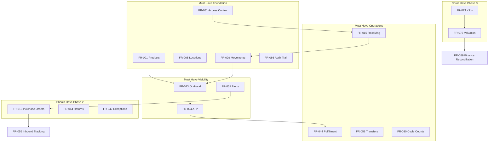

# MoSCoW Prioritization: Functional Requirements

**Document Owner:** Product Owner  
**Purpose:** Prioritize all functional requirements for the Inventory Management System using the MoSCoW method  
**Audience:** Business stakeholders, product owners, delivery teams, and steering committee  
**Scope:** Prioritization and business justification only — no technical design  
**Based On:** Functional Requirements (FR-001 – FR-090), Project Scope, Business Vision, SMART Objectives, and Feature Catalog

---

## MoSCoW Definitions

| Priority | Meaning | Release Alignment |
|----------|---------|-------------------|
| **Must Have** | Non-negotiable for go-live. The initiative fails or MVP success criteria are not met without this capability. | Phase 1 — MVP (Months 0–6) |
| **Should Have** | Important for operational performance after MVP stabilization. High business value, but the business can operate briefly without it while MVP matures. | Phase 2 (Months 6–12) |
| **Could Have** | Valuable for strategic maturity, analytics, and financial alignment. Desirable if capacity permits; deferrable without blocking daily operations. | Phase 3 (Months 12–18) |
| **Won't Have (Current Release)** | Not committed for the current 18-month initiative. Documented for traceability but deferred pending organizational readiness, policy decisions, or mature network data. | Beyond current initiative |

---

## Prioritization Summary

| Priority | Count | Percentage |
|----------|-------|------------|
| **Must Have** | 55 | 61% |
| **Should Have** | 26 | 29% |
| **Could Have** | 6 | 7% |
| **Won't Have (Current Release)** | 3 | 3% |
| **Total** | 90 | 100% |

### Priority by Domain

| Domain | Must | Should | Could | Won't |
|--------|------|--------|-------|-------|
| Master Data & Governance | 8 | 3 | 0 | 1 |
| Inbound & Receiving | 5 | 4 | 1 | 0 |
| Inventory Visibility | 5 | 1 | 0 | 0 |
| Inventory Control | 9 | 2 | 1 | 0 |
| Order Fulfillment | 6 | 3 | 1 | 0 |
| Replenishment | 3 | 3 | 0 | 1 |
| Network Transfers | 4 | 1 | 0 | 1 |
| Returns | 0 | 4 | 0 | 0 |
| Reporting & Dashboards | 4 | 1 | 2 | 0 |
| Notifications | 2 | 2 | 0 | 1 |
| User Access & Accountability | 5 | 0 | 0 | 0 |
| Governance & Audit | 4 | 2 | 2 | 0 |

---

## Must Have (55 Requirements)

*Required for MVP — establishes single source of truth, core operations, accountability, and fulfillment reliability.*

---

### FR-001: Create and Maintain Product Master Records

| Attribute | Detail |
|-----------|--------|
| **Priority** | **Must Have** |
| **Business Justification** | Foundational for every inventory operation. Without a unified product catalog, locations cannot receive, count, reserve, or ship consistently — directly addresses PP-07 (fragmented records) and BO-01 (single trusted view). |
| **Dependencies** | None — foundational requirement |
| **Why This Priority** | MVP explicitly requires product master records. No other FR can function without product identity. This is the first data pillar for go-live. |

---

### FR-002: Manage Product Status Lifecycle

| Attribute | Detail |
|-----------|--------|
| **Priority** | **Must Have** |
| **Business Justification** | Prevents discontinued and inactive products from entering replenishment and fulfillment flows — protecting against obsolete stock accumulation and ordering errors (BR-27). |
| **Dependencies** | FR-001 |
| **Why This Priority** | MVP scope includes active/inactive status. Status control is essential from day one to avoid shipping or reordering products the business has withdrawn. |

---

### FR-003: Support Product Identifier Lookup

| Attribute | Detail |
|-----------|--------|
| **Priority** | **Must Have** |
| **Business Justification** | Warehouse operators must identify products quickly and accurately during receiving, counting, and picking — reducing misidentification that causes PP-03 (accuracy failures). |
| **Dependencies** | FR-001 |
| **Why This Priority** | MVP includes barcode/identifier support. Operational speed and accuracy on the floor depend on reliable lookup from go-live. |

---

### FR-004: Detect and Resolve Duplicate Product Records

| Attribute | Detail |
|-----------|--------|
| **Priority** | **Must Have** |
| **Business Justification** | Duplicate SKUs destroy inventory trust at launch — especially during data migration — causing split stock records and false availability (PP-07). |
| **Dependencies** | FR-001 |
| **Why This Priority** | Data quality at go-live is a blocking risk (BR-06). Duplicate detection must be active before and during initial catalog load (FR-090). |

---

### FR-005: Configure and Maintain Inventory Locations

| Attribute | Detail |
|-----------|--------|
| **Priority** | **Must Have** |
| **Business Justification** | Stock cannot be tracked without defined locations. This enables BO-01 and is prerequisite for all location-scoped transactions across warehouses and stores. |
| **Dependencies** | None — foundational requirement |
| **Why This Priority** | MVP explicitly requires location configuration for primary sites. Every movement, count, and report depends on location master data. |

---

### FR-006: Manage Location Hierarchy

| Attribute | Detail |
|-----------|--------|
| **Priority** | **Must Have** |
| **Business Justification** | Supports regional accountability and rolled-up reporting even at MVP scale — preparing the network structure without requiring Phase 2 complexity. |
| **Dependencies** | FR-005 |
| **Why This Priority** | Multi-location MVP requires at minimum a logical network structure. Hierarchy enables filtered reporting and future regional management without rework. |

---

### FR-008: Define Stock Policy and Replenishment Thresholds

| Attribute | Detail |
|-----------|--------|
| **Priority** | **Must Have** |
| **Business Justification** | Enables proactive low-stock detection — MVP includes basic replenishment alerts. Without thresholds, PP-06 (reactive replenishment) persists unchanged. |
| **Dependencies** | FR-001, FR-005 |
| **Why This Priority** | MVP success criteria include low-stock and out-of-stock notifications. Alerts (FR-051) cannot function without threshold parameters. |

---

### FR-010: Establish Opening Stock Balance at Location Go-Live

| Attribute | Detail |
|-----------|--------|
| **Priority** | **Must Have** |
| **Business Justification** | Prevents go-live with embedded inventory errors — a critical risk (BR-06, BA-16) that would undermine all subsequent operations and BO-02 accuracy goals. |
| **Dependencies** | FR-005, FR-032 |
| **Why This Priority** | MVP go-live at primary locations requires verified opening balances. Cannot activate a location for transactions without a trusted baseline. |

---

### FR-011: Maintain Standard Reason Codes

| Attribute | Detail |
|-----------|--------|
| **Priority** | **Must Have** |
| **Business Justification** | Mandatory reason codes are required for adjustments, write-offs, and audit trail (BR-20) — supporting BO-03 standardization and PP-08 accountability. |
| **Dependencies** | None — can be configured at setup |
| **Why This Priority** | MVP requires reason codes for adjustments. Without them, shrinkage analysis and audit substantiation are impossible from day one. |

---

### FR-015: Receive and Verify Inbound Goods

| Attribute | Detail |
|-----------|--------|
| **Priority** | **Must Have** |
| **Business Justification** | Core inbound operation — every stock increase enters through receiving. Directly supports BO-03 (standardized movement recording) and BR-4 (verify before acceptance). |
| **Dependencies** | FR-001, FR-005, FR-003 |
| **Why This Priority** | MVP explicitly includes goods receipt. Without receiving, inventory only decreases and the system cannot reflect inbound supply. |

---

### FR-016: Document and Resolve Receipt Discrepancies

| Attribute | Detail |
|-----------|--------|
| **Priority** | **Must Have** |
| **Business Justification** | Protects inventory accuracy at the point of entry — addresses PP-03 and PP-05 by preventing silent acceptance of short shipments and damage (BR-6). |
| **Dependencies** | FR-015, FR-011 |
| **Why This Priority** | Discrepancies occur several times weekly at active receiving locations. MVP must handle them or accuracy fails immediately at the dock. |

---

### FR-017: Enforce Purchase Order Reference for Supplier Receipts

| Attribute | Detail |
|-----------|--------|
| **Priority** | **Must Have** |
| **Business Justification** | Maintains procurement control from first receipt (BR-7) — with authorized ad-hoc exception path for emergencies per MVP scope note. |
| **Dependencies** | FR-015; optionally FR-013 when PO module delivered |
| **Why This Priority** | MVP receiving requires PO reference with controlled exceptions. Prevents unauthorized receiving that corrupts financial and operational controls. |

---

### FR-018: Manage Put-Away and Stock Availability Timing

| Attribute | Detail |
|-----------|--------|
| **Priority** | **Must Have** |
| **Business Justification** | Ensures ATP reflects locatable stock only (BR-5) — preventing pick failures and overselling of goods in the receiving area. |
| **Dependencies** | FR-015 |
| **Why This Priority** | MVP must distinguish received vs. available stock. Promising dock stock that pickers cannot find recreates PP-04 fulfillment failures. |

---

### FR-019: Receive Return and Non-PO Inbound Stock

| Attribute | Detail |
|-----------|--------|
| **Priority** | **Must Have** |
| **Business Justification** | Captures all inventory increases in one system (BO-03) — including ad-hoc and return receipts at MVP locations even before full returns module (Phase 2). |
| **Dependencies** | FR-015, FR-011 |
| **Why This Priority** | MVP movement recording must be complete. Non-PO inbound occurs at launch; without capture, on-hand balances are immediately wrong. |

---

### FR-023: Display On-Hand Quantity by Product and Location

| Attribute | Detail |
|-----------|--------|
| **Priority** | **Must Have** |
| **Business Justification** | Core MVP promise — answer "what do we have and where?" (BO-01, PP-01). The primary value proposition of the entire initiative. |
| **Dependencies** | FR-001, FR-005, FR-029 |
| **Why This Priority** | MVP success criterion: ≥95% of stock inquiries answered via system. This is the central visibility capability. |

---

### FR-024: Display Available-to-Promise (ATP) Quantity

| Attribute | Detail |
|-----------|--------|
| **Priority** | **Must Have** |
| **Business Justification** | Prevents overselling (PP-04, BR-1) — the most critical customer-facing inventory failure mode cited in business vision and pain points. |
| **Dependencies** | FR-023, FR-025 |
| **Why This Priority** | MVP explicitly includes ATP visibility. Sales and fulfillment cannot operate without knowing what is still sellable. |

---

### FR-025: Display Reserved and Committed Stock

| Attribute | Detail |
|-----------|--------|
| **Priority** | **Must Have** |
| **Business Justification** | Explains the gap between on-hand and ATP — reducing sales/warehouse disputes and enabling accurate fulfillment planning. |
| **Dependencies** | FR-023, FR-042 |
| **Why This Priority** | MVP includes reserved stock visibility. Without it, ATP is distrusted and teams revert to manual warehouse calls. |

---

### FR-026: Indicate Stock Status (In Stock, Low Stock, Out of Stock)

| Attribute | Detail |
|-----------|--------|
| **Priority** | **Must Have** |
| **Business Justification** | Enables rapid daily operational review without manual threshold comparison — supports BO-05 stockout reduction at MVP. |
| **Dependencies** | FR-008, FR-024 |
| **Why This Priority** | MVP dashboard and alert logic depend on status indicators. Operational teams need at-a-glance problem identification from go-live. |

---

### FR-027: Search and Filter Inventory Views

| Attribute | Detail |
|-----------|--------|
| **Priority** | **Must Have** |
| **Business Justification** | Reduces warehouse interruption from ad-hoc inquiries (PP-20) and supports self-service availability checks for sales and operations. |
| **Dependencies** | FR-023 |
| **Why This Priority** | MVP requires search and filter by product, location, category, and status. Visibility without search is impractical at operational scale. |

---

### FR-029: Record All Inventory Movements with Full History

| Attribute | Detail |
|-----------|--------|
| **Priority** | **Must Have** |
| **Business Justification** | Complete movement history supports BO-03 (98% movement capture), PP-08 accountability, and root-cause investigation. |
| **Dependencies** | FR-001, FR-005 |
| **Why This Priority** | MVP audit and reporting depend on movement records. Every other transaction FR assumes movement logging exists. |

---

### FR-030: Schedule and Assign Cycle Counts

| Attribute | Detail |
|-----------|--------|
| **Priority** | **Must Have** |
| **Business Justification** | Sustains inventory accuracy post-go-live (BO-02) — rotating verification without disruptive full-wall counts only. |
| **Dependencies** | FR-001, FR-005 |
| **Why This Priority** | MVP includes cycle counts. Accuracy target of 90% by month 6 requires an active count program from launch. |

---

### FR-031: Perform Blind Cycle Counts

| Attribute | Detail |
|-----------|--------|
| **Priority** | **Must Have** |
| **Business Justification** | Produces credible accuracy metrics (BR-18) — without blind counting, BO-02 measurement is meaningless. |
| **Dependencies** | FR-030 |
| **Why This Priority** | Industry control standard and audit expectation. Non-blind counts would fail internal and external scrutiny. |

---

### FR-032: Conduct Full Physical Inventory Count

| Attribute | Detail |
|-----------|--------|
| **Priority** | **Must Have** |
| **Business Justification** | Required for opening balances (FR-010), annual substantiation, and correcting accumulated drift (BR-24). |
| **Dependencies** | FR-005, FR-030 |
| **Why This Priority** | MVP includes full physical count workflow. Go-live and year-end processes both require this capability. |

---

### FR-033: Identify and Report Count Variances

| Attribute | Detail |
|-----------|--------|
| **Priority** | **Must Have** |
| **Business Justification** | Focuses correction effort on material discrepancies (BR-22) — essential for BO-02 accuracy program effectiveness. |
| **Dependencies** | FR-030, FR-031, FR-032 |
| **Why This Priority** | Counting without variance identification is incomplete. MVP count workflow requires variance detection to close the control loop. |

---

### FR-034: Investigate and Approve Count Adjustments

| Attribute | Detail |
|-----------|--------|
| **Priority** | **Must Have** |
| **Business Justification** | Segregation of duties for count corrections (BR-19, BR-21) — prevents unauthorized inventory changes and supports PP-09 governance. |
| **Dependencies** | FR-033, FR-011 |
| **Why This Priority** | MVP requires approval workflow for count variances. Adjusting without investigation would recreate the trust problems the initiative solves. |

---

### FR-035: Process Stock Adjustments with Mandatory Reason Codes

| Attribute | Detail |
|-----------|--------|
| **Priority** | **Must Have** |
| **Business Justification** | Enables corrections for damage, shrinkage, and errors with accountability (BR-20) — core daily warehouse operation at every location. |
| **Dependencies** | FR-011, FR-037 |
| **Why This Priority** | MVP explicitly includes adjustments with reason codes. Physical reality diverges from records daily; corrections must be supported at launch. |

---

### FR-036: Process Inventory Write-Offs with Authorization

| Attribute | Detail |
|-----------|--------|
| **Priority** | **Must Have** |
| **Business Justification** | Removes unsellable stock from records with control (BR-23) — preventing ghost inventory and supporting loss prevention. |
| **Dependencies** | FR-035, FR-011, FR-037 |
| **Why This Priority** | Write-offs occur regularly at active locations. MVP must handle them or obsolete and damaged stock remains in sellable ATP. |

---

### FR-037: Enforce Adjustment Approval Thresholds

| Attribute | Detail |
|-----------|--------|
| **Priority** | **Must Have** |
| **Business Justification** | Proportional oversight for high-impact changes (BR-21) — addresses BN-02 approval bottlenecks with structured escalation from day one. |
| **Dependencies** | FR-035, FR-036, FR-034 |
| **Why This Priority** | MVP includes approval for adjustments. Even simple threshold rules are essential for internal control at go-live. |

---

### FR-041: Confirm Order Availability Before Commitment

| Attribute | Detail |
|-----------|--------|
| **Priority** | **Must Have** |
| **Business Justification** | Prevents overpromising to customers (PP-04, BR-1) — directly supports BO-06 fulfillment reliability from first order processed. |
| **Dependencies** | FR-024 |
| **Why This Priority** | MVP fulfillment support requires availability confirmation. This is the sales-facing gate that stops overselling. |

---

### FR-042: Reserve Inventory for Confirmed Orders

| Attribute | Detail |
|-----------|--------|
| **Priority** | **Must Have** |
| **Business Justification** | Prevents double-allocation during fulfillment window (BR-2) — essential for reliable ATP and pick operations. |
| **Dependencies** | FR-024, FR-041 |
| **Why This Priority** | MVP explicitly includes order reservation. Without reservation, concurrent orders compete for the same physical stock. |

---

### FR-043: Release Inventory Reservations

| Attribute | Detail |
|-----------|--------|
| **Priority** | **Must Have** |
| **Business Justification** | Restores ATP when orders cancel or complete — prevents stock being indefinitely locked to dead orders. |
| **Dependencies** | FR-042 |
| **Why This Priority** | Reservation without release breaks ATP over time. MVP partial fulfillment and cancellation handling require this paired capability. |

---

### FR-044: Support Pick, Pack, and Ship Workflow

| Attribute | Detail |
|-----------|--------|
| **Priority** | **Must Have** |
| **Business Justification** | Completes physical fulfillment with accurate deduction (BR-3) — core outbound operation and BO-03 movement recording. |
| **Dependencies** | FR-042, FR-003 |
| **Why This Priority** | MVP explicitly includes pick, pack, and ship. Outbound fulfillment is half of the inventory lifecycle and primary revenue enabler. |

---

### FR-045: Handle Partial Fulfillment

| Attribute | Detail |
|-----------|--------|
| **Priority** | **Must Have** |
| **Business Justification** | Balances customer service with inventory reality (BR-28) — MVP includes partial fulfillment; common when PP-04 conditions exist during rollout. |
| **Dependencies** | FR-042, FR-044 |
| **Why This Priority** | MVP scope explicitly includes partial fulfillment. Blocking entire orders when partial stock exists damages customer experience unnecessarily. |

---

### FR-049: Display Order Fulfillment Status

| Attribute | Detail |
|-----------|--------|
| **Priority** | **Must Have** |
| **Business Justification** | Reduces customer service inquiry time and prevents conflicting customer communications during MVP adoption. |
| **Dependencies** | FR-042, FR-044, FR-045 |
| **Why This Priority** | MVP order status visibility for operations and CS is essential. Without status, the system adds work instead of removing it. |

---

### FR-051: Generate Low-Stock and Out-of-Stock Alerts

| Attribute | Detail |
|-----------|--------|
| **Priority** | **Must Have** |
| **Business Justification** | Converts passive monitoring to actionable signals (BR-9, PP-06) — MVP explicitly includes low-stock and out-of-stock notifications. |
| **Dependencies** | FR-008, FR-024, FR-026 |
| **Why This Priority** | BO-05 stockout reduction starts with alerts. MVP success requires proactive notification, not just passive dashboards. |

---

### FR-052: Review and Acknowledge Stock Alerts

| Attribute | Detail |
|-----------|--------|
| **Priority** | **Must Have** |
| **Business Justification** | Ensures alerts drive action and prevents alert fatigue — closes the loop on FR-051 for purchasing daily workflow. |
| **Dependencies** | FR-051 |
| **Why This Priority** | Alerts without acknowledgment tracking recreate the "ignored email" problem. MVP replenishment workflow requires alert lifecycle management. |

---

### FR-053: Generate Replenishment Suggestions

| Attribute | Detail |
|-----------|--------|
| **Priority** | **Must Have** |
| **Business Justification** | Moves purchasing from gut-feel to threshold-driven discipline (PP-06) — MVP includes basic replenishment suggestions, not auto-PO. |
| **Dependencies** | FR-008, FR-051, FR-052 |
| **Why This Priority** | MVP scope includes replenishment suggestions based on thresholds. This is the minimum intelligence needed to act on alerts. |

---

### FR-058: Request Inter-Location Stock Transfers

| Attribute | Detail |
|-----------|--------|
| **Priority** | **Must Have** |
| **Business Justification** | Resolves local stockouts using network inventory (PP-02, BR-11) — MVP explicitly includes transfers between locations. |
| **Dependencies** | FR-005, FR-023, FR-024 |
| **Why This Priority** | Multi-location MVP cannot succeed without transfers. Stock imbalance is a critical pain point from day one of network go-live. |

---

### FR-059: Approve or Reject Transfer Requests

| Attribute | Detail |
|-----------|--------|
| **Priority** | **Must Have** |
| **Business Justification** | Prevents unauthorized stock movements that create new imbalances — control requirement paired with FR-058. |
| **Dependencies** | FR-058, FR-063 |
| **Why This Priority** | MVP transfers require approval per business process BP-24. Request without approval would weaken location accountability. |

---

### FR-060: Execute and Record Inter-Location Transfers

| Attribute | Detail |
|-----------|--------|
| **Priority** | **Must Have** |
| **Business Justification** | Ensures both locations reflect accurate balances (BO-03) — stock must not disappear between sites. |
| **Dependencies** | FR-059, FR-029 |
| **Why This Priority** | MVP transfer execution completes the network balancing loop. Approved transfers must update inventory at both locations. |

---

### FR-063: Enforce Source Location Minimum on Transfers

| Attribute | Detail |
|-----------|--------|
| **Priority** | **Must Have** |
| **Business Justification** | Prevents fixing one stockout by creating another (BR-12) — essential network protection rule from first transfer. |
| **Dependencies** | FR-008, FR-058, FR-059 |
| **Why This Priority** | MVP transfers must enforce source minimums. Without this, transfers could cascade stockouts across the network. |

---

### FR-068: Display Inventory Summary Dashboard

| Attribute | Detail |
|-----------|--------|
| **Priority** | **Must Have** |
| **Business Justification** | Management single view of inventory health (BO-01) — MVP success criterion includes dashboard access for inventory health. |
| **Dependencies** | FR-023, FR-026, FR-051 |
| **Why This Priority** | MVP explicitly includes inventory summary dashboard. Leadership must see network health without requesting manual reports. |

---

### FR-069: Generate Stock Movement Reports

| Attribute | Detail |
|-----------|--------|
| **Priority** | **Must Have** |
| **Business Justification** | Replaces manual movement reconstruction (BO-04) — supports audit, operational review, and BO-03 compliance measurement. |
| **Dependencies** | FR-029 |
| **Why This Priority** | MVP includes movement history reports. Accountability and audit both require exportable movement evidence. |

---

### FR-070: Generate Stockout and Overstock Reports

| Attribute | Detail |
|-----------|--------|
| **Priority** | **Must Have** |
| **Business Justification** | Directs action toward problem areas (BO-05) — purchasing and operations need prioritized lists beyond real-time alerts. |
| **Dependencies** | FR-026, FR-008 |
| **Why This Priority** | MVP includes stockout and overstock reports. Weekly management review depends on this structured output. |

---

### FR-071: Generate Inventory Accuracy and Variance Reports

| Attribute | Detail |
|-----------|--------|
| **Priority** | **Must Have** |
| **Business Justification** | Measures BO-02 accuracy progress — without measurement, the 90%/95% accuracy targets cannot be tracked or managed. |
| **Dependencies** | FR-030, FR-033, FR-034 |
| **Why This Priority** | MVP includes variance reports. Accuracy is a P1 critical objective; reporting proves progress to stakeholders. |

---

### FR-074: Support Basic Replenishment Reporting

| Attribute | Detail |
|-----------|--------|
| **Priority** | **Must Have** |
| **Business Justification** | Consolidates purchasing daily review (FR-051–053) into one view — reduces time spent gathering data from multiple screens. |
| **Dependencies** | FR-051, FR-053 |
| **Why This Priority** | MVP basic replenishment reporting supports buyer daily workflow. Alerts alone are insufficient for batch purchasing decisions. |

---

### FR-076: Deliver Low-Stock and Out-of-Stock Notifications

| Attribute | Detail |
|-----------|--------|
| **Priority** | **Must Have** |
| **Business Justification** | Ensures critical conditions reach decision-makers promptly — alerts (FR-051) must push to people, not wait for dashboard checks. |
| **Dependencies** | FR-051, FR-081 |
| **Why This Priority** | MVP includes notifications. Passive alerts in a queue without delivery fail the proactive replenishment objective. |

---

### FR-077: Deliver Pending Approval Notifications

| Attribute | Detail |
|-----------|--------|
| **Priority** | **Must Have** |
| **Business Justification** | Reduces approval bottlenecks (BN-01, BN-02) for adjustments, counts, and transfers — critical when MVP loads new approval workflows. |
| **Dependencies** | FR-037, FR-034, FR-059, FR-081 |
| **Why This Priority** | MVP introduces approval gates. Without notifications, approvals stall and operations revert to offline escalation. |

---

### FR-081: Enforce Role-Based Access Control

| Attribute | Detail |
|-----------|--------|
| **Priority** | **Must Have** |
| **Business Justification** | Protects inventory integrity (PP-09) — MVP requires basic roles: warehouse operator, supervisor, administrator. |
| **Dependencies** | None — platform requirement |
| **Why This Priority** | Cannot go live without access control. Segregation of duties and location accountability depend on roles from first transaction. |

---

### FR-082: Restrict Access by Location

| Attribute | Detail |
|-----------|--------|
| **Priority** | **Must Have** |
| **Business Justification** | Aligns system access with operational accountability — location managers must not change other locations' stock. |
| **Dependencies** | FR-005, FR-081 |
| **Why This Priority** | Multi-location MVP requires location-scoped access. Network-wide admin access for all users would undermine location ownership. |

---

### FR-083: Log User Activity for Accountability

| Attribute | Detail |
|-----------|--------|
| **Priority** | **Must Have** |
| **Business Justification** | Supports loss prevention and investigation (PP-08) — who did what is essential from first go-live day. |
| **Dependencies** | FR-081 |
| **Why This Priority** | MVP accountability requirement. User attribution on every transaction is a non-negotiable control for adoption trust. |

---

### FR-084: Enforce Segregation of Duties

| Attribute | Detail |
|-----------|--------|
| **Priority** | **Must Have** |
| **Business Justification** | Core internal control (BR-19) — counter cannot approve own count adjustments from go-live. |
| **Dependencies** | FR-081, FR-034, FR-037 |
| **Why This Priority** | MVP control requirement paired with count and adjustment workflows. Launching without SoD would fail audit readiness. |

---

### FR-085: Manage User Accounts and Role Assignments

| Attribute | Detail |
|-----------|--------|
| **Priority** | **Must Have** |
| **Business Justification** | Enables onboarding/offboarding as MVP rolls out to primary locations — prevents orphaned access. |
| **Dependencies** | FR-081 |
| **Why This Priority** | MVP requires administrator user management. Each new location go-live adds users; account lifecycle must be supported immediately. |

---

### FR-086: Maintain Complete Audit Trail of Inventory Changes

| Attribute | Detail |
|-----------|--------|
| **Priority** | **Must Have** |
| **Business Justification** | Immutable audit evidence (PP-08) — MVP explicitly includes audit trail with user and timestamp on all transactions. |
| **Dependencies** | FR-029, FR-083 |
| **Why This Priority** | Audit trail is MVP must-have. Finance and internal audit will not accept the system without complete change history. |

---

### FR-090: Support Initial Data Import for Product and Stock Setup

| Attribute | Detail |
|-----------|--------|
| **Priority** | **Must Have** |
| **Business Justification** | Practical go-live enabler — manual entry of full catalog at each location is infeasible within MVP timeline (BO-01). |
| **Dependencies** | FR-001, FR-005, FR-004, FR-010 |
| **Why This Priority** | MVP boundaries explicitly allow simple data import. Without import, rollout to primary locations is blocked by data entry volume. |

---

## Should Have (26 Requirements)

*Important for Phase 2 operational performance — deliver after MVP stabilization and adoption at primary locations.*

---

### FR-007: Plan Location Closure and Stock Disposition

| Attribute | Detail |
|-----------|--------|
| **Priority** | **Should Have** |
| **Business Justification** | Protects asset value during network changes — not needed for initial go-live at opening locations but required before first closure or consolidation event. |
| **Dependencies** | FR-005, FR-058, FR-060, FR-035 |
| **Why This Priority** | Infrequent but high-impact. MVP focuses on opening and operating locations; closure workflow can follow once core operations are stable. |

---

### FR-009: Classify Products by ABC Priority

| Attribute | Detail |
|-----------|--------|
| **Priority** | **Should Have** |
| **Business Justification** | Directs count and alert effort to high-impact items (BR-32) — improves BO-02 and BO-05 but requires cross-functional agreement (BR-07, BA-18). |
| **Dependencies** | FR-001, FR-030, FR-051 |
| **Why This Priority** | Phase 2 per scope. MVP operates with uniform thresholds; ABC optimization follows once baseline data exists post-go-live. |

---

### FR-012: Manage Inventory Governance Policies

| Attribute | Detail |
|-----------|--------|
| **Priority** | **Should Have** |
| **Business Justification** | Formalizes accountability (PP-09, MP-08) — addresses undefined approval thresholds (Q-06) that block full workflow automation. |
| **Dependencies** | FR-037, FR-034, FR-081 |
| **Why This Priority** | MVP uses hard-coded or configured thresholds; formal policy management follows organizational policy workshop outcomes in Phase 2. |

---

### FR-013: Record Purchase Order Commitments

| Attribute | Detail |
|-----------|--------|
| **Priority** | **Should Have** |
| **Business Justification** | Creates inbound visibility for receiving verification and availability projections — supports BO-05 but MVP can operate with summary-level inbound tracking first. |
| **Dependencies** | FR-001, FR-005, FR-015 |
| **Why This Priority** | Project scope postpones automated PO generation until MVP stable. PO recording is Phase 2 advanced replenishment prerequisite. |

---

### FR-014: Plan and Communicate Expected Inbound Deliveries

| Attribute | Detail |
|-----------|--------|
| **Priority** | **Should Have** |
| **Business Justification** | Improves receiving efficiency and CS restock communication — valuable once PO module (FR-013) exists. |
| **Dependencies** | FR-013 |
| **Why This Priority** | Depends on PO data. MVP receiving operates reactively on arrival; planning view adds value when inbound volume justifies preparation. |

---

### FR-020: Support Receipt Quantity Tolerance Evaluation

| Attribute | Detail |
|-----------|--------|
| **Priority** | **Should Have** |
| **Business Justification** | Balances receiving flexibility with control — requires defined tolerance parameters not yet established organizationally. |
| **Dependencies** | FR-015, FR-016, FR-013 |
| **Why This Priority** | MVP handles discrepancies manually via FR-016. Automated tolerance rules follow receiving policy definition in Phase 2. |

---

### FR-021: Cancel or Amend Open Purchase Orders

| Attribute | Detail |
|-----------|--------|
| **Priority** | **Should Have** |
| **Business Justification** | Maintains accurate inbound projections when supplier commitments change — requires active PO module. |
| **Dependencies** | FR-013 |
| **Why This Priority** | Phase 2 PO lifecycle completion. MVP ad-hoc receiving covers emergencies; full PO lifecycle follows PO recording capability. |

---

### FR-028: Display Expected Inbound and Network-Wide Availability

| Attribute | Detail |
|-----------|--------|
| **Priority** | **Should Have** |
| **Business Justification** | Enables transfer-before-purchase discipline (BR-11) and realistic CS restock dates — high value once PO and network data are trustworthy. |
| **Dependencies** | FR-013, FR-023, FR-024 |
| **Why This Priority** | Phase 2 visibility enhancement. MVP location-level ATP is sufficient initially; network aggregation adds value after multi-site adoption. |

---

### FR-038: Manage Quarantine and Hold Stock Status

| Attribute | Detail |
|-----------|--------|
| **Priority** | **Should Have** |
| **Business Justification** | Prevents shipping defective or uninspected goods (BR-13) — important for returns and damage but not daily MVP path. |
| **Dependencies** | FR-024, FR-035, FR-065 |
| **Why This Priority** | Phase 2 per scope (returns and quarantine deferred). MVP can use adjustments for damage; formal quarantine follows returns workflow. |

---

### FR-039: Analyze Shrinkage and Loss Trends

| Attribute | Detail |
|-----------|--------|
| **Priority** | **Should Have** |
| **Business Justification** | Converts adjustment data into management insight (BP-15) — requires 3–6 months of MVP transaction history to be meaningful. |
| **Dependencies** | FR-035, FR-036, FR-011, FR-071 |
| **Why This Priority** | Phase 2 analytics. Shrinkage trends need baseline data from MVP operations before analysis delivers actionable patterns. |

---

### FR-046: Manage Backorders and Replenishment Priority

| Attribute | Detail |
|-----------|--------|
| **Priority** | **Should Have** |
| **Business Justification** | Fair and efficient delayed-order fulfillment — requires defined backorder priority policy (Q-07) not yet resolved. |
| **Dependencies** | FR-045, FR-042, FR-053 |
| **Why This Priority** | MVP partial fulfillment creates backorders; Phase 2 adds priority queue automation once policy is defined and volume justifies it. |

---

### FR-047: Handle Outbound Fulfillment Exceptions

| Attribute | Detail |
|-----------|--------|
| **Priority** | **Should Have** |
| **Business Justification** | Minimizes customer impact from pick failures and damage (PP-03) — structured exception workflow beyond MVP basic partial ship. |
| **Dependencies** | FR-044, FR-035, FR-049 |
| **Why This Priority** | Phase 2 per feature catalog. MVP handles basic partial fulfillment; formal exception management follows operational volume and CS feedback. |

---

### FR-048: Support Multi-Location Split Fulfillment

| Attribute | Detail |
|-----------|--------|
| **Priority** | **Should Have** |
| **Business Justification** | Maximizes network fill rate — valuable when multi-site MVP is stable and order volume justifies split shipment complexity. |
| **Dependencies** | FR-041, FR-042, FR-044, FR-060 |
| **Why This Priority** | Phase 2 capability. MVP fulfills from single location per order; split fulfillment adds coordination overhead not needed on day one. |

---

### FR-054: Create and Track Purchase Requisitions

| Attribute | Detail |
|-----------|--------|
| **Priority** | **Should Have** |
| **Business Justification** | Formalizes replenishment-to-procurement handoff with approval accountability — Phase 2 advanced replenishment workflow. |
| **Dependencies** | FR-053, FR-013, FR-077 |
| **Why This Priority** | Project scope: advanced replenishment in Phase 2. MVP suggestions suffice initially; requisitions add process formality when purchasing adopts system. |

---

### FR-055: Track Inbound Supply Status

| Attribute | Detail |
|-----------|--------|
| **Priority** | **Should Have** |
| **Business Justification** | Enables realistic CS restock communication (BP-23) — depends on PO module and reduces PP-20 inquiry volume. |
| **Dependencies** | FR-013, FR-028 |
| **Why This Priority** | Phase 2 inbound tracking. MVP buyers track inbound externally; system visibility follows PO integration. |

---

### FR-056: Enforce Safety Stock Protection Rules

| Attribute | Detail |
|-----------|--------|
| **Priority** | **Should Have** |
| **Business Justification** | Preserves buffer stock (BR-10) — requires mature safety stock parameters and exception approval process. |
| **Dependencies** | FR-008, FR-042, FR-058, FR-012 |
| **Why This Priority** | Phase 2 policy enforcement. MVP defines safety stock; automated enforcement with exceptions follows governance policy definition (Q-06). |

---

### FR-061: Monitor In-Transit Inventory

| Attribute | Detail |
|-----------|--------|
| **Priority** | **Should Have** |
| **Business Justification** | Accountability for stock between dispatch and receipt — addresses workflow gap WG-02 identified in domain analysis. |
| **Dependencies** | FR-060 |
| **Why This Priority** | Phase 2 transfer enhancement. MVP records dispatch and receipt; explicit in-transit state adds value when transfer volume grows. |

---

### FR-064: Authorize and Record Customer Returns

| Attribute | Detail |
|-----------|--------|
| **Priority** | **Should Have** |
| **Business Justification** | Connects returns to orders (BR-25) — project scope defers structured returns to Phase 2 after outbound fulfillment accuracy is proven. |
| **Dependencies** | FR-049, FR-019 |
| **Why This Priority** | Phase 2 returns module. MVP captures basic return receipt (FR-019); full RA workflow follows fulfillment stabilization. |

---

### FR-065: Receive and Inspect Returned Goods

| Attribute | Detail |
|-----------|--------|
| **Priority** | **Should Have** |
| **Business Justification** | Ensures only resalable goods re-enter ATP (BR-26) — paired with returns module. |
| **Dependencies** | FR-064, FR-038 |
| **Why This Priority** | Phase 2. Inspection workflow requires return authorization process (FR-064) not in MVP scope. |

---

### FR-066: Restock or Write Off Returned Inventory

| Attribute | Detail |
|-----------|--------|
| **Priority** | **Should Have** |
| **Business Justification** | Accurate post-return inventory state — completes returns lifecycle. |
| **Dependencies** | FR-065, FR-035, FR-036 |
| **Why This Priority** | Phase 2 completion of returns chain. Depends on inspection workflow (FR-065). |

---

### FR-067: Track Return Processing Status

| Attribute | Detail |
|-----------|--------|
| **Priority** | **Should Have** |
| **Business Justification** | Reduces CS escalations on return timing — customer-facing value once returns volume justifies module. |
| **Dependencies** | FR-064, FR-065, FR-066 |
| **Why This Priority** | Phase 2 CS enablement. MVP CS handles returns externally; status tracking follows structured returns go-live. |

---

### FR-072: Provide Location Performance Snapshots

| Attribute | Detail |
|-----------|--------|
| **Priority** | **Should Have** |
| **Business Justification** | Fair cross-location accountability (PP-08) — requires comparable MVP data across sites for 3+ months. |
| **Dependencies** | FR-071, FR-070, FR-068 |
| **Why This Priority** | Phase 2 management reporting. Location comparison is meaningful only after all primary sites operate on system with history. |

---

### FR-078: Deliver Transfer and Fulfillment Exception Alerts

| Attribute | Detail |
|-----------|--------|
| **Priority** | **Should Have** |
| **Business Justification** | Rapid response to operational exceptions — follows formal exception workflows (FR-047, FR-061). |
| **Dependencies** | FR-047, FR-061, FR-076 |
| **Why This Priority** | Phase 2 notification extension. MVP covers stock and approval alerts; exception alerts follow exception module adoption. |

---

### FR-079: Deliver Inbound Supply Delay Notifications

| Attribute | Detail |
|-----------|--------|
| **Priority** | **Should Have** |
| **Business Justification** | Proactive restock delay communication — depends on PO tracking (FR-055). |
| **Dependencies** | FR-055, FR-076 |
| **Why This Priority** | Phase 2. MVP purchasing tracks delays externally; automated delay notifications follow inbound supply tracking. |

---

### FR-087: Support Audit and Control Review Queries

| Attribute | Detail |
|-----------|--------|
| **Priority** | **Should Have** |
| **Business Justification** | Reduces audit preparation effort — first internal audit cycle typically 6–9 months post-go-live. |
| **Dependencies** | FR-086, FR-083, FR-084 |
| **Why This Priority** | Phase 2 audit enablement. MVP audit trail (FR-086) suffices initially; structured audit packages follow first audit cycle planning. |

---

### FR-088: Detect and Record Control Policy Breaches

| Attribute | Detail |
|-----------|--------|
| **Priority** | **Should Have** |
| **Business Justification** | Makes control weaknesses visible proactively (BP-32) — requires mature policy definitions (FR-012). |
| **Dependencies** | FR-012, FR-086, FR-083 |
| **Why This Priority** | Phase 2 governance maturity. Breach detection requires defined policies not finalized at MVP. Automated detection follows governance workshop. |

---

## Could Have (6 Requirements)

*Phase 3 strategic maturity — deliver if Phase 1 and 2 succeed and capacity allows within 12–18 month window.*

---

### FR-022: Record Supplier Delivery Performance

| Attribute | Detail |
|-----------|--------|
| **Priority** | **Could Have** |
| **Business Justification** | Informs supplier relationship management and replenishment timing — valuable but not required for daily operations. |
| **Dependencies** | FR-013, FR-016, FR-015 |
| **Why This Priority** | Phase 3 per FR document. Requires months of PO and receipt data. Long-term supplier analytics per scope Scale & Integration phase. |

---

### FR-040: Review and Action Obsolete and Slow-Moving Stock

| Attribute | Detail |
|-----------|--------|
| **Priority** | **Could Have** |
| **Business Justification** | Releases working capital (PP-15) — requires movement history maturity of 6–12 months to identify slow movers reliably. |
| **Dependencies** | FR-029, FR-002, FR-070, FR-035 |
| **Why This Priority** | Phase 3 aging analysis. MVP focuses on accuracy and availability; obsolescence management follows stable operational data. |

---

### FR-050: Support Authorized Product Substitution

| Attribute | Detail |
|-----------|--------|
| **Priority** | **Could Have** |
| **Business Justification** | Recovers revenue from would-be failed fulfillments — requires substitution policy (Q-08) and approved alternate lists not yet defined. |
| **Dependencies** | FR-047, FR-001, FR-044 |
| **Why This Priority** | Phase 3 exception capability. Domain analysis flagged undefined substitution policy; defer until policy workshop completes. |

---

### FR-073: Report Inventory Performance KPIs

| Attribute | Detail |
|-----------|--------|
| **Priority** | **Could Have** |
| **Business Justification** | Measures BO-06 operational maturity — fill rate, turnover, days of supply require stable baseline data and agreed metric definitions. |
| **Dependencies** | FR-068, FR-071, FR-049, FR-029 |
| **Why This Priority** | Phase 3 per scope (inventory performance KPIs). MVP/Phase 2 operational reports suffice until KPI targets are validated organizationally (Q-12). |

---

### FR-075: Support Inventory Valuation Summary Views

| Attribute | Detail |
|-----------|--------|
| **Priority** | **Could Have** |
| **Business Justification** | Bridges operations and finance (PP-05, BO-07) — requires agreed costing method (Q-11) not yet defined. |
| **Dependencies** | FR-023, FR-035, FR-036; organizational costing method decision |
| **Why This Priority** | Phase 3 financial alignment per scope. Finance reconciliation is explicitly Phase 3; quantity accuracy is MVP/Phase 2 priority. |

---

### FR-089: Support Financial Inventory Reconciliation

| Attribute | Detail |
|-----------|--------|
| **Priority** | **Could Have** |
| **Business Justification** | Enables timely month-end close (BP-30) — high finance value but depends on FR-075 and mature adjustment/write-off processes. |
| **Dependencies** | FR-075, FR-086, FR-071, FR-036 |
| **Why This Priority** | Phase 3 per scope. Project explicitly states finance alignment is Phase 3 goal; MVP focuses on quantity accuracy not valuation. |

---

## Won't Have (Current Release) (3 Requirements)

*Explicitly deferred beyond the current 18-month initiative — documented for traceability and future program planning.*

---

### FR-057: Support Promotional Stock Readiness Review

| Attribute | Detail |
|-----------|--------|
| **Priority** | **Won't Have (Current Release)** |
| **Business Justification** | Protects campaign ROI (BR-29) — valuable for marketing but not required for core inventory control and visibility objectives. |
| **Dependencies** | FR-008, FR-013, FR-028, FR-053; marketing campaign calendar integration |
| **Why This Priority** | Project scope defers campaign-specific capabilities until core operations proven. Requires cross-functional campaign coordination (BP-31) and marketing process maturity. Organizational readiness for ring-fenced promotional stock is not expected within 18 months. Documented for future commercial alignment program. |

---

### FR-062: Analyze and Recommend Network Rebalancing

| Attribute | Detail |
|-----------|--------|
| **Priority** | **Won't Have (Current Release)** |
| **Business Justification** | Optimizes enterprise inventory investment (PP-02) — but project scope warns premature network optimization causes bad transfers without trustworthy data. |
| **Dependencies** | FR-028, FR-058, FR-070, FR-072; trustworthy data across all locations |
| **Why This Priority** | Scope principle: "Network-wide stock optimization — premature recommendations may cause bad transfers." Long-term goal (18+ months). Manual transfer requests (FR-058) cover MVP/Phase 2 needs. Automated rebalancing recommendations deferred until accuracy ≥95% sustained two quarters (BO-02). |

---

### FR-080: Deliver Campaign and Launch Readiness Alerts

| Attribute | Detail |
|-----------|--------|
| **Priority** | **Won't Have (Current Release)** |
| **Business Justification** | Early warning for marketing campaigns — depends on FR-057 which is also deferred. |
| **Dependencies** | FR-057, FR-076, FR-051 |
| **Why This Priority** | Paired with FR-057 — no campaign readiness review means no readiness alerts. Deferred to future commercial alignment release. Low daily operational impact; medium priority process (BP-31) does not justify current release commitment. |

---

## Dependency Overview

---

## Prioritization Principles Applied

| Principle | Application |
|-----------|-------------|
| **Accuracy before intelligence** | Must Have focuses on recording, counting, and visibility; Could Have analytics wait for clean data |
| **Visibility before optimization** | Network rebalancing (FR-062) is Won't Have; basic transfers (FR-058) are Must Have |
| **Core operations before edge cases** | Substitution (FR-050) and split fulfillment (FR-048) are Should/Could Have |
| **Adoption before expansion** | Returns module (FR-064–067) is Should Have after fulfillment proven |
| **Business value over feature volume** | Promotional features (FR-057, FR-080) deferred despite medium process priority |

---

## Alignment with Business Objectives

| Objective | Must Have FRs | Should Have FRs | Could Have FRs |
|-----------|---------------|-----------------|----------------|
| BO-01 Single trusted view | FR-023, FR-024, FR-027, FR-068 | FR-028, FR-072 | FR-073 |
| BO-02 Inventory accuracy | FR-030–034, FR-071 | FR-039, FR-009 | — |
| BO-03 Standardized recording | FR-015, FR-029, FR-044, FR-060 | FR-064–066 | — |
| BO-04 Reduce reconciliation | FR-069, FR-068 | FR-072, FR-087 | FR-089 |
| BO-05 Reduce stockouts | FR-051–053, FR-070 | FR-054–055, FR-056 | FR-040 |
| BO-06 Fulfillment reliability | FR-041–045, FR-049 | FR-046–048 | FR-050 |
| BO-07 Financial alignment | FR-086 | FR-088 | FR-075, FR-089 |

---

## Out of Scope (Not in FR Catalog)

The following capabilities are **Won't Have** for the entire IMS initiative — they are not represented as functional requirements:

- General ledger, AP/AR, and payment processing
- Full ERP, manufacturing, MRP, and BOM management
- CRM, pricing engine, and e-commerce storefront
- AI/ML demand forecasting and automated PO generation
- Marketplace, POS, supplier EDI, and external integrations
- Regulatory compliance modules (serialization, pharma track-and-trace)
- Batch/lot tracking, bin-level management, kitting, mobile apps (deferred per scope)

---

## Document Summary

All **90 functional requirements** are prioritized using MoSCoW:

- **55 Must Have (61%)** — MVP go-live essentials
- **26 Should Have (29%)** — Phase 2 operational performance
- **6 Could Have (7%)** — Phase 3 strategic maturity
- **3 Won't Have (3%)** — Deferred beyond current 18-month initiative

Prioritization aligns with Project Scope phased delivery, SMART business objectives, and domain analysis readiness constraints. Must Have requirements form the critical path; Should Have requirements depend on MVP adoption success; Could Have requirements depend on organizational policy decisions (Q-06, Q-11, Q-12) and data maturity.

---

*End of MoSCoW Prioritization Document*
