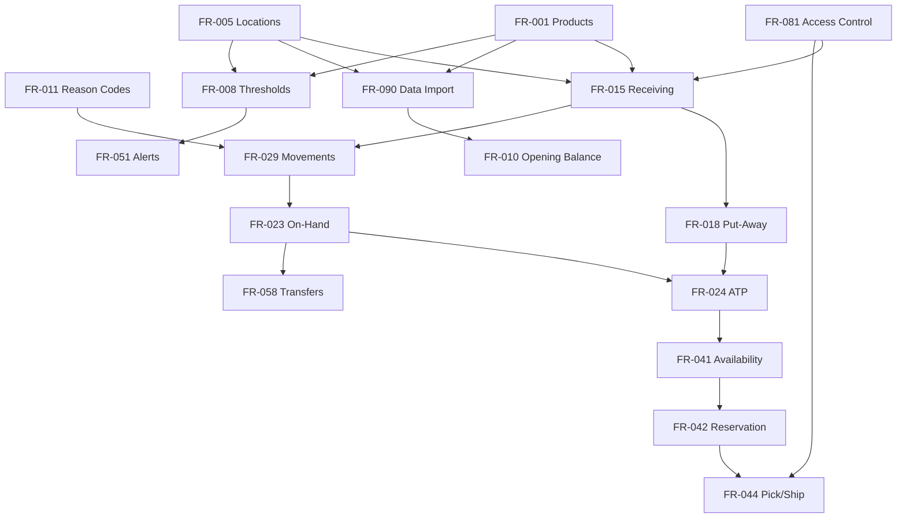

# Functional Requirements Dependency Analysis

**Document Owner:** Senior Business Analyst  
**Purpose:** Analyze and document business dependencies between all functional requirements (FR-001 – FR-090)  
**Audience:** Product owners, business analysts, delivery planners, and QA  
**Scope:** Business dependencies only — not technical architecture, database design, or integration patterns  
**Based On:** Functional Requirements Document, MoSCoW Prioritization, Business Process Analysis, and Business Workflows

---

## How to Read This Document

A **business dependency** exists when one requirement must be in place — or a business process it supports must be operating — before another requirement can deliver correct business outcomes. Dependencies reflect operational sequencing, data prerequisites, policy foundations, and control relationships from a business perspective.

### Dependency Types

| Type | Code | Definition |
|------|------|------------|
| **Master Data Prerequisite** | MDP | Parent provides product, location, or reference data the dependent cannot function without |
| **Process Prerequisite** | PP | Parent business process must be established and operating before dependent process is meaningful |
| **Policy Prerequisite** | POL | Parent defines thresholds, rules, or governance parameters that the dependent applies or enforces |
| **Transactional Data Flow** | TDF | Parent generates inventory movements or balances that the dependent reads, reports on, or acts upon |
| **Control Prerequisite** | CP | Parent establishes authorization, segregation of duties, or accountability the dependent relies on |
| **Decision Prerequisite** | DP | Parent enables a business decision (availability, approval, disposition) required by the dependent |
| **Visibility Prerequisite** | VP | Parent provides inventory status information the dependent consumes for action or communication |

### Relationship Notation

- **Parent Requirement** = must exist or be operational first (predecessor)
- **Dependent Requirement** = relies on the parent (successor)

---

## Executive Summary

| Metric | Value |
|--------|-------|
| Total functional requirements | 90 |
| Documented dependency relationships | 185 |
| Foundational requirements (no in-catalog parent) | 4 (FR-001, FR-005, FR-011, FR-081) |
| Requirements with highest fan-in (most dependents) | FR-001 (28), FR-005 (22), FR-023 (18), FR-029 (14), FR-024 (12) |

### Critical Business Dependency Chains

```
FR-001 (Products) + FR-005 (Locations)
    → FR-029 (Movements) → FR-023 (On-Hand) → FR-024 (ATP)
        → FR-041 (Availability) → FR-042 (Reservation) → FR-044 (Pick/Ship)

FR-005 (Locations) → FR-010 (Opening Balance) → Operational Go-Live

FR-008 (Thresholds) → FR-051 (Alerts) → FR-053 (Suggestions) → FR-013 (POs)

FR-030 (Cycle Count) → FR-033 (Variance) → FR-034 (Approval) → FR-035 (Adjustment)

FR-081 (Access Control) → All operational transactions
```

---

## Dependency Register

### Domain 1: Master Data & Governance

| ID | Parent | Dependent | Type | Reason | Business Impact if Implemented Out of Order |
|----|--------|-----------|------|--------|---------------------------------------------|
| DEP-001 | FR-001 | FR-002 | MDP | Product status applies to an existing product identity | Status changes would have no product to attach to; discontinued/active rules would not apply to any record |
| DEP-002 | FR-001 | FR-003 | MDP | Lookup requires product records with identifiers | Operators cannot find products during receiving, counting, or picking; floor operations halt |
| DEP-003 | FR-001 | FR-004 | MDP | Duplicate detection compares against existing product catalog | Duplicates would not be identified; fragmented stock records created at go-live |
| DEP-004 | FR-001 | FR-008 | MDP | Thresholds are defined per product (and location) | Reorder levels cannot be assigned; alert and replenishment logic has no product context |
| DEP-005 | FR-005 | FR-006 | MDP | Hierarchy organizes existing locations | Regional rollups would reference non-existent or orphan locations; network reporting invalid |
| DEP-006 | FR-005 | FR-007 | PP | Location closure requires an active location with stock | Closure disposition cannot be planned; stranded inventory risk at decommissioned sites |
| DEP-007 | FR-005 | FR-008 | MDP | Thresholds are defined per product and location | Location-specific stock policy impossible; alerts misdirected or absent |
| DEP-008 | FR-005 | FR-010 | PP | Opening balance establishes inventory at a configured location | Balances recorded against undefined locations; go-live baseline invalid |
| DEP-009 | FR-001 | FR-010 | MDP | Opening balance counts require valid product identities | Unknown SKUs at go-live corrupt baseline; fulfillment and receiving fail from day one |
| DEP-010 | FR-032 | FR-010 | PP | Full count methodology supports verified opening balance substantiation | Opening balances lack audit credibility; finance and operations reject go-live baseline |
| DEP-011 | FR-001 | FR-009 | TDF | ABC classification requires product identity and benefits from movement history | Classification assigns to wrong or non-existent products; priority rules misapplied |
| DEP-012 | FR-029 | FR-009 | TDF | ABC classification uses velocity and movement data | Classification based on incomplete data; count and alert priorities misdirected |
| DEP-013 | FR-037 | FR-012 | POL | Governance policies reference approval thresholds already in use | Policy document disconnected from actual approval behavior; audit confusion |
| DEP-014 | FR-034 | FR-012 | PP | Count variance approval experience informs formal governance policy | Policies defined without operational context; impractical rules rejected by warehouse teams |
| DEP-015 | FR-001 | FR-040 | MDP | Obsolete/slow-moving review applies to product records | Aging analysis cannot identify products; working capital review invalid |
| DEP-016 | FR-029 | FR-040 | TDF | Slow-moving identification requires movement history | False obsolescence flags or missed dead stock; wrong clearance/write-off decisions |
| DEP-017 | FR-002 | FR-040 | DP | Discontinued status triggers obsolete stock review | Discontinued products not flagged for clearance; obsolete stock accumulates |
| DEP-018 | FR-001 | FR-090 | MDP | Product import creates product master records | Import loads orphan data without product structure; catalog unusable |
| DEP-019 | FR-004 | FR-090 | CP | Duplicate detection must run during product import | Import embeds duplicate SKUs; split inventory from go-live |
| DEP-020 | FR-005 | FR-090 | MDP | Opening balance import requires valid locations | Balances imported to undefined locations; network totals wrong |

---

### Domain 2: Inbound & Receiving

| ID | Parent | Dependent | Type | Reason | Business Impact if Implemented Out of Order |
|----|--------|-----------|------|--------|---------------------------------------------|
| DEP-021 | FR-001 | FR-013 | MDP | Purchase orders reference valid products | PO lines for unknown SKUs; receiving cannot match and inbound visibility useless |
| DEP-022 | FR-005 | FR-013 | MDP | POs specify receiving location | Inbound directed to undefined site; receipt routing failure |
| DEP-023 | FR-013 | FR-014 | TDF | Inbound planning consumes open PO expected delivery data | Receiving schedule empty; dock unprepared despite outstanding orders |
| DEP-024 | FR-001 | FR-015 | MDP | Receipt requires product identification | Goods received against unknown products; inventory corrupted at entry |
| DEP-025 | FR-005 | FR-015 | MDP | Receipt assigns stock to a location | Received stock not locatable; network visibility broken |
| DEP-026 | FR-003 | FR-015 | PP | Receiving uses product lookup for verification | Slow, error-prone manual identification; receipt mismatches increase |
| DEP-027 | FR-013 | FR-017 | POL | Standard receipt validates against PO reference (BR-7) | Receipt control absent; unauthorized inbound accepted |
| DEP-028 | FR-015 | FR-016 | PP | Discrepancy resolution follows goods receipt verification | Discrepancies without receipt context; supplier disputes lack evidence |
| DEP-029 | FR-011 | FR-016 | POL | Discrepancy documentation uses reason codes | Discrepancies uncategorized; supplier performance analysis impossible |
| DEP-030 | FR-015 | FR-018 | PP | Put-away follows verified goods receipt (BR-5) | Stock marked available before receipt verified; ATP inflated incorrectly |
| DEP-031 | FR-015 | FR-019 | PP | Non-PO inbound follows same receipt foundation as PO receipt | Return/ad-hoc receipts bypass controls; incomplete movement history |
| DEP-032 | FR-013 | FR-020 | POL | Tolerance evaluation compares receipt to PO expected quantity | Tolerance rules operate without benchmark; over/under-ship acceptance arbitrary |
| DEP-033 | FR-015 | FR-020 | PP | Tolerance evaluated at receipt submission | Tolerance logic disconnected from receipt event; variances missed at dock |
| DEP-034 | FR-013 | FR-021 | PP | PO amendment applies to open purchase order records | Amendments to non-existent POs; inbound projections corrupted |
| DEP-035 | FR-013 | FR-022 | TDF | Supplier performance derived from PO and receipt records | Performance metrics without PO context; OTIF and accuracy meaningless |
| DEP-036 | FR-016 | FR-022 | TDF | Discrepancy history feeds supplier quality metrics | Supplier scorecard ignores receipt failures; bad suppliers not identified |
| DEP-037 | FR-081 | FR-015 | CP | Receiving requires authorized warehouse role | Uncontrolled receipts; accountability and audit trail compromised |
| DEP-038 | FR-018 | FR-024 | DP | ATP increases only after put-away complete (BR-5) | Customers promised stock in receiving area; pick failures and overselling |

---

### Domain 3: Inventory Visibility & Status

| ID | Parent | Dependent | Type | Reason | Business Impact if Implemented Out of Order |
|----|--------|-----------|------|--------|---------------------------------------------|
| DEP-039 | FR-029 | FR-023 | TDF | On-hand calculated from recorded movements | On-hand displays without transaction foundation; numbers untrusted (PP-01 persists) |
| DEP-040 | FR-001 | FR-023 | MDP | On-hand viewed per product | Location stock totals without product breakdown useless |
| DEP-041 | FR-005 | FR-023 | MDP | On-hand viewed per location | Enterprise totals without location context; network decisions impossible |
| DEP-042 | FR-023 | FR-024 | TDF | ATP derived from on-hand minus commitments | ATP shown without on-hand basis; availability numbers fabricated |
| DEP-043 | FR-025 | FR-024 | TDF | Reservations reduce ATP | ATP ignores committed stock; overselling resumes (PP-04) |
| DEP-044 | FR-038 | FR-024 | TDF | Quarantined stock excluded from ATP (BR-13) | Defective/held stock promised to customers; quality and compliance risk |
| DEP-045 | FR-018 | FR-024 | TDF | Unput-away stock excluded from ATP | Dock stock sold but unpickable; fulfillment failures |
| DEP-046 | FR-042 | FR-025 | TDF | Reservations created by order confirmation process | Reserved stock view empty while orders pending; sales/warehouse dispute ATP |
| DEP-047 | FR-008 | FR-026 | POL | Status indicators derived from threshold comparison | In stock/low/out status arbitrary without thresholds; daily review unreliable |
| DEP-048 | FR-024 | FR-026 | VP | Status based on current ATP relative to thresholds | Status contradicts availability; false confidence or false alarms |
| DEP-049 | FR-023 | FR-027 | VP | Search returns inventory records with quantities | Search finds products but no stock context; inquiry value lost |
| DEP-050 | FR-013 | FR-028 | TDF | Expected inbound derived from open PO quantities | Inbound projection absent; CS cannot quote restock dates accurately |
| DEP-051 | FR-023 | FR-028 | VP | Network availability aggregates location on-hand/ATP | Network view without location balances; transfer-before-purchase impossible |
| DEP-052 | FR-082 | FR-027 | CP | Search results scoped to authorized locations | Users see or act on unauthorized location data; accountability breach |

---

### Domain 4: Inventory Control & Accuracy

| ID | Parent | Dependent | Type | Reason | Business Impact if Implemented Out of Order |
|----|--------|-----------|------|--------|---------------------------------------------|
| DEP-053 | FR-001 | FR-029 | MDP | Movements reference valid products | Transactions for unknown SKUs; audit trail and balances corrupt |
| DEP-054 | FR-005 | FR-029 | MDP | Movements occur at valid locations | Stock appears at undefined locations; network totals invalid |
| DEP-055 | FR-015 | FR-029 | PP | Receipt is primary inbound movement type | Inbound movements missing; on-hand lower than physical reality |
| DEP-056 | FR-044 | FR-029 | PP | Shipment is primary outbound movement type | Outbound movements missing; on-hand higher than physical; overselling |
| DEP-057 | FR-001 | FR-030 | MDP | Count tasks assign valid products | Counts for unknown SKUs; accuracy program invalid |
| DEP-058 | FR-005 | FR-030 | MDP | Counts scheduled by location | Count program without location scope; wrong site counted |
| DEP-059 | FR-009 | FR-030 | POL | ABC class drives count frequency (BR-32) | All items treated equally; A-items under-counted, stockouts undetected |
| DEP-060 | FR-030 | FR-031 | PP | Blind count executes within assigned cycle count task | Blind count without task structure; uncontrolled counts, no schedule |
| DEP-061 | FR-030 | FR-033 | TDF | Variance calculated from submitted count results | Variances without count submission; false adjustments |
| DEP-062 | FR-032 | FR-033 | TDF | Full count also produces variances for investigation | Full count variances handled outside standard workflow; audit gap |
| DEP-063 | FR-033 | FR-034 | PP | Investigation follows identified variance (BR-22) | Adjustments without investigation; recurring errors continue |
| DEP-064 | FR-011 | FR-034 | POL | Approved adjustments require reason context from investigation | Corrections without categorized cause; shrinkage analysis useless |
| DEP-065 | FR-084 | FR-034 | CP | Counter cannot approve own count (BR-19) | Self-approved adjustments; fraud and error risk; audit failure |
| DEP-066 | FR-011 | FR-035 | POL | Adjustments require mandatory reason codes (BR-20) | Uncategorized corrections; PP-08 accountability not improved |
| DEP-067 | FR-034 | FR-035 | PP | Count-driven adjustments follow approved variance investigation | Unauthorized count corrections; record integrity destroyed |
| DEP-068 | FR-037 | FR-035 | CP | High-value adjustments require independent approval (BR-21) | Large unauthorized changes; financial misstatement risk |
| DEP-069 | FR-011 | FR-036 | POL | Write-offs require reason codes (BR-23) | Write-offs untracked by cause; loss prevention blind |
| DEP-070 | FR-037 | FR-036 | CP | Write-offs above threshold need authorization (BR-23) | Unauthorized disposal; fraud and margin distortion |
| DEP-071 | FR-035 | FR-036 | PP | Write-off is permanent removal; adjustment is general correction | Write-off process confused with reversible adjustment; record inconsistency |
| DEP-072 | FR-012 | FR-037 | POL | Approval thresholds defined in governance policy | Threshold routing arbitrary; approval bottlenecks or control gaps |
| DEP-073 | FR-024 | FR-038 | DP | Quarantine reduces sellable ATP immediately | Quarantined stock still promised; defective goods shipped |
| DEP-074 | FR-035 | FR-038 | PP | Failed inspection may route to write-off via adjustment process | Quarantine release path incomplete; held stock stuck indefinitely |
| DEP-075 | FR-035 | FR-039 | TDF | Shrinkage analysis aggregates adjustment data | Shrinkage report empty despite losses; PP-15 unaddressed |
| DEP-076 | FR-036 | FR-039 | TDF | Write-offs feed shrinkage and loss trends | Write-off patterns invisible; theft and damage trends missed |
| DEP-077 | FR-033 | FR-039 | TDF | Count variances contribute to loss analysis | Recurring count failures not analyzed; accuracy program ineffective |
| DEP-078 | FR-029 | FR-086 | TDF | Audit trail records all balance-affecting movements | Audit trail empty while operations run; PP-08 and audit failure |
| DEP-079 | FR-011 | FR-086 | POL | Audit entries include reason codes for adjustments | Audit evidence incomplete; investigations blocked |
| DEP-080 | FR-023 | FR-041 | VP | Availability confirmation relies on accurate on-hand as ATP foundation | Orders confirmed against stale or missing balances; overselling risk before ATP layer is trusted |

---

### Domain 5: Order Fulfillment

| ID | Parent | Dependent | Type | Reason | Business Impact if Implemented Out of Order |
|----|--------|-----------|------|--------|---------------------------------------------|
| DEP-081 | FR-024 | FR-041 | VP | Availability confirmation checks ATP (BR-1) | Orders confirmed without stock check; PP-04 overselling continues |
| DEP-082 | FR-005 | FR-041 | MDP | Availability checked at fulfillment location | Wrong location promised; shipment from site without stock |
| DEP-083 | FR-002 | FR-041 | DP | Product status must allow fulfillment | Discontinued/inactive products promised and ordered |
| DEP-084 | FR-041 | FR-042 | PP | Reservation follows availability confirmation (BR-2) | Stock reserved without confirming availability; double-commitments |
| DEP-085 | FR-024 | FR-042 | VP | Reservation requires sufficient ATP | Reservations exceed available stock; pick failures guaranteed |
| DEP-086 | FR-042 | FR-043 | PP | Release applies to existing reservations | Cannot unlock stock; ATP permanently reduced after cancellations |
| DEP-087 | FR-042 | FR-044 | PP | Pick/pack/ship executes against reserved orders (BR-3) | Picks without reservation; competing orders for same stock on floor |
| DEP-088 | FR-003 | FR-044 | PP | Picking uses product identification at location | Mis-picks increase; wrong items shipped |
| DEP-089 | FR-044 | FR-049 | TDF | Fulfillment status derived from pick and ship events | Status view static; CS gives customers outdated information |
| DEP-090 | FR-042 | FR-049 | TDF | Status shows reserved quantities before shipment | Order appears unfulfillable while stock is reserved; unnecessary CS escalation |
| DEP-091 | FR-042 | FR-045 | PP | Partial fulfillment applies to reserved order lines | Partial ship without reservation context; ATP and order state inconsistent |
| DEP-092 | FR-044 | FR-045 | PP | Partial ship completes pick for available portion only | Full order shipped incorrectly or blocked entirely when partial acceptable |
| DEP-093 | FR-045 | FR-046 | PP | Backorder queue populated by partial fulfillment outcomes | Backorders not tracked; customers forgotten when stock arrives |
| DEP-094 | FR-042 | FR-046 | PP | Backorder fulfillment re-reserves when stock available (BE-31) | Stock received but not allocated to waiting customers; PP-04 variant |
| DEP-095 | FR-044 | FR-047 | PP | Exceptions arise during pick/pack/ship execution | Exception handling without fulfillment process; orphaned failures |
| DEP-096 | FR-035 | FR-047 | PP | Pick failures may require inventory adjustment | System shows stock that does not exist; recurring pick failures |
| DEP-097 | FR-049 | FR-047 | VP | Exception handling updates order status visible to CS | CS unaware of pick failures; customers not informed |
| DEP-098 | FR-041 | FR-048 | DP | Split fulfillment decided at availability check | Multi-location ship attempted without allocation plan; duplicate or missed shipments |
| DEP-099 | FR-042 | FR-048 | PP | Split fulfillment creates reservations at multiple locations | Shipments from wrong locations; partial network fulfillment chaos |
| DEP-100 | FR-060 | FR-048 | PP | Split fulfillment may require transfer if stock misaligned | Locations ship without stock; emergency transfers outside control |
| DEP-101 | FR-047 | FR-050 | PP | Substitution handled as fulfillment exception path | Substitutes attempted without exception framework; unauthorized product swaps |
| DEP-102 | FR-001 | FR-050 | MDP | Substitute must be valid product with approved alternate relationship | Invalid substitute shipped; customer receives wrong product |
| DEP-103 | FR-056 | FR-042 | POL | Safety stock protection may block reservation (BR-10) | Safety buffer consumed silently; next demand spike causes stockout |

---

### Domain 6: Replenishment & Inbound Supply

| ID | Parent | Dependent | Type | Reason | Business Impact if Implemented Out of Order |
|----|--------|-----------|------|--------|---------------------------------------------|
| DEP-104 | FR-008 | FR-051 | POL | Alerts triggered when ATP crosses reorder threshold (BR-9) | Alerts fire randomly or never; PP-06 reactive purchasing continues |
| DEP-105 | FR-024 | FR-051 | VP | Alert evaluation requires current ATP | Stale alerts; purchasing acts on outdated stock levels |
| DEP-106 | FR-051 | FR-052 | PP | Alert review follows alert generation (BP-21) | Alerts generated but never actioned; alert fatigue without workflow |
| DEP-107 | FR-051 | FR-076 | PP | Notifications deliver generated alerts to recipients | Alerts exist only in queue; purchasing unaware until stockout |
| DEP-108 | FR-052 | FR-053 | PP | Replenishment suggestions follow validated alert review | Suggestions for dismissed false alerts; wasted purchasing effort |
| DEP-109 | FR-008 | FR-053 | POL | Suggestion quantity uses threshold and policy parameters | Suggested order quantities arbitrary; over/under-ordering |
| DEP-110 | FR-028 | FR-053 | DP | Network check before purchase recommendation (BR-11) | Purchases placed while excess stock at other locations; PP-02 worsens |
| DEP-111 | FR-053 | FR-054 | PP | Requisition formalizes approved replenishment suggestion (BP-22) | Requisitions without analytical basis; maverick buying |
| DEP-112 | FR-013 | FR-054 | PP | Approved requisition converts to purchase order (BP-05) | Requisition-to-PO handoff broken; replenishment intent not executed |
| DEP-113 | FR-013 | FR-055 | TDF | Inbound tracking reads open PO status | CS and operations cannot see expected supply; unnecessary escalations |
| DEP-114 | FR-055 | FR-079 | PP | Delay notifications triggered from inbound supply status | Late supplier deliveries unnoticed; surprise stockouts |
| DEP-115 | FR-008 | FR-056 | POL | Safety stock parameters define protection level (BR-10) | Safety stock rule unenforceable; buffer meaningless |
| DEP-116 | FR-042 | FR-056 | PP | Safety stock evaluated at reservation time | Safety stock consumed by transfers/reservations without guard |
| DEP-117 | FR-058 | FR-056 | PP | Safety stock evaluated at transfer request time (BR-12 related) | Transfers drain buffer at source location |
| DEP-118 | FR-008 | FR-057 | POL | Campaign readiness compares stock to targets by SKU/location | Readiness review without thresholds/targets undefined; false go/no-go |
| DEP-119 | FR-013 | FR-057 | TDF | Readiness includes expected inbound from open POs | Campaign launched without knowing inbound will close gap |
| DEP-120 | FR-028 | FR-057 | VP | Network and inbound visibility inform readiness gap analysis | Incomplete readiness picture; marketing commits under-stocked |
| DEP-121 | FR-051 | FR-074 | TDF | Replenishment report includes active alerts | Report missing urgent items; buyer must check multiple views |
| DEP-122 | FR-053 | FR-074 | TDF | Replenishment report includes suggestions | Report incomplete for daily purchasing review |

---

### Domain 7: Network Balance & Transfers

| ID | Parent | Dependent | Type | Reason | Business Impact if Implemented Out of Order |
|----|--------|-----------|------|--------|---------------------------------------------|
| DEP-123 | FR-023 | FR-058 | VP | Transfer request requires source and destination stock visibility | Transfers requested blind; wrong source/quantity selected |
| DEP-124 | FR-024 | FR-058 | VP | Transfer validates source ATP sufficiency | Transfer depletes source below operational needs |
| DEP-125 | FR-058 | FR-059 | PP | Approval follows transfer request submission (BP-24) | Unauthorized transfers executed; network imbalance worsens |
| DEP-126 | FR-063 | FR-059 | POL | Approver sees source minimum constraint before approving (BR-12) | Approver authorizes transfer that creates source stockout |
| DEP-127 | FR-059 | FR-060 | PP | Execution follows approved transfer (BP-25) | Unapproved stock movements; both locations' records corrupt |
| DEP-128 | FR-029 | FR-060 | PP | Transfer records outbound and inbound movements | Transfer without movement history; stock lost between locations |
| DEP-129 | FR-060 | FR-061 | TDF | In-transit state exists between dispatch and receipt | In-transit inventory invisible; accountability gap during transfer |
| DEP-130 | FR-028 | FR-062 | VP | Rebalancing analysis requires network-wide stock visibility | Recommendations based on incomplete network picture; bad transfers |
| DEP-131 | FR-070 | FR-062 | TDF | Rebalancing uses stockout/overstock reports | Recommendations miss imbalance patterns; optimization ineffective |
| DEP-132 | FR-058 | FR-062 | PP | Recommendations convert to transfer requests | Analysis without execution path; recommendations ignored |
| DEP-133 | FR-008 | FR-063 | POL | Source minimum threshold defined in stock policy | Transfer limit calculation impossible; source locations drained |
| DEP-134 | FR-024 | FR-063 | VP | Maximum transferable quantity based on source ATP | Over-transfer attempted; source stockout cascades |

---

### Domain 8: Returns Management

| ID | Parent | Dependent | Type | Reason | Business Impact if Implemented Out of Order |
|----|--------|-----------|------|--------|---------------------------------------------|
| DEP-135 | FR-049 | FR-064 | TDF | Return authorization links to original order fulfillment record | Returns disconnected from orders; refunds without inventory control |
| DEP-136 | FR-064 | FR-065 | PP | Physical receipt follows return authorization (BR-25) | Unauthorized returns accepted; inventory and fraud risk |
| DEP-137 | FR-015 | FR-065 | PP | Return receipt uses goods receipt foundation | Return receipt bypasses standard receiving controls |
| DEP-138 | FR-065 | FR-066 | PP | Disposition follows inspection (BR-26) | Damaged returns restocked as sellable; customer complaints increase |
| DEP-139 | FR-038 | FR-066 | PP | Failed inspection may hold in quarantine before write-off | Defective returns enter ATP without inspection gate |
| DEP-140 | FR-035 | FR-066 | PP | Write-off disposition uses adjustment/write-off process | Rejected returns not removed from records; ghost inventory |
| DEP-141 | FR-064 | FR-067 | TDF | Status tracking spans authorization through completion | CS cannot inform customer on return progress; escalations increase |
| DEP-142 | FR-019 | FR-064 | PP | MVP return receipt (FR-019) precedes full RA module | Full returns module without basic receipt path; duplicate processes |

---

### Domain 9: Reporting & Dashboards

| ID | Parent | Dependent | Type | Reason | Business Impact if Implemented Out of Order |
|----|--------|-----------|------|--------|---------------------------------------------|
| DEP-143 | FR-023 | FR-068 | TDF | Dashboard aggregates on-hand, reserved, ATP metrics | Dashboard empty or static; BO-01 not achieved |
| DEP-144 | FR-026 | FR-068 | TDF | Dashboard highlights low-stock and out-of-stock counts | Health indicators missing; management blind to crises |
| DEP-145 | FR-051 | FR-068 | TDF | Dashboard may surface alert summary metrics | Operational urgency not visible at executive glance |
| DEP-146 | FR-029 | FR-069 | TDF | Movement report sourced from transaction history | Report blank; manual spreadsheet reconciliation continues (PP-07) |
| DEP-147 | FR-026 | FR-070 | TDF | Stockout report uses status indicators | Stockouts missed in reporting; BO-05 not measurable |
| DEP-148 | FR-008 | FR-070 | POL | Overstock report compares stock to thresholds | Overstock undefined; capital trapped in excess not visible |
| DEP-149 | FR-033 | FR-071 | TDF | Accuracy report uses count variance results | Accuracy rate unmeasurable; BO-02 progress unknown |
| DEP-150 | FR-030 | FR-071 | TDF | Accuracy report requires count program data | No accuracy metrics; count program value not demonstrated |
| DEP-151 | FR-071 | FR-072 | TDF | Location snapshots include accuracy metrics | Location comparison incomplete; PP-08 inconsistency hidden |
| DEP-152 | FR-070 | FR-072 | TDF | Location snapshots include stockout frequency | Performance comparison omits customer impact metric |
| DEP-153 | FR-029 | FR-073 | TDF | KPIs calculated from movement and fulfillment history | Fill rate and turnover fabricated; BO-06 not credible |
| DEP-154 | FR-049 | FR-073 | TDF | Fill rate KPI requires fulfillment outcome data | Fill rate overstated or zero; executive decisions wrong |
| DEP-155 | FR-023 | FR-075 | TDF | Valuation extends on-hand quantities with unit cost | Valuation without quantity base; finance reconciliation invalid |
| DEP-156 | FR-075 | FR-089 | PP | Financial reconciliation uses valuation summary views | Finance reconciliation without valuation; PP-05 persists |
| DEP-157 | FR-086 | FR-089 | TDF | Reconciliation substantiated by audit trail and adjustments | Finance cannot explain variances; month-end close delayed |
| DEP-158 | FR-036 | FR-089 | TDF | Write-off log required for financial alignment | Write-offs invisible to finance; balance sheet misstated |

---

### Domain 10: Notifications & Alerts

| ID | Parent | Dependent | Type | Reason | Business Impact if Implemented Out of Order |
|----|--------|-----------|------|--------|---------------------------------------------|
| DEP-159 | FR-037 | FR-077 | PP | Approval notifications triggered by pending approval submissions | Approvers unaware; BN-01/BN-02 bottlenecks worsen |
| DEP-160 | FR-034 | FR-077 | PP | Count variance approvals generate notifications | Variance corrections delayed; accuracy program stalls |
| DEP-161 | FR-059 | FR-077 | PP | Transfer approvals generate notifications | Transfers stuck in pending; destination stockouts continue |
| DEP-162 | FR-047 | FR-078 | PP | Fulfillment exception alerts follow exception recording | Pick failures unnoticed; customer impact escalates |
| DEP-163 | FR-061 | FR-078 | PP | In-transit delay alerts follow transfer monitoring | Transfer delays hidden; destination assumes receipt |
| DEP-164 | FR-057 | FR-080 | PP | Campaign readiness alerts follow readiness review process | Alerts without readiness logic; false marketing signals |
| DEP-165 | FR-051 | FR-080 | POL | Readiness alerts may overlap with low-stock alert infrastructure | Duplicate or conflicting alert channels confuse recipients |

---

### Domain 11: User Access & Accountability

| ID | Parent | Dependent | Type | Reason | Business Impact if Implemented Out of Order |
|----|--------|-----------|------|--------|---------------------------------------------|
| DEP-166 | FR-081 | FR-082 | CP | Location scope applies within authenticated role framework | Location rules bypassed; users access all sites regardless of role |
| DEP-167 | FR-005 | FR-082 | MDP | Location access assigns users to defined locations | Access rules reference non-existent locations |
| DEP-168 | FR-081 | FR-015 | CP | Receiving requires authenticated authorized role | Anonymous or unauthorized receipts; PP-09 failure |
| DEP-169 | FR-081 | FR-035 | CP | Adjustments require authorized role | Unauthorized inventory changes; fraud risk |
| DEP-170 | FR-081 | FR-044 | CP | Pick/ship requires warehouse operator role | Uncontrolled fulfillment; audit and accuracy failure |
| DEP-171 | FR-083 | FR-086 | TDF | Audit trail enriched by user activity logging context | Audit shows changes but incomplete user action context |
| DEP-172 | FR-081 | FR-083 | CP | Activity logging requires identified authenticated users | Actions attributed to unknown actors; investigations impossible |
| DEP-173 | FR-034 | FR-084 | CP | Segregation of duties enforced on count approval path | Counter approves own variances; SOX/control failure |
| DEP-174 | FR-035 | FR-084 | CP | Segregation of duties enforced on adjustment approval | Self-approved write-offs; internal control breakdown |
| DEP-175 | FR-081 | FR-085 | CP | Account management operates on role framework | Users created without roles; access control meaningless |
| DEP-176 | FR-082 | FR-085 | CP | Location assignment part of account provisioning | Users granted network access unintentionally at onboarding |

---

### Domain 12: Governance, Audit & Compliance

| ID | Parent | Dependent | Type | Reason | Business Impact if Implemented Out of Order |
|----|--------|-----------|------|--------|---------------------------------------------|
| DEP-177 | FR-086 | FR-087 | TDF | Audit review queries search audit trail records | Audit packages empty; external audit fails |
| DEP-178 | FR-083 | FR-087 | TDF | Audit review includes user activity evidence | Control testing incomplete; segregation not verifiable |
| DEP-179 | FR-084 | FR-087 | TDF | Audit review validates segregation of duties compliance | SOX testing fails; material weakness reported |
| DEP-180 | FR-012 | FR-088 | POL | Breach detection compares actions against defined policies | Breaches undetected; controls fail silently until audit |
| DEP-181 | FR-017 | FR-088 | PP | Ad-hoc receipt without PO recorded as policy exception/breach | Unauthorized receiving invisible to governance |
| DEP-182 | FR-086 | FR-088 | TDF | Breach log supplements audit trail for governance review | Policy violations not linked to inventory changes |
| DEP-183 | FR-010 | FR-090 | PP | Import supports go-live; opening balance part of import scope | Go-live delayed; manual entry bottleneck at each location |
| DEP-184 | FR-071 | FR-073 | TDF | Record accuracy KPI sourced from count accuracy reports | Accuracy KPI contradicts operational reports; executive distrust |
| DEP-185 | FR-039 | FR-072 | TDF | Location snapshots may include shrinkage metrics from loss analysis | Location performance omits loss dimension; weak managers not identified |

---

## Requirements Dependency Profile

Summary of direct parent dependencies per requirement (requirements with no in-catalog parents listed as **Foundational**).

| Requirement | Direct Parents | Fan-In Role |
|-------------|----------------|-------------|
| FR-001 | Foundational | High — 28 dependents |
| FR-005 | Foundational | High — 22 dependents |
| FR-011 | Foundational | Medium — 8 dependents |
| FR-081 | Foundational | High — all operational FRs |
| FR-029 | FR-001, FR-005, FR-015, FR-044 | High — 14 dependents |
| FR-023 | FR-029, FR-001, FR-005 | High — 18 dependents |
| FR-024 | FR-023, FR-025, FR-038, FR-018 | High — 12 dependents |
| FR-013 | FR-001, FR-005 | Medium — 10 dependents |
| FR-008 | FR-001, FR-005 | Medium — 9 dependents |
| FR-042 | FR-041, FR-024 | Medium — 8 dependents |
| FR-051 | FR-008, FR-024 | Medium — 6 dependents |
| FR-086 | FR-029, FR-011 | Medium — 5 dependents |
| FR-090 | FR-001, FR-004, FR-005, FR-010 | Go-live enabler |

*Full fan-in counts available in dependency register above.*

---

## Recommended Business Implementation Sequence

Based on dependency analysis (not MoSCoW alone), the following **business waves** minimize out-of-order risk:

| Wave | Requirements | Business Rationale |
|------|--------------|-------------------|
| **Wave 0 — Platform** | FR-081, FR-082, FR-085, FR-011 | Access control and reason codes before any transaction |
| **Wave 1 — Foundation** | FR-001, FR-004, FR-005, FR-006, FR-002, FR-003 | Product and location master before movements |
| **Wave 2 — Go-Live Data** | FR-090, FR-032, FR-010, FR-008 | Import, opening balance, thresholds before operations |
| **Wave 3 — Movements In** | FR-015, FR-016, FR-017, FR-018, FR-019, FR-029 | Receiving pipeline creates trusted stock |
| **Wave 4 — Visibility** | FR-023, FR-024, FR-025, FR-026, FR-027 | Single source of truth operational |
| **Wave 5 — Control** | FR-030, FR-031, FR-033, FR-034, FR-037, FR-035, FR-036, FR-084, FR-086 | Accuracy program and accountability |
| **Wave 6 — Fulfillment** | FR-041, FR-042, FR-043, FR-044, FR-045, FR-049 | Outbound operations |
| **Wave 7 — Network & Replenish** | FR-051–053, FR-058–060, FR-063, FR-076–077 | Alerts, transfers, notifications |
| **Wave 8 — Phase 2** | FR-013–014, FR-064–067, FR-047–048, FR-054–055, etc. | Advanced workflows after MVP stable |
| **Wave 9 — Phase 3** | FR-073, FR-075, FR-089, FR-040, FR-022 | Analytics and finance after data maturity |

---

## High-Risk Out-of-Order Scenarios

| If Built Before Parent | Dependent at Risk | Business Consequence |
|------------------------|-------------------|----------------------|
| FR-024 (ATP) before FR-029 (Movements) | All fulfillment FRs | Availability numbers untrusted; PP-01 and PP-04 persist |
| FR-042 (Reserve) before FR-024 (ATP) | FR-044, FR-045 | Overselling and pick failures from day one |
| FR-051 (Alerts) before FR-008 (Thresholds) | FR-052, FR-053, FR-076 | Alerts never fire or fire constantly; purchasing ignores system |
| FR-054 (Requisitions) before FR-013 (POs) | FR-055, FR-021 | Replenishment intent never converts to inbound supply |
| FR-064 (Returns RA) before FR-049 (Order Status) | FR-065–067 | Returns cannot link to orders; customer resolution broken |
| FR-075 (Valuation) before FR-023 (On-Hand) | FR-089 | Finance reconciliation on wrong quantities; PP-05 worsens |
| FR-062 (Rebalancing) before FR-028 (Network View) | Transfer operations | Bad transfer recommendations; network imbalance increases |
| FR-088 (Breach Detection) before FR-012 (Policies) | Governance program | False breaches or undetected violations; audit failure |
| Any operational FR before FR-081 (Access) | All transactions | Uncontrolled changes; PP-09 accountability failure |

---

## Dependency Diagram (Core Path)



---

## Document Summary

This analysis documents **185 business dependency relationships** across **90 functional requirements**, using seven dependency types grounded in business process sequencing, master data, policy, transactional data flow, controls, decisions, and visibility.

**Four foundational requirements** have no in-catalog parents: FR-001 (Products), FR-005 (Locations), FR-011 (Reason Codes), and FR-081 (Access Control). All other requirements depend directly or transitively on these foundations.

Delivery planning should use this analysis together with MoSCoW prioritization: priority defines *what* to build; dependencies define *in what business order* to avoid undermining BO-01 through BO-07 and recreating pain points PP-01 through PP-09.

---

*End of Functional Requirements Dependency Analysis*
