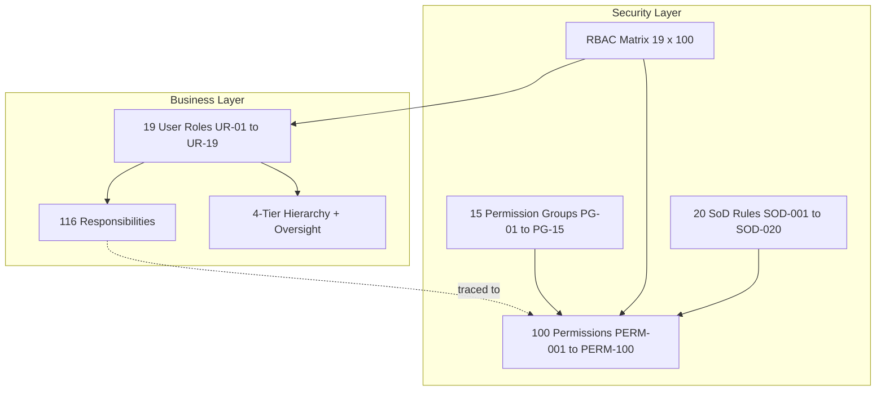

# Access Model Security Review: Inventory Management System

**Document Owner:** Senior Security Architect  
**Purpose:** Independent review of the complete access model before system analysis and implementation design  
**Audience:** Security engineers, solution architects, product owners, internal auditors, and project governance  
**Review Date:** July 2026  
**Artifacts Reviewed:**

| Artifact | Location | Scope |
|----------|----------|-------|
| User Roles | `User Roles/user-roles.md` | 19 business roles (UR-01–UR-19) |
| Role Responsibilities | `User Roles/role-responsibilities.md` | 116 responsibilities |
| Business Role Hierarchy | `User Roles/business-role-hierarchy.md` | 4 tiers + 2 oversight positions |
| System Permissions | `Permissions/system-permissions.md` | 100 permissions (PERM-001–PERM-100) |
| Permission Groups | `Permissions/permission-groups.md` | 15 groups (PG-01–PG-15) |
| RBAC Matrix | `Permissions/rbac-matrix.md` | 19 roles × 100 permissions |
| Separation of Duties Rules | `Permissions/separation-of-duties-rules.md` | 20 SoD rules (SOD-001–SOD-020) |

**Scope:** Design-time security assessment — no implementation code review

---

## Executive Summary

The IMS access model is **structurally sound and well-documented**. It traces business roles to functional requirements, defines granular permissions with business rationale, groups permissions logically, maps RBAC with sensitive-permission justifications, and documents 20 segregation-of-duties rules aligned to FR-084 and NFR-COM-009.

**Overall assessment: Conditionally ready for system analysis** — subject to resolving **3 critical findings**, **5 high findings**, and **8 medium findings** documented below.

| Dimension | Rating | Summary |
|-----------|--------|---------|
| Role completeness | **Amber** | 19 business roles are adequate for operations; System Administrator and technical service identities are undefined |
| Permission completeness | **Amber** | 100 permissions cover FR-001–FR-090 well; governance and delegation gaps remain |
| RBAC alignment | **Amber** | Strong least-privilege for frontline roles; management roles aggregate conflicting permissions |
| SoD design | **Red** | 20 rules documented but 6 are violated at single-role level in RBAC matrix |
| Hierarchy alignment | **Green** | Organizational hierarchy supports control independence (InvCtrl peer to WHMgr, finance under CFO) |
| Audit readiness | **Amber** | Audit permissions well-scoped; incomplete SoD validation table and no role recertification model |

**Critical blockers before system analysis:**

1. Define **System Administrator** role (UR-20) and complete RBAC for PERM-095/096  
2. Remediate **single-role SoD violations** in Purchasing Manager and Operations Director assignments  
3. Split **Warehouse Manager** return and receipt discrepancy permissions to enforce SOD-009, SOD-011, SOD-012  

---

## 1. Access Model Overview

### 1.1 Model Structure

### 1.2 Coverage Statistics

| Layer | Count | Traceability |
|-------|-------|--------------|
| Business roles | 19 | Mapped to business actors A-01–A-19 |
| Responsibilities | 116 | Traced to FR-001–FR-090 and BP-01–BP-32 |
| Permissions | 100 | Mapped to features F-01–F-30 |
| Permission groups | 15 | 100 permissions fully assigned to groups |
| RBAC assignments | 1,900 cells | 19 roles × 100 permissions |
| SoD rules | 20 | 8 permission pairs in catalog + 12 extended rules |

### 1.3 Design Strengths

| Strength | Evidence |
|----------|----------|
| **Least privilege for frontline roles** | RcvClk (11 perms), PikPak (9), WHStf (5), SalRep (8) — tightly scoped execution |
| **Executive read-only pattern** | CEO (28 perms, visibility + reports only); CFO (30 perms, finance-focused) |
| **Audit independence** | IntAud and ExtAud have no transactional permissions; read/query only |
| **Admin isolation** | PERM-095/096 unassigned to all business roles |
| **Count independence** | WHStf/RegMgr count (PERM-038); cannot approve (PERM-042 denied) |
| **Buyer/procurement separation** | Buyer creates PO (PERM-024); cannot approve (PERM-069 denied) |
| **Hierarchy supports SoD** | InvCtrl peer to WHMgr (not subordinate) preserves count objectivity |
| **Sensitive permission documentation** | RBAC Section 7 provides justification for every approval and override permission |
| **Location scoping model** | Network-wide vs. assigned-location vs. business-need scoping defined |

---

## 2. Missing Roles

Roles required for a complete, implementable access model that are absent or excluded from the current catalog.

| ID | Proposed Role | Priority | Gap Description | Recommendation |
|----|---------------|----------|-----------------|----------------|
| **MR-01** | **System Administrator** | **Critical** | Referenced in FR-081–FR-085, NFR-SEC-005, stakeholder analysis, and RBAC notes as holder of PERM-095/096 — but excluded from `user-roles.md` with no UR ID, responsibilities, or matrix row | Add **UR-20: System Administrator** as technical operations role. Define responsibilities: user lifecycle, role assignment, location scope, security configuration. Assign PERM-095, PERM-096, PERM-097; explicitly deny all operational transaction permissions. No reporting to COO — IT governance line. |
| **MR-02** | **Integration Service Account** | High | FR and NFR reference system integrations (ERP, carrier, supplier feeds). No non-human identity model exists | Define technical identity type (not UR) with machine credentials, scoped API permissions, no UI login, certificate-based auth. Document in access model appendix. |
| **MR-03** | **Approval Delegate** | Medium | Escalation paths and SoD exception policy reference approver leave delegation — no role or permission attribute | Do not create a new UR. Add **delegation attribute** on existing approver roles with time-bound PERM delegation (see MP-02 below). |
| **MR-04** | **Supplier Portal User** | Low (Phase 2) | A-20 Supplier actor documented; MVP excludes standing access; future phase noted in user-roles appendix | Defer to Phase 2 role catalog. When added, scope to inbound ASN, PO acknowledgment, discrepancy response — no internal permissions. |
| **MR-05** | **Data Migration Operator** | Medium | PERM-015/016 cover go-live import but no cutover-specific role for one-time migration teams | Extend UR-20 or create time-limited **Migration Operator** profile with PERM-015 only, auto-expire at go-live + 30 days. |
| **MR-06** | **Help Desk / IT Support** | Low | Monitoring NFRs reference IT support for alerts; no read-only diagnostic access role | Optional UR-21 with PERM-097 (activity log) and system health views only — no inventory transactions or user admin. |

### Role Exclusion Validation

| Excluded Stakeholder | Valid? | Notes |
|---------------------|--------|-------|
| Product Owner | Yes | Project delivery, not operational |
| Business Analyst | Yes | Project delivery, not operational |
| Project Sponsor | Yes | Governance, not operational |
| System Administrator | **No** | Must be included before implementation — operational system cannot be provisioned |

---

## 3. Missing Permissions

Permissions or access capabilities implied by functional requirements, responsibilities, or security NFRs but not present in PERM-001–PERM-100.

| ID | Proposed Permission | Priority | Source | Gap Description | Recommendation |
|----|---------------------|----------|--------|-----------------|----------------|
| **MP-01** | **Manage Approval Authority Matrix** | High | FR-037, FR-059, R-02-02, PERM-013 partial | PERM-013 covers governance policies but threshold routing (who approves what value) is not a distinct enforceable action | Add **PERM-101: Configure Approval Thresholds** — restricted to COO, CFO, OpsDir. Separate from day-to-day policy management. |
| **MP-02** | **Delegate Approval Authority** | High | SoD exception policy, hierarchy escalation paths | No permission for temporary approver delegation during leave | Add **PERM-102: Delegate Approval Authority** — time-bound, auditable, cannot delegate to self or subordinate who initiated transaction. |
| **MP-03** | **Release Ring-Fenced Stock** | Medium | PERM-093 ring-fence without explicit release | Ring-fencing without release permission creates orphaned stock | Add **PERM-103: Release Promotional Stock Ring-Fence** — MktMgr requests; COO/OpsDir approves. |
| **MP-04** | **Export Audit Evidence Package** | Medium | FR-087, UR-19 responsibilities | PERM-091 exports reports; no structured audit evidence export for external auditors | Add **PERM-104: Export Audit Evidence Package** — IntAud, ExtAud, FinMgr only; logged and watermarked. |
| **MP-05** | **View Own Access Profile** | Medium | NFR-SEC-005, FR-081 | Users cannot verify their own role and scope assignments | Add **PERM-105: View Own Role and Permission Profile** — all authenticated users. |
| **MP-06** | **Recertify Role Assignments** | High | NFR-COM-009, SoD monitoring table | Semi-annual recertification referenced in SoD doc but no permission for managers to certify | Add **PERM-106: Recertify User Role Assignments** — managers certify direct reports; COO certifies functional managers. |
| **MP-07** | **Configure SoD Rules** | Medium | FR-084, NFR-SEC-007 | SoD rules are documented but no admin permission to configure enforcement | Add **PERM-107: Configure SoD Rule Enforcement** — System Administrator only; changes require Internal Auditor review. |
| **MP-08** | **Break-Glass Emergency Access** | High | Business constraints, availability NFRs | No documented emergency access when approvers unavailable | Add **PERM-108: Activate Break-Glass Access** — dual authorization, auto-expire 4 hours, mandatory post-incident audit. |
| **MP-09** | **Manage Supplier Master** | Low | BP-05, A-20 | Supplier data referenced in receiving/PO but no supplier master permission | Evaluate if supplier master is in IMS scope or external ERP. If IMS: add PERM-109 under PG-06. |
| **MP-10** | **Approve Product Master Changes** | Medium | SOD-020 | Product update (PERM-002) has no separate approval step for material attribute changes | Consider **PERM-110: Approve Product Master Change** for UOM, tracking class, cost-affecting attributes — OpsDir approves InvCtrl changes. |

### Permission Catalog Gaps (Existing Permissions)

| Permission | Gap | Recommendation |
|------------|-----|----------------|
| PERM-031, PERM-032 | Not listed in system-permissions SoD pairs table (only PERM-028/032) | Add PERM-031 to SoD pairs table; align with SOD-008 |
| PERM-029, PERM-030 | Not in SoD pairs table | Add to catalog; align with SOD-009 |
| PERM-079–081 | Not in SoD pairs table | Add inspect/restock and inspect/write-off pairs; align with SOD-011, SOD-012 |
| Notifications (FR-076–080) | Intentionally not permissions | Acceptable — document as subscription configuration tied to role, not permission |

---

## 4. Over-Privileged Roles

Roles whose RBAC assignments grant permissions beyond documented responsibilities, create single-role SoD violations, or aggregate excessive authority.

### 4.1 Critical — Single-Role SoD Violations

These roles hold **both initiate and approve** permissions for the same workflow within a single role assignment. The RBAC matrix states "initiate/approve pairs are never granted to the same role" (Section 1) but the following assignments contradict that principle.

| Role | SoD Rule | Conflicting Permissions | Risk | Recommendation |
|------|----------|------------------------|------|----------------|
| **UR-15 Purchasing Manager** | SOD-001 | PERM-024–026 (create/amend/cancel PO) + PERM-069 (approve PO) | Self-approved purchasing; primary fraud vector in procurement | **Remove PERM-069 from PurMgr** for POs they created. Route to COO/CFO above PurMgr authority threshold. PurMgr retains PERM-068 (requisition approval) only if separated from PERM-067 — see next row. |
| **UR-15 Purchasing Manager** | SOD-002 | PERM-067 (create requisition) + PERM-068 (approve requisition) | Fictitious replenishment requests approved without challenge | **Remove PERM-067 from PurMgr** OR remove PERM-068. PurMgr approves; Buyers and OpsDir create requisitions. |
| **UR-04 Operations Director** | SOD-004 | PERM-043 (request adjustment) + PERM-044 (approve adjustment) | Self-approved inventory balance changes | **Remove PERM-043 from OpsDir** OR route PERM-044 approvals to COO only. OpsDir approves; WHMgr/InvCtrl request. |
| **UR-04 Operations Director** | SOD-005 | PERM-045 (request write-off) + PERM-046 (approve write-off) | Self-approved asset disposal | **Remove PERM-045 from OpsDir**. OpsDir approves (PERM-046); WHMgr requests. |
| **UR-04 Operations Director** | SOD-006 | PERM-071 (request transfer) + PERM-072 (approve transfer) | Unauthorized network stock redistribution | **Remove PERM-072 from OpsDir** for transfers they requested OR remove PERM-071. COO approves OpsDir-initiated transfers. |
| **UR-06 Warehouse Manager** | SOD-009 | PERM-029 (document discrepancy) + PERM-030 (resolve discrepancy) | Receiver closes own disputes in their favor | **Remove PERM-030 from WHMgr**. Purchasing Manager resolves (already has PERM-030 in matrix). |
| **UR-06 Warehouse Manager** | SOD-011 | PERM-079 (inspect return) + PERM-080 (restock return) | Defective goods re-enter sellable inventory | **Remove PERM-080 from WHMgr** OR remove PERM-079. InvCtrl approves restock based on inspection record. |
| **UR-06 Warehouse Manager** | SOD-012 | PERM-079 (inspect return) + PERM-081 (write-off return) | Theft disguised as return write-off | **Remove PERM-081 from WHMgr** OR remove PERM-079. Split inspect vs. disposition roles. |
| **UR-05 Inventory Controller** | SOD-014 | PERM-041 (investigate variance) + PERM-042 (approve count adjustment) | Biased investigation when same person approves | **Remove PERM-042 from InvCtrl** for variances they investigated. WHMgr approves immaterial; OpsDir approves material. InvCtrl retains investigate + schedule. |
| **UR-05 Inventory Controller** | SOD-020 | PERM-001–003 (product master) + PERM-042 (approve count) | Master data changes justify fraudulent adjustments | Implement **transaction-level control**: system blocks InvCtrl from PERM-042 on SKUs they modified within count cycle. |

### 4.2 High — Excessive Permission Breadth

| Role | Permissions | Concern | Recommendation |
|------|-------------|---------|----------------|
| **UR-04 Operations Director** | 62 allowed (highest non-exec) | Holds initiate + approve across adjustments, write-offs, transfers, counts, fulfillment exceptions, safety stock override, and import | Split into **OpsDir-Approve** and **OpsDir-Operate** sub-profiles OR enforce transaction-level SoD in system. Reduce to ≤45 permissions by moving initiate actions to WHMgr/InvCtrl. |
| **UR-02 COO** | 52 allowed | PERM-052–054 reserve/release/allocate + PERM-060 resolve exceptions + PERM-070 safety override + PERM-069 approve PO | Executive should approve and oversee, not operate fulfillment. **Remove PERM-052–054, PERM-060** from COO; retain approvals and overrides only. |
| **UR-15 Purchasing Manager** | 32 allowed | Full PG-06 including create and approve sides | After SoD remediation, reduce to ~22 permissions (visibility + approve + supplier performance; delegate create to Buyer). |
| **UR-06 Warehouse Manager** | 42 allowed | Full receiving approval + full returns lifecycle + fulfillment management | After SoD split, ~35 permissions. Consider separating **WHMgr-Receiving** and **WHMgr-Fulfillment** for large sites. |
| **UR-05 Inventory Controller** | 38 allowed | Product master write + count approve + import approve + quarantine + returns restock/write-off | Remove returns disposition (PERM-080, PERM-081) — not in InvCtrl responsibilities. Retain data quality and count program ownership. |

### 4.3 Medium — Sensitive Permission Concerns

| Role | Permission | Concern | Recommendation |
|------|------------|---------|----------------|
| **UR-02 COO** | PERM-093 Ring-fence | Marketing requests; COO executes without OpsDir validation | Require OpsDir co-approval or MktMgr request workflow |
| **UR-14 Marketing Manager** | PERM-093 Ring-fence | Commercial role removes stock from ATP | Change to **request-only**; COO/OpsDir approves ring-fence |
| **UR-17 Finance Manager** | PERM-098, PERM-099 | Audit trail access appropriate; ensure no PERM-044/046 on same account | Add **provisioning control**: block FinMgr + any adjustment approval permission on same user |
| **UR-18 Internal Auditor** | PG-04 partial (variance view, shrinkage) | Read-only control data — acceptable; verify no PERM-038 count | Confirmed: IntAud cannot count. No change needed. |
| **UR-01 CEO** | PERM-009 Location closure | Strategic approval appropriate; lacks PERM-006–008 create context | Acceptable for executive sign-off; ensure read-only location detail via PG-03 |

---

## 5. Under-Privileged Roles

Roles lacking permissions required to perform documented responsibilities.

| Role | Missing Permission | Responsibility / FR | Impact | Recommendation |
|------|-------------------|---------------------|--------|----------------|
| **UR-10 Regional / Store Manager** | **PERM-074** Receive Stock Transfer | R-10-03 participate in local replenishment; BP-24, BP-26 | Store cannot confirm transfer receipt; in-transit stock orphaned | **Grant PERM-074** to RegMgr (location-scoped). Retain PERM-071 request; deny PERM-072 approve. |
| **UR-10 Regional / Store Manager** | **PERM-023** Movement History | R-10-02 monitor store stock | Limited traceability for store-level discrepancies | **Grant PERM-023** (location-scoped) |
| **UR-12 Sales Representative** | **PERM-082** Return Status | R-12-03 follow up on orders; customer inquiries | Cannot answer return status without escalating to CS | **Grant PERM-082** (read-only, customer-order-scoped) |
| **UR-14 Marketing Manager** | **PERM-091** Export Reports | R-14-04 campaign performance review | Cannot export campaign readiness data for planning meetings | **Grant PERM-091** for campaign-related reports only |
| **UR-07 Receiving Clerk** | **PERM-023** Movement History | Troubleshoot receipt posting errors | Cannot verify whether prior receipts posted | **Grant PERM-023** (limited to receiving-related movements, location-scoped) |
| **UR-09 Warehouse Staff** | **PERM-017** partial only | R-09-02 count participation | WHStf has on-hand view but denied ATP — acceptable for blind count | No change — blind count design intentional |
| **UR-19 External Auditor** | **PERM-100** Breach Records | R-19-02 evaluate control effectiveness | Cannot review SoD violation history during audit | **Grant PERM-100** (time-limited, audit-period scope) |
| **UR-19 External Auditor** | **PERM-091** Export | Audit evidence collection | Must request exports through FinMgr | **Grant PERM-091** (audit-scoped, logged) |
| **UR-20 System Administrator** | **PERM-095, PERM-096** (entire role missing) | FR-081, FR-085 | Cannot provision users or enforce RBAC | **Create role and assign** — see MR-01 |
| **UR-16 Buyer** | **PERM-068** blocked (correct) | — | Not under-privileged — correct SoD | No change |

---

## 6. Conflicting Permissions

Conflicts arise when permission combinations undermine controls — at **role level**, **multi-role assignment**, or **permission group** level.

### 6.1 Role-Level Conflicts (Single Role)

Documented in Section 4.1. Summary matrix:

| Conflict Pair | Roles Affected | Severity |
|---------------|----------------|----------|
| PERM-024 + PERM-069 | PurMgr | Critical |
| PERM-067 + PERM-068 | PurMgr | Critical |
| PERM-043 + PERM-044 | OpsDir | Critical |
| PERM-045 + PERM-046 | OpsDir | Critical |
| PERM-071 + PERM-072 | OpsDir | Critical |
| PERM-029 + PERM-030 | WHMgr | High |
| PERM-079 + PERM-080 | WHMgr | High |
| PERM-079 + PERM-081 | WHMgr | High |
| PERM-041 + PERM-042 | InvCtrl | High |
| PERM-001–003 + PERM-042 | InvCtrl | Medium (temporal) |

### 6.2 Multi-Role Accumulation Risks

Even when individual roles are SoD-clean, **the same user holding multiple roles** can recreate conflicts. High-risk combinations:

| Role Combination | SoD Rules Violated | Likelihood | Mitigation |
|------------------|-------------------|------------|------------|
| PurMgr + Buyer | SOD-001, SOD-002 | High in small teams | Provisioning rule: mutually exclusive role assignment without documented exception |
| WHMgr + RcvClk | SOD-007, SOD-008 | Medium | Common in small warehouses — require documented exception with enhanced audit flag |
| OpsDir + WHMgr | SOD-004–006, SOD-009 | Medium | Director covering for site manager — time-bound role elevation with auto-revoke |
| InvCtrl + WHMgr | SOD-003, SOD-014 | Low | Should never be combined — block at provisioning |
| FinMgr + OpsDir | SOD-017 | Low | Finance/operations dual-hat — block adjustment approval on FinMgr account |
| IntAud + any operational role | SOD-016 | Must never occur | Hard block at provisioning |
| MktMgr + SalMgr | Commercial concentration | Low | Acceptable; monitor ring-fence + availability conflicts |

**Recommendation:** Implement **role assignment conflict matrix** at provisioning time (FR-084, FR-085). System Administrator must validate combinations against SoD rules before activation.

### 6.3 Permission Group Conflicts

Assigning a full permission group to a role inherits all initiate and approve permissions in that group.

| Group | Risk if Assigned Whole | Roles Currently Affected | Recommendation |
|-------|------------------------|--------------------------|--------------|
| **PG-04** Inventory Control | 4 initiate/approve pairs | OpsDir, InvCtrl, WHMgr (partial) | Define **PG-04a** (initiate) and **PG-04b** (approve) sub-groups before implementation |
| **PG-06** Purchasing | PO and requisition create + approve | PurMgr, Buyer | Define **PG-06a** (execute) and **PG-06b** (approve) sub-groups |
| **PG-07** Receiving | Receive + approve exceptions + resolve | WHMgr | Define **PG-07a** (execute) and **PG-07b** (approve/resolve) sub-groups |
| **PG-09** Returns | Full lifecycle in one group | WHMgr, InvCtrl | Define **PG-09a** (intake/inspect) and **PG-09b** (disposition) sub-groups |

### 6.4 RBAC SoD Validation Table Gaps

The RBAC matrix Section 6 validates 8 SoD rules. The following documented rules are **not validated** in the matrix:

| SoD Rule | Status in RBAC §6 | Action |
|----------|---------------------|--------|
| SOD-008 Ad-hoc receipt | Missing | Add validation row |
| SOD-009 Discrepancy document/resolve | Missing | Add validation row |
| SOD-011 Return inspect/restock | Missing | Add validation row |
| SOD-012 Return inspect/write-off | Missing | Add validation row |
| SOD-013 Reserve/ship without verification | Missing | Add validation row |
| SOD-014 Investigate/approve variance | Missing | Add validation row |
| SOD-018 Approve PO/receive same PO | Missing | Add cross-role validation |
| SOD-019 Safety stock override | Missing | Add validation row |

---

## 7. Security Risks

Consolidated risk register from the access model review.

| Risk ID | Risk | Likelihood | Impact | Current Control | Residual Risk | Priority |
|---------|------|------------|--------|-----------------|---------------|----------|
| **AR-01** | Self-approved purchase orders via PurMgr role | High | High | Documented SoD rule; **not enforced in RBAC** | **Critical** | P1 |
| **AR-02** | Self-approved inventory adjustments via OpsDir role | Medium | High | InvCtrl cannot approve own requests; OpsDir can | **High** | P1 |
| **AR-03** | Multi-role SoD bypass in small teams | High | High | Exception policy documented; no provisioning block | **High** | P1 |
| **AR-04** | System Administrator role undefined — ad hoc admin access | High | Critical | PERM-095/096 unassigned | **Critical** | P1 |
| **AR-05** | Return disposition fraud via WHMgr inspect + restock/write-off | Medium | Medium | SoD documented; RBAC violates | **High** | P2 |
| **AR-06** | Receipt discrepancy manipulation via WHMgr | Medium | Medium | SoD documented; RBAC violates | **High** | P2 |
| **AR-07** | Count program integrity — InvCtrl investigates and approves | Medium | High | Partial — counter/approver split exists | **Medium** | P2 |
| **AR-08** | Privilege escalation — no role recertification | Medium | High | Mentioned in SoD monitoring; no permission | **Medium** | P2 |
| **AR-09** | Emergency operations without break-glass controls | Medium | Medium | Exception policy for small teams only | **Medium** | P2 |
| **AR-10** | Location scope bypass for SalRep/CsRep/Buyer | Low | Medium | "Business need" scoping undefined in implementation | **Medium** | P3 |
| **AR-11** | Audit evidence tampering awareness — FinMgr has audit trail | Low | Low | FinMgr denied operational approvals | **Low** | P3 |
| **AR-12** | Ring-fence stock permanently unavailable | Low | Medium | No release permission (MP-03) | **Medium** | P3 |
| **AR-13** | External auditor cannot complete control testing | Medium | Medium | Missing PERM-100, limited export | **Medium** | P3 |
| **AR-14** | Permission group assignment grants hidden SoD pairs | High | High | Warning in permission-groups doc only | **High** | P2 |
| **AR-15** | Hierarchy used as implicit permission inheritance | Low | High | Documented as not implied — verify implementation does not inherit | **Low** | P3 |

---

## 8. Hierarchy vs. RBAC Alignment

| Hierarchy Principle | RBAC Alignment | Status |
|--------------------|----------------|--------|
| InvCtrl peer to WHMgr (not subordinate) | InvCtrl cannot count (PERM-038 ✖); WHMgr cannot approve material adjustments (PERM-044 ✖) | **Aligned** |
| Finance under CFO, separate from operations | FinMgr has PG-12; no operational approve permissions | **Aligned** |
| Audit independent of operations | IntAud/ExtAud read-only | **Aligned** |
| Purchasing under COO | PurMgr has full procurement; COO can approve PO (PERM-069) | **Aligned** — escalation path exists |
| WHMgr supervises RcvClk | RcvClk receives; WHMgr approves exceptions | **Aligned** |
| OpsDir supervises WHMgr | OpsDir can approve what WHMgr initiates — but OpsDir also initiates | **Misaligned** — see AR-02 |
| CEO apex accountability | CEO read-only, no transactions | **Aligned** |
| RegMgr parallel to WHMgr under OpsDir | RegMgr cannot receive transfers (PERM-074 ✖) | **Misaligned** — see under-privileged |

**Key finding:** Organizational hierarchy is well-designed for control independence, but **RBAC does not consistently mirror hierarchy-based SoD**. Management roles absorb both supervisory and execution permissions that subordinates hold, creating concentration of authority not intended by the hierarchy design.

---

## 9. Responsibilities-to-Permissions Traceability Gaps

Sample of responsibilities without clear permission support (not exhaustive):

| Responsibility | Role | Expected Permission | RBAC Status |
|----------------|------|---------------------|-------------|
| R-10-03 Request inter-location replenishment | RegMgr | PERM-071 | ✔ Granted |
| R-10-03 Receive replenishment at store | RegMgr | PERM-074 | ✖ **Missing** |
| R-16-04 Resolve receipt discrepancies with suppliers | Buyer | PERM-030 | ✔ Granted |
| R-06-08 Release orders to pick queue | WHMgr | PERM-054 | ✔ Granted |
| R-05-09 Maintain reason codes | InvCtrl | PERM-014 | ✔ Granted |
| R-18-05 Investigate SoD concerns | IntAud | PERM-100 | ✔ FinMgr/IntAud only — ExtAud ✖ |
| System provisioning (FR-085) | System Administrator | PERM-095, PERM-096 | **Role missing** |

---

## 10. Recommendations

Prioritized actions to complete before moving to system analysis and implementation design.

### 10.1 Critical — Must Complete Before System Analysis

| # | Recommendation | Owner | Deliverable |
|---|----------------|-------|-------------|
| **R-01** | **Add UR-20 System Administrator** to user roles, responsibilities, hierarchy (IT branch), and RBAC matrix with PERM-095/096/097 only | Security Architect | Updated `user-roles.md`, `rbac-matrix.md` |
| **R-02** | **Remediate PurMgr SoD violations** — remove PERM-069 and either PERM-067 or PERM-068 from UR-15 | Security Engineer | Updated `rbac-matrix.md` |
| **R-03** | **Remediate OpsDir SoD violations** — separate initiate and approve permissions; COO becomes approver for OpsDir-initiated transactions | Security Engineer | Updated `rbac-matrix.md` |
| **R-04** | **Split WHMgr receiving and returns permissions** per SOD-009, SOD-011, SOD-012 | Security Engineer | Updated `rbac-matrix.md` |
| **R-05** | **Define role assignment conflict matrix** for multi-role SoD enforcement at provisioning | Security Architect | New section in `rbac-matrix.md` or `separation-of-duties-rules.md` |
| **R-06** | **Create permission sub-groups** (PG-04a/b, PG-06a/b, PG-07a/b, PG-09a/b) to prevent whole-group SoD inheritance | Security Engineer | Updated `permission-groups.md` |

### 10.2 High — Complete During System Analysis Phase

| # | Recommendation | Owner | Deliverable |
|---|----------------|-------|-------------|
| **R-07** | Add missing permissions MP-01, MP-02, MP-06, MP-08 (approval matrix, delegation, recertification, break-glass) | Security Engineer | Updated `system-permissions.md` |
| **R-08** | Grant under-privileged permissions to RegMgr (PERM-074, PERM-023) and ExtAud (PERM-100, PERM-091) | Security Engineer | Updated `rbac-matrix.md` |
| **R-09** | Remove InvCtrl returns disposition permissions (PERM-080, PERM-081) — not aligned to responsibilities | Security Engineer | Updated `rbac-matrix.md` |
| **R-10** | Reduce COO operational permissions (PERM-052–054, PERM-060) — retain executive approve/override only | Security Engineer | Updated `rbac-matrix.md` |
| **R-11** | Complete RBAC SoD validation table for all 20 SOD rules | Security Engineer | Updated `rbac-matrix.md` Section 6 |
| **R-12** | Align system-permissions SoD pairs table with all 20 SOD rules | Security Engineer | Updated `system-permissions.md` |
| **R-13** | Change MktMgr PERM-093 to request-only; add MP-03 release ring-fence | Security Engineer | Permission + RBAC update |
| **R-14** | Define transaction-level SoD enforcement specification (same user, same transaction ID) for system analysis | Security Architect | SoD implementation spec |

### 10.3 Medium — Complete Before Go-Live

| # | Recommendation | Owner | Deliverable |
|---|----------------|-------|-------------|
| **R-15** | Add MP-04, MP-05, MP-07, MP-09, MP-10 permissions as phased | Security Engineer | Permission catalog v2 |
| **R-16** | Define Integration Service Account identity model (MR-02) | Security Architect | Technical access appendix |
| **R-17** | Document location scope implementation rules for SalRep, CsRep, Buyer ("business need" scoping) | Solution Architect | Location scope spec |
| **R-18** | Implement role recertification workflow (PERM-106) — semi-annual per SoD monitoring table | Security Engineer | Access governance procedure |
| **R-19** | Add SalRep PERM-082 and MktMgr PERM-091 | Security Engineer | RBAC update |
| **R-20** | Conduct formal access model sign-off with Operations Director and Internal Auditor per NFR-SEC-005 | Security Architect | Sign-off record |

---

## 11. Pre-System-Analysis Checklist

Use this checklist to gate entry into system analysis and technical design.

| # | Gate Criterion | Status | Blocking? |
|---|----------------|--------|-----------|
| 1 | All 19 business roles mapped to RBAC matrix | ✔ Complete | No |
| 2 | System Administrator role defined and mapped | ✖ **Incomplete** | **Yes** |
| 3 | 100 permissions assigned to permission groups | ✔ Complete | No |
| 4 | Single-role SoD violations remediated in RBAC | ✖ **10 violations** | **Yes** |
| 5 | Multi-role conflict matrix defined | ✖ **Not started** | **Yes** |
| 6 | Permission sub-groups for SoD pairs defined | ✖ **Not started** | **Yes** |
| 7 | Under-privileged roles remediated (RegMgr, ExtAud) | ✖ **Partial** | No |
| 8 | 20 SoD rules validated in RBAC matrix | ✖ **8 of 20** | No |
| 9 | Sensitive permissions documented with justification | ✔ Complete | No |
| 10 | Location scoping rules defined | ✔ Partial — implementation detail needed | No |
| 11 | Role hierarchy aligned to control independence | ✔ Complete | No |
| 12 | Responsibilities traced to permissions (spot check) | ✔ Mostly aligned | No |
| 13 | Access model sign-off by OpsDir and IntAud | ✖ **Not started** | No (pre-go-live) |

**Gate decision:** Proceed to system analysis **after completing items 2, 4, 5, and 6**. Items 7–13 can run in parallel with system analysis but must complete before access control implementation.

---

## 12. Document Summary

This review assessed the complete IMS access model across **7 artifacts** covering roles, responsibilities, permissions, permission groups, hierarchy, RBAC, and segregation of duties.

**The model is a strong foundation** with excellent documentation, frontline least-privilege, audit independence, and comprehensive permission catalog. **The primary weaknesses are:**

1. Undefined System Administrator role despite functional requirement dependency  
2. Single-role SoD violations in Purchasing Manager, Operations Director, and Warehouse Manager  
3. Permission groups that inherit conflicting initiate/approve pairs when assigned wholesale  
4. Incomplete SoD validation coverage (8 of 20 rules)  
5. Minor under-privilege gaps for Regional/Store Manager and External Auditor  

**16 prioritized recommendations** (6 critical, 8 high, 6 medium) must be addressed before or during system analysis to ensure the implemented system enforces the intended control model.

---

## Appendix A: Role Permission Count — Risk Tier

| Tier | Roles | Permission Range | Risk Profile |
|------|-------|------------------|--------------|
| **Executive visibility** | CEO, CFO | 28–30 | Low — read-only |
| **Frontline execution** | RcvClk, PikPak, WHStf, SalRep | 5–11 | Low — tightly scoped |
| **Commercial / store** | CsRep, MktMgr, RegMgr, SalMgr | 14–22 | Low–medium |
| **Functional management** | Buyer, FinMgr, InvCtrl, WHMgr, PurMgr | 20–42 | Medium — monitor SoD |
| **Network operations** | OpsDir | 62 | **High — SoD remediation required** |
| **Executive operations** | COO | 52 | Medium — reduce operational permissions |
| **Oversight** | IntAud, ExtAud | 20–24 | Low — read-only |
| **Undefined** | System Administrator | 0 (missing) | **Critical — must define** |

---

## Appendix B: Cross-Reference Index

| Topic | Primary Document | Section |
|-------|------------------|---------|
| SoD rules | `separation-of-duties-rules.md` | Rules SOD-001–SOD-020 |
| RBAC assignments | `rbac-matrix.md` | Sections 2–3 |
| Sensitive permissions | `rbac-matrix.md` | Section 7 |
| Permission groups | `permission-groups.md` | PG-01–PG-15 |
| SoD across groups | `permission-groups.md` | Segregation of Duties Across Groups |
| Role hierarchy | `business-role-hierarchy.md` | Design Principles |
| FR-084 SoD enforcement | `functional-requirements.md` | FR-084 |
| NFR-SEC-007 automated SoD | `security-requirements.md` | Category 2 |

---

*End of Access Model Security Review*
