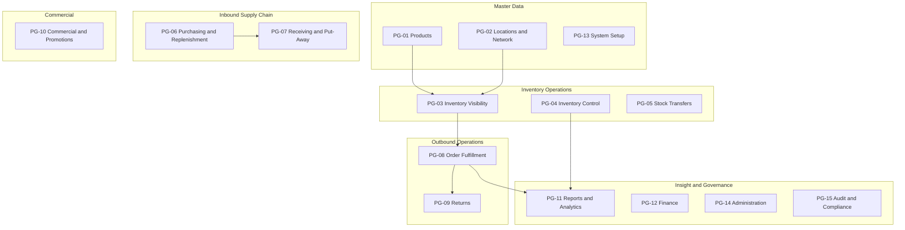

# Permission Groups: Inventory Management System

**Document Owner:** Security Engineer  
**Purpose:** Organize system permissions into logical permission groups for role-based access control design, administration, and assignment  
**Audience:** Security engineers, solution architects, product owners, and system administrators  
**Scope:** Permission grouping only — role-to-group and role-to-permission mappings are addressed in a subsequent access control matrix  
**Based On:** System Permissions Catalog (PERM-001–PERM-100)

---

## Document Conventions

| Convention | Meaning |
|------------|---------|
| **PG-xx** | Permission Group identifier |
| **PERM-xxx** | System permission identifier from the permissions catalog |

Permission groups bundle related permissions under a business module boundary. Groups simplify role design by allowing administrators to grant coherent capability sets rather than individual permissions. A role may be assigned one or more permission groups; effective permissions are the union of all included group permissions.

---

## Group Summary

| Group ID | Group Name | Business Module | Permission Count |
|----------|------------|-----------------|------------------|
| PG-01 | Products | Product Catalog | 6 |
| PG-02 | Locations & Network | Location & Warehouse Management | 5 |
| PG-03 | Inventory Visibility | Inventory Visibility & Status | 7 |
| PG-04 | Inventory Control | Inventory Control & Accuracy | 18 |
| PG-05 | Stock Transfers | Network Balance & Transfers | 6 |
| PG-06 | Purchasing & Replenishment | Replenishment & Inbound Supply | 12 |
| PG-07 | Receiving & Put-Away | Inbound & Receiving | 7 |
| PG-08 | Order Fulfillment | Order Fulfillment | 13 |
| PG-09 | Returns | Returns Management | 6 |
| PG-10 | Commercial & Promotions | Commercial Alignment | 2 |
| PG-11 | Reports & Analytics | Reporting & Dashboards | 8 |
| PG-12 | Finance | Financial Inventory Alignment | 2 |
| PG-13 | System Setup | System Go-Live & Initial Data | 2 |
| PG-14 | Administration | User Access & Role Management | 2 |
| PG-15 | Audit & Compliance | Governance, Audit & Compliance | 4 |
| **Total** | **15 groups** | | **100** |

---

## PG-01: Products

| Attribute | Description |
|-----------|-------------|
| **Group ID** | PG-01 |
| **Group Name** | Products |
| **Business Module** | Product Catalog |
| **Purpose** | Govern creation, maintenance, classification, and operational lookup of product master data so all locations and departments reference a single, consistent product identity. |

### Included Permissions

| Permission ID | Permission Name |
|---------------|-----------------|
| PERM-001 | Create Product |
| PERM-002 | Update Product |
| PERM-003 | Manage Product Status |
| PERM-004 | Lookup Product |
| PERM-005 | Resolve Duplicate Product |
| PERM-012 | Classify Products (ABC) |

---

## PG-02: Locations & Network

| Attribute | Description |
|-----------|-------------|
| **Group ID** | PG-02 |
| **Group Name** | Locations & Network |
| **Business Module** | Location & Warehouse Management |
| **Purpose** | Define and maintain the inventory location network including warehouses, stores, and distribution points, their hierarchy, operational status, opening balances, and closure disposition. |

### Included Permissions

| Permission ID | Permission Name |
|---------------|-----------------|
| PERM-006 | Create Location |
| PERM-007 | Update Location |
| PERM-008 | Manage Location Hierarchy |
| PERM-009 | Plan Location Closure and Disposition |
| PERM-010 | Establish Opening Stock Balance |

---

## PG-03: Inventory Visibility

| Attribute | Description |
|-----------|-------------|
| **Group ID** | PG-03 |
| **Group Name** | Inventory Visibility |
| **Business Module** | Inventory Visibility & Status |
| **Purpose** | Provide read-only access to real-time stock position across the network including on-hand, available-to-promise, reserved, status indicators, movement history, and network-wide availability views. |

### Included Permissions

| Permission ID | Permission Name |
|---------------|-----------------|
| PERM-017 | View On-Hand Inventory |
| PERM-018 | View Available-to-Promise |
| PERM-019 | View Reserved Stock |
| PERM-020 | View Stock Status Indicators |
| PERM-021 | Search and Filter Inventory |
| PERM-022 | View Network and Inbound Availability |
| PERM-023 | View Inventory Movement History |

---

## PG-04: Inventory Control

| Attribute | Description |
|-----------|-------------|
| **Group ID** | PG-04 |
| **Group Name** | Inventory Control |
| **Business Module** | Inventory Control & Accuracy |
| **Purpose** | Sustain inventory record accuracy through counting programs, adjustments, write-offs, quarantine management, stock policies, reason codes, and loss analysis — with segregated initiate and approve actions. |

### Included Permissions

| Permission ID | Permission Name |
|---------------|-----------------|
| PERM-011 | Define Stock Thresholds |
| PERM-013 | Manage Inventory Governance Policies |
| PERM-014 | Manage Reason Codes |
| PERM-037 | Schedule Cycle Count |
| PERM-038 | Perform Cycle Count |
| PERM-039 | Initiate Full Physical Count |
| PERM-040 | View Count Variances |
| PERM-041 | Investigate Count Variance |
| PERM-042 | Approve Count Adjustment |
| PERM-043 | Request Stock Adjustment |
| PERM-044 | Approve Stock Adjustment |
| PERM-045 | Request Inventory Write-Off |
| PERM-046 | Approve Inventory Write-Off |
| PERM-047 | Place Stock on Quarantine or Hold |
| PERM-048 | Release Stock from Quarantine or Hold |
| PERM-049 | View Shrinkage and Loss Analysis |
| PERM-050 | Review Obsolete and Slow-Moving Stock |
| PERM-070 | Override Safety Stock Protection |

---

## PG-05: Stock Transfers

| Attribute | Description |
|-----------|-------------|
| **Group ID** | PG-05 |
| **Group Name** | Stock Transfers |
| **Business Module** | Network Balance & Transfers |
| **Purpose** | Manage inter-location stock movement including transfer requests, approvals, dispatch, receipt, in-transit tracking, and network rebalancing recommendations. |

### Included Permissions

| Permission ID | Permission Name |
|---------------|-----------------|
| PERM-071 | Request Stock Transfer |
| PERM-072 | Approve Stock Transfer |
| PERM-073 | Dispatch Stock Transfer |
| PERM-074 | Receive Stock Transfer |
| PERM-075 | View In-Transit Inventory |
| PERM-076 | View Network Rebalancing Recommendations |

---

## PG-06: Purchasing & Replenishment

| Attribute | Description |
|-----------|-------------|
| **Group ID** | PG-06 |
| **Group Name** | Purchasing & Replenishment |
| **Business Module** | Replenishment & Inbound Supply |
| **Purpose** | Manage the inbound supply pipeline from low-stock detection through purchase requisitions and purchase orders, including supplier performance visibility and replenishment decision support. |

### Included Permissions

| Permission ID | Permission Name |
|---------------|-----------------|
| PERM-024 | Create Purchase Order |
| PERM-025 | Amend Purchase Order |
| PERM-026 | Cancel Purchase Order |
| PERM-027 | View Expected Inbound Deliveries |
| PERM-035 | View Inbound Supply Status |
| PERM-036 | View Supplier Delivery Performance |
| PERM-064 | View Low-Stock Alerts |
| PERM-065 | Acknowledge or Dismiss Stock Alert |
| PERM-066 | View Replenishment Suggestions |
| PERM-067 | Create Purchase Requisition |
| PERM-068 | Approve Purchase Requisition |
| PERM-069 | Approve Purchase Order |

---

## PG-07: Receiving & Put-Away

| Attribute | Description |
|-----------|-------------|
| **Group ID** | PG-07 |
| **Group Name** | Receiving & Put-Away |
| **Business Module** | Inbound & Receiving |
| **Purpose** | Execute warehouse inbound operations including goods receipt verification, discrepancy handling, put-away confirmation, and physical receipt of return shipments at the dock. |

### Included Permissions

| Permission ID | Permission Name |
|---------------|-----------------|
| PERM-028 | Receive Goods |
| PERM-029 | Document Receipt Discrepancy |
| PERM-030 | Resolve Receipt Discrepancy |
| PERM-031 | Approve Ad-Hoc Receipt |
| PERM-032 | Approve Receipt Beyond Tolerance |
| PERM-033 | Confirm Put-Away |
| PERM-034 | Receive Return Inbound |

---

## PG-08: Order Fulfillment

| Attribute | Description |
|-----------|-------------|
| **Group ID** | PG-08 |
| **Group Name** | Order Fulfillment |
| **Business Module** | Order Fulfillment |
| **Purpose** | Manage the complete outbound order lifecycle from availability confirmation and inventory reservation through pick, pack, ship, partial fulfillment, backorders, and exception resolution. |

### Included Permissions

| Permission ID | Permission Name |
|---------------|-----------------|
| PERM-051 | Confirm Order Availability |
| PERM-052 | Reserve Inventory |
| PERM-053 | Release Inventory Reservation |
| PERM-054 | Release Order to Fulfillment |
| PERM-055 | Execute Pick and Pack |
| PERM-056 | Confirm Shipment |
| PERM-057 | Process Partial Fulfillment |
| PERM-058 | Manage Backorder Queue |
| PERM-059 | Report Fulfillment Exception |
| PERM-060 | Resolve Fulfillment Exception |
| PERM-061 | Allocate Multi-Location Fulfillment |
| PERM-062 | View Order Fulfillment Status |
| PERM-063 | Approve Product Substitution |

---

## PG-09: Returns

| Attribute | Description |
|-----------|-------------|
| **Group ID** | PG-09 |
| **Group Name** | Returns |
| **Business Module** | Returns Management |
| **Purpose** | Manage the customer return lifecycle from authorization and intake through inspection, restock or write-off disposition, and status tracking. |

### Included Permissions

| Permission ID | Permission Name |
|---------------|-----------------|
| PERM-077 | Authorize Customer Return |
| PERM-078 | Receive Returned Goods |
| PERM-079 | Inspect Returned Goods |
| PERM-080 | Restock Returned Inventory |
| PERM-081 | Write Off Returned Inventory |
| PERM-082 | View Return Processing Status |

**Cross-reference:** PERM-034 (Receive Return Inbound) is grouped under PG-07 Receiving & Put-Away because it represents the dock receipt transaction; PG-09 covers the full return business process.

---

## PG-10: Commercial & Promotions

| Attribute | Description |
|-----------|-------------|
| **Group ID** | PG-10 |
| **Group Name** | Commercial & Promotions |
| **Business Module** | Commercial Alignment |
| **Purpose** | Support promotional and launch planning by reviewing campaign stock readiness and ring-fencing promotional inventory from general availability. |

### Included Permissions

| Permission ID | Permission Name |
|---------------|-----------------|
| PERM-092 | Review Campaign Stock Readiness |
| PERM-093 | Ring-Fence Promotional Stock |

---

## PG-11: Reports & Analytics

| Attribute | Description |
|-----------|-------------|
| **Group ID** | PG-11 |
| **Group Name** | Reports & Analytics |
| **Business Module** | Reporting & Dashboards |
| **Purpose** | Provide access to operational dashboards, standard reports, performance KPIs, and data export capabilities for inventory monitoring, analysis, and decision support. |

### Included Permissions

| Permission ID | Permission Name |
|---------------|-----------------|
| PERM-083 | View Inventory Dashboard |
| PERM-084 | View Stock Movement Reports |
| PERM-085 | View Stockout and Overstock Reports |
| PERM-086 | View Inventory Accuracy Reports |
| PERM-087 | View Location Performance Reports |
| PERM-088 | View Inventory Performance KPIs |
| PERM-089 | View Replenishment Reports |
| PERM-091 | Export Reports |

**Note:** PERM-090 (View Inventory Valuation Reports) is grouped under PG-12 Finance because valuation reports primarily serve financial reconciliation workflows.

---

## PG-12: Finance

| Attribute | Description |
|-----------|-------------|
| **Group ID** | PG-12 |
| **Group Name** | Finance |
| **Business Module** | Financial Inventory Alignment |
| **Purpose** | Support operational-to-financial inventory alignment through valuation reporting and period-end reconciliation without replacing general ledger functions. |

### Included Permissions

| Permission ID | Permission Name |
|---------------|-----------------|
| PERM-090 | View Inventory Valuation Reports |
| PERM-094 | Perform Financial Inventory Reconciliation |

---

## PG-13: System Setup

| Attribute | Description |
|-----------|-------------|
| **Group ID** | PG-13 |
| **Group Name** | System Setup |
| **Business Module** | System Go-Live & Initial Data |
| **Purpose** | Govern controlled bulk import of product master data and opening stock balances during system deployment and location go-live, with segregated submit and approve actions. |

### Included Permissions

| Permission ID | Permission Name |
|---------------|-----------------|
| PERM-015 | Import Initial Master Data |
| PERM-016 | Approve Initial Data Import |

---

## PG-14: Administration

| Attribute | Description |
|-----------|-------------|
| **Group ID** | PG-14 |
| **Group Name** | Administration |
| **Business Module** | User Access & Role Management |
| **Purpose** | Manage user accounts, role assignments, and location access scope to align system access with organizational structure and operational accountability. |

### Included Permissions

| Permission ID | Permission Name |
|---------------|-----------------|
| PERM-095 | Manage User Accounts |
| PERM-096 | Assign User Roles and Location Scope |

---

## PG-15: Audit & Compliance

| Attribute | Description |
|-----------|-------------|
| **Group ID** | PG-15 |
| **Group Name** | Audit & Compliance |
| **Business Module** | Governance, Audit & Compliance |
| **Purpose** | Provide read and query access to user activity logs, inventory audit trails, audit evidence packages, and control policy breach records for internal assurance and external audit. |

### Included Permissions

| Permission ID | Permission Name |
|---------------|-----------------|
| PERM-097 | View User Activity Log |
| PERM-098 | View Inventory Audit Trail |
| PERM-099 | Query Audit Evidence |
| PERM-100 | View Control Policy Breach Records |

---

## Group Hierarchy Overview

---

## Group-to-Business Module Mapping

| Business Module (Functional Domain) | Permission Group(s) |
|-------------------------------------|---------------------|
| Master Data & Governance | PG-01, PG-02, PG-04 (policies, thresholds, reason codes), PG-13 |
| Inventory Visibility & Status | PG-03 |
| Inventory Control & Accuracy | PG-04 |
| Inbound & Receiving | PG-07 |
| Replenishment & Inbound Supply | PG-06 |
| Order Fulfillment | PG-08 |
| Network Balance & Transfers | PG-05 |
| Returns Management | PG-09 |
| Reporting & Dashboards | PG-11 |
| Commercial Alignment | PG-10 |
| Financial Inventory Alignment | PG-12 |
| User Access & Role Management | PG-14 |
| Governance, Audit & Compliance | PG-15 |

---

## Segregation of Duties Across Groups

Permission groups that contain initiate/approve pairs should be assigned to roles with segregation-of-duties awareness. When a role receives a full group, it inherits all permissions in that group — including both sides of approval workflows.

| Group | Initiate Permissions | Approve Permissions | SoD Consideration |
|-------|---------------------|---------------------|-------------------|
| PG-04 Inventory Control | PERM-038, PERM-043, PERM-045 | PERM-042, PERM-044, PERM-046 | Counter cannot approve own count adjustment |
| PG-06 Purchasing & Replenishment | PERM-024, PERM-067 | PERM-068, PERM-069 | Buyer cannot approve own requisition or PO |
| PG-05 Stock Transfers | PERM-071 | PERM-072 | Requester cannot approve own transfer |
| PG-07 Receiving & Put-Away | PERM-028 | PERM-031, PERM-032 | Receiver cannot approve own tolerance exception |
| PG-13 System Setup | PERM-015 | PERM-016 | Importer cannot approve own data load |

For roles requiring only one side of a workflow, assign individual permissions rather than the full group, or define sub-groups in the access control matrix design phase.

---

## Typical Group Combinations by Operational Area

These combinations illustrate logical group bundling for common operational areas. They are illustrative only — not role assignments.

| Operational Area | Typical Permission Groups |
|------------------|--------------------------|
| Warehouse floor (receiving) | PG-03, PG-07 |
| Warehouse floor (fulfillment) | PG-03, PG-08 |
| Inventory control office | PG-01, PG-03, PG-04, PG-11 |
| Purchasing department | PG-03, PG-06, PG-11 |
| Sales and customer service | PG-03, PG-08 (view + availability), PG-09 (authorize) |
| Operations management | PG-02, PG-03, PG-04, PG-05, PG-08, PG-11 |
| Finance | PG-03, PG-11, PG-12 |
| System administration | PG-14 |
| Internal audit | PG-03, PG-11, PG-15 |

---

## Document Summary

This document organizes **100 system permissions** into **15 permission groups** aligned with IMS business modules. Groups provide a logical structure for role-based access control design while preserving granular permission-level enforcement and segregation-of-duties rules defined in the system permissions catalog.

Role-to-group mappings and location scope defaults are addressed in the subsequent access control matrix.

---

*End of Permission Groups Document*
