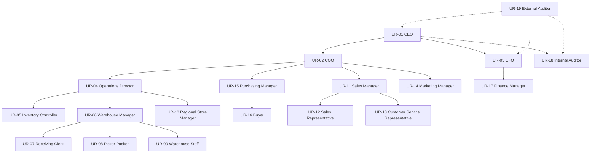

# Business Role Hierarchy: Inventory Management System

**Document Owner:** Security Architect  
**Purpose:** Define the organizational role hierarchy for the Inventory Management System, establishing reporting relationships, supervisory scope, and inherited accountability between business roles  
**Audience:** Security architects, business analysts, organizational designers, and access control designers  
**Scope:** Organizational hierarchy and business accountability only — no system implementation, permission inheritance, or technical role design  
**Based On:** User Roles (UR-01–UR-19), Role Responsibilities, Business Actor Analysis, and Stakeholder Analysis

---

## Document Conventions

| Convention | Meaning |
|------------|---------|
| **UR-xx** | User Role identifier |
| **R-xx-xx** | Responsibility identifier from Role Responsibilities catalog |

**Inherited responsibilities** describe organizational accountability that flows upward through the hierarchy — what a parent role is answerable for regarding child role performance, escalations, and domain outcomes. They do not imply that parent roles perform child-level tasks directly.

**Hierarchy tiers** reflect organizational authority levels, not system access levels.

---

## Hierarchy Overview

The IMS organizational model comprises **four internal hierarchy tiers** plus **two oversight positions** outside standard line management:

| Tier | Level | Roles |
|------|-------|-------|
| **Tier 1** | Enterprise Leadership | CEO |
| **Tier 2** | Executive Function | COO, CFO |
| **Tier 3** | Functional Management | Operations Director, Purchasing Manager, Sales Manager, Marketing Manager, Finance Manager, Inventory Controller |
| **Tier 4** | Location & Team Execution | Warehouse Manager, Regional/Store Manager, Buyer, Sales Representative, Customer Service Representative, Receiving Clerk, Warehouse Picker/Packer, Warehouse Staff |
| **Oversight** | Independent Assurance | Internal Auditor, External Auditor |

---

## Tier 1: Enterprise Leadership

---

### UR-01: Chief Executive Officer (CEO)

| Attribute | Description |
|-----------|-------------|
| **Role ID** | UR-01 |
| **Hierarchy Tier** | Tier 1 — Enterprise Leadership |
| **Parent Role** | None — apex of organizational hierarchy |
| **Child Roles** | Chief Operating Officer (UR-02); Chief Financial Officer (UR-03); Internal Auditor (UR-18) — independent oversight reporting to board/audit committee with CEO accountability interface |
| **Inherited Responsibilities** | None — CEO holds ultimate enterprise accountability for inventory as a strategic business capability but does not inherit subordinate task execution. Organizationally accountable for: (1) enterprise-wide inventory performance outcomes delivered through COO and CFO branches; (2) strategic network and capital decisions escalated from executive reports; (3) governance and audit readiness across all inventory domains; (4) cross-functional alignment between operations, commercial, procurement, and finance leadership. |
| **Business Justification** | The CEO sits at the apex because inventory affects company strategy, working capital, growth capacity, and market reputation. All inventory leadership roles ultimately roll up to CEO accountability for board and investor reporting, even when day-to-day authority is delegated to COO and CFO. |

---

## Tier 2: Executive Function

---

### UR-02: Chief Operating Officer (COO)

| Attribute | Description |
|-----------|-------------|
| **Role ID** | UR-02 |
| **Hierarchy Tier** | Tier 2 — Executive Function |
| **Parent Role** | Chief Executive Officer (UR-01) |
| **Child Roles** | Operations Director (UR-04); Purchasing Manager (UR-15); Sales Manager (UR-11); Marketing Manager (UR-14) |
| **Inherited Responsibilities** | From **Operations Director branch**: network-wide inventory accuracy, fulfillment performance, location operational consistency, and resolution of operational escalations not closed at director level. From **Purchasing Manager branch**: inbound supply reliability, replenishment discipline, and procurement alignment with inventory policy. From **Sales Manager branch**: commercial commitment integrity — ensuring sales promises align with supply capability. From **Marketing Manager branch**: campaign and launch readiness coordination with supply chain. Additionally: executive approval of high-value adjustments, major transfers, and operational policy changes within COO authority; standardization of inventory processes across the location network. |
| **Business Justification** | The COO owns end-to-end operational performance including warehousing, fulfillment, supply coordination, and commercial alignment with supply. Grouping operations, purchasing, and commercial demand functions under COO reflects the cross-functional nature of inventory management — stockouts and fulfillment failures require coordinated response across these domains. |

---

### UR-03: Chief Financial Officer (CFO)

| Attribute | Description |
|-----------|-------------|
| **Role ID** | UR-03 |
| **Hierarchy Tier** | Tier 2 — Executive Function |
| **Parent Role** | Chief Executive Officer (UR-01) |
| **Child Roles** | Finance Manager / Accountant (UR-17) |
| **Inherited Responsibilities** | From **Finance Manager**: inventory valuation accuracy, month-end reconciliation timeliness, shrinkage and write-off financial substantiation, and audit evidence quality. At executive level: working capital performance (carrying cost, turnover), balance sheet inventory valuation confidence, write-off and financial policy governance, large purchase commitment financial approval, and external audit response accountability. |
| **Business Justification** | Inventory is a material balance-sheet asset. Separating the finance branch under CFO preserves independence between operational inventory management (COO branch) and financial reporting accountability, while ensuring the CFO can challenge operational data that affects published financial results. |

---

## Tier 3: Functional Management

---

### UR-04: Operations Director

| Attribute | Description |
|-----------|-------------|
| **Role ID** | UR-04 |
| **Hierarchy Tier** | Tier 3 — Functional Management |
| **Parent Role** | Chief Operating Officer (UR-02) |
| **Child Roles** | Inventory Controller (UR-05); Warehouse Manager (UR-06); Regional / Store Manager (UR-10) |
| **Inherited Responsibilities** | From **Inventory Controller**: product master data integrity, stock policy compliance, count program effectiveness, variance investigation quality, and inventory record accuracy across all locations. From **Warehouse Manager(s)**: location-level receiving, storage, fulfillment, and shipping performance; local inventory accuracy; warehouse team productivity and transaction timeliness. From **Regional/Store Manager(s)**: retail location stock availability, customer-facing stockout prevention, and local replenishment coordination. Additionally: network-wide stock distribution balance, fulfillment escalation resolution within director authority, transfer and adjustment approval within thresholds, and operational standards enforcement. |
| **Business Justification** | The Operations Director is the single point of operational accountability between executive leadership and location-level execution. Consolidating inventory control, warehouse operations, and retail locations under one director ensures network-wide consistency and provides a clear escalation path for cross-location issues. |

---

### UR-05: Inventory Controller

| Attribute | Description |
|-----------|-------------|
| **Role ID** | UR-05 |
| **Hierarchy Tier** | Tier 3 — Functional Management (specialist function) |
| **Parent Role** | Operations Director (UR-04) |
| **Child Roles** | None — individual contributor / functional owner role with matrix influence over warehouse count execution |
| **Inherited Responsibilities** | None in the line-management sense. The Inventory Controller is accountable for enterprise inventory data quality and accuracy programs but does not have direct reports in the warehouse hierarchy. Organizationally, the Operations Director inherits accountability for Inventory Controller program outcomes (accuracy rates, count compliance, master data quality). |
| **Business Justification** | Inventory control requires specialized expertise independent of daily warehouse supervision to maintain objectivity in count programs and variance investigation. Placing Inventory Controller at Tier 3 alongside location managers (rather than under Warehouse Manager) preserves segregation between count execution at locations and count program ownership. |

---

### UR-06: Warehouse Manager

| Attribute | Description |
|-----------|-------------|
| **Role ID** | UR-06 |
| **Hierarchy Tier** | Tier 3 — Functional Management (location-scoped) |
| **Parent Role** | Operations Director (UR-04) |
| **Child Roles** | Receiving Clerk (UR-07); Warehouse Picker / Packer (UR-08); Warehouse Staff (UR-09) |
| **Inherited Responsibilities** | From **Receiving Clerk**: timely and accurate goods receipt, discrepancy reporting, and inbound documentation quality. From **Warehouse Picker/Packer**: pick accuracy, pack quality, shipment preparation, and fulfillment exception reporting. From **Warehouse Staff**: put-away timeliness, count participation accuracy, and warehouse floor organization. Additionally: location inventory record accuracy, daily operational transaction completeness, local adjustment and transfer initiation within authority, and order release to fulfillment queue. |
| **Business Justification** | Each warehouse requires a single location authority accountable for translating network policies into daily floor execution. Warehouse Manager is the operational bridge between network-level direction (Operations Director) and frontline transaction execution. |

---

### UR-10: Regional / Store Manager

| Attribute | Description |
|-----------|-------------|
| **Role ID** | UR-10 |
| **Hierarchy Tier** | Tier 3 — Functional Management (location-scoped) |
| **Parent Role** | Operations Director (UR-04) |
| **Child Roles** | None — retail location manager without warehouse floor reports in IMS scope |
| **Inherited Responsibilities** | None in the line-management sense. Organizationally, the Operations Director inherits accountability for store-level stock availability, transfer request discipline, and local count participation at retail locations under this manager's scope. |
| **Business Justification** | Retail stores are inventory-holding locations with distinct customer-facing accountability. Placing Regional/Store Manager parallel to Warehouse Manager (both under Operations Director) reflects that stores and warehouses serve different operational models while sharing network inventory governance. |

---

### UR-11: Sales Manager

| Attribute | Description |
|-----------|-------------|
| **Role ID** | UR-11 |
| **Hierarchy Tier** | Tier 3 — Functional Management |
| **Parent Role** | Chief Operating Officer (UR-02) |
| **Child Roles** | Sales Representative (UR-12); Customer Service Representative (UR-13) |
| **Inherited Responsibilities** | From **Sales Representative**: customer availability confirmation discipline, order creation accuracy, delivery commitment reliability, and escalation of unfulfillable orders. From **Customer Service Representative**: order status inquiry accuracy, proactive delay communication, return intake quality, and fulfillment issue escalation timeliness. Additionally: large order feasibility validation with operations, key account fulfillment monitoring, promotional demand coordination, and sales team adherence to availability-first selling practices. |
| **Business Justification** | Sales and customer service jointly represent the customer-facing edge of inventory commitment. Grouping both under Sales Manager ensures consistent availability messaging and coordinated escalation when fulfillment fails, while keeping commercial demand signals under the COO branch for alignment with supply operations. |

---

### UR-14: Marketing Manager

| Attribute | Description |
|-----------|-------------|
| **Role ID** | UR-14 |
| **Hierarchy Tier** | Tier 3 — Functional Management |
| **Parent Role** | Chief Operating Officer (UR-02) |
| **Child Roles** | None — coordinates with Sales Manager and Purchasing Manager without direct reports in IMS scope |
| **Inherited Responsibilities** | None in the line-management sense. Organizationally, the COO inherits accountability for marketing-driven demand being supply-validated before campaigns launch, through Marketing Manager's coordination with purchasing and operations. |
| **Business Justification** | Marketing campaigns create demand spikes that directly affect inventory. Placing Marketing Manager under COO (rather than a separate commercial chief) ensures promotional planning is operationally grounded and connected to replenishment and fulfillment branches that COO already oversees. |

---

### UR-15: Purchasing Manager

| Attribute | Description |
|-----------|-------------|
| **Role ID** | UR-15 |
| **Hierarchy Tier** | Tier 3 — Functional Management |
| **Parent Role** | Chief Operating Officer (UR-02) |
| **Child Roles** | Buyer / Procurement Officer (UR-16) |
| **Inherited Responsibilities** | From **Buyer**: timely purchase order placement, open order tracking accuracy, supplier follow-up effectiveness, and receipt discrepancy resolution with suppliers. Additionally: procurement strategy alignment with inventory policy, purchase approval within authority, low-stock alert response discipline, supplier dispute resolution, and emergency procurement governance. |
| **Business Justification** | Purchasing is the supply-side counterpart to fulfillment demand. Under COO, Purchasing Manager can directly coordinate with Operations Director on replenishment urgency and with Sales/Marketing on demand signals, reducing the latency that causes stockouts when procurement sits in a separate silo. |

---

### UR-17: Finance Manager / Accountant

| Attribute | Description |
|-----------|-------------|
| **Role ID** | UR-17 |
| **Hierarchy Tier** | Tier 3 — Functional Management |
| **Parent Role** | Chief Financial Officer (UR-03) |
| **Child Roles** | None — finance function individual contributor / team lead |
| **Inherited Responsibilities** | None in the line-management sense. Organizationally, the CFO inherits accountability for Finance Manager's reconciliation quality, valuation substantiation, and audit evidence completeness. |
| **Business Justification** | Finance Manager executes the operational-to-financial bridge for inventory under CFO direction. Keeping this role in the finance branch (not under Operations Director) preserves the independence required for objective reconciliation and write-off financial review. |

---

## Tier 4: Location & Team Execution

---

### UR-07: Receiving Clerk

| Attribute | Description |
|-----------|-------------|
| **Role ID** | UR-07 |
| **Hierarchy Tier** | Tier 4 — Location & Team Execution |
| **Parent Role** | Warehouse Manager (UR-06) |
| **Child Roles** | None |
| **Inherited Responsibilities** | None — frontline execution role. |
| **Business Justification** | Receiving is the entry point for inventory accuracy. Direct reporting to Warehouse Manager ensures immediate supervision of receipt quality, discrepancy escalation, and dock-to-system timeliness at each location. |

---

### UR-08: Warehouse Picker / Packer

| Attribute | Description |
|-----------|-------------|
| **Role ID** | UR-08 |
| **Hierarchy Tier** | Tier 4 — Location & Team Execution |
| **Parent Role** | Warehouse Manager (UR-06) |
| **Child Roles** | None |
| **Inherited Responsibilities** | None — frontline execution role. |
| **Business Justification** | Pick and pack execution directly determines order accuracy and shipment quality. Warehouse Manager supervision ensures pick exceptions are escalated promptly and fulfillment priorities align with operational commitments. |

---

### UR-09: Warehouse Staff

| Attribute | Description |
|-----------|-------------|
| **Role ID** | UR-09 |
| **Hierarchy Tier** | Tier 4 — Location & Team Execution |
| **Parent Role** | Warehouse Manager (UR-06) |
| **Child Roles** | None |
| **Inherited Responsibilities** | None — frontline execution role. |
| **Business Justification** | Put-away, counting, and material handling support roles require location-level direction to maintain organized storage and accurate count participation. Consolidating under Warehouse Manager provides unified floor supervision. |

---

### UR-12: Sales Representative

| Attribute | Description |
|-----------|-------------|
| **Role ID** | UR-12 |
| **Hierarchy Tier** | Tier 4 — Location & Team Execution |
| **Parent Role** | Sales Manager (UR-11) |
| **Child Roles** | None |
| **Inherited Responsibilities** | None — frontline commercial execution role. |
| **Business Justification** | Sales Representatives are the primary point of customer order creation and availability commitment. Sales Manager supervision ensures ATP confirmation discipline and consistent escalation when stock cannot support customer requests. |

---

### UR-13: Customer Service Representative

| Attribute | Description |
|-----------|-------------|
| **Role ID** | UR-13 |
| **Hierarchy Tier** | Tier 4 — Location & Team Execution |
| **Parent Role** | Sales Manager (UR-11) |
| **Child Roles** | None |
| **Inherited Responsibilities** | None — frontline commercial support role. |
| **Business Justification** | Customer service handles post-sale inquiries, delays, and return intake — all requiring accurate fulfillment and availability data. Reporting to Sales Manager keeps customer-facing inventory communication aligned with sales commitments and escalation practices. |

---

### UR-16: Buyer / Procurement Officer

| Attribute | Description |
|-----------|-------------|
| **Role ID** | UR-16 |
| **Hierarchy Tier** | Tier 4 — Location & Team Execution |
| **Parent Role** | Purchasing Manager (UR-15) |
| **Child Roles** | None |
| **Inherited Responsibilities** | None — frontline procurement execution role. |
| **Business Justification** | Buyers execute daily purchasing transactions and supplier communication. Purchasing Manager supervision ensures requisition discipline, duplicate order prevention, and alignment with replenishment priorities. |

---

## Oversight Positions (Outside Line Hierarchy)

---

### UR-18: Internal Auditor

| Attribute | Description |
|-----------|-------------|
| **Role ID** | UR-18 |
| **Hierarchy Tier** | Oversight — Independent Assurance |
| **Parent Role** | Chief Executive Officer (UR-01) / Audit Committee — functionally independent of operational line management |
| **Child Roles** | None |
| **Inherited Responsibilities** | None — oversight role does not inherit operational task accountability. Organizationally, the CEO and audit committee are accountable for ensuring internal audit findings are remediated across all branches of the hierarchy. |
| **Business Justification** | Internal audit must be independent of the operations and finance branches it evaluates. Dotted-line reporting to CEO/audit committee preserves objectivity while giving audit findings executive visibility. Internal Auditor reviews activities across all tiers without being subordinate to the managers whose controls are tested. |

---

### UR-19: External Auditor

| Attribute | Description |
|-----------|-------------|
| **Role ID** | UR-19 |
| **Hierarchy Tier** | Oversight — External Independent Assurance |
| **Parent Role** | None — external to the organization |
| **Child Roles** | None |
| **Inherited Responsibilities** | None — external party with no organizational subordinates or inherited operational accountability. |
| **Business Justification** | External auditors are independent third parties engaged by the board/shareholders. They exist outside the organizational hierarchy and interact with CEO, CFO, Internal Auditor, Finance Manager, and Inventory Controller during audit periods without line-management authority over any internal role. |

---

## Hierarchy Summary Table

| Role ID | Role Name | Tier | Parent Role | Direct Child Roles | Child Count |
|---------|-----------|------|-------------|------------------|-------------|
| UR-01 | CEO | 1 | — | COO, CFO, Internal Auditor* | 3 |
| UR-02 | COO | 2 | CEO | Operations Director, Purchasing Manager, Sales Manager, Marketing Manager | 4 |
| UR-03 | CFO | 2 | CEO | Finance Manager | 1 |
| UR-04 | Operations Director | 3 | COO | Inventory Controller, Warehouse Manager, Regional/Store Manager | 3 |
| UR-05 | Inventory Controller | 3 | Operations Director | — | 0 |
| UR-06 | Warehouse Manager | 3 | Operations Director | Receiving Clerk, Picker/Packer, Warehouse Staff | 3 |
| UR-07 | Receiving Clerk | 4 | Warehouse Manager | — | 0 |
| UR-08 | Warehouse Picker/Packer | 4 | Warehouse Manager | — | 0 |
| UR-09 | Warehouse Staff | 4 | Warehouse Manager | — | 0 |
| UR-10 | Regional/Store Manager | 3 | Operations Director | — | 0 |
| UR-11 | Sales Manager | 3 | COO | Sales Representative, Customer Service Representative | 2 |
| UR-12 | Sales Representative | 4 | Sales Manager | — | 0 |
| UR-13 | Customer Service Representative | 4 | Sales Manager | — | 0 |
| UR-14 | Marketing Manager | 3 | COO | — | 0 |
| UR-15 | Purchasing Manager | 3 | COO | Buyer | 1 |
| UR-16 | Buyer | 4 | Purchasing Manager | — | 0 |
| UR-17 | Finance Manager | 3 | CFO | — | 0 |
| UR-18 | Internal Auditor | Oversight | CEO / Audit Committee* | — | 0 |
| UR-19 | External Auditor | Oversight | — (external) | — | 0 |

*\*Internal Auditor reports to audit committee with CEO interface; not a line-management subordinate of COO or CFO.*

---

## Inherited Responsibility Cascade

The table below summarizes how accountability cascades from parent to child branches at each tier boundary.

| Parent Role | Cascaded Accountability Domains | Key Inherited Outcomes |
|-------------|--------------------------------|------------------------|
| **CEO** | Enterprise strategy, working capital, network growth, governance | Inventory supports business strategy; board-ready performance reporting |
| **COO** | Operations, procurement, commercial demand | Fill rate, accuracy, supply-demand alignment, process standardization |
| **CFO** | Financial valuation, reconciliation, audit readiness | Accurate balance sheet; timely close; substantiated write-offs |
| **Operations Director** | Accuracy programs, warehouse execution, retail availability | Network inventory health; location performance consistency |
| **Warehouse Manager** | Receiving, picking, put-away, counting | Location transaction accuracy; fulfillment timeliness |
| **Sales Manager** | Sales commitments, customer communication | No overpromising; effective fulfillment escalation |
| **Purchasing Manager** | Procurement execution, supplier management | Reliable inbound supply; threshold-driven replenishment |

---

## Escalation Paths

Organizational hierarchy defines default escalation routes when decisions exceed role authority or issues cannot be resolved at the current level.

| Escalation Trigger | From Role | Escalation Path |
|--------------------|-----------|-----------------|
| High-value adjustment or write-off | Warehouse Manager | Operations Director → COO → CEO |
| Transfer approval beyond authority | Regional/Store Manager | Operations Director → COO |
| Count variance beyond tolerance | Inventory Controller | Operations Director → COO |
| Large order feasibility conflict | Sales Representative | Sales Manager → Operations Director → COO |
| Emergency procurement / supply gap | Buyer | Purchasing Manager → Operations Director → COO |
| Supplier dispute unresolved | Buyer | Purchasing Manager → Finance Manager (credit) |
| Campaign stock readiness failure | Marketing Manager | Purchasing Manager + Operations Director → COO |
| Month-end reconciliation variance | Finance Manager | CFO → CEO |
| Control weakness or fraud concern | Any role | Internal Auditor → Audit Committee → CEO |
| External audit finding | External Auditor | CFO + CEO + Board |

---

## Matrix Relationships (Non-Hierarchical)

Some roles operate across hierarchy branches through **matrix coordination** — not parent-child relationships:

| Role | Matrix Partners | Coordination Purpose |
|------|-----------------|---------------------|
| Inventory Controller | Warehouse Managers, Purchasing Manager, Finance Manager | Count execution, reorder parameters, variance data |
| Marketing Manager | Purchasing Manager, Sales Manager, Operations Director | Campaign readiness and demand planning |
| Finance Manager | Inventory Controller, Operations Director | Reconciliation and write-off substantiation |
| Regional/Store Manager | Warehouse Manager, Operations Director | Transfer replenishment |
| Internal Auditor | All roles | Control testing — no line authority |

Matrix relationships do not alter the primary hierarchy but define cross-functional coordination expected in normal operations.

---

## Design Principles

| Principle | Application |
|-----------|-------------|
| **Single location accountability** | Each warehouse has one Warehouse Manager; each retail location has one Regional/Store Manager — both under Operations Director |
| **Separation of control and execution** | Inventory Controller is peer to Warehouse Manager, not subordinate — preserves count program independence |
| **Separation of operations and finance** | Finance branch under CFO, not COO — preserves reconciliation independence |
| **Demand-supply alignment under COO** | Sales, Marketing, Purchasing, and Operations under COO — enables integrated response to stockouts |
| **Audit independence** | Internal and External Auditors outside operational line hierarchy |
| **Clear escalation ladders** | Every execution role has an unambiguous management chain to executive decision-makers |

---

## Document Summary

This document defines the **organizational role hierarchy** for 19 IMS business roles across **four internal tiers** and **two oversight positions**. The hierarchy reflects reporting relationships, supervisory scope, and cascading accountability from CEO through executive, functional management, and frontline execution roles.

Inherited responsibilities describe what parent roles are organizationally answerable for regarding child role outcomes — not task delegation or system access inheritance. Role-to-permission mapping and technical access control design are addressed in subsequent security architecture deliverables.

---

*End of Business Role Hierarchy Document*
