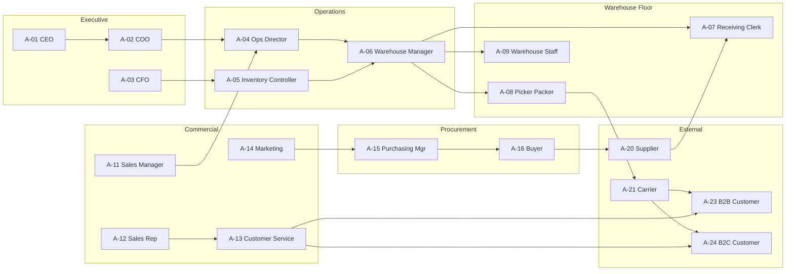

# Business Actor Analysis: Inventory Management System

**Document Owner:** Domain Expert / Senior Business Analyst  
**Purpose:** Identify every business actor involved in inventory management processes and define their roles, responsibilities, and interactions  
**Scope:** Business actors and operational authority only — no system roles, authentication, or technology design  
**Based On:** Business Process Analysis (32 processes), Stakeholder Analysis, and Business Vision

---

## Executive Summary

This document identifies **27 business actors** — **22 internal** and **5 external** — who participate in the 32 inventory management business processes. Each actor profile includes business role, responsibilities, goals, operational permissions (decision rights and authority boundaries), process participation, and interactions with other actors.

Actors are grouped by organizational domain. Business permissions describe what the actor is authorized to decide, approve, initiate, or execute in the course of normal operations — not technical access rights.

---

## Actor Index

| ID | Actor | Type | Primary Domain |
|----|-------|------|----------------|
| A-01 | Chief Executive Officer (CEO) | Internal | Executive Leadership |
| A-02 | Chief Operating Officer (COO) | Internal | Executive Leadership |
| A-03 | Chief Financial Officer (CFO) | Internal | Executive Leadership |
| A-04 | Operations Director | Internal | Operations |
| A-05 | Inventory Controller | Internal | Inventory Control |
| A-06 | Warehouse Manager | Internal | Warehouse Operations |
| A-07 | Receiving Clerk | Internal | Warehouse Operations |
| A-08 | Warehouse Picker / Packer | Internal | Warehouse Operations |
| A-09 | Warehouse Staff (General) | Internal | Warehouse Operations |
| A-10 | Regional / Store Manager | Internal | Retail / Regional Operations |
| A-11 | Sales Manager | Internal | Commercial |
| A-12 | Sales Representative | Internal | Commercial |
| A-13 | Customer Service Representative | Internal | Commercial |
| A-14 | Marketing Manager | Internal | Commercial |
| A-15 | Purchasing Manager | Internal | Procurement |
| A-16 | Buyer / Procurement Officer | Internal | Procurement |
| A-17 | Finance Manager / Accountant | Internal | Finance |
| A-18 | Internal Auditor | Internal | Governance & Audit |
| A-19 | External Auditor | External | Governance & Audit |
| A-20 | Supplier / Vendor | External | Supply Chain |
| A-21 | Logistics / Carrier Partner | External | Supply Chain |
| A-22 | Freight Forwarder | External | Supply Chain |
| A-23 | B2B Customer | External | Customer |
| A-24 | B2C Customer | External | Customer |
| A-25 | Regulatory Authority | External | Governance & Compliance |

---

## Internal Actors

---

### A-01: Chief Executive Officer (CEO)

| Attribute | Description |
|-----------|-------------|
| **Actor Name** | Chief Executive Officer (CEO) |
| **Business Role** | Executive sponsor accountable for company strategy, growth, and overall business performance |
| **Responsibilities** | Set strategic direction for inventory as a business capability; approve major investments in network expansion; hold leadership accountable for inventory KPIs; represent inventory performance to board and investors; authorize significant policy changes affecting working capital |
| **Goals** | Protect revenue and margin; improve working capital efficiency; enable scalable growth; build market reputation for reliable fulfillment; reduce operational risk from inventory mismanagement |
| **Business Permissions** | Approve network expansion and new location strategy; authorize major inventory policy changes; review and act on executive inventory performance reports; delegate operational authority to COO; approve capital allocation for inventory initiatives |
| **Business Processes** | BP-29 (Inventory Performance Reporting — consumer); BP-02 (Location & Warehouse Setup — strategic approval); BP-26 (Network Stock Rebalancing — strategic decisions) |
| **Interactions** | Receives performance summaries from **COO** and **CFO**; sets expectations for **Operations Director**; reviews inventory health for board reporting; informed by **Purchasing Manager** on supply risk for strategic accounts |

---

### A-02: Chief Operating Officer (COO)

| Attribute | Description |
|-----------|-------------|
| **Actor Name** | Chief Operating Officer (COO) |
| **Business Role** | Senior operations executive responsible for end-to-end operational performance including warehousing, fulfillment, and supply coordination |
| **Responsibilities** | Drive operational efficiency across the location network; standardize inventory processes; resolve cross-functional escalations; align operations with business strategy; approve major operational policy changes; sponsor process compliance enforcement |
| **Goals** | Achieve high order fill rates; reduce fulfillment cycle time; standardize processes across locations; improve inventory accuracy; scale operations without proportional cost increase |
| **Business Permissions** | Approve high-value stock adjustments and inter-location transfers; authorize operational policy updates; approve location setup and closure decisions; escalate to CEO on strategic inventory matters; mandate process compliance across locations |
| **Business Processes** | BP-02, BP-14 (high-value adjustment approval), BP-26, BP-29, BP-32; oversight of BP-10, BP-15, BP-25 |
| **Interactions** | Directs **Operations Director** and **Warehouse Managers**; coordinates with **Purchasing Manager** on replenishment strategy; partners with **CFO** on working capital targets; receives escalations from **Sales Manager** on fulfillment failures; supports **Internal Auditor** on control enforcement |

---

### A-03: Chief Financial Officer (CFO)

| Attribute | Description |
|-----------|-------------|
| **Actor Name** | Chief Financial Officer (CFO) |
| **Business Role** | Executive accountable for financial health, working capital, and accurate financial reporting |
| **Responsibilities** | Oversee inventory as a balance-sheet asset; approve inventory-related capital and operating budgets; ensure financial records reflect operational reality; partner with operations on carrying cost reduction; support audit readiness |
| **Goals** | Reduce inventory carrying cost; improve inventory turnover; minimize write-offs and shrinkage; ensure accurate balance sheet valuation; support timely month-end close |
| **Business Permissions** | Approve inventory initiative budgets; authorize write-off thresholds and financial policies; review and challenge inventory valuation; approve large purchase commitments from a financial perspective; sign off on audit responses |
| **Business Processes** | BP-29 (executive reporting), BP-30 (valuation oversight), BP-14 (write-off policy), BP-05 (budget approval for large orders), BP-32 |
| **Interactions** | Works with **Finance Manager** on reconciliation; challenges **Operations Director** on excess stock; partners with **Purchasing Manager** on procurement spend; receives reports from **Inventory Controller**; engages **External Auditor** during annual audit |

---

### A-04: Operations Director

| Attribute | Description |
|-----------|-------------|
| **Actor Name** | Operations Director |
| **Business Role** | Senior manager responsible for day-to-day operational performance across warehouses and fulfillment |
| **Responsibilities** | Manage network-wide inventory accuracy and fulfillment performance; set operational standards; approve adjustments, transfers, and count variances within authority limits; coordinate between warehouse, purchasing, and sales; resolve operational escalations; drive count program adherence |
| **Goals** | Maintain inventory accuracy above target; minimize stockouts on priority SKUs; optimize stock distribution across locations; reduce manual reconciliation effort; achieve consistent performance across warehouse teams |
| **Business Permissions** | Approve stock adjustments and count variances within defined value thresholds; authorize inter-location transfers; approve cycle count schedules; assign warehouse management accountability; escalate to COO beyond authority limits; configure location operational policies |
| **Business Processes** | BP-02, BP-10, BP-11 (oversight), BP-13, BP-14, BP-15, BP-16, BP-17, BP-24, BP-25, BP-26, BP-29, BP-30, BP-32 |
| **Interactions** | Supervises **Warehouse Managers** and **Inventory Controller**; coordinates with **Purchasing Manager** on replenishment urgency; responds to **Sales Manager** availability escalations; provides data to **Finance Manager**; reports to **COO** |

---

### A-05: Inventory Controller

| Attribute | Description |
|-----------|-------------|
| **Actor Name** | Inventory Controller |
| **Business Role** | Business owner of inventory accuracy, product master data integrity, and count programs |
| **Responsibilities** | Maintain product master data quality; define and maintain stock policies and reorder thresholds; schedule and oversee cycle and full counts; investigate count variances; facilitate ABC classification; produce accuracy and variance reports; drive root-cause analysis for chronic discrepancies |
| **Goals** | Achieve and sustain high inventory record accuracy; timely resolution of variances; reliable product and location master data; effective count program across all locations; meaningful shrinkage analysis |
| **Business Permissions** | Create and update product master records; define reorder levels and minimum thresholds; schedule cycle and full counts; approve count adjustments within policy; initiate stock adjustment requests; publish ABC classification; generate inventory accuracy reports; escalate unexplained variances to Operations Director |
| **Business Processes** | BP-01, BP-03, BP-04, BP-05 (input), BP-10, BP-11, BP-12, BP-13, BP-14, BP-15, BP-20 (recurring exceptions), BP-21, BP-22, BP-24, BP-28, BP-29, BP-30, BP-31, BP-32 |
| **Interactions** | Partners with **Purchasing Manager** on reorder parameters; supports **Warehouse Managers** on count execution; provides data to **Finance Manager**; coordinates with **Sales Manager** on demand input; works with **Internal Auditor** on control testing; receives discrepancy data from **Receiving Clerk** |

---

### A-06: Warehouse Manager

| Attribute | Description |
|-----------|-------------|
| **Actor Name** | Warehouse Manager |
| **Business Role** | Location-level manager accountable for daily warehouse operations and location inventory accuracy |
| **Responsibilities** | Supervise receiving, storage, picking, packing, and shipping at assigned location; ensure timely transaction recording; approve local count variances; initiate adjustments and transfer requests; manage warehouse team productivity; maintain safe and organized storage |
| **Goals** | Accurate stock records at their location; efficient pick and ship cycles; minimal count variances; well-organized stock placement; productive and accountable team |
| **Business Permissions** | Authorize goods receipts at location; initiate stock adjustments and write-off requests within limits; approve cycle count results at location; initiate and receive inter-location transfers; release orders to pick queue; approve put-away assignments; escalate exceptions to Operations Director; supervise warehouse staff |
| **Business Processes** | BP-02 (input), BP-06, BP-07, BP-08, BP-09, BP-10, BP-11, BP-12, BP-13, BP-14, BP-16, BP-17, BP-18, BP-19, BP-20, BP-24, BP-25, BP-27, BP-28, BP-29 |
| **Interactions** | Supervises **Receiving Clerk**, **Picker/Packer**, and **Warehouse Staff**; coordinates with **Buyer** on inbound timing; responds to **Customer Service** on fulfillment status; receives transfer requests from **Regional Manager**; reports to **Operations Director**; hands off shipments to **Carrier Partner** |

---

### A-07: Receiving Clerk

| Attribute | Description |
|-----------|-------------|
| **Actor Name** | Receiving Clerk |
| **Business Role** | Frontline operator responsible for accepting and recording inbound shipments |
| **Responsibilities** | Accept inbound deliveries at dock; verify quantity and condition against delivery documents; record goods receipts; flag discrepancies, damage, or wrong items; hand off verified goods for put-away; support return receipt processing |
| **Goals** | Fast and accurate receiving; clear visibility of expected shipments; minimal rework from recording errors; immediate reflection of received stock in inventory |
| **Business Permissions** | Record goods receipt transactions; log quantity variances and damage reports; refuse acceptance of clearly non-conforming shipments pending supervisor review; initiate discrepancy reports; cannot approve adjustments or override receipt variances independently |
| **Business Processes** | BP-06, BP-07, BP-08, BP-09, BP-28 |
| **Interactions** | Receives shipments from **Supplier** and **Freight Forwarder**; reports discrepancies to **Warehouse Manager** and **Buyer**; hands off goods to **Warehouse Staff** for put-away; referenced in disputes with **Supplier** |

---

### A-08: Warehouse Picker / Packer

| Attribute | Description |
|-----------|-------------|
| **Actor Name** | Warehouse Picker / Packer |
| **Business Role** | Frontline operator executing order fulfillment through picking, packing, and shipment preparation |
| **Responsibilities** | Pick items per pick list; verify product and quantity; pack orders per shipping standards; confirm pick completion; report unable-to-pick or damaged items; prepare shipments for carrier handoff |
| **Goals** | Clear pick lists with accurate locations; fast picking with minimal errors; immediate confirmation of completed picks; easy escalation for exceptions |
| **Business Permissions** | Execute picks against released pick lists; confirm picked and packed quantities; report pick exceptions (short pick, damaged item, stock not found); cannot adjust inventory, approve substitutions, or release orders independently |
| **Business Processes** | BP-18, BP-20 |
| **Interactions** | Receives pick assignments from **Warehouse Manager**; reports exceptions to **Warehouse Manager**; coordinates with **Customer Service** indirectly through fulfillment status; prepares goods for **Carrier Partner** pickup |

---

### A-09: Warehouse Staff (General)

| Attribute | Description |
|-----------|-------------|
| **Actor Name** | Warehouse Staff (General) |
| **Business Role** | Frontline warehouse operator supporting put-away, counting, and general material handling |
| **Responsibilities** | Move received goods to storage locations; participate in cycle and full counts; handle material movement within warehouse; maintain organized storage areas; support pick operations during peak volume |
| **Goals** | Efficient put-away; accurate count participation; safe material handling; organized warehouse floor |
| **Business Permissions** | Execute put-away per supervisor assignment; perform physical counts as assigned; report observed damage or misplaced stock; cannot approve counts, adjust records, or authorize movements independently |
| **Business Processes** | BP-09, BP-11, BP-12 |
| **Interactions** | Receives put-away direction from **Warehouse Manager**; receives goods from **Receiving Clerk**; participates in counts supervised by **Inventory Controller** and **Warehouse Manager** |

---

### A-10: Regional / Store Manager

| Attribute | Description |
|-----------|-------------|
| **Actor Name** | Regional / Store Manager |
| **Business Role** | Manager accountable for retail store or regional group of locations, including local stock levels and customer experience |
| **Responsibilities** | Monitor store-level stock; request replenishment transfers from warehouse; initiate local count participation; escalate stockouts affecting customer experience; balance local stock without excess; coordinate with central operations on network needs |
| **Goals** | Shelves stocked with right products; minimal customer-facing stockouts; balanced stock without excess; visibility into inbound replenishment |
| **Business Permissions** | Request inter-location stock transfers; initiate local cycle count requests; view stock status for assigned store(s); escalate stockout situations; limited authority to initiate local adjustments subject to approval |
| **Business Processes** | BP-02 (input), BP-10, BP-24, BP-26, BP-29 (local view) |
| **Interactions** | Requests transfers from **Warehouse Manager** and **Operations Director**; coordinates with **Sales Manager** on local demand; receives replenishment updates from **Purchasing**; reports stock issues to **Operations Director** |

---

### A-11: Sales Manager

| Attribute | Description |
|-----------|-------------|
| **Actor Name** | Sales Manager |
| **Business Role** | Commercial leader ensuring sales commitments align with supply capability |
| **Responsibilities** | Lead sales team performance; ensure availability before large commitments; escalate fulfillment risks; coordinate promotional demand with operations and purchasing; monitor order fulfillment for key accounts |
| **Goals** | Accurate stock availability for sales commitments; high order win rate without overpromising; visibility into backorder risk; data for sales planning and promotions |
| **Business Permissions** | Confirm large order feasibility with operations; escalate stockout and fulfillment risks; request availability checks across network; coordinate promotional demand signals with marketing and purchasing; cannot reserve stock or modify inventory directly |
| **Business Processes** | BP-01 (input), BP-04, BP-10, BP-16, BP-19, BP-21 (demand context), BP-23, BP-24, BP-29, BP-31 |
| **Interactions** | Coordinates with **Operations Director** on availability; directs **Sales Representatives**; partners with **Marketing Manager** on campaigns; escalates to **Purchasing Manager** on supply gaps; receives order status from **Customer Service** |

---

### A-12: Sales Representative

| Attribute | Description |
|-----------|-------------|
| **Actor Name** | Sales Representative |
| **Business Role** | Customer-facing sales professional creating quotes and orders for B2B and B2C accounts |
| **Responsibilities** | Engage customers; confirm product availability before quoting; communicate delivery expectations; create orders; follow up on order status; identify upsell opportunities within stock constraints |
| **Goals** | Quickly confirm availability to customers; provide reliable delivery dates; avoid order cancellations; serve customers without depending on manual warehouse checks |
| **Business Permissions** | Request availability confirmation; place customer orders; communicate delivery commitments based on confirmed availability; escalate unfulfillable orders; cannot override reservations or adjust inventory |
| **Business Processes** | BP-16, BP-19, BP-23, BP-27 (initiation), BP-31 (demand signal) |
| **Interactions** | Confirms availability with **Operations** and **Warehouse Manager**; serves **B2B Customer**; coordinates with **Customer Service** on order issues; receives fulfillment updates indirectly through operations |

---

### A-13: Customer Service Representative

| Attribute | Description |
|-----------|-------------|
| **Actor Name** | Customer Service Representative |
| **Business Role** | Frontline customer support handling inquiries, complaints, order status, and return intake |
| **Responsibilities** | Answer order status inquiries; communicate delays and partial shipments; process return requests at intake level; coordinate with warehouse on fulfillment issues; resolve stock-related complaints; notify customers of backorder status |
| **Goals** | Answer "where is my order?" accurately; proactively inform customers of delays; resolve stock-related complaints quickly; reduce handling time |
| **Business Permissions** | Look up order fulfillment status and product availability; initiate customer return intake records; communicate revised delivery expectations; escalate fulfillment failures; cannot adjust inventory or authorize write-offs |
| **Business Processes** | BP-10, BP-16, BP-17 (status), BP-18 (status), BP-19, BP-20, BP-23, BP-27, BP-28 (coordination) |
| **Interactions** | Serves **B2B Customer** and **B2C Customer**; coordinates with **Warehouse Manager** on fulfillment; works with **Sales Representative** on replacements; initiates returns processed by **Receiving Clerk**; escalates to **Sales Manager** |

---

### A-14: Marketing Manager

| Attribute | Description |
|-----------|-------------|
| **Actor Name** | Marketing Manager |
| **Business Role** | Commercial planner responsible for promotions, campaigns, and product launches |
| **Responsibilities** | Plan promotional calendar; coordinate launch timing with operations and purchasing; communicate expected demand uplift; verify stock readiness before campaigns; monitor inventory during active promotions |
| **Goals** | Confidence that promoted products are adequately stocked; early warning of insufficient campaign inventory; alignment between marketing calendar and replenishment |
| **Business Permissions** | Request stock readiness assessments for campaign SKUs; communicate promotional demand forecasts; participate in go/no-go decisions for campaigns; cannot place purchase orders or modify inventory directly |
| **Business Processes** | BP-01 (launch input), BP-10 (campaign monitoring), BP-31 |
| **Interactions** | Coordinates with **Purchasing Manager** on pre-promotion stock build; partners with **Sales Manager** on demand expectations; receives readiness confirmation from **Operations Director** and **Inventory Controller** |

---

### A-15: Purchasing Manager

| Attribute | Description |
|-----------|-------------|
| **Actor Name** | Purchasing Manager |
| **Business Role** | Procurement leader managing supplier relationships, purchasing strategy, and replenishment execution |
| **Responsibilities** | Oversee procurement strategy; approve purchase orders and requisitions; manage supplier relationships; align purchasing with inventory policy; monitor inbound supply; resolve supplier disputes; coordinate emergency procurement |
| **Goals** | Right products ordered at right time and quantity; reduced emergency purchases; reliable inbound visibility; optimized order frequency and sizes |
| **Business Permissions** | Approve purchase requisitions and purchase orders within authority limits; negotiate with suppliers; configure reorder parameters (with Inventory Controller); authorize expedited procurement; escalate budget exceptions to CFO; manage buyer team assignments |
| **Business Processes** | BP-01, BP-03, BP-04, BP-05, BP-06, BP-08, BP-19 (replenishment), BP-21, BP-22, BP-23, BP-26, BP-29, BP-31 |
| **Interactions** | Directs **Buyer**; partners with **Inventory Controller** on thresholds; coordinates with **Warehouse Manager** on delivery timing; resolves disputes with **Supplier**; receives low-stock signals from replenishment process; reports to **COO** and **CFO** on supply risk |

---

### A-16: Buyer / Procurement Officer

| Attribute | Description |
|-----------|-------------|
| **Actor Name** | Buyer / Procurement Officer |
| **Business Role** | Operational purchaser executing day-to-day ordering and supplier follow-up |
| **Responsibilities** | Place purchase orders with suppliers; track open orders and deliveries; follow up on delayed shipments; resolve receipt discrepancies with suppliers; avoid duplicate ordering; execute emergency purchases when authorized |
| **Business Permissions** | Create purchase orders within approved requisitions; communicate with suppliers on delivery status; initiate discrepancy claims; request stock checks before emergency orders; cannot approve requisitions above personal authority or modify inventory policy |
| **Business Processes** | BP-05, BP-06, BP-08, BP-21, BP-22, BP-23, BP-31 (execution) |
| **Interactions** | Places orders with **Supplier**; coordinates ETA with **Freight Forwarder**; works with **Receiving Clerk** on discrepancy resolution; receives requisitions from **Purchasing Manager**; informs **Sales Manager** and **Customer Service** on inbound supply |

---

### A-17: Finance Manager / Accountant

| Attribute | Description |
|-----------|-------------|
| **Actor Name** | Finance Manager / Accountant |
| **Business Role** | Finance professional responsible for inventory valuation, reconciliation, and financial reporting |
| **Responsibilities** | Record inventory value in financial books; perform month-end inventory reconciliation; analyze shrinkage and write-off financial impact; support audit with inventory evidence; challenge unexplained operational variances |
| **Goals** | Accurate inventory valuation; timely month-end reconciliation; clear documentation for adjustments and write-offs; alignment between operational and financial records |
| **Business Permissions** | Extract inventory valuation data; review and approve financial treatment of write-offs; reconcile operational records with general ledger; request supporting documentation for adjustments; cannot execute operational inventory transactions |
| **Business Processes** | BP-01 (costing reference), BP-04, BP-08 (payment/credit), BP-12, BP-14, BP-15, BP-27 (refund), BP-28, BP-29, BP-30, BP-32 |
| **Interactions** | Reconciles with **Inventory Controller** and **Operations Director**; partners with **CFO** on valuation issues; supports **External Auditor**; reviews write-offs from **Warehouse Manager**; coordinates with **Buyer** on supplier credits |

---

### A-18: Internal Auditor

| Attribute | Description |
|-----------|-------------|
| **Actor Name** | Internal Auditor |
| **Business Role** | Independent assurance professional evaluating internal controls over inventory |
| **Responsibilities** | Test inventory control design and operating effectiveness; sample transactions for compliance; investigate control weaknesses; review segregation of duties; report findings to audit committee; recommend corrective actions |
| **Goals** | Effective inventory controls; verifiable transaction integrity; early detection of fraud or process failure; clean internal and external audit outcomes |
| **Business Permissions** | Review full transaction history and audit evidence; request documentation and explanations from all departments; issue audit findings and recommendations; cannot execute or approve operational inventory transactions |
| **Business Processes** | BP-12, BP-13, BP-14 (oversight), BP-15, BP-32 |
| **Interactions** | Reviews records from **Inventory Controller** and **Finance Manager**; tests controls over **Warehouse Manager** and **Receiving Clerk** activities; reports to **COO** and **CFO**; coordinates with **External Auditor** |

---

## External Actors

---

### A-19: External Auditor

| Attribute | Description |
|-----------|-------------|
| **Actor Name** | External Auditor |
| **Business Role** | Independent third-party auditor verifying financial statements and inventory controls |
| **Responsibilities** | Test inventory existence and valuation; evaluate control effectiveness; sample transactions; issue audit opinion; identify material misstatements and control deficiencies |
| **Goals** | Sufficient evidence of inventory existence and valuation; effective controls over movements; complete and reliable audit trail |
| **Business Permissions** | Request inventory reports, count records, and transaction evidence during audit period; interview business personnel; issue audit findings; no operational authority within the organization |
| **Business Processes** | BP-12, BP-30, BP-32 |
| **Interactions** | Works with **Finance Manager**, **Inventory Controller**, and **Internal Auditor**; requests evidence from **Operations Director**; reports to board and **CFO** |

---

### A-20: Supplier / Vendor

| Attribute | Description |
|-----------|-------------|
| **Actor Name** | Supplier / Vendor |
| **Business Role** | External party providing products to the organization per commercial supply agreements |
| **Responsibilities** | Fulfill purchase orders per agreed terms; deliver on schedule; provide accurate delivery documentation; resolve quantity and quality disputes; maintain product availability and catalog accuracy |
| **Goals** | Clear and timely purchase orders; predictable receiving process; quick dispute resolution; sustainable supply partnership |
| **Business Permissions** | Accept or negotiate purchase orders within contract terms; ship goods per order specifications; issue delivery documentation; dispute receiving claims with supporting evidence; no authority within buyer's internal operations |
| **Business Processes** | BP-01 (product specifications), BP-05, BP-07, BP-08, BP-23 |
| **Interactions** | Receives orders from **Buyer** and **Purchasing Manager**; delivers to **Receiving Clerk**; resolves discrepancies with **Buyer**; payment coordinated through **Finance Manager** |

---

### A-21: Logistics / Carrier Partner

| Attribute | Description |
|-----------|-------------|
| **Actor Name** | Logistics / Carrier Partner |
| **Business Role** | External transport provider moving goods between warehouse and customers or between locations |
| **Responsibilities** | Pick up packed orders from warehouse; transport goods per service level agreements; provide tracking information; deliver to customer or destination location; report delivery failures |
| **Goals** | Accurate shipment manifests; efficient pickup scheduling; clear delivery instructions; minimal failed deliveries |
| **Business Permissions** | Accept shipments per warehouse handoff; provide tracking and delivery confirmation; report delivery exceptions; no authority over inventory records or order content |
| **Business Processes** | BP-18, BP-25 |
| **Interactions** | Picks up from **Warehouse Manager** and **Picker/Packer**; delivers to **B2B Customer**, **B2C Customer**, or receiving location; tracking shared with **Customer Service** |

---

### A-22: Freight Forwarder

| Attribute | Description |
|-----------|-------------|
| **Actor Name** | Freight Forwarder |
| **Business Role** | External coordinator for bulk or international inbound shipments |
| **Responsibilities** | Consolidate inbound shipments; manage customs documentation; communicate expected arrival dates; coordinate delivery to warehouse; resolve documentation mismatches |
| **Goals** | Accurate shipment documentation; reliable ETAs; efficient customs clearance; coordinated warehouse delivery |
| **Business Permissions** | Provide shipment status and ETA to buyer organization; deliver consolidated shipments to agreed location; no authority within buyer's internal operations |
| **Business Processes** | BP-06, BP-07, BP-23 |
| **Interactions** | Communicates with **Buyer** and **Purchasing Manager**; delivers to **Receiving Clerk**; coordinates timing with **Warehouse Manager** |

---

### A-23: B2B Customer

| Attribute | Description |
|-----------|-------------|
| **Actor Name** | B2B Customer (Business Buyer) |
| **Business Role** | External business customer purchasing products in bulk or on recurring terms |
| **Responsibilities** | Place orders per commercial agreement; provide delivery requirements; accept or reject partial shipments per policy; manage own supply planning based on supplier performance |
| **Goals** | Accurate availability information; reliable delivery commitments; order status transparency; consistent product supply |
| **Business Permissions** | Place orders; request delivery date changes; initiate return requests; cancel orders per contract terms; no authority within supplier operations |
| **Business Processes** | BP-16 (demand trigger), BP-17 (indirect), BP-18 (recipient), BP-19, BP-27 |
| **Interactions** | Orders through **Sales Representative**; receives fulfillment updates from **Customer Service**; receives shipments from **Carrier Partner**; return intake via **Customer Service** |

---

### A-24: B2C Customer

| Attribute | Description |
|-----------|-------------|
| **Actor Name** | B2C Customer (Retail Consumer) |
| **Business Role** | External individual consumer purchasing products for personal use |
| **Responsibilities** | Place orders through retail or e-commerce channels; receive deliveries or pick up in store; initiate returns when needed; expect accurate availability representation |
| **Goals** | Product available when ordered; accurate delivery estimates; minimal cancellations; straightforward returns |
| **Business Permissions** | Place and cancel orders per channel policy; request order status; initiate returns; no authority within supplier operations |
| **Business Processes** | BP-16 (demand trigger), BP-18 (recipient), BP-19, BP-20 (impact), BP-27 |
| **Interactions** | Orders via sales channels served by **Sales Representative** or retail (**Regional Manager** store); supported by **Customer Service**; receives shipments from **Carrier Partner** |

---

### A-25: Regulatory Authority

| Attribute | Description |
|-----------|-------------|
| **Actor Name** | Regulatory Authority |
| **Business Role** | Government or industry body enforcing product traceability, safety, or reporting regulations (when applicable) |
| **Responsibilities** | Enforce applicable regulations; conduct inspections; require evidence of product traceability and record-keeping; issue compliance requirements and penalties for non-compliance |
| **Goals** | Demonstrable product traceability; compliant record-keeping; timely reporting when required; evidence of recall capability |
| **Business Permissions** | Request data exports and reports during inspections; issue compliance orders and penalties; no role in day-to-day operations |
| **Business Processes** | BP-32 (indirect — control readiness); future linkage to BP-07, BP-28 if regulated products introduced |
| **Interactions** | Requests evidence from **COO**, **Finance Manager**, and **Internal Auditor**; minimal interaction in current distribution scope unless regulated categories are entered |

---

## Actor-to-Process Participation Matrix

| Process | Participating Actors |
|---------|---------------------|
| **BP-01** Product Master Data Management | A-05, A-15, A-04, A-11, A-14, A-17, A-20 |
| **BP-02** Location & Warehouse Setup | A-04, A-02, A-10, A-06, A-17, A-01 |
| **BP-03** Stock Policy & Threshold Definition | A-05, A-15, A-04, A-11, A-17 |
| **BP-04** ABC Product Classification | A-05, A-04, A-15, A-11, A-17 |
| **BP-05** Purchase Order Placement | A-15, A-16, A-05, A-17, A-06, A-20 |
| **BP-06** Inbound Shipment Planning | A-15, A-16, A-06, A-07, A-04, A-22 |
| **BP-07** Goods Receipt & Verification | A-07, A-06, A-15, A-16, A-20 |
| **BP-08** Receipt Discrepancy Resolution | A-07, A-06, A-16, A-15, A-20, A-17 |
| **BP-09** Stock Put-Away & Storage | A-09, A-06, A-07 |
| **BP-10** Inventory Status Monitoring | A-04, A-05, A-06, A-11, A-13, A-15, A-10 |
| **BP-11** Cycle Counting | A-05, A-09, A-06, A-04 |
| **BP-12** Full Physical Inventory Count | A-05, A-06, A-04, A-17, A-18 |
| **BP-13** Count Variance Investigation & Approval | A-05, A-06, A-04, A-18 |
| **BP-14** Stock Adjustment & Write-Off | A-06, A-05, A-04, A-02, A-17, A-18 |
| **BP-15** Shrinkage & Loss Management | A-05, A-04, A-17, A-18, A-06 |
| **BP-16** Order Availability Confirmation | A-11, A-12, A-13, A-04, A-06, A-23, A-24 |
| **BP-17** Inventory Reservation | A-04, A-06, A-11, A-13 |
| **BP-18** Pick, Pack & Ship | A-08, A-06, A-04, A-13, A-21 |
| **BP-19** Partial Fulfillment & Backorder Management | A-06, A-13, A-11, A-12, A-04, A-15, A-23, A-24 |
| **BP-20** Outbound Exception Handling | A-08, A-06, A-13, A-12, A-05 |
| **BP-21** Low-Stock Alert Review | A-15, A-16, A-05, A-04, A-11 |
| **BP-22** Replenishment Planning & Requisition | A-15, A-16, A-05, A-04, A-17 |
| **BP-23** Inbound Supply Tracking | A-16, A-15, A-04, A-11, A-13, A-06, A-22 |
| **BP-24** Inter-Location Transfer Request | A-10, A-04, A-06, A-11, A-05 |
| **BP-25** Inter-Location Transfer Execution | A-06, A-04, A-21, A-05 |
| **BP-26** Network Stock Rebalancing | A-04, A-05, A-10, A-15, A-02 |
| **BP-27** Customer Return Intake | A-13, A-12, A-06, A-17, A-23, A-24 |
| **BP-28** Return-to-Stock or Disposal Decision | A-06, A-07, A-05, A-13, A-17 |
| **BP-29** Inventory Performance Reporting | A-04, A-05, A-02, A-01, A-03, A-15, A-11, A-06, A-10 |
| **BP-30** Inventory Valuation & Financial Reconciliation | A-17, A-05, A-04, A-03, A-19 |
| **BP-31** Promotional & Launch Stock Readiness | A-14, A-15, A-04, A-06, A-11, A-05 |
| **BP-32** Inventory Audit & Control Review | A-18, A-19, A-17, A-05, A-04, A-02 |

---

## Actor Interaction Overview

---

## Key Actor Dependencies

| Dependent Actor | Depends On | Nature of Dependency |
|-----------------|------------|-------------------|
| Sales Representative (A-12) | Operations Director (A-04), Warehouse Manager (A-06) | Accurate availability data to confirm customer orders |
| Customer Service (A-13) | Warehouse Manager (A-06), Picker/Packer (A-08) | Fulfillment status to answer customer inquiries |
| Purchasing Manager (A-15) | Inventory Controller (A-05) | Reorder thresholds and consumption data for replenishment |
| Warehouse Manager (A-06) | Buyer (A-16), Supplier (A-20) | Timely inbound deliveries to maintain stock |
| Finance Manager (A-17) | Inventory Controller (A-05), Operations Director (A-04) | Accurate operational data for valuation and reconciliation |
| Operations Director (A-04) | Purchasing Manager (A-15), Sales Manager (A-11) | Supply and demand signals for network balancing |
| Receiving Clerk (A-07) | Supplier (A-20), Buyer (A-16) | Delivery documentation and PO references for verification |
| Regional Manager (A-10) | Warehouse Manager (A-06), Operations Director (A-04) | Transfer fulfillment for store replenishment |
| Marketing Manager (A-14) | Purchasing Manager (A-15), Operations Director (A-04) | Stock readiness before campaigns |
| B2B / B2C Customer (A-23, A-24) | Sales Rep (A-12), Customer Service (A-13), Carrier (A-21) | Order placement, status, and delivery |

---

## Business Permission Tiers

Operational authority is tiered to support segregation of duties and escalation:

| Tier | Authority Level | Actors | Typical Permissions |
|------|-----------------|--------|---------------------|
| **Tier 1 — Executive** | Strategic and high-value | CEO, COO, CFO | Budget approval, policy authorization, strategic network decisions, high-value write-off approval |
| **Tier 2 — Management** | Operational approval | Operations Director, Purchasing Manager, Warehouse Manager, Finance Manager | Approve adjustments, transfers, count variances, purchase orders within limits; authorize local operations |
| **Tier 3 — Control** | Data and program ownership | Inventory Controller, Internal Auditor | Define policies, schedule counts, approve count adjustments, audit and review (no dual approval of own work) |
| **Tier 4 — Execution** | Transaction execution | Buyer, Receiving Clerk, Picker/Packer, Warehouse Staff, Sales Rep, Customer Service | Execute assigned transactions; initiate requests; report exceptions; no independent approval authority |
| **Tier 5 — External** | Contractual participation | Supplier, Carrier, Freight Forwarder, Customers, Auditors | Fulfill external role per agreement; no internal operational authority |

---

## Actor Count Summary

| Category | Count | Actors |
|----------|-------|--------|
| **Executive Leadership** | 3 | CEO, COO, CFO |
| **Operations & Warehouse** | 6 | Operations Director, Inventory Controller, Warehouse Manager, Receiving Clerk, Picker/Packer, Warehouse Staff |
| **Retail / Regional** | 1 | Regional / Store Manager |
| **Commercial** | 4 | Sales Manager, Sales Representative, Customer Service, Marketing Manager |
| **Procurement** | 2 | Purchasing Manager, Buyer |
| **Finance** | 1 | Finance Manager / Accountant |
| **Governance & Audit** | 2 | Internal Auditor, External Auditor |
| **External Supply Chain** | 3 | Supplier, Carrier, Freight Forwarder |
| **External Customers** | 2 | B2B Customer, B2C Customer |
| **External Regulatory** | 1 | Regulatory Authority |
| **Total** | **27** | |

---

## Document Summary

This analysis identifies **27 business actors** participating across **32 inventory management processes**. Internal actors span executive leadership, operations, warehouse floor, commercial, procurement, finance, and audit functions. External actors include suppliers, logistics partners, customers, auditors, and regulatory bodies.

Business permissions are defined as operational decision rights and authority boundaries — not technical system access. The actor-to-process matrix and interaction map support RACI development, training design, and organizational change planning in subsequent project phases.

---

*End of Business Actor Analysis Document*
