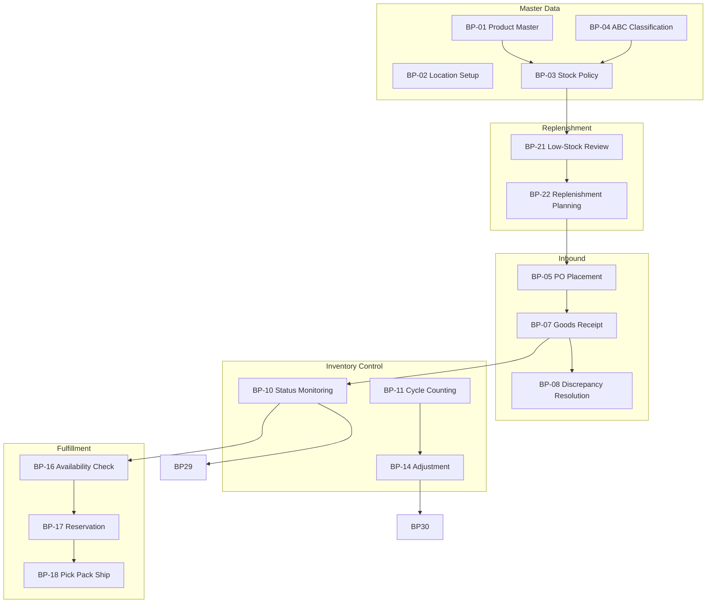

# Business Process Analysis: Inventory Management System

**Document Owner:** Senior Business Analyst  
**Purpose:** Identify and document all core business processes within the Inventory Management domain  
**Scope:** Business operations only — no software, technology, or implementation design  
**Based On:** Business Vision, Project Scope, Stakeholder Analysis, and Business Assumptions

---

## Executive Summary

This document defines **32 business processes** that govern how a distribution and retail organization manages inventory across multiple locations. Processes span product and location governance, inbound logistics, stock control, order fulfillment, replenishment, inter-location balancing, returns, financial alignment, performance management, and audit oversight.

Processes are grouped into nine domains. Each process is described using a consistent structure to support business analysis, process improvement, and requirements traceability in subsequent project phases.

---

## Process Index

| # | Process Name | Domain | Frequency | Priority |
|---|--------------|--------|-----------|----------|
| 1 | Product Master Data Management | Master Data & Governance | Ongoing / As needed | High |
| 2 | Location & Warehouse Setup | Master Data & Governance | As needed | High |
| 3 | Stock Policy & Threshold Definition | Master Data & Governance | Monthly / Quarterly | High |
| 4 | ABC Product Classification | Master Data & Governance | Semi-annual | Medium |
| 5 | Purchase Order Placement | Inbound & Receiving | Daily / Weekly | High |
| 6 | Inbound Shipment Planning | Inbound & Receiving | Daily | Medium |
| 7 | Goods Receipt & Verification | Inbound & Receiving | Daily | High |
| 8 | Receipt Discrepancy Resolution | Inbound & Receiving | As triggered | High |
| 9 | Stock Put-Away & Storage | Inbound & Receiving | Daily | Medium |
| 10 | Inventory Status Monitoring | Inventory Control | Daily | High |
| 11 | Cycle Counting | Inventory Control | Daily / Weekly | High |
| 12 | Full Physical Inventory Count | Inventory Control | Annual / Semi-annual | High |
| 13 | Count Variance Investigation & Approval | Inventory Control | As triggered | High |
| 14 | Stock Adjustment & Write-Off | Inventory Control | As triggered | High |
| 15 | Shrinkage & Loss Management | Inventory Control | Monthly | High |
| 16 | Order Availability Confirmation | Order Fulfillment | Per order | High |
| 17 | Inventory Reservation | Order Fulfillment | Per order | High |
| 18 | Pick, Pack & Ship | Order Fulfillment | Daily | High |
| 19 | Partial Fulfillment & Backorder Management | Order Fulfillment | As triggered | High |
| 20 | Outbound Exception Handling | Order Fulfillment | As triggered | Medium |
| 21 | Low-Stock Alert Review | Replenishment | Daily | High |
| 22 | Replenishment Planning & Requisition | Replenishment | Daily / Weekly | High |
| 23 | Inbound Supply Tracking | Replenishment | Daily | Medium |
| 24 | Inter-Location Transfer Request | Network Balance | As triggered | High |
| 25 | Inter-Location Transfer Execution | Network Balance | Daily / Weekly | High |
| 26 | Network Stock Rebalancing | Network Balance | Weekly / Monthly | Medium |
| 27 | Customer Return Intake | Returns | Daily | Medium |
| 28 | Return-to-Stock or Disposal Decision | Returns | As triggered | Medium |
| 29 | Inventory Performance Reporting | Performance Management | Daily / Weekly / Monthly | High |
| 30 | Inventory Valuation & Financial Reconciliation | Financial Alignment | Monthly | High |
| 31 | Promotional & Launch Stock Readiness | Commercial Alignment | Per campaign | Medium |
| 32 | Inventory Audit & Control Review | Governance & Compliance | Quarterly / Annual | High |

---

## Domain 1: Master Data & Governance

Processes that establish and maintain the foundational reference data required for all inventory operations.

---

### BP-01: Product Master Data Management

| Attribute | Description |
|-----------|-------------|
| **Process Name** | Product Master Data Management |
| **Business Purpose** | Maintain accurate, consistent product records so all locations, departments, and partners refer to the same product identity, unit of measure, and classification attributes. Ensures reliable tracking, ordering, and fulfillment across the network. |
| **Trigger** | New product introduction; product attribute change; product discontinuation; data quality review identifying errors or duplicates |
| **Input** | Product specifications from suppliers or merchandising; SKU assignment rules; category taxonomy; unit of measure standards; approval from purchasing and operations |
| **Output** | Active, inactive, or discontinued product records; standardized SKU identifiers; product attributes required for inventory tracking (category, unit of measure, reorder parameters) |
| **Departments Involved** | Inventory Control (owner); Purchasing; Operations; Sales; Marketing (for launches); Finance (for costing reference) |
| **Frequency** | Ongoing — daily updates for new items; periodic reviews for data quality |
| **Priority** | High |

---

### BP-02: Location & Warehouse Setup

| Attribute | Description |
|-----------|-------------|
| **Process Name** | Location & Warehouse Setup |
| **Business Purpose** | Define and maintain the organizational structure of inventory-holding locations (warehouses, stores, distribution points) so stock can be assigned, tracked, and reported at the correct level of granularity. |
| **Trigger** | Opening a new location; closing or consolidating a location; reorganizing location hierarchy; changing location operational status |
| **Input** | Location details (name, address, type); operational scope; responsible manager assignment; physical layout constraints; network design decisions from operations leadership |
| **Output** | Authorized inventory locations; location hierarchy; assignment of operational accountability per location |
| **Departments Involved** | Operations (owner); COO; Regional / Store Managers; Warehouse Managers; Finance |
| **Frequency** | As needed — infrequent for established networks; more frequent during expansion |
| **Priority** | High |

---

### BP-03: Stock Policy & Threshold Definition

| Attribute | Description |
|-----------|-------------|
| **Process Name** | Stock Policy & Threshold Definition |
| **Business Purpose** | Establish reorder levels, minimum stock thresholds, and safety stock parameters so the business can proactively identify low-stock conditions and align purchasing with operational needs. |
| **Trigger** | New product onboarding; change in demand patterns; supplier lead time change; seasonal planning; performance review showing chronic stockouts or overstock |
| **Input** | Historical consumption data; supplier lead times; service level targets; ABC classification; seasonal demand forecasts; purchasing and operations input |
| **Output** | Defined reorder levels and minimum thresholds per product and location; documented stock policy parameters; prioritized alert rules for critical SKUs |
| **Departments Involved** | Inventory Control (owner); Purchasing; Operations; Sales (for demand input); Finance (for carrying cost perspective) |
| **Frequency** | Monthly review for priority products; quarterly comprehensive review |
| **Priority** | High |

---

### BP-04: ABC Product Classification

| Attribute | Description |
|-----------|-------------|
| **Process Name** | ABC Product Classification |
| **Business Purpose** | Segment products by business importance (revenue contribution, velocity, criticality) so operational effort, count frequency, and replenishment focus are directed toward high-impact items. |
| **Trigger** | Scheduled classification review; significant shift in sales mix; new product line introduction; executive request for prioritization framework |
| **Input** | Sales volume and revenue data; movement velocity; margin contribution; stockout impact history; cross-functional input from sales, purchasing, and operations |
| **Output** | Agreed ABC classification per SKU; updated count schedules and alert priorities aligned to classification; published priority product list |
| **Departments Involved** | Inventory Control (facilitator); Operations; Purchasing; Sales; Finance |
| **Frequency** | Semi-annual — with ad-hoc updates for major assortment changes |
| **Priority** | Medium |

---

## Domain 2: Inbound & Receiving

Processes that manage the flow of goods from suppliers into the organization's inventory.

---

### BP-05: Purchase Order Placement

| Attribute | Description |
|-----------|-------------|
| **Process Name** | Purchase Order Placement |
| **Business Purpose** | Procure inventory from approved suppliers in the right quantities and at the right time to maintain stock availability while avoiding excess carrying costs. |
| **Trigger** | Approved replenishment requisition; low-stock alert; emergency stockout; promotional stock build-up; new product launch requirement |
| **Input** | Replenishment suggestions; current stock levels; open order status; supplier terms and lead times; approved budget; product specifications |
| **Output** | Issued purchase order to supplier; recorded commitment of inbound expected stock; communicated delivery expectations to receiving location |
| **Departments Involved** | Purchasing (owner); Buyer / Procurement Officer; Inventory Control; Finance (budget approval for large orders); Warehouse Manager (delivery capacity) |
| **Frequency** | Daily for active procurement; weekly batch ordering for routine replenishment |
| **Priority** | High |

---

### BP-06: Inbound Shipment Planning

| Attribute | Description |
|-----------|-------------|
| **Process Name** | Inbound Shipment Planning |
| **Business Purpose** | Prepare receiving locations for expected inbound deliveries so staffing, dock capacity, and storage space are available to process shipments promptly upon arrival. |
| **Trigger** | Purchase order confirmation from supplier; advance shipment notice; freight forwarder ETA notification; scheduled delivery date approaching |
| **Input** | Open purchase orders; expected delivery dates; shipment contents; receiving location capacity; carrier or freight forwarder information |
| **Output** | Receiving schedule or readiness plan; communicated expectations to receiving team; visibility of inbound stock for operations and sales |
| **Departments Involved** | Purchasing; Warehouse Manager; Receiving Clerk; Operations; Freight Forwarder (external) |
| **Frequency** | Daily |
| **Priority** | Medium |

---

### BP-07: Goods Receipt & Verification

| Attribute | Description |
|-----------|-------------|
| **Process Name** | Goods Receipt & Verification |
| **Business Purpose** | Accept inbound shipments, verify quantity and condition against delivery documentation and purchase orders, and formally record received stock into inventory so on-hand balances reflect physical reality. |
| **Trigger** | Physical arrival of supplier shipment at warehouse or store receiving dock |
| **Input** | Delivery note or packing list; purchase order reference; physical goods; product identifiers (SKU, barcode); receiving location assignment |
| **Output** | Recorded goods receipt; updated on-hand inventory; receipt confirmation or variance flag; goods available for put-away or fulfillment |
| **Departments Involved** | Receiving Clerk (executor); Warehouse Manager (supervision); Purchasing (for PO matching); Supplier (external) |
| **Frequency** | Daily |
| **Priority** | High |

---

### BP-08: Receipt Discrepancy Resolution

| Attribute | Description |
|-----------|-------------|
| **Process Name** | Receipt Discrepancy Resolution |
| **Business Purpose** | Investigate and resolve differences between expected and received quantities or conditions (short shipments, over-shipments, damage, wrong items) to protect inventory accuracy and supplier accountability. |
| **Trigger** | Receiving clerk identifies quantity mismatch, damaged goods, or incorrect items during goods receipt verification |
| **Input** | Receiving discrepancy report; delivery documentation; purchase order; photographic or physical evidence of damage; supplier contact information |
| **Output** | Resolved discrepancy (credit, replacement, acceptance with adjustment); supplier dispute documentation; corrected inventory record; escalation if unresolved |
| **Departments Involved** | Receiving Clerk; Warehouse Manager; Purchasing / Buyer; Supplier (external); Finance (for credit or payment adjustment) |
| **Frequency** | As triggered — typically several times per week at active receiving locations |
| **Priority** | High |

---

### BP-09: Stock Put-Away & Storage

| Attribute | Description |
|-----------|-------------|
| **Process Name** | Stock Put-Away & Storage |
| **Business Purpose** | Move received goods from the receiving area to designated storage positions so items are locatable for picking, protected from damage, and organized for efficient warehouse operations. |
| **Trigger** | Completion of goods receipt verification; availability of storage space; put-away assignment from warehouse supervisor |
| **Input** | Received and verified goods; storage location assignment; product handling requirements; warehouse layout and capacity |
| **Output** | Goods physically stored in assigned location; stock available and locatable for picking or transfer; organized warehouse floor |
| **Departments Involved** | Warehouse staff; Warehouse Manager; Receiving Clerk (handoff) |
| **Frequency** | Daily |
| **Priority** | Medium |

---

## Domain 3: Inventory Control

Processes that maintain the accuracy, integrity, and accountability of inventory records.

---

### BP-10: Inventory Status Monitoring

| Attribute | Description |
|-----------|-------------|
| **Process Name** | Inventory Status Monitoring |
| **Business Purpose** | Continuously track on-hand, reserved, and available-to-promise stock levels across all locations so operations, sales, and management can make timely decisions without manual verification. |
| **Trigger** | Start of business day; inventory movement (receipt, fulfillment, transfer, adjustment); management request; low-stock or out-of-stock condition |
| **Input** | Current stock balances by product and location; open order reservations; inbound expected stock; defined thresholds and alert rules |
| **Output** | Current inventory status view; stock status indicators (in stock, low stock, out of stock); available-to-promise quantities for sales; exception alerts |
| **Departments Involved** | Operations (owner); Inventory Control; Warehouse Managers; Sales; Customer Service; Purchasing |
| **Frequency** | Daily — continuous throughout business hours |
| **Priority** | High |

---

### BP-11: Cycle Counting

| Attribute | Description |
|-----------|-------------|
| **Process Name** | Cycle Counting |
| **Business Purpose** | Verify physical stock against recorded balances on a rotating schedule to detect and correct discrepancies early, sustain inventory accuracy, and reduce reliance on disruptive full-wall counts. |
| **Trigger** | Scheduled count plan (by location, category, or ABC class); post-incident accuracy concern; new product or high-variance SKU flagged for verification |
| **Input** | Count schedule; product and location assignments; current system on-hand quantities; counting team and supervisor |
| **Output** | Physical count results; identified variances; count completion confirmation; input to variance investigation process |
| **Departments Involved** | Inventory Control (program owner); Warehouse staff (counters); Warehouse Manager (supervision); Operations Director (oversight) |
| **Frequency** | Daily / Weekly — distributed across locations per count calendar |
| **Priority** | High |

---

### BP-12: Full Physical Inventory Count

| Attribute | Description |
|-----------|-------------|
| **Process Name** | Full Physical Inventory Count |
| **Business Purpose** | Conduct a comprehensive count of all inventory at a location to establish a verified baseline, support financial reporting, and correct accumulated discrepancies that cycle counts may not fully address. |
| **Trigger** | Annual or semi-annual count calendar; pre-go-live baseline establishment; audit requirement; significant unexplained variance trend |
| **Input** | Location inventory listing; count team assignments; count methodology and procedures; operations schedule to minimize disruption |
| **Output** | Full location count results; total variance report; approved baseline inventory position; financial inventory substantiation |
| **Departments Involved** | Inventory Control (owner); Warehouse Manager; Operations; Finance; Internal Auditor |
| **Frequency** | Annual or semi-annual per location |
| **Priority** | High |

---

### BP-13: Count Variance Investigation & Approval

| Attribute | Description |
|-----------|-------------|
| **Process Name** | Count Variance Investigation & Approval |
| **Business Purpose** | Investigate root causes of differences between physical counts and recorded stock, approve legitimate corrections, and prevent unauthorized or unexplained inventory changes. |
| **Trigger** | Cycle count or full count identifies quantity variance exceeding defined tolerance |
| **Input** | Count variance report; transaction history for affected SKU; physical recount if needed; operator and supervisor input; reason code options |
| **Output** | Approved or rejected adjustment; documented root cause; corrected inventory balance; trend data for loss prevention and process improvement |
| **Departments Involved** | Inventory Control; Warehouse Manager; Operations Director (for significant variances); Internal Auditor (oversight) |
| **Frequency** | As triggered — follows each count cycle |
| **Priority** | High |

---

### BP-14: Stock Adjustment & Write-Off

| Attribute | Description |
|-----------|-------------|
| **Process Name** | Stock Adjustment & Write-Off |
| **Business Purpose** | Correct inventory records when physical reality differs from system balances due to damage, shrinkage, obsolescence, or data correction — with mandatory justification and approval to maintain accountability. |
| **Trigger** | Approved count variance; discovered damage or spoilage; identified obsolete stock; theft or loss event; data entry correction |
| **Input** | Adjustment request with reason code; quantity and product identification; supporting evidence; approval authority per policy threshold |
| **Output** | Updated inventory balance; documented adjustment with reason and approver; write-off record for finance; audit trail entry |
| **Departments Involved** | Warehouse Manager (initiator); Inventory Control; Operations Director (approver for high-value); Finance (for write-offs); Internal Auditor |
| **Frequency** | As triggered — typically daily at active locations |
| **Priority** | High |

---

### BP-15: Shrinkage & Loss Management

| Attribute | Description |
|-----------|-------------|
| **Process Name** | Shrinkage & Loss Management |
| **Business Purpose** | Identify, analyze, and reduce inventory loss from theft, damage, process errors, and unexplained shrinkage to protect margin and strengthen internal controls. |
| **Trigger** | Monthly shrinkage review; pattern of recurring variances; audit finding; significant single adjustment event |
| **Input** | Adjustment and write-off history; count variance trends; reason code analysis; location performance data; loss prevention observations |
| **Output** | Shrinkage analysis report; corrective action plan; policy or process changes; escalation of fraud or control concerns |
| **Departments Involved** | Inventory Control (owner); Operations; Finance; Internal Auditor; Warehouse Managers |
| **Frequency** | Monthly review; continuous monitoring via adjustment data |
| **Priority** | High |

---

## Domain 4: Order Fulfillment

Processes that commit, allocate, and ship inventory to fulfill customer orders.

---

### BP-16: Order Availability Confirmation

| Attribute | Description |
|-----------|-------------|
| **Process Name** | Order Availability Confirmation |
| **Business Purpose** | Verify that requested products are available in sufficient quantity at the appropriate location before committing to customer delivery dates — preventing overpromising and order failures. |
| **Trigger** | Customer order or quote request; sales inquiry; large or strategic order review; promotional order surge |
| **Input** | Customer order requirements (product, quantity, delivery date); available-to-promise stock by location; inbound expected stock; fulfillment capacity |
| **Output** | Confirmed availability or identified shortfall; recommended fulfillment location; realistic delivery commitment; escalation for unavailable items |
| **Departments Involved** | Sales; Customer Service; Operations; Warehouse Manager |
| **Frequency** | Per order — multiple times daily |
| **Priority** | High |

---

### BP-17: Inventory Reservation

| Attribute | Description |
|-----------|-------------|
| **Process Name** | Inventory Reservation |
| **Business Purpose** | Commit specific inventory quantities to confirmed orders so stock is protected from allocation to other orders and available-to-promise balances accurately reflect what can still be sold. |
| **Trigger** | Customer order confirmed; sales order released for fulfillment; replenishment of backordered line when stock arrives |
| **Input** | Confirmed order lines; product and quantity; preferred fulfillment location; reservation policy rules |
| **Output** | Reserved stock tied to order; reduced available-to-promise quantity; fulfillment queue entry; reservation confirmation to sales and customer service |
| **Departments Involved** | Operations; Warehouse Manager; Sales; Customer Service |
| **Frequency** | Per order — daily |
| **Priority** | High |

---

### BP-18: Pick, Pack & Ship

| Attribute | Description |
|-----------|-------------|
| **Process Name** | Pick, Pack & Ship |
| **Business Purpose** | Retrieve reserved items from storage, prepare them for shipment, and dispatch to customers — completing the physical fulfillment cycle and deducting inventory upon shipment. |
| **Trigger** | Reserved order released to warehouse fulfillment queue; daily pick wave schedule; priority or expedited order flag |
| **Input** | Pick list with product, quantity, and location; packing materials; carrier shipping instructions; order documentation |
| **Output** | Picked and packed shipment; carrier handoff; shipped order confirmation; inventory deduction; tracking information for customer communication |
| **Departments Involved** | Warehouse Picker / Packer (executor); Warehouse Manager (supervision); Operations; Customer Service (status updates); Carrier (external) |
| **Frequency** | Daily |
| **Priority** | High |

---

### BP-19: Partial Fulfillment & Backorder Management

| Attribute | Description |
|-----------|-------------|
| **Process Name** | Partial Fulfillment & Backorder Management |
| **Business Purpose** | Handle situations where full order quantity cannot be fulfilled immediately — shipping available items, placing remaining lines on backorder, and communicating revised expectations to customers. |
| **Trigger** | Insufficient stock at pick time; reservation shortfall; customer acceptance of partial delivery policy |
| **Input** | Order with unfulfillable lines; available partial quantity; customer delivery preferences; expected inbound replenishment dates |
| **Output** | Partial shipment; backorder record for remaining quantity; customer notification of revised delivery; prioritized replenishment or transfer for backordered items |
| **Departments Involved** | Warehouse Manager; Customer Service; Sales; Operations; Purchasing (for replenishment) |
| **Frequency** | As triggered — varies by stock availability conditions |
| **Priority** | High |

---

### BP-20: Outbound Exception Handling

| Attribute | Description |
|-----------|-------------|
| **Process Name** | Outbound Exception Handling |
| **Business Purpose** | Resolve fulfillment disruptions such as pick failures (stock not found on shelf), damaged items during pick, order cancellations, and shipment delays to minimize customer impact and correct inventory records. |
| **Trigger** | Picker reports unable-to-pick; damaged item found during pick; customer cancellation; carrier failed pickup or delivery |
| **Input** | Exception report from warehouse floor; order details; physical stock investigation; customer communication |
| **Output** | Resolved exception (re-pick, substitution, cancellation, or adjustment); updated order status; inventory correction if needed; customer notification |
| **Departments Involved** | Warehouse Picker / Packer; Warehouse Manager; Customer Service; Sales; Inventory Control (for recurring exceptions) |
| **Frequency** | As triggered — daily at high-volume locations |
| **Priority** | Medium |

---

## Domain 5: Replenishment

Processes that ensure stock is reordered and inbound supply is tracked to prevent stockouts.

---

### BP-21: Low-Stock Alert Review

| Attribute | Description |
|-----------|-------------|
| **Process Name** | Low-Stock Alert Review |
| **Business Purpose** | Review triggered low-stock and out-of-stock conditions, validate alert accuracy, and initiate appropriate replenishment or transfer action before customer-facing stockouts occur. |
| **Trigger** | Stock level falls below defined reorder threshold; out-of-stock condition; priority SKU alert |
| **Input** | Low-stock and out-of-stock alerts; current on-hand and reserved quantities; open purchase orders; consumption trend; ABC classification |
| **Output** | Validated replenishment need; dismissed false alert with documented reason; escalated emergency action for critical stockouts |
| **Departments Involved** | Purchasing (primary actor); Inventory Control; Operations; Sales (for demand context) |
| **Frequency** | Daily |
| **Priority** | High |

---

### BP-22: Replenishment Planning & Requisition

| Attribute | Description |
|-----------|-------------|
| **Process Name** | Replenishment Planning & Requisition |
| **Business Purpose** | Determine what to order, how much, and when — converting stock alerts and consumption patterns into actionable purchase requisitions that balance availability with carrying cost. |
| **Trigger** | Reviewed low-stock alert; scheduled replenishment cycle; promotional stock build requirement; post-stockout recovery |
| **Input** | Validated stock alerts; movement history; supplier lead times; economic order considerations; budget constraints; open order status |
| **Output** | Approved purchase requisition; prioritized order list; documented replenishment rationale; handoff to purchase order placement |
| **Departments Involved** | Purchasing Manager (owner); Buyer; Inventory Control; Operations; Finance (for budget) |
| **Frequency** | Daily for urgent items; weekly for routine replenishment |
| **Priority** | High |

---

### BP-23: Inbound Supply Tracking

| Attribute | Description |
|-----------|-------------|
| **Process Name** | Inbound Supply Tracking |
| **Business Purpose** | Monitor status of open purchase orders and expected inbound deliveries so operations, sales, and customer service have visibility into when out-of-stock or low-stock conditions will be resolved. |
| **Trigger** | Purchase order placed; supplier shipment confirmation; delivery delay notification; customer or sales inquiry about inbound stock |
| **Input** | Open purchase orders; supplier delivery commitments; freight forwarder updates; receiving status |
| **Output** | Inbound supply status view; revised ETA communications; escalation of delayed shipments; updated availability projections |
| **Departments Involved** | Purchasing / Buyer (owner); Operations; Sales; Customer Service; Warehouse Manager |
| **Frequency** | Daily |
| **Priority** | Medium |

---

## Domain 6: Network Balance

Processes that redistribute stock across the location network to correct imbalances.

---

### BP-24: Inter-Location Transfer Request

| Attribute | Description |
|-----------|-------------|
| **Process Name** | Inter-Location Transfer Request |
| **Business Purpose** | Initiate movement of stock from a location with excess or available inventory to a location experiencing stockout or low-stock — balancing the network without waiting for supplier replenishment. |
| **Trigger** | Stockout or low-stock at destination location; excess stock at source location; sales request for specific location fulfillment; network rebalancing review |
| **Input** | Stock levels at source and destination locations; transfer quantity and product; business justification; approval requirements per policy |
| **Output** | Approved or rejected transfer request; documented transfer authorization; fulfillment priority for warehouse teams |
| **Departments Involved** | Regional / Store Manager (initiator); Operations; Warehouse Manager (source and destination); Sales; Inventory Control |
| **Frequency** | As triggered — several times per week at multi-location networks |
| **Priority** | High |

---

### BP-25: Inter-Location Transfer Execution

| Attribute | Description |
|-----------|-------------|
| **Process Name** | Inter-Location Transfer Execution |
| **Business Purpose** | Physically move approved stock between locations and record the transfer so both sending and receiving location balances are updated accurately and stock is available at the destination. |
| **Trigger** | Approved transfer request; scheduled transfer dispatch; replenishment shipment from central warehouse to store |
| **Input** | Approved transfer authorization; product, quantity, source and destination locations; freight arrangement; packing and shipping documentation |
| **Output** | Stock deducted at source location; stock received at destination location; transfer transaction record; updated network stock distribution |
| **Departments Involved** | Warehouse Manager (source and destination); Operations; Logistics / Carrier (external); Inventory Control |
| **Frequency** | Daily / Weekly depending on network activity |
| **Priority** | High |

---

### BP-26: Network Stock Rebalancing

| Attribute | Description |
|-----------|-------------|
| **Process Name** | Network Stock Rebalancing |
| **Business Purpose** | Proactively analyze stock distribution across all locations and recommend or execute transfers to reduce network-wide overstock and stockout conditions — optimizing inventory investment across the enterprise. |
| **Trigger** | Weekly or monthly network review; persistent imbalance patterns; seasonal redistribution need; new location stocking requirement |
| **Input** | Network-wide stock levels by product and location; demand patterns by location; transfer costs and lead times; overstock and stockout reports |
| **Output** | Rebalancing recommendations or executed transfer plan; reduced cross-location imbalance; improved network fill rate; documented redistribution rationale |
| **Departments Involved** | Operations Director (owner); Inventory Control; Regional Managers; Purchasing; COO (for strategic decisions) |
| **Frequency** | Weekly / Monthly |
| **Priority** | Medium |

---

## Domain 7: Returns

Processes that handle goods returned from customers and restore or remove them from inventory.

---

### BP-27: Customer Return Intake

| Attribute | Description |
|-----------|-------------|
| **Process Name** | Customer Return Intake |
| **Business Purpose** | Accept and document customer returns at the point of contact so returned goods are tracked, customers receive appropriate resolution, and inventory impact is captured. |
| **Trigger** | Customer initiates return (defective product, wrong item, change of mind, warranty claim); field service replacement return |
| **Input** | Customer return request; original order reference; returned product and quantity; return reason; product condition assessment |
| **Output** | Recorded return intake; return authorization; routing to warehouse for physical receipt; customer resolution initiated (refund, replacement, credit) |
| **Departments Involved** | Customer Service (owner); Sales; Warehouse Manager (for physical receipt); Finance (for refund processing) |
| **Frequency** | Daily |
| **Priority** | Medium |

---

### BP-28: Return-to-Stock or Disposal Decision

| Attribute | Description |
|-----------|-------------|
| **Process Name** | Return-to-Stock or Disposal Decision |
| **Business Purpose** | Inspect returned goods and determine whether they can be restocked for resale, require rework, or must be written off — ensuring inventory records reflect the disposition accurately. |
| **Trigger** | Returned goods physically received at warehouse; customer service return intake record |
| **Input** | Returned product and condition; return reason; quality inspection result; product resale policy; original inventory record |
| **Output** | Restocked inventory (if resalable); write-off or disposal record (if not resalable); updated stock balance; return processing completion |
| **Departments Involved** | Warehouse Manager; Receiving Clerk; Inventory Control; Customer Service; Finance (for write-offs) |
| **Frequency** | As triggered — follows return intake |
| **Priority** | Medium |

---

## Domain 8: Performance Management & Commercial Alignment

Processes that measure inventory health and align stock with commercial activities.

---

### BP-29: Inventory Performance Reporting

| Attribute | Description |
|-----------|-------------|
| **Process Name** | Inventory Performance Reporting |
| **Business Purpose** | Produce and distribute inventory health metrics and operational reports so management can monitor performance, identify problems, and drive continuous improvement across locations. |
| **Trigger** | Scheduled reporting cycle (daily, weekly, monthly); management request; steering committee review; KPI threshold breach |
| **Input** | Inventory balances; movement history; count accuracy data; stockout and overstock events; fulfillment performance; shrinkage records |
| **Output** | Inventory summary dashboards; stock movement reports; stockout and overstock reports; accuracy and variance reports; location performance snapshots |
| **Departments Involved** | Operations (primary consumer); Inventory Control (data owner); COO; CEO; CFO; Purchasing; Sales; Warehouse Managers |
| **Frequency** | Daily (operational alerts); Weekly (management review); Monthly (executive reporting) |
| **Priority** | High |

---

### BP-30: Inventory Valuation & Financial Reconciliation

| Attribute | Description |
|-----------|-------------|
| **Process Name** | Inventory Valuation & Financial Reconciliation |
| **Business Purpose** | Align operational inventory records with financial accounting so inventory asset value on the balance sheet is accurate, month-end close is timely, and audit requirements are met. |
| **Trigger** | Month-end close cycle; quarterly financial reporting; audit request; significant adjustment or write-off event |
| **Input** | Operational inventory quantities; unit costs or valuation rates; adjustment and write-off logs; general ledger inventory balance; movement summaries |
| **Output** | Inventory valuation report; reconciliation of operational vs. financial records; variance explanation; financial posting support; audit evidence |
| **Departments Involved** | Finance / Accountant (owner); Inventory Control; Operations; CFO; External Auditor |
| **Frequency** | Monthly |
| **Priority** | High |

---

### BP-31: Promotional & Launch Stock Readiness

| Attribute | Description |
|-----------|-------------|
| **Process Name** | Promotional & Launch Stock Readiness |
| **Business Purpose** | Ensure adequate inventory is in place before marketing campaigns, promotions, or new product launches so customer demand generated by commercial activities can be fulfilled without stockout embarrassment. |
| **Trigger** | Marketing campaign or promotion scheduled; new product launch date set; seasonal peak planning |
| **Input** | Campaign calendar and promoted SKU list; expected demand uplift; current and inbound stock levels; lead time for replenishment; launch inventory targets |
| **Output** | Stock readiness confirmation or gap identification; pre-build purchase orders; coordinated timing between marketing, purchasing, and warehouse; go/no-go recommendation for campaign |
| **Departments Involved** | Marketing (initiator); Purchasing; Operations; Warehouse Manager; Sales; Inventory Control |
| **Frequency** | Per campaign or launch — typically monthly or quarterly planning cycles |
| **Priority** | Medium |

---

## Domain 9: Governance & Compliance

Processes that ensure inventory operations meet control, audit, and policy requirements.

---

### BP-32: Inventory Audit & Control Review

| Attribute | Description |
|-----------|-------------|
| **Process Name** | Inventory Audit & Control Review |
| **Business Purpose** | Independently verify that inventory controls are operating effectively, transactions are properly authorized and documented, and the organization is prepared for internal and external audit scrutiny. |
| **Trigger** | Quarterly internal audit schedule; annual external audit; significant control incident; regulatory inspection (if applicable) |
| **Input** | Transaction history and audit trail; count records and variance approvals; adjustment and write-off logs; user activity records; segregation of duties matrix; company inventory policies |
| **Output** | Audit findings and recommendations; control effectiveness assessment; corrective action plan; evidence package for external auditor; policy compliance report |
| **Departments Involved** | Internal Auditor (owner); External Auditor; Finance; Inventory Control; Operations Director; COO |
| **Frequency** | Quarterly (internal); Annual (external) |
| **Priority** | High |

---

## Process Dependency Map

The following diagram shows primary dependencies between core inventory business processes. Arrows indicate that one process depends on outputs or prerequisites from another.

---

## Department Participation Summary

| Department | Primary Processes | Role |
|------------|-------------------|------|
| **Inventory Control** | BP-01, BP-03, BP-04, BP-11, BP-12, BP-13, BP-15, BP-29 | Data ownership, accuracy program, policy definition |
| **Operations / COO** | BP-10, BP-16, BP-17, BP-24, BP-25, BP-26, BP-29 | Network oversight, fulfillment coordination, rebalancing |
| **Warehouse Management** | BP-07, BP-09, BP-11, BP-14, BP-18, BP-20, BP-25, BP-28 | Daily execution of receiving, storage, counting, fulfillment |
| **Purchasing** | BP-05, BP-21, BP-22, BP-23, BP-31 | Procurement, replenishment, supplier coordination |
| **Sales & Customer Service** | BP-16, BP-19, BP-27, BP-31 | Availability confirmation, customer communication, returns intake |
| **Finance** | BP-14, BP-30, BP-32 | Valuation, reconciliation, write-off accounting, audit support |
| **Marketing** | BP-31 | Campaign stock readiness coordination |
| **Internal / External Audit** | BP-32, BP-13, BP-15 | Control review, compliance verification |

---

## Priority Distribution

| Priority | Count | Processes |
|----------|-------|-----------|
| **High** | 22 | BP-01 through BP-03, BP-05, BP-07, BP-08, BP-10 through BP-19, BP-21, BP-22, BP-24, BP-25, BP-29, BP-30, BP-32 |
| **Medium** | 10 | BP-04, BP-06, BP-09, BP-20, BP-23, BP-26, BP-27, BP-28, BP-31 |

---

## Frequency Distribution

| Frequency | Count | Processes |
|-----------|-------|-----------|
| **Daily** | 14 | BP-07, BP-09, BP-10, BP-14, BP-16, BP-17, BP-18, BP-21, BP-23, BP-25, BP-27, BP-29 (in part) |
| **Daily / Weekly** | 4 | BP-05, BP-11, BP-22, BP-25 |
| **Weekly / Monthly** | 3 | BP-26, BP-29 (in part), BP-30 |
| **Monthly** | 2 | BP-03, BP-15 |
| **As Triggered** | 6 | BP-08, BP-13, BP-19, BP-20, BP-24, BP-28 |
| **Periodic / Scheduled** | 5 | BP-04, BP-06, BP-12, BP-31, BP-32 |

---

## Document Summary

This analysis identifies **32 business processes** across nine operational domains that constitute the core inventory management capability for a multi-location distribution and retail organization. **22 processes are rated High priority** because they directly affect stock accuracy, fulfillment reliability, replenishment effectiveness, and financial integrity.

These processes should serve as the foundation for:
- As-is and to-be process mapping workshops
- Business requirements definition
- Stakeholder training and change management design
- KPI and success metric alignment
- Process ownership and RACI assignment

All processes described herein reflect business operations only. Technology enablement, system design, and implementation decisions are intentionally excluded from this document.

---

*End of Business Process Analysis Document*
