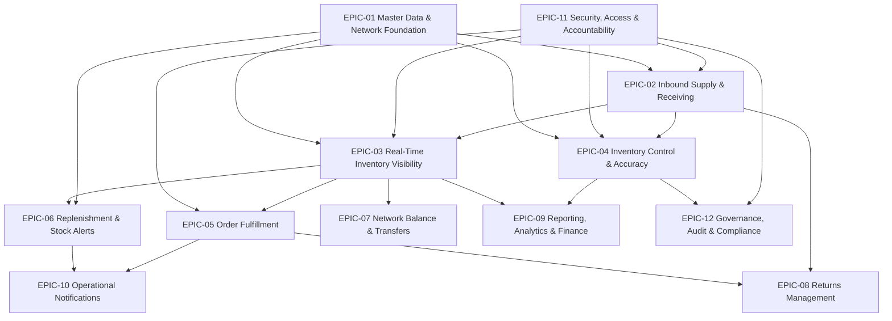

# Product Epics: Inventory Management System

**Document Owner:** Product Owner  
**Purpose:** Organize all approved functional requirements (FR-001 – FR-090) from BRD-IMS-001 into logical, deliverable epics for roadmap planning and stakeholder alignment  
**Audience:** Executive sponsors, product owners, business stakeholders, delivery teams  
**Based On:** BRD-IMS-001 (approved baseline), Functional Requirements Document, Feature Catalog (F-01 – F-30), Business Objectives (BO-01 – BO-24)  
**Status:** Epic definition — user stories not yet created

---

## Epic Overview

| Epic ID | Epic Name | FR Count | Primary Phase | Related Business Objectives |
|---------|-----------|----------|---------------|----------------------------|
| EPIC-01 | Master Data & Network Foundation | 13 | MVP / Phase 2 | BO-01, BO-02, BO-21 |
| EPIC-02 | Inbound Supply & Goods Receiving | 10 | MVP / Phase 2 / Phase 3 | BO-03, BO-05 |
| EPIC-03 | Real-Time Inventory Visibility | 6 | MVP / Phase 2 | BO-01, BO-16 |
| EPIC-04 | Inventory Control & Accuracy | 12 | MVP / Phase 2 / Phase 3 | BO-02, BO-03, BO-19 |
| EPIC-05 | Order Fulfillment | 10 | MVP / Phase 2 / Phase 3 | BO-06, BO-16 |
| EPIC-06 | Replenishment Planning & Stock Alerts | 7 | MVP / Phase 2 / Phase 3 | BO-05 |
| EPIC-07 | Network Balance & Stock Transfers | 6 | MVP / Phase 2 / Phase 3 | BO-01, BO-05 |
| EPIC-08 | Returns Management | 4 | MVP (basic) / Phase 2 | BO-03, BO-06 |
| EPIC-09 | Reporting, Analytics & Financial Alignment | 9 | MVP / Phase 2 / Phase 3 | BO-01, BO-04, BO-07, BO-18, BO-20 |
| EPIC-10 | Operational Notifications & Awareness | 5 | MVP / Phase 2 / Phase 3 | BO-05, BO-06 |
| EPIC-11 | Security, Access & Accountability | 5 | MVP | BO-19, BO-21 |
| EPIC-12 | Governance, Audit & Compliance | 4 | MVP / Phase 2 | BO-19, BO-07 |

**Total functional requirements covered:** 90 (FR-001 – FR-090)

---

## EPIC-01: Master Data & Network Foundation

### 1. Epic ID
**EPIC-01**

### 2. Epic Name
Master Data & Network Foundation

### 3. Business Goal
Establish a single, trusted foundation of product, location, and policy master data — and enable controlled system adoption — so every downstream inventory process operates on consistent, accurate reference information across the enterprise network.

### 4. Description
This epic delivers the structural backbone of the Inventory Management System. It covers product catalog management, inventory location network setup, stock policy configuration, governance reference data, and initial data import for go-live. Without this epic, no receiving, fulfillment, counting, or reporting capability can function reliably. It addresses critical pain points including duplicate product records (PP-07), fragmented location definitions, and embedded errors at go-live (BR-06).

### 5. Included Features

| Feature ID | Feature Name | Functional Requirements |
|------------|--------------|------------------------|
| F-01 | Product Catalog Management | FR-001, FR-002, FR-003, FR-004 |
| F-02 | Location & Network Setup | FR-005, FR-006, FR-007, FR-010 |
| F-03 | Stock Policy & Product Classification | FR-008, FR-009, FR-012, FR-056* |
| F-30 | System Go-Live & Initial Data Setup | FR-090 |

\* FR-056 (Safety Stock Protection) is primarily consumed by fulfillment and transfer epics; policy definition originates here.

**Functional requirements:** FR-001, FR-002, FR-003, FR-004, FR-005, FR-006, FR-007, FR-008, FR-009, FR-010, FR-011, FR-012, FR-090

**Key capabilities:**
- Product master records with lifecycle status (active, inactive, discontinued)
- Product identifier lookup (SKU, barcode)
- Duplicate product detection and resolution
- Location configuration, hierarchy, and opening balance establishment
- Stock policy and replenishment threshold definition
- ABC product classification and inventory governance policies (Phase 2)
- Bulk import of product catalog and opening stock for go-live

### 6. Business Value
- Eliminates duplicate and conflicting product identities that cause ordering errors and fulfillment mismatches
- Creates the organizational structure required for network-wide stock visibility (BO-01)
- Enables proactive low-stock detection through threshold parameters (BO-05)
- Prevents go-live with unverified opening balances that undermine trust from day one
- Accelerates adoption through controlled data import rather than manual entry of entire catalogs

### 7. Primary Stakeholders
- **Project Sponsor / COO (A-02)** — network design and rollout accountability
- **Operations Director (A-04)** — location network and policy approval
- **Inventory Controller (A-05)** — master data ownership and data quality
- **Warehouse Manager (A-06)** — location setup and opening balance verification
- **Purchasing Manager (A-15)** — product catalog and threshold alignment
- **Finance Manager (A-17)** — opening balance substantiation
- **Regional / Store Manager (A-10)** — location-level setup participation

---

## EPIC-02: Inbound Supply & Goods Receiving

### 1. Epic ID
**EPIC-02**

### 2. Epic Name
Inbound Supply & Goods Receiving

### 3. Business Goal
Ensure all inventory entering the organization is verified, documented, and made operationally available through controlled receiving workflows — creating accurate on-hand balances from the point of entry and full visibility into the inbound supply pipeline.

### 4. Description
This epic governs how stock enters the system: from purchase order commitment and inbound delivery planning through dock-level receipt verification, discrepancy resolution, put-away confirmation, and non-PO inbound movements. It standardizes the receive-to-available lifecycle so ATP reflects locatable, sellable inventory. Phase 2 extends the epic with full PO lifecycle management, tolerance evaluation, and supplier performance tracking.

### 5. Included Features

| Feature ID | Feature Name | Functional Requirements |
|------------|--------------|------------------------|
| F-05 | Goods Receiving & Verification | FR-015, FR-016, FR-017, FR-019, FR-020, FR-029 |
| F-06 | Put-Away Management | FR-018 |
| F-07 | Purchase Order & Inbound Supply Management | FR-013, FR-014, FR-021, FR-022, FR-055, FR-079* |

\* FR-079 (Inbound Delay Notifications) is delivered through EPIC-10; listed here as a dependent capability.

**Functional requirements:** FR-013, FR-014, FR-015, FR-016, FR-017, FR-018, FR-019, FR-020, FR-021, FR-022

**Key capabilities:**
- Goods receipt with quantity, identity, and condition verification
- Receipt discrepancy documentation and resolution
- PO reference enforcement with authorized ad-hoc exceptions
- Put-away confirmation before sellable availability update
- Return and non-PO inbound receipt (MVP basic path)
- Purchase order recording, amendment, and inbound delivery planning (Phase 2)
- Receipt quantity tolerance evaluation (Phase 2)
- Supplier delivery performance tracking (Phase 3)

### 6. Business Value
- Ensures on-hand balances reflect physical reality from point of entry (BO-03)
- Protects supplier accountability and prevents payment for undelivered goods
- Prevents promising stock that pickers cannot locate (put-away discipline)
- Creates inbound supply visibility for sales, operations, and replenishment (BO-05)
- Captures complete movement history for audit and root-cause analysis

### 7. Primary Stakeholders
- **Receiving Clerk (A-07)** — dock-level receipt execution
- **Warehouse Manager (A-06)** — receiving oversight and put-away coordination
- **Purchasing Manager (A-15) / Buyer (A-16)** — PO management and supplier coordination
- **Operations Director (A-04)** — inbound pipeline visibility
- **Customer Service Representative (A-13)** — inbound availability communication
- **Supplier (A-20)** — delivery performance (indirect)

---

## EPIC-03: Real-Time Inventory Visibility

### 1. Epic ID
**EPIC-03**

### 2. Epic Name
Real-Time Inventory Visibility

### 3. Business Goal
Provide a trusted, real-time single source of truth for inventory across the network — answering what stock exists, where it is, what is reserved, and what is available to promise — without manual spreadsheets or warehouse calls.

### 4. Description
This epic delivers the core visibility layer that underpins every operational and commercial decision. Users can view on-hand, reserved, and ATP quantities by product and location; see stock status indicators; search and filter inventory views; and (in Phase 2) access network-wide and expected inbound availability. This epic directly addresses the primary business problem of fragmented, untrusted inventory information (PP-01, BO-01).

### 5. Included Features

| Feature ID | Feature Name | Functional Requirements |
|------------|--------------|------------------------|
| F-04 | Inventory Visibility & Search | FR-023, FR-024, FR-025, FR-026, FR-027, FR-028 |

**Functional requirements:** FR-023, FR-024, FR-025, FR-026, FR-027, FR-028

**Key capabilities:**
- On-hand quantity by product and location
- Available-to-promise (ATP) calculation and display
- Reserved and committed stock visibility with order linkage
- Stock status indicators (in stock, low stock, out of stock)
- Multi-criteria search and filter
- Expected inbound and network-wide availability views (Phase 2)

### 6. Business Value
- Delivers the foundational "what do we have and where?" answer for the entire organization (BO-01)
- Prevents overselling and overpromising through accurate ATP (BO-06, BR-1)
- Reduces ad-hoc warehouse interruption from stock inquiries (BO-16)
- Enables network-level replenishment and transfer-before-purchase decisions (BR-11)
- Supports self-service availability checks for sales and customer service

### 7. Primary Stakeholders
- **Operations Director (A-04)** — network oversight
- **Inventory Controller (A-05)** — daily stock monitoring
- **Warehouse Manager (A-06)** — location-level visibility
- **Sales Representative (A-12) / Sales Manager (A-11)** — availability confirmation
- **Customer Service Representative (A-13)** — customer inquiry response
- **Purchasing Manager (A-15)** — replenishment context
- **Regional / Store Manager (A-10)** — location stock review

---

## EPIC-04: Inventory Control & Accuracy

### 1. Epic ID
**EPIC-04**

### 2. Epic Name
Inventory Control & Accuracy

### 3. Business Goal
Sustain inventory record accuracy through systematic counting, controlled adjustments, complete movement traceability, and loss analysis — ensuring physical stock and system balances remain aligned and discrepancies are investigated with proper authorization.

### 4. Description
This epic encompasses the full inventory control lifecycle: recording every movement with immutable history, scheduling and executing cycle and full physical counts, investigating variances with segregation of duties, processing adjustments and write-offs with mandatory reason codes, and analyzing shrinkage trends. Phase 2 adds quarantine/hold management; Phase 3 adds obsolescence review. This epic is central to achieving the ≥95% inventory accuracy target (BO-02).

### 5. Included Features

| Feature ID | Feature Name | Functional Requirements |
|------------|--------------|------------------------|
| F-14 | Cycle Counting | FR-030, FR-031, FR-071* |
| F-15 | Full Physical Inventory Count | FR-032 |
| F-16 | Count Variance Investigation & Approval | FR-033, FR-034, FR-037 |
| F-17 | Stock Adjustments & Write-Offs | FR-011*, FR-035, FR-036, FR-077* |
| F-18 | Quarantine & Hold Stock Management | FR-038 |
| F-19 | Shrinkage & Obsolescence Analysis | FR-039, FR-040 |

\* FR-011 (Reason Codes) is shared with EPIC-01; FR-071 (Accuracy Reports) is shared with EPIC-09; FR-077 (Approval Notifications) is shared with EPIC-10.

**Functional requirements:** FR-029, FR-030, FR-031, FR-032, FR-033, FR-034, FR-035, FR-036, FR-037, FR-038, FR-039, FR-040

**Key capabilities:**
- Complete inventory movement history for all transaction types
- Cycle count scheduling, assignment, and blind counting
- Full physical inventory count with movement freeze
- Variance identification, investigation, and independent approval
- Stock adjustments and write-offs with reason codes and approval thresholds
- Quarantine and hold stock status (Phase 2)
- Shrinkage trend analysis and obsolete stock identification

### 6. Business Value
- Achieves and sustains inventory accuracy targets (BO-02)
- Creates complete traceability for accountability and audit (BO-03, BO-19)
- Prevents unauthorized or unexplained inventory changes through approval controls
- Enables targeted loss prevention through reason-coded shrinkage analysis
- Releases working capital trapped in obsolete stock (Phase 3)

### 7. Primary Stakeholders
- **Inventory Controller (A-05)** — count program ownership and variance investigation
- **Warehouse Manager (A-06)** — count execution and adjustment initiation
- **Warehouse Staff (A-09)** — cycle counting execution
- **Operations Director (A-04)** — accuracy oversight and approval
- **Finance Manager (A-17) / CFO (A-03)** — write-off authorization and financial impact
- **Internal Auditor (A-18)** — control review and substantiation

---

## EPIC-05: Order Fulfillment

### 1. Epic ID
**EPIC-05**

### 2. Epic Name
Order Fulfillment

### 3. Business Goal
Deliver reliable end-to-end order fulfillment — from availability confirmation and inventory reservation through pick, pack, and ship — while handling partial shipments, backorders, exceptions, and multi-location allocation with accurate inventory deduction.

### 4. Description
This epic covers the complete outbound fulfillment cycle. MVP delivers availability confirmation, reservation, release, pick/pack/ship workflow, partial fulfillment, and order status visibility. Phase 2 extends with backorder priority management, fulfillment exception handling, and multi-location split fulfillment. Phase 3 adds authorized product substitution. This epic directly supports fill rate improvement (BO-06) and reduces customer-facing fulfillment failures.

### 5. Included Features

| Feature ID | Feature Name | Functional Requirements |
|------------|--------------|------------------------|
| F-10 | Order Availability & Reservation | FR-041, FR-042, FR-043, FR-048 |
| F-11 | Pick, Pack & Ship Fulfillment | FR-044, FR-049 |
| F-12 | Partial Fulfillment & Backorder Management | FR-045, FR-046 |
| F-13 | Fulfillment Exception Handling | FR-047, FR-050, FR-078* |

\* FR-078 (Fulfillment Exception Alerts) is delivered through EPIC-10.

**Functional requirements:** FR-041, FR-042, FR-043, FR-044, FR-045, FR-046, FR-047, FR-048, FR-049, FR-050

**Key capabilities:**
- Order availability confirmation before customer commitment
- Inventory reservation and release against confirmed orders
- Pick, pack, and ship workflow with pick verification
- Partial fulfillment with backorder creation
- Backorder priority sequencing and auto-reservation (Phase 2)
- Fulfillment exception resolution (pick failures, damage, cancellation) (Phase 2)
- Multi-location split fulfillment (Phase 2)
- Order fulfillment status visibility
- Authorized product substitution (Phase 3)

### 6. Business Value
- Prevents double-allocation and overselling of physical stock (BO-06)
- Improves fill rate and reduces order cancellations and expedited shipping costs
- Provides transparent order status for customer service and operations
- Maximizes network fill rate through multi-location fulfillment (Phase 2)
- Ensures inventory records match goods dispatched at shipment confirmation

### 7. Primary Stakeholders
- **Warehouse Picker / Packer (A-08)** — pick and ship execution
- **Warehouse Manager (A-06)** — fulfillment queue management
- **Sales Representative (A-12) / Sales Manager (A-11)** — availability and commitment
- **Customer Service Representative (A-13)** — order status and customer communication
- **Operations Director (A-04)** — fulfillment performance oversight
- **Logistics / Carrier Partner (A-21)** — shipment coordination (indirect)

---

## EPIC-06: Replenishment Planning & Stock Alerts

### 1. Epic ID
**EPIC-06**

### 2. Epic Name
Replenishment Planning & Stock Alerts

### 3. Business Goal
Transform replenishment from reactive crisis response to threshold-driven discipline — detecting low-stock and out-of-stock conditions proactively and converting them into actionable purchasing and transfer decisions before customer impact occurs.

### 4. Description
This epic automates the detection and response to stock level breaches. MVP delivers automatic low-stock/out-of-stock alert generation, alert review and acknowledgment, and replenishment suggestions that consider network availability before recommending new purchases. Phase 2 adds purchase requisition creation and tracking. Phase 3 adds promotional stock readiness review (deferred per MoSCoW). This epic is the primary driver for stockout reduction (BO-05).

### 5. Included Features

| Feature ID | Feature Name | Functional Requirements |
|------------|--------------|------------------------|
| F-20 | Low-Stock Alerting & Replenishment | FR-051, FR-052, FR-053, FR-054, FR-074* |
| F-25 | Promotional & Launch Stock Readiness | FR-057, FR-080* |

\* FR-074 (Replenishment Reporting) is shared with EPIC-09; FR-080 (Campaign Alerts) is shared with EPIC-10. FR-057 and FR-080 are Phase 3 / deferred.

**Functional requirements:** FR-051, FR-052, FR-053, FR-054, FR-057

**Cross-epic dependencies:** FR-055 (Inbound Supply Tracking — EPIC-02), FR-056 (Safety Stock Protection — EPIC-01), FR-074 (Replenishment Reporting — EPIC-09), FR-080 (Campaign Alerts — EPIC-10)

**Key capabilities:**
- Automatic low-stock and out-of-stock alert generation
- Alert review, acknowledgment, and dismissal with documented rationale
- Replenishment suggestions with network availability check
- Purchase requisition creation and tracking (Phase 2)
- Promotional and launch stock readiness review (Phase 3 — deferred)

### 6. Business Value
- Converts passive monitoring into actionable replenishment signals (BO-05)
- Reduces emergency purchasing and customer-facing stockouts
- Moves purchasing from gut-feel to threshold-driven discipline
- Prevents unnecessary purchase when network transfer can resolve shortage (BR-11)
- Closes the alert loop so purchasing acts on signals rather than ignoring them

### 7. Primary Stakeholders
- **Purchasing Manager (A-15) / Buyer (A-16)** — alert review and replenishment action
- **Inventory Controller (A-05)** — threshold alignment and alert validation
- **Operations Director (A-04)** — stockout risk oversight
- **Marketing Manager (A-14)** — campaign readiness (Phase 3)
- **Sales Manager (A-11)** — demand context for replenishment

---

## EPIC-07: Network Balance & Stock Transfers

### 1. Epic ID
**EPIC-07**

### 2. Epic Name
Network Balance & Stock Transfers

### 3. Business Goal
Enable the organization to resolve local stock imbalances by moving stock between locations within the existing network — without waiting for supplier replenishment — while protecting source location service levels and maintaining accurate balances at every stage.

### 4. Description
This epic covers the full inter-location transfer lifecycle: request initiation with business justification, approval routing, dispatch and receipt execution with balanced location updates, in-transit monitoring, and source minimum threshold enforcement. Phase 3 adds automated network rebalancing recommendations (deferred per MoSCoW). MVP transfer capabilities are essential for multi-location operations where one site's surplus can resolve another's shortage.

### 5. Included Features

| Feature ID | Feature Name | Functional Requirements |
|------------|--------------|------------------------|
| F-08 | Inter-Location Stock Transfers | FR-058, FR-059, FR-060, FR-061, FR-063 |
| F-09 | Network Stock Rebalancing | FR-062 |

**Functional requirements:** FR-058, FR-059, FR-060, FR-061, FR-062, FR-063

**Key capabilities:**
- Inter-location transfer request with source/destination validation
- Transfer approval, rejection, or modification with documented rationale
- Transfer execution with dispatch, in-transit, and receipt stages
- In-transit inventory monitoring (Phase 2)
- Source location minimum threshold enforcement
- Network rebalancing analysis and recommendations (Phase 3 — deferred)

### 6. Business Value
- Resolves local stockouts using existing network inventory (BO-05, BR-11)
- Prevents unauthorized stock movements that create cascading imbalances
- Maintains accurate balances at both sending and receiving locations (BO-03)
- Provides network visibility during transfer lead time
- Optimizes inventory investment across the enterprise (Phase 3)

### 7. Primary Stakeholders
- **Regional / Store Manager (A-10)** — transfer initiation for local needs
- **Operations Director (A-04)** — network balance oversight and approval
- **Warehouse Manager (A-06)** — transfer dispatch and receipt execution
- **Inventory Controller (A-05)** — transfer policy and threshold alignment
- **COO (A-02)** — network rebalancing strategy (Phase 3)
- **Logistics / Carrier Partner (A-21)** — physical movement coordination

---

## EPIC-08: Returns Management

### 1. Epic ID
**EPIC-08**

### 2. Epic Name
Returns Management

### 3. Business Goal
Manage the complete customer return lifecycle from authorization through inspection and disposition — ensuring returned goods are tracked, customers receive appropriate resolution, and inventory impact is captured accurately without contaminating sellable stock.

### 4. Description
This epic governs how customer returns re-enter the inventory system. MVP includes basic return receipt through FR-019 (in EPIC-02). Phase 2 delivers the full returns module: return authorization linked to original orders, physical receipt and inspection workflow, restock or write-off disposition, and end-to-end return status visibility. The epic connects commercial transactions to physical return processing and prevents damaged goods from re-entering sellable inventory.

### 5. Included Features

| Feature ID | Feature Name | Functional Requirements |
|------------|--------------|------------------------|
| F-21 | Returns Management | FR-064, FR-065, FR-066, FR-067 |

**Functional requirements:** FR-064, FR-065, FR-066, FR-067

**MVP dependency:** FR-019 (Receive Return and Non-PO Inbound Stock) in EPIC-02 provides interim return receipt capability.

**Key capabilities:**
- Return authorization linked to original orders (Phase 2)
- Physical receipt and inspection of returned goods (Phase 2)
- Restock or write-off disposition with reason codes (Phase 2)
- Return processing status visibility for customer service (Phase 2)

### 6. Business Value
- Connects physical returns to commercial transactions — preventing unauthorized returns
- Ensures only resalable goods re-enter sellable inventory (BR-26)
- Enables accurate customer communication on refund, replacement, or credit timing
- Maintains complete movement history for all inventory increases (BO-03)
- Reduces return-related customer service escalations

### 7. Primary Stakeholders
- **Customer Service Representative (A-13)** — return authorization and customer communication
- **Warehouse Manager (A-06)** — return receipt and inspection oversight
- **Receiving Clerk (A-07)** — physical return receipt
- **Inventory Controller (A-05)** — disposition approval and inventory impact
- **B2B Customer (A-23) / B2C Customer (A-24)** — return initiators (indirect)

---

## EPIC-09: Reporting, Analytics & Financial Alignment

### 1. Epic ID
**EPIC-09**

### 2. Epic Name
Reporting, Analytics & Financial Alignment

### 3. Business Goal
Provide operational and management reporting, performance dashboards, and financial inventory views — enabling leaders to monitor inventory health, measure progress toward strategic objectives, and align operational records with financial reporting without manual data compilation.

### 4. Description
This epic delivers the analytical and decision-support layer of the IMS. MVP provides summary dashboards, stock movement reports, stockout/overstock reports, and inventory accuracy/variance reports. Phase 2 adds location performance snapshots and replenishment reporting. Phase 3 delivers KPI dashboards, inventory valuation summaries, and operational-to-financial reconciliation support. This epic reduces reconciliation effort (BO-04) and supports financial alignment (BO-07, BO-18, BO-20).

### 5. Included Features

| Feature ID | Feature Name | Functional Requirements |
|------------|--------------|------------------------|
| F-22 | Inventory Reporting & Dashboards | FR-068, FR-069, FR-070, FR-072, FR-074 |
| F-23 | Inventory Performance KPIs | FR-073 |
| F-24 | Financial Inventory Reconciliation | FR-075, FR-089 |

**Functional requirements:** FR-068, FR-069, FR-070, FR-071, FR-072, FR-073, FR-074, FR-075, FR-089

**Key capabilities:**
- Inventory summary dashboard with health indicators
- Stock movement reports by period, product, location, and transaction type
- Stockout and overstock reports
- Inventory accuracy and variance reports
- Location performance snapshots (Phase 2)
- Replenishment reporting (Phase 2)
- Inventory performance KPIs — fill rate, turnover, days of supply (Phase 3)
- Inventory valuation summary views (Phase 3)
- Operational-to-financial reconciliation support (Phase 3)

### 6. Business Value
- Gives management a single operational view without manual report compilation (BO-01)
- Reduces time spent on inventory reconciliation (BO-04)
- Supports audit substantiation and trend analysis
- Enables progress tracking toward strategic KPI targets
- Aligns operational inventory with financial reporting needs (BO-07, BO-18)
- Supports timely month-end close through valuation and reconciliation views (BO-20)

### 7. Primary Stakeholders
- **CEO (A-01) / COO (A-02)** — executive oversight
- **Operations Director (A-04)** — operational performance review
- **Inventory Controller (A-05)** — accuracy and variance analysis
- **CFO (A-03) / Finance Manager (A-17)** — valuation and reconciliation
- **Purchasing Manager (A-15)** — replenishment and stockout analysis
- **Internal Auditor (A-18) / External Auditor (A-19)** — audit substantiation

---

## EPIC-10: Operational Notifications & Awareness

### 1. Epic ID
**EPIC-10**

### 2. Epic Name
Operational Notifications & Awareness

### 3. Business Goal
Deliver timely, role-appropriate notifications when stock conditions, approvals, exceptions, or supply delays require action — reducing decision latency and preventing operational issues from escalating unnoticed.

### 4. Description
This epic provides the cross-cutting notification delivery capability that supports multiple operational epics. MVP delivers low-stock/out-of-stock push notifications and pending approval notifications. Phase 2 extends with transfer and fulfillment exception alerts and inbound supply delay notifications. Phase 3 adds campaign readiness alerts (deferred). Notifications ensure that alerts generated in EPIC-04, EPIC-05, EPIC-06, and EPIC-07 reach decision-makers promptly rather than requiring dashboard checks.

### 5. Included Features

| Feature ID | Feature Name | Functional Requirements |
|------------|--------------|------------------------|
| F-26 | Operational Notifications & Alerts | FR-076, FR-077, FR-078, FR-079, FR-080 |

**Functional requirements:** FR-076, FR-077, FR-078, FR-079, FR-080

**Key capabilities:**
- Low-stock and out-of-stock push notifications (MVP)
- Pending approval notifications for adjustments, counts, and transfers (MVP)
- Transfer and fulfillment exception alerts (Phase 2)
- Inbound supply delay notifications (Phase 2)
- Campaign and launch readiness alerts (Phase 3 — deferred)

### 6. Business Value
- Ensures critical stock conditions reach purchasing before customer impact (BO-05)
- Accelerates approval workflows by notifying designated approvers (BO-06)
- Reduces mean time to respond for operational exceptions
- Prevents alert fatigue through structured delivery tied to acknowledgment workflows
- Supports proactive restock delay communication to sales and customer service

### 7. Primary Stakeholders
- **Purchasing Manager (A-15)** — low-stock and supply delay notifications
- **Warehouse Manager (A-06)** — fulfillment and transfer exception alerts
- **Operations Director (A-04)** — escalation and critical alert oversight
- **Customer Service Representative (A-13)** — supply delay and fulfillment updates
- **All operational roles** — approval and action notifications

---

## EPIC-11: Security, Access & Accountability

### 1. Epic ID
**EPIC-11**

### 2. Epic Name
Security, Access & Accountability

### 3. Business Goal
Control who can view, transact, approve, and configure inventory operations — aligning system access with organizational accountability, location scope, and segregation of duties to strengthen loss prevention and internal control.

### 4. Description
This epic establishes the security and control foundation for the entire system. It delivers role-based access control, location-scoped visibility and transaction authority, user account and role management, user activity logging, and segregation of duties enforcement. These capabilities are prerequisites for every other epic and are required from MVP go-live. They directly support audit readiness (BO-19) and adoption governance (BO-21).

### 5. Included Features

| Feature ID | Feature Name | Functional Requirements |
|------------|--------------|------------------------|
| F-27 | User Access & Role Management | FR-081, FR-082, FR-085 |
| F-28 | Operational Accountability & Controls | FR-083, FR-084 |

**Functional requirements:** FR-081, FR-082, FR-083, FR-084, FR-085

**Key capabilities:**
- Role-based access control aligned to business roles (UR-01 – UR-19)
- Location-scoped visibility and transaction authority
- User account creation, deactivation, and role assignment
- User activity logging for all material actions
- Segregation of duties enforcement (no self-approval, conflicting role prevention)

### 6. Business Value
- Prevents unauthorized access to inventory data and transactions
- Ensures users see only locations and functions relevant to their role
- Creates individual accountability for all material inventory actions (BO-19)
- Enforces control policies that prevent fraud and error (BR-21)
- Supports compliance with internal control standards and audit expectations

### 7. Primary Stakeholders
- **COO (A-02) / Operations Director (A-04)** — access policy and role design
- **System Administrator** — user provisioning and role assignment
- **Internal Auditor (A-18)** — control design review and SoD validation
- **Warehouse Manager (A-06) / Inventory Controller (A-05)** — subject to enforced controls
- **All internal actors** — access consumers and accountability subjects

---

## EPIC-12: Governance, Audit & Compliance

### 1. Epic ID
**EPIC-12**

### 2. Epic Name
Governance, Audit & Compliance

### 3. Business Goal
Maintain complete, queryable records of all inventory changes and support structured audit and control review — demonstrating control effectiveness to internal and external auditors and detecting policy breaches proactively.

### 4. Description
This epic delivers the compliance and audit enablement layer. MVP provides a complete immutable audit trail of all inventory changes. Phase 2 adds structured audit query support and control policy breach detection. This epic builds on movement history (EPIC-04) and user activity logging (EPIC-11) to provide auditor-ready evidence packages and proactive control monitoring.

### 5. Included Features

| Feature ID | Feature Name | Functional Requirements |
|------------|--------------|------------------------|
| F-29 | Audit Trail & Compliance | FR-086, FR-087, FR-088 |

**Functional requirements:** FR-086, FR-087, FR-088

**Key capabilities:**
- Complete immutable audit trail of all inventory changes (MVP)
- Audit and control review query support (Phase 2)
- Control policy breach detection and recording (Phase 2)

### 6. Business Value
- Demonstrates 100% traceability of inventory changes for audit (BO-19)
- Reduces audit preparation effort through queryable evidence packages
- Makes control weaknesses visible proactively before audit findings
- Supports financial reconciliation substantiation (BO-07)
- Strengthens organizational governance maturity (PP-09)

### 7. Primary Stakeholders
- **Internal Auditor (A-18)** — audit trail review and control testing
- **External Auditor (A-19)** — substantiation and evidence requests
- **Finance Manager (A-17) / CFO (A-03)** — financial control alignment
- **Inventory Controller (A-05)** — audit coordination and variance substantiation
- **Operations Director (A-04)** — control policy ownership

---

## Epic Dependency Map

The diagram below shows primary dependencies between epics. Foundation and platform epics must precede or run in parallel with operational epics.

---

## Epic-to-Phase Delivery Summary

| Phase | Epics (Primary Delivery) | MVP Must-Have FR Count |
|-------|--------------------------|------------------------|
| **Phase 1 — MVP** | EPIC-01, EPIC-02, EPIC-03, EPIC-04, EPIC-05, EPIC-06, EPIC-07, EPIC-09 (core), EPIC-10 (core), EPIC-11, EPIC-12 (audit trail) | ~55 FRs |
| **Phase 2 — Improve Performance** | EPIC-02 (PO module), EPIC-04 (quarantine), EPIC-05 (exceptions), EPIC-06 (requisitions), EPIC-07 (in-transit), EPIC-08 (full returns), EPIC-09 (location reports), EPIC-10 (extended alerts), EPIC-12 (audit queries) | ~25 FRs |
| **Phase 3 — Smarter Decisions** | EPIC-04 (obsolescence), EPIC-05 (substitution), EPIC-06 (campaign readiness), EPIC-07 (rebalancing), EPIC-09 (KPIs, valuation, reconciliation) | ~10 FRs |

---

## Cross-Epic Functional Requirements

Some functional requirements support multiple epics. Each requirement has one primary epic owner; dependent epics consume the capability.

| FR ID | Primary Epic | Also Consumed By |
|-------|--------------|------------------|
| FR-011 | EPIC-01 | EPIC-04 |
| FR-019 | EPIC-02 | EPIC-08 (MVP interim returns) |
| FR-029 | EPIC-04 | EPIC-02 |
| FR-055 | EPIC-02 | EPIC-06 |
| FR-056 | EPIC-01 | EPIC-05, EPIC-06, EPIC-07 |
| FR-071 | EPIC-09 | EPIC-04 |
| FR-074 | EPIC-09 | EPIC-06 |
| FR-076 | EPIC-10 | EPIC-06 |
| FR-077 | EPIC-10 | EPIC-04 |
| FR-078 | EPIC-10 | EPIC-05, EPIC-07 |
| FR-079 | EPIC-10 | EPIC-02 |
| FR-080 | EPIC-10 | EPIC-06 |

---

## Document Control

| Attribute | Detail |
|-----------|--------|
| **Document ID** | EPIC-IMS-001 |
| **Version** | 1.0 |
| **Created** | July 5, 2026 |
| **Author** | Product Owner |
| **Next Step** | Decompose epics into features and user stories per delivery phase |
| **Related Artifacts** | BRD-IMS-001, FR-001–FR-090, Feature Catalog F-01–F-30, MoSCoW Prioritization, RTM-IMS-001 |
